# 应用机器学习：第16讲：无监督学习的语言（第二部分） 🧠

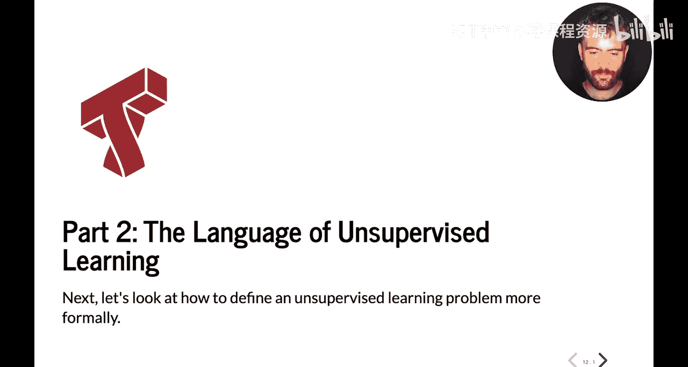

在本节课中，我们将更深入地探讨无监督学习的语言，并正式定义在后续几讲中会频繁使用的术语。我们将从无监督学习问题的基本构成开始，并将其与监督学习进行对比，最后通过一个具体示例（K均值算法）来巩固这些概念。

---

## 数据集 📊

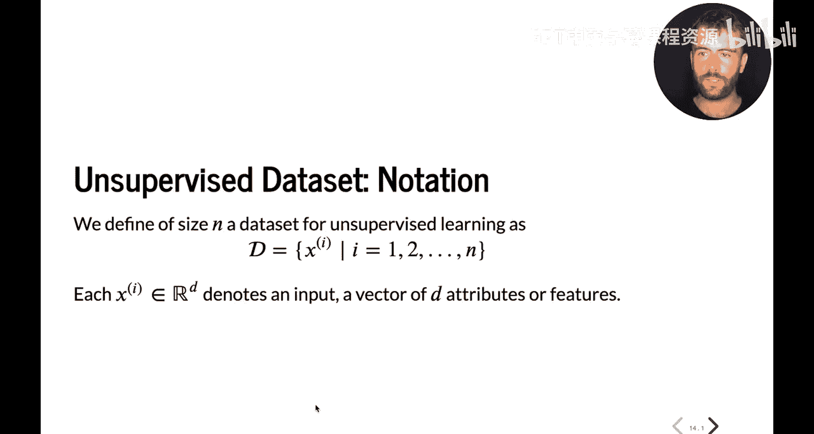

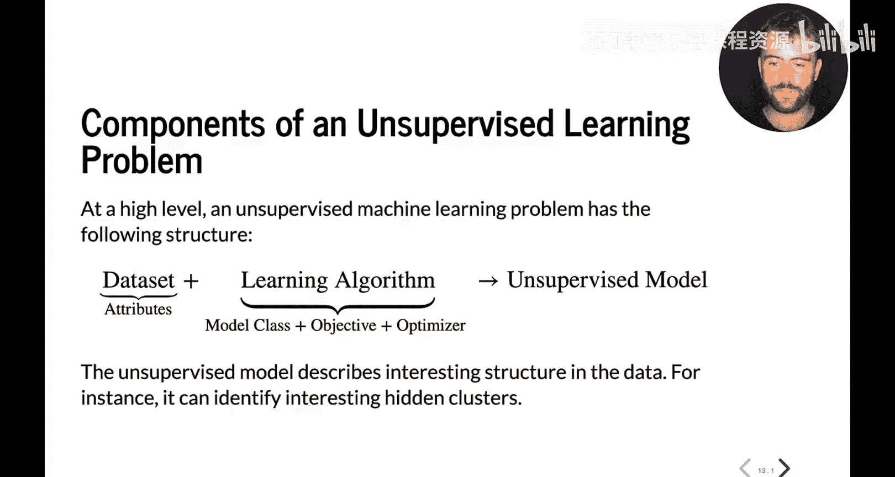

在无监督学习中，数据集是输入的集合，其中每个输入是一个 **d** 维的属性或特征向量。这与监督学习类似，但**没有标签 Y**，只有输入 **X**。这符合我们之前的直觉：无监督学习可以被视为移除了数据标签的监督学习。

与监督学习类似，我们假设存在一个数据分布 **P** 来支配这个数据集。所有输入都从这个概率分布中独立同分布地采样。这意味着每个样本 **x** 都是独立的，并且来自同一个分布 **P**。

**独立同分布** 意味着：
- **独立**：每个样本的抽取不依赖于其他样本。
- **同分布**：所有样本都来自同一个概率分布 **P**。

例如，抛硬币的结果序列是独立同分布的。相反，年度人口普查数据则不是独立的，因为某一年的人口数量会受到前一年人口数量的影响。

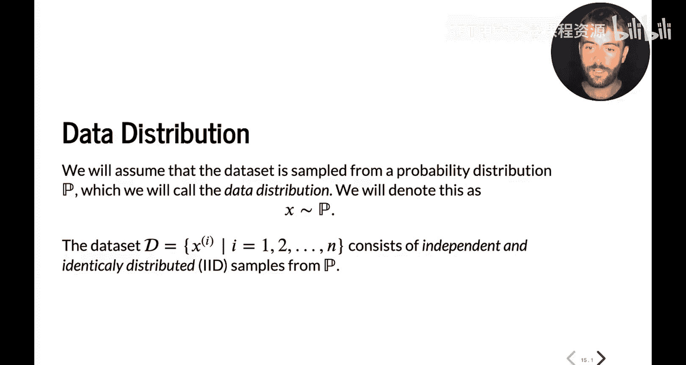

---

## 无监督学习算法的构成 ⚙️

在高层结构上，无监督学习算法与监督学习算法相似，都包含**模型类**、**目标函数**和**优化器**。然而，模型类和目标函数的具体选择（以及相应的优化器）将无监督学习与监督学习区分开来。

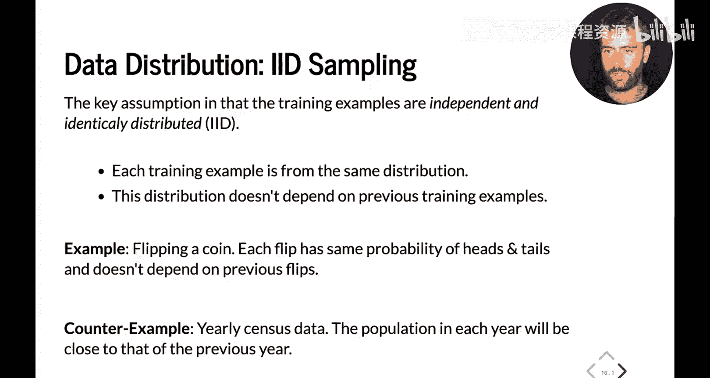

### 模型与模型类

在非概率定义下，一个**模型**是一个映射 **f**，它接收一个输入 **x**，并返回关于该输入结构的某种有趣信息 **s**，其中 **s** 属于某个结构集合 **S**。

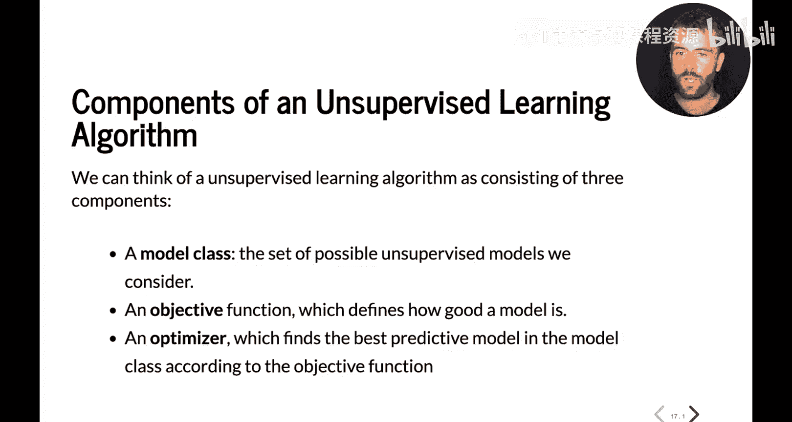

例如，结构可以是一个聚类标签、一个低维表示，或一些潜在特征。模型通常由参数 **θ** 参数化。

**模型类** 是所有可能模型的集合。如果模型是参数化的，模型类可以表示为一组参数 **θ** 的集合 **Θ**。

### 目标函数

给定一个模型类，我们需要衡量特定模型对数据的拟合程度。为此，我们定义一个**目标函数 J**。在参数化模型中，**J** 是参数空间上的函数，我们通常希望最小化它（因此它常被视为损失函数）。

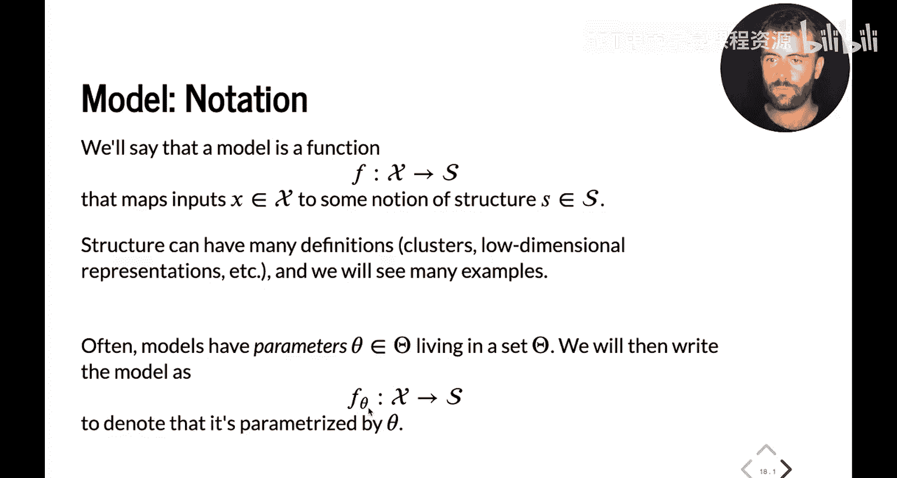

### 优化器

**优化器** 是一种算法，用于在模型类中找到能最优拟合数据（即最小化目标函数）的模型或参数。

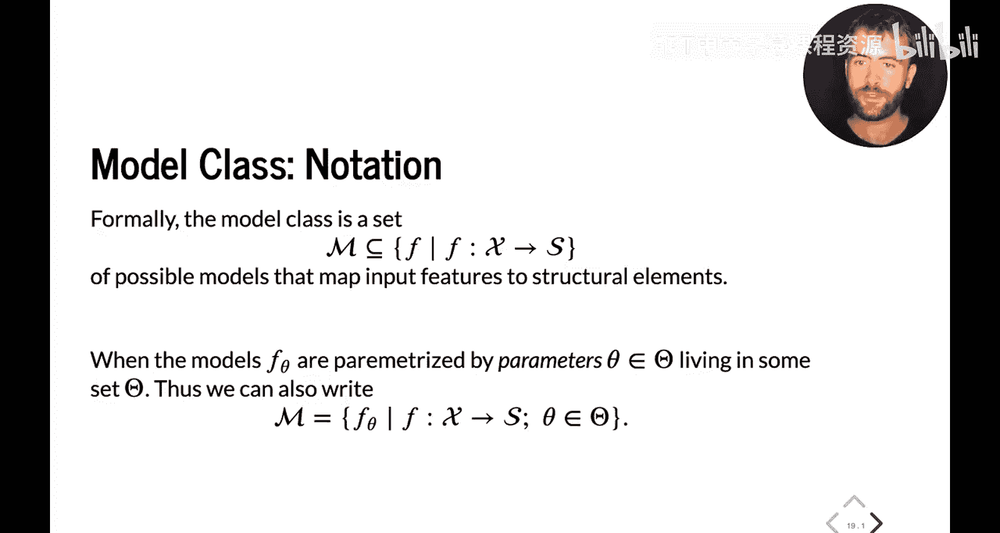

---

## 示例：K均值算法 🔍

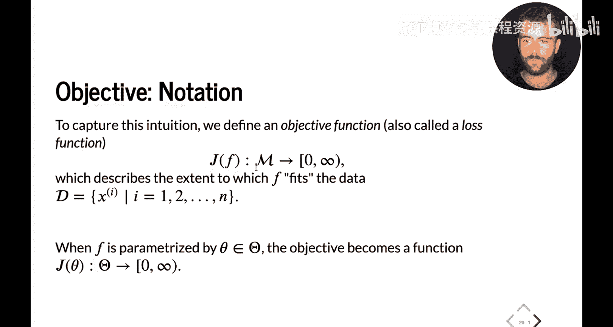

上一节我们介绍了无监督学习的一般框架，本节中我们来看看一个具体示例：K均值聚类算法，并分析它如何融入上述框架。

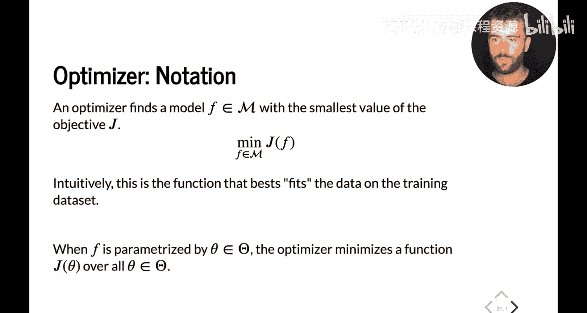

### K均值模型

K均值算法旨在发现数据中的 **K** 个隐藏聚类。每个聚类由其**质心**（即聚类中点的均值）表示。

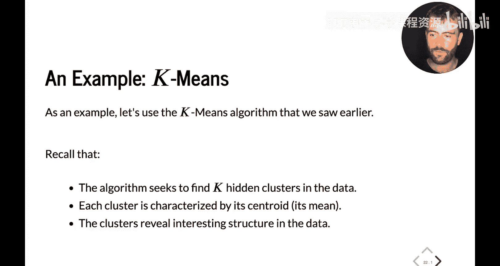

在K均值中，模型 **f** 将每个数据点 **x** 映射到其所属的聚类。该模型完全由 **K** 个质心的位置参数化。因此，参数 **θ** 就是这组质心 **{c₁, c₂, ..., cₖ}**。

### K均值的目标函数

如何判断一组质心定义的聚类是“好”的？一个直观的想法是：属于一个聚类的点应该离该聚类的质心很近。因此，一个好的聚类应使所有点到其最近质心的距离之和最小。

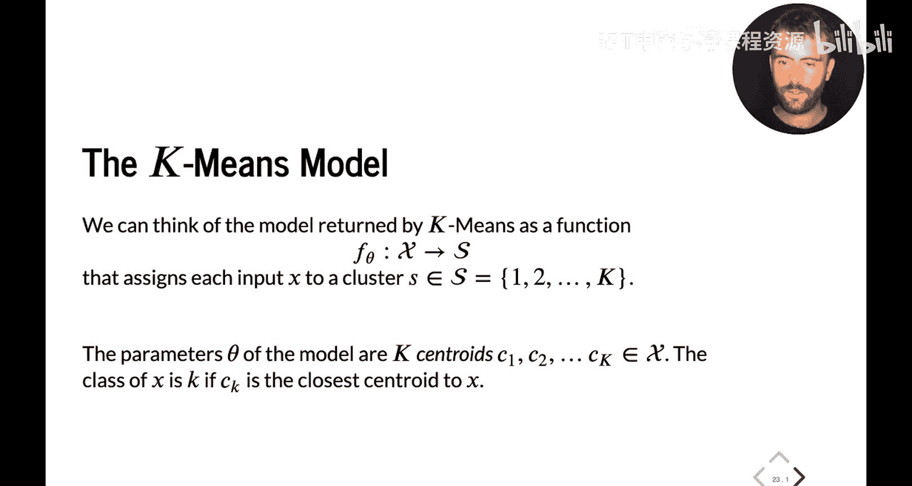

这引出了K均值的目标函数：

**J(θ) = Σᵢ ||xᵢ - c_{f(xᵢ)}||²**

其中：
- **xᵢ** 是第 **i** 个数据点。
- **c_{f(xᵢ)}** 是点 **xᵢ** 被分配到的聚类的质心。
- **||...||²** 表示欧几里得距离的平方。

最小化这个目标函数，就能找到一组“好”的质心。

### K均值的优化器

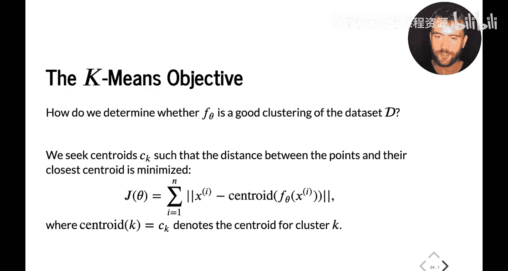

K均值使用一种迭代的**交替优化**算法来最小化上述目标函数。算法步骤如下：

1.  **初始化**：随机选择 **K** 个点作为初始质心，或随机将点分配到聚类。
2.  **重复以下两步直到收敛**：
    - **分配步骤**：固定当前质心，将每个数据点分配给离它最近的质心所在的聚类。即更新 **f(x)**。
    - **更新步骤**：固定当前聚类分配，将每个聚类的质心重新计算为该聚类中所有点的均值。即更新 **cₖ**。

这个过程会不断减少目标函数的值，直到质心的移动非常小（收敛）。

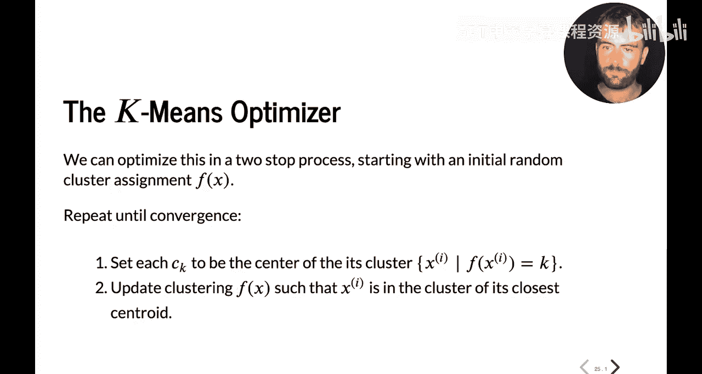

下图展示了K均值在二维数据上的迭代过程。初始时，质心（用X和O表示）位置随机，点被随机着色。经过几次迭代后，质心移动到更能代表其所属点群中心的位置，点的颜色（聚类分配）也随之稳定下来。

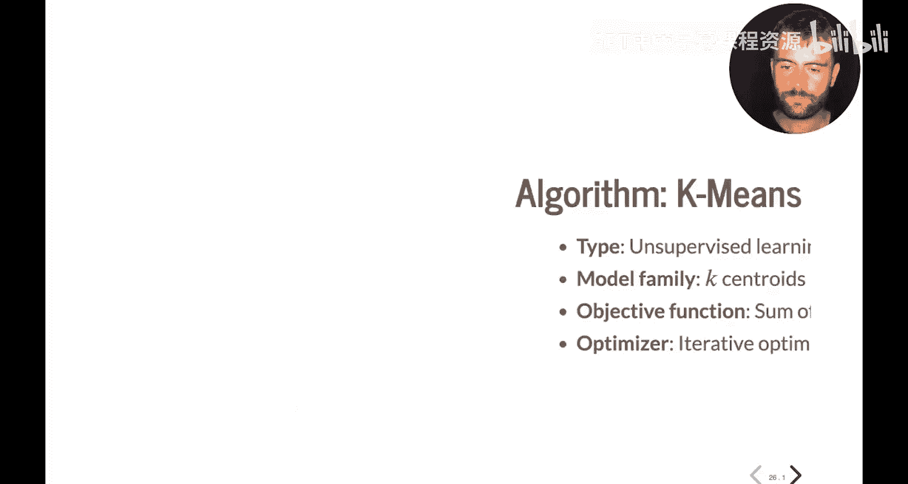

---

## 总结 📝

本节课中我们一起学习了无监督学习的核心概念和术语。我们首先定义了无监督学习的数据集是**无标签的输入集合**，并假设数据是**独立同分布**的。接着，我们剖析了无监督学习算法的三个核心组件：**模型类**、**目标函数**和**优化器**。

最后，我们通过**K均值聚类算法**这一具体示例，演示了这些组件如何协同工作：其模型是由质心定义的聚类映射，目标函数是点到最近质心的距离平方和，优化器则采用交替最小化的迭代过程。

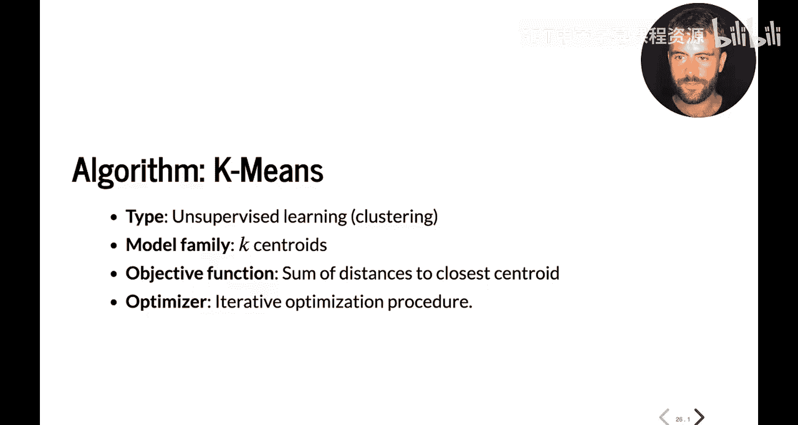

理解这个通用框架，将帮助我们更好地学习和分析后续将遇到的各种无监督学习算法。