# 康奈尔大学《应用机器学习 CS 5787_ Applied Machine Learning 2020》中英字幕（deepseek p60 -60-Lecture 16. Part 3_ Unsupervised Learning in Practice.zh_en -BV12udzYvEFM_p60-

We are now at part three of Le 16 of Applied Ma learning。

 where I would like to talk about some practical aspects of applying unsupervised learning in practice。

So we defined our first unsupervised learning algorithm。

 and now I would like to talk about some important considerations to be aware of when you're trying to use this in practice。

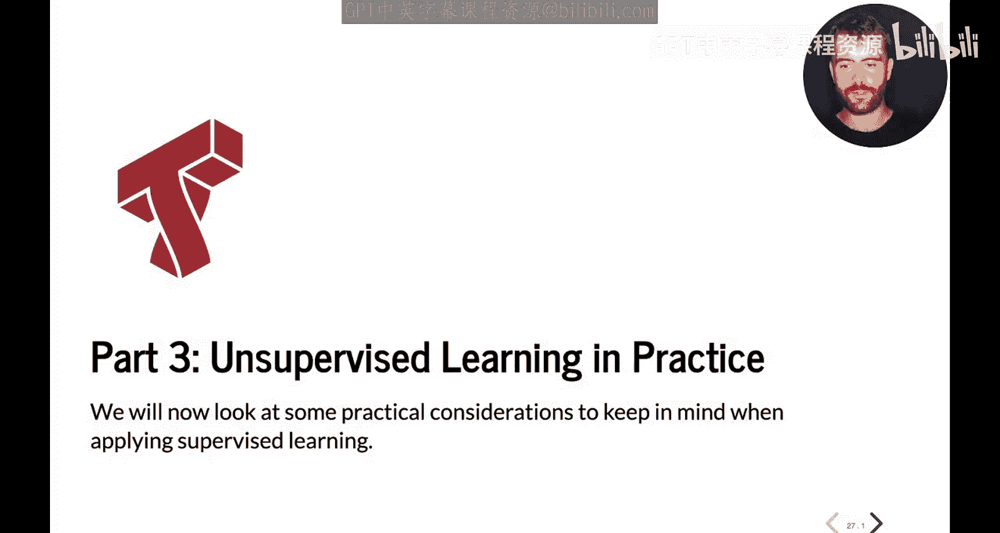

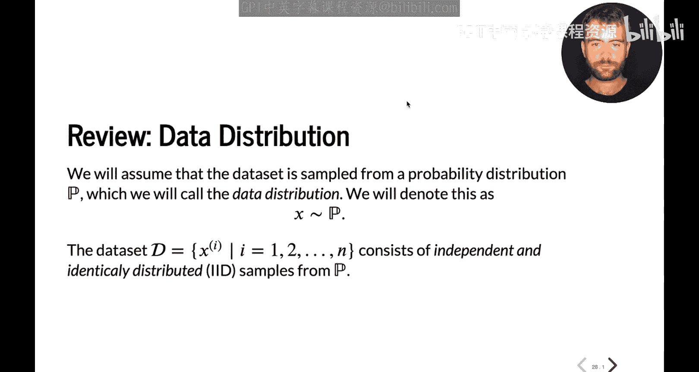

Now recall that we assumed so far that our data comes from a data distribution。

 which is a distribution over xs， which are our inputs， there are vectors of attributes。

 and our data is simply a collection of IED samples of excess from this probability distribution。

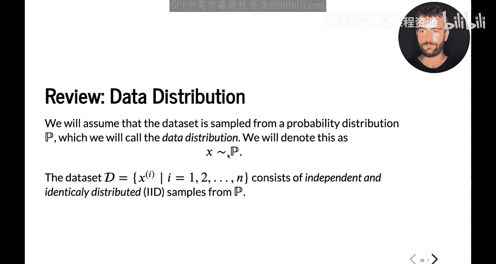

So when we talked about supervised learning， we defined this important concept called generalization。

 which means that we seen data after we have seen training data from our distribution。

Once we go and deploy the model and we have new additional unseen data coming from the same distribution。

 then the algorithm will still perform well， it will be useful and it will give us some useful prediction。

 it will provide us with useful signal so this is the high level concept of generalization。

 it extends beyond just the training data。So I would like to also talk about how this concept extends to unsupervised learning and we're not going to cover the entirety of the topic in this video。

 but it will give you a first taste of the issues that are involved in unsupervised learning compared to supervised learning。

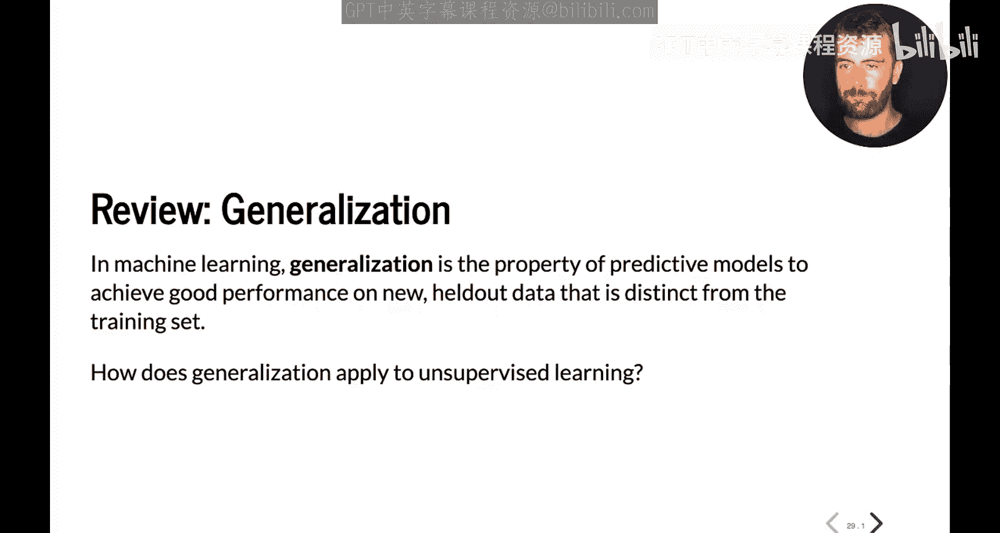

So the concept of generalization that I defined at the beginning of the course for supervised learning doesn't exactly extend to unsupervised learning because we don't have labels。

 we can no longer apply the same notion of accuracy on training and test set that we had defined earlier。

But there is still a notion of generalization that is useful here so we can think of this probability distribution as having two components。

 a signal component which can represent a set of hidden clusters or this could be human speech or some low dimensional data space where the data lives。

 and then we have additional randomness noise that corrupts this signal。

 so for example the clusters are not all small and tight they're all they're more spread out。

 theres randomness within the clusters the speech may be corrupted in white noise and the low dimensional data space again the points may be shifted slightly off from this low- dimensional data space。

And they they as a result， live in a higher dimensional space and one way to think about journalismization。

 which is useful for both supervised and unsupervised learning is that a good model will learn the signal F。

 but it will discard the noise E， this error E， it will only learn the the noise。

 so this kind of intuition we can apply it to unsupervised learning to get a better understanding of when。

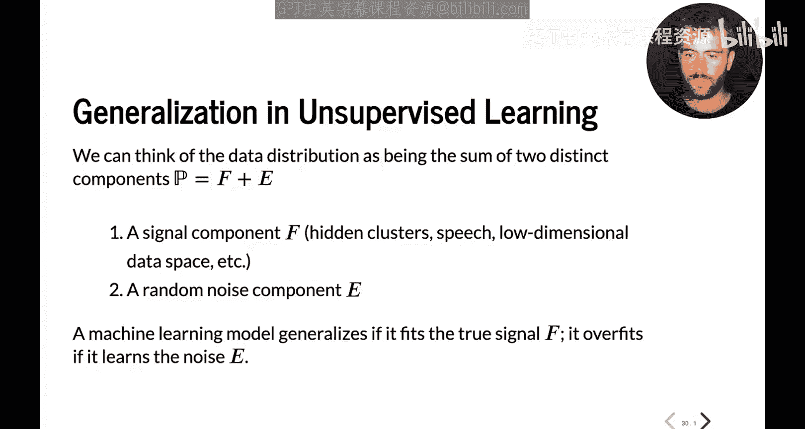

When unsupervised learning works and when it doesn't work。

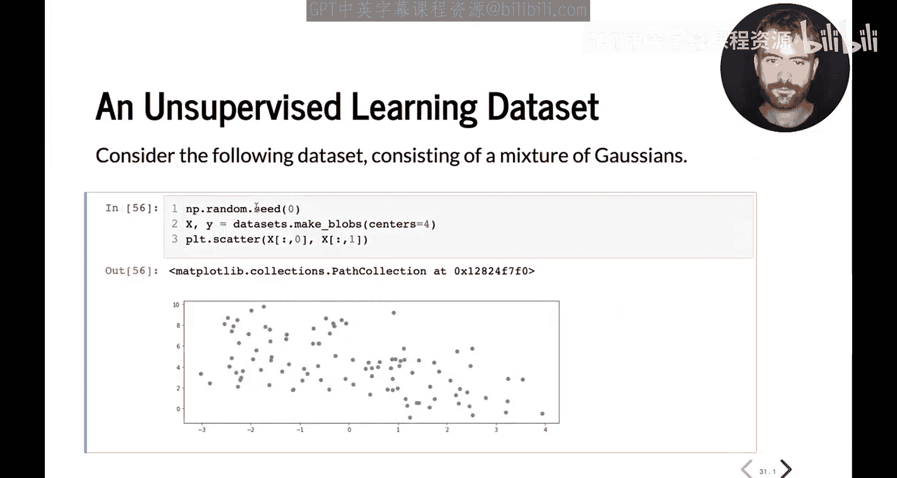

As a running example for this video I'm going to use the following data。

 so here I'm using a feature of psychic current called make blobs and here it forms this data which is two dimensional and it actually has a certain kind of structure that I'll show you in a second but without any labels it looks like this。

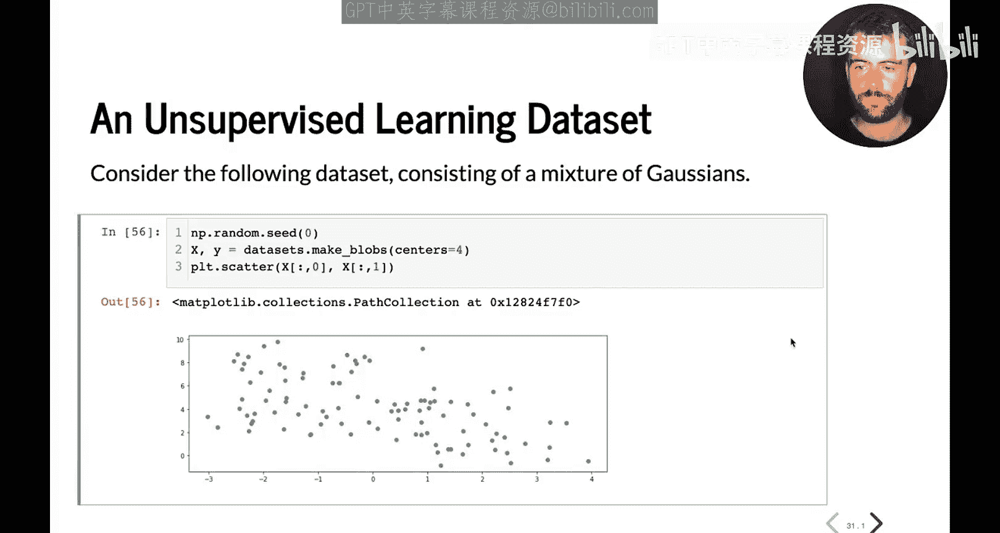

Now I also have true labels for this data set and it actually corresponds to four clusters。

 there are actually four clusters in this data， so there's a cluster， there's a yellow cluster here。

 there's a green cluster here， there's a purple cluster here and a blue cluster here and if we remove the labels then we have this。

Signed it then we have something which looks like a uniform。Insteadt of data。

 but actually it has this structure hidden inside of it。

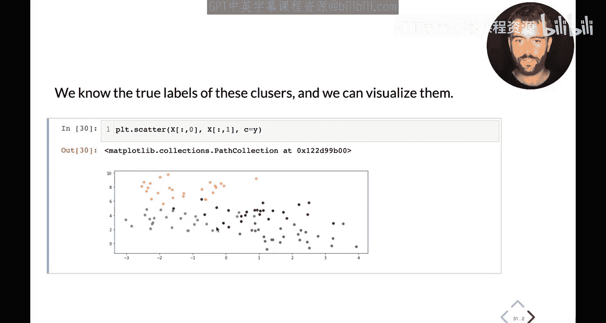

Now， in unsupervised learning， we can think of something which looks a lot like underfitting if or we observe something which looks a lot like underfitting。

 if we try to fit a model that is too simple for this data。

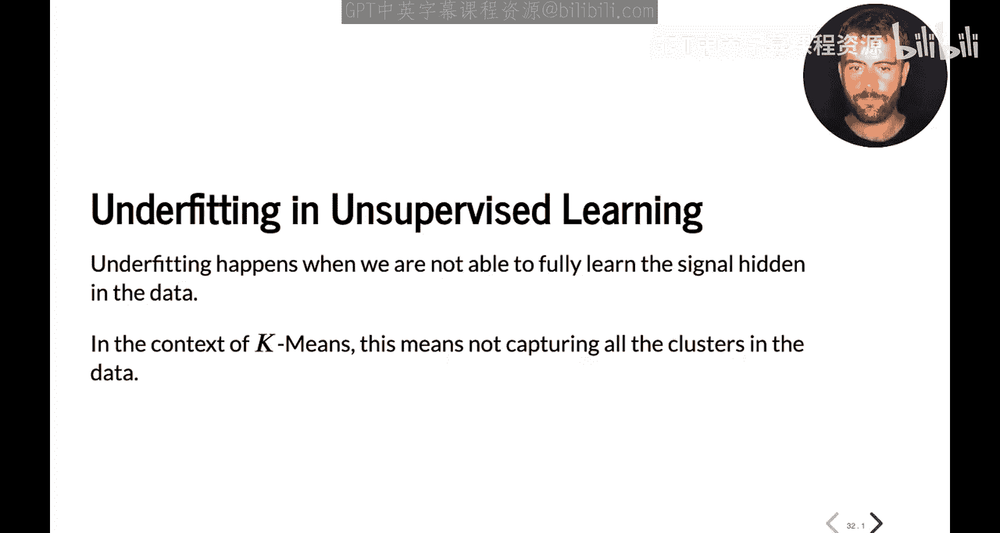

For example， let's run K means on this storyy data set and let's ask it to find two clusters。

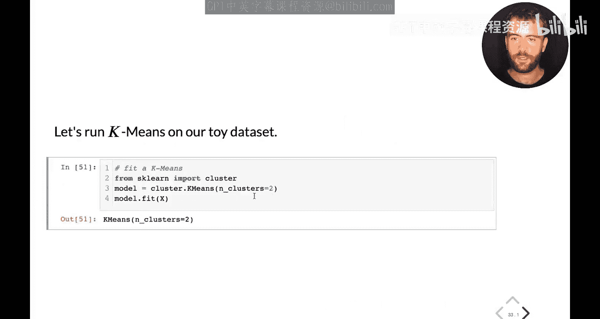

And we obtained from K meanss the following two centroids which are the red diamonds here。

 and although it does find two useful sets of points。

 even visually inspecting this we see here in this region there's more white space so this set of points seems to be more distinct that from it seems to be distinct from this set of points。

 so identifies useful structure， but it still unsatisfying because it really it hasn't described it hasn't identified the entirety of the structure that's in this data。

 there's actually more richness and we haven't really found the entirety of the structure and also if we look at our objective here。

 it has this value and I'll come back to this value but here we have run 400 the values around 462 for this particular clustering。

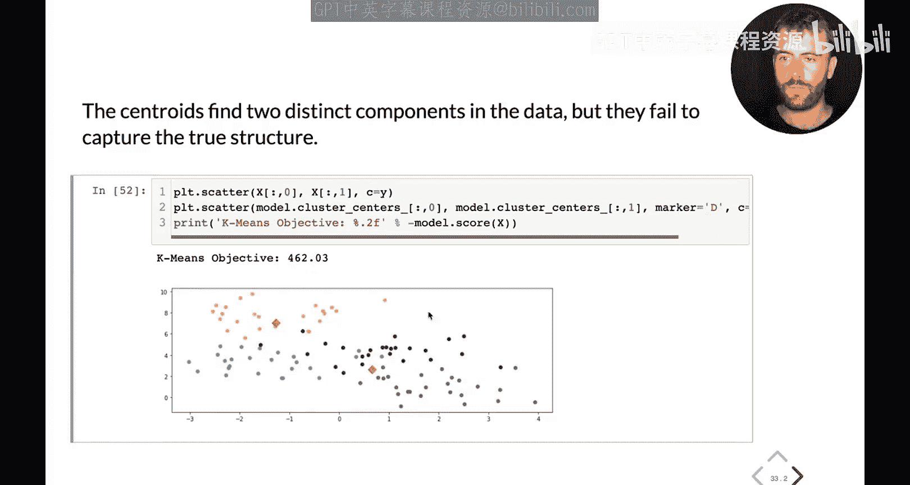

And of course， to mitigate this problem， we can increase the number of clusters。

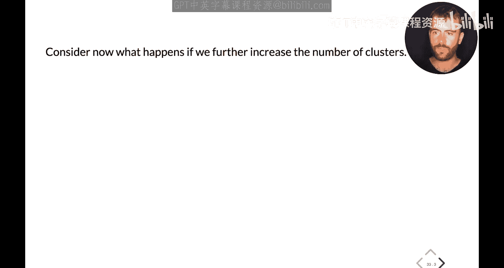

So if we increase the number of clusters to four， we have something which looks like this。

 which actually recovers a lot of the structure that we have seen in this data。

 but we can keep going， oh and also this improves our objective， it goes from 462 to 164。

 we can also keep going we can add more clusters here here we have 10 clusters in the data and we can keep going we can add 20 clusters to this data and now our objective is really small。

But even though our objective is small， clearly at this clustering at some point stops being very useful。

 so it basically identifies a cluster here， identifies a cluster here。

 a cluster here but we know how the data was generated and actually all of these yellow points they were just samples from the same Gaussian distribution and it just happens that here there were in the middle in this white region。

 there were no samples， and so this looks like a separate cluster。

 these little points look like a cluster， these points look like a cluster。

 but now we're not really fitting a signal， now we're fitting noise。And so in that sense。

 we are essentially overfitting the data， we have started to fit the noise rather than the signal。

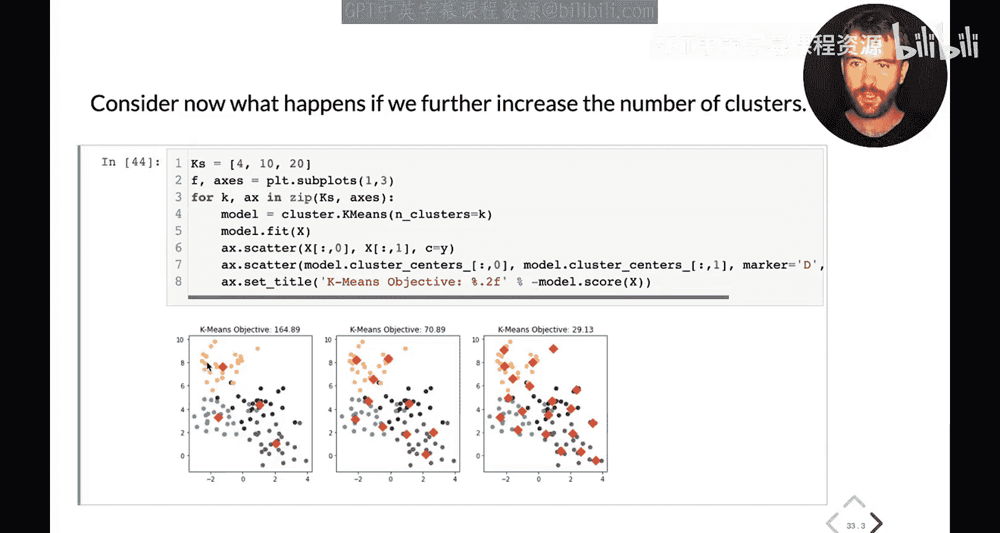

And even though this is not a very precise definition。

 it still feels a lot like overfitting and in these slides， I refer to it as overfitting。

 even though overfiing is a concept that's mostly defined it's mostly used for supervised learning。

 I just want to point out that this is another failure mode of unsupervised learning。

 when we try to when the signal that the model identifies now corresponds to the noise rather than the true signal that's in our data distribution。

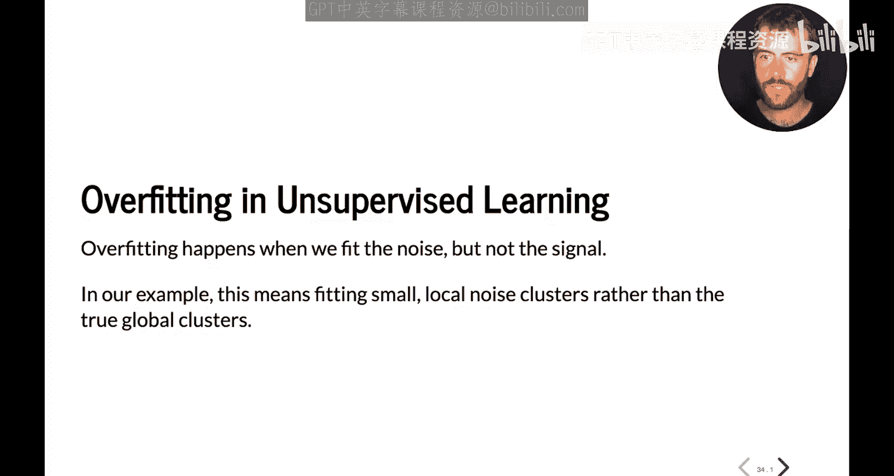

And of course we can take this example to the extreme and we can fit this little cluster。

 this little cluster， there are a few points here that or。

I guess it has determined that this is a separate cluster here， these two points are a cluster。

 these two points are a cluster， but now with 50 clusters it's clearly just fitting noise and this is not useful even though Arrcane means's objective is very small。

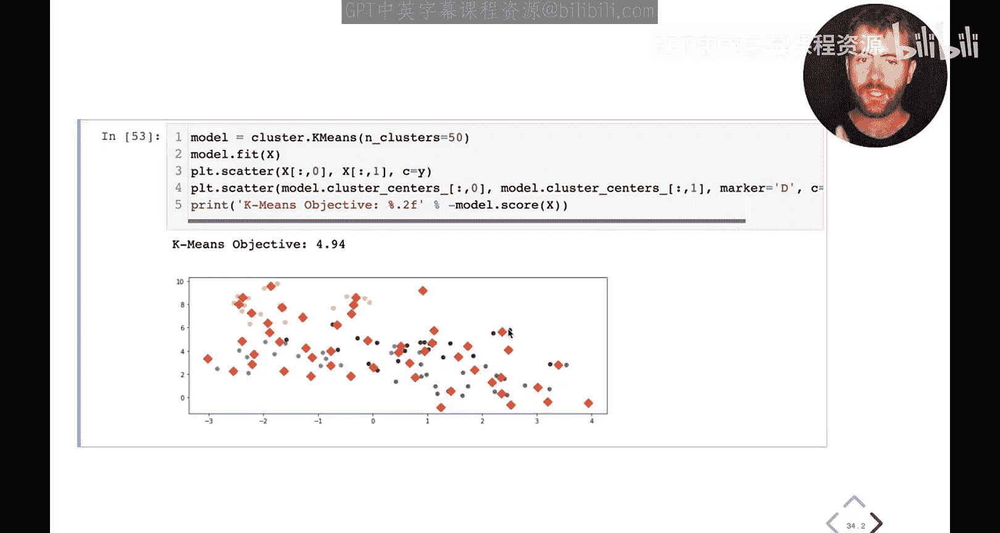

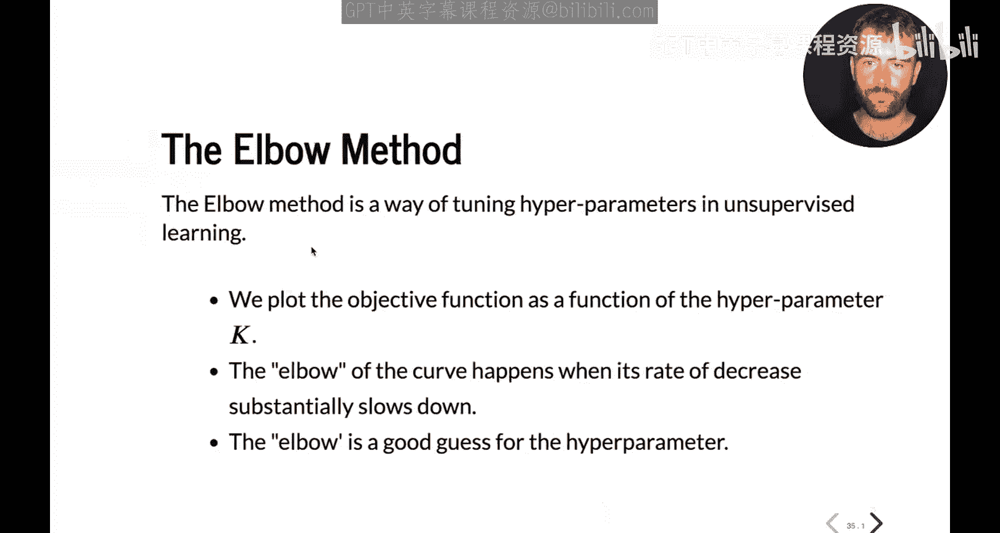

Now unlike supervised learning， we don't really have labels for this， of course in this to example。

 we do have labels， that's because I generated them。

 but in practice we don't have labels and so it is hard to assess the quality of our clustering in an objective way。

But there are some heuristics that can be used。For example。

 one popular heuristic is something called the elbow method。

 and that's a general approach for tuning hyperparameters and unsupervised learning。

And the idea of this method is that we plot the objective function that we saw earlier。

 so it was 462 then it was 164。We plot this value as a function of our hyperparameter。

 which in this case is k。And then we look at the curve and we refer to as the elbow to the point。

 we refer to the point in which there is an inflection in the rate of decrease of this curve as the elbow。

 so this loss will decrease， but at some point it will stop decreasing。

 it will start decreasing more slowly after a certain point in the curve， which is called the elbow。

 and the elbow is something that is often a good guess for the hyperparameter of the model。

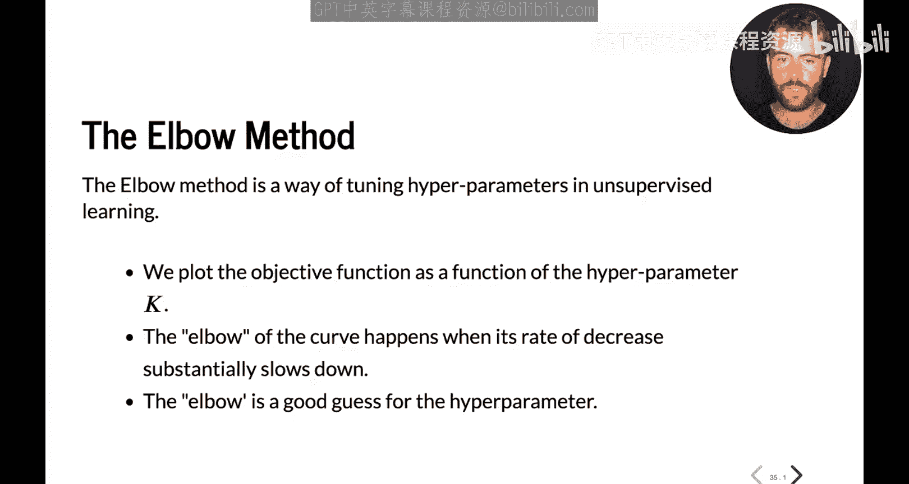

So here， let's perform this exercise for the key means model that we had earlier。

 so I'm going to plot the objective value for different values which go from 1，2，3，4。

5 all the way to k here。And I'm going to assign a score to this data and we see the following pattern。

 so of course everything is decreasing， but then after about4 this rate it just the curve flattens out and the line is almost now we're almost at a straight line here。

 so we no longer see any incremental well we decrease our objective function but the rate of decrease has slowed down the delta at each point now is roughly the same。

 so it seems like the rate of decrease has saturated after about k equals4。

 which is the right number in this case because K equals 4 is the actual number of clusters in this data。

And we refer to this red point， this point at four， we refer to this as the elbow。

 it's called the elbow because you can think of this as being an arm and the arm is bent and the elbow。

 this is where it comes from， but this is the point where the utility of adding more clusters saturates and we just have a uniform decrease。

So here this is one heuristic that can be used in order to detect this value。

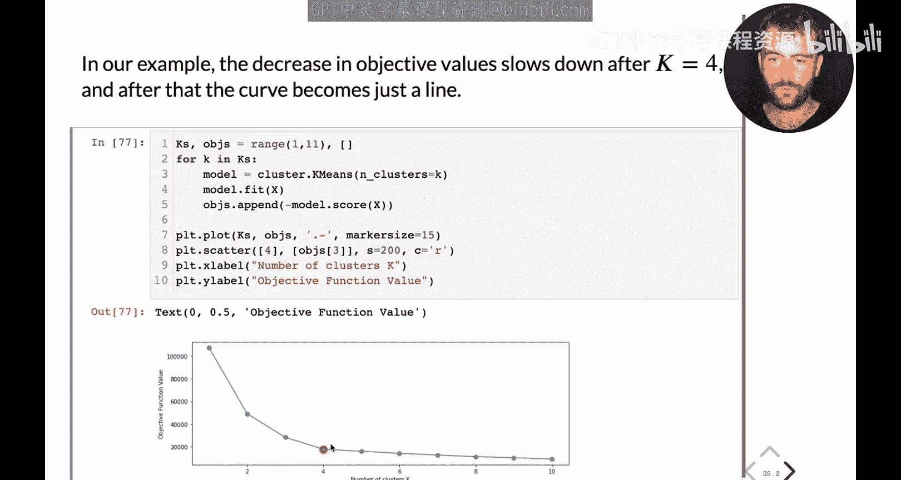

And more generally， detecting these kinds of failure modes， again。

 I'm referring to them as overfaing and underfaing。This is a definition that I chose in practice。

 maybe the more general and the more correct term would be to just say that we're fitting noise or we're not fitting our signal。

 but I like to draw this analogy to overfitting and underfitting in supervised learning so I keep using these terms and this is a problem that happens in supervised learning。

 but it's much more difficult to diagnose。And it often requires our own intuition。

 it requires human evaluation to see whether the results the structure that has been found。

 whether it's useful or not， there's the case in many applications。

 although in some applications of unsupervised learning， we can have access to a set of labels。

 or we could manually go and we could try to label some of these data points。

 perhaps we could inspect them。For example， if we're dealing with digits。

 we could go and manually label a few digits and see if the structure that we have found is useful or not。

 so there's also a set of techniques for measuring the accuracy of a fit based on。

True labels that can be used， but in general， this problem is much more difficult and less well defined than in supervised learning。

And finally I want to add that in general this is true。

 but there are certain families of models which are in nature probabilistic and we will be talking about probabilistic methods in unsupervised learning really soon and there we can actually have a similar definition to overfaing and underfaing as we did in supervised learning by looking at the likelihood of the data。

 so we had a definition of or we had this concept of optimizing log likelihood for supervised learning we will also define the same idea for unsupervised learning and this likelihood objective is actually something that we're going to be able to use in order to evaluate the quality of a fit on training and heldout data and that is a third approach to understanding these two failure modes of unsupervised learning that we're going to look at later。

 but for now I guess we have with these kinds of。Algorithms like kines and others that we're going to see。

 it requires either human intuition and inspection。

 or it requires creating a small label data set or obtaining labels and then using techniques which assess quality using labels。

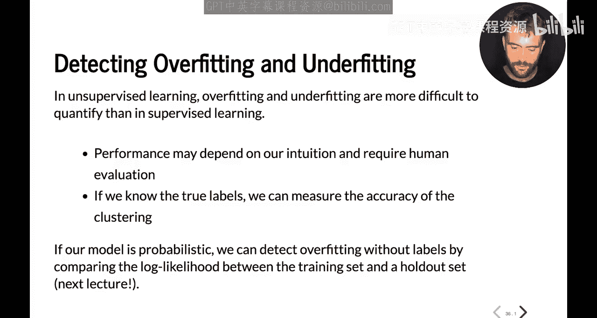

And if we believe that we are overfitting the noise in the data。

 then of course we have different solutions， the one that we have seen is to reduce the model complexity。

 for example， reducing k and K means，Or we could just have a single model where we could penalize large values of k so we could assign a cost for choosing highK。

 if we have additional hyperparameters， we could just assess a cost for all of these hyperparameters when they're high。

 or as I mentioned we could also use a probabilistic model and we could apply regularization techniques to these kinds of models。

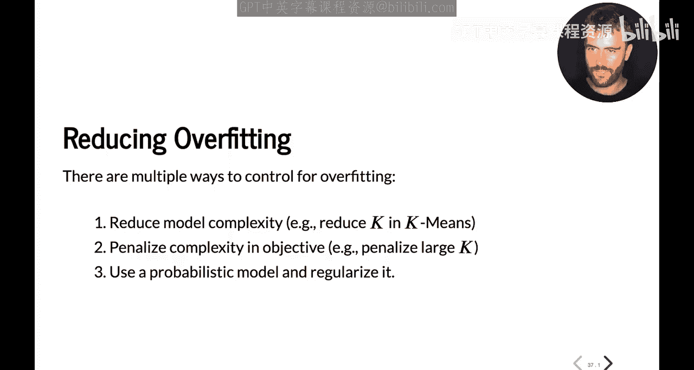

So in summary the applying unsupervised learning algorithms is not always straightforward。

 there are often it's easy to either not extract the entirety of the signal or it's easy to start fitting noise and we have this problem in supervised learning too but in unsupervised learning。

 it's more challenging because we have less because we don't have labeled data and so that requires specialized specialized techniques and in practice this is the main consideration that you should have in mind if you're applying unsupervised learning are you fitting noise or you fitting signal and there are techniques for evaluating this problem some of which I mentioned just now and others we're going to see in subsequent lectures。

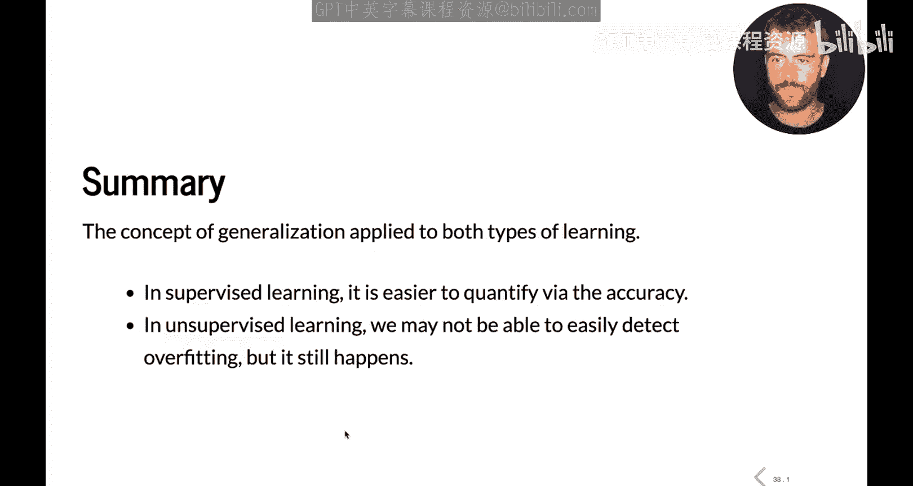