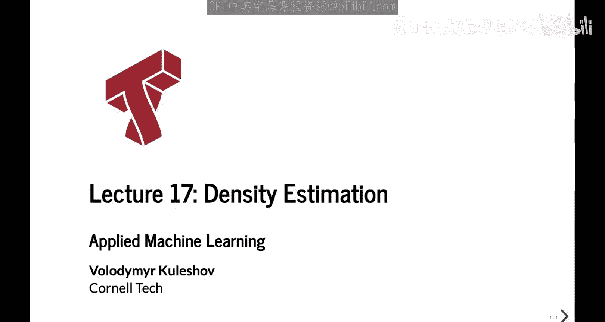
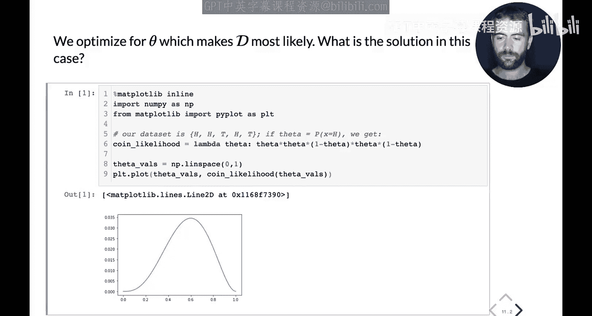

# 康奈尔大学《应用机器学习 CS 5787_ Applied Machine Learning 2020》中英字幕（deepseek p61 -61-Lecture 17. Part 1_ Unsupervised Probabilistic Models.zh_en -BV12udzYvEFM_p61-

Hi and welcome to Lecture 17 of Applied Mach Learning。

In lecture 17 we are going to start our first topic in unsupervised learning。

 which is going to be density estimation， so I'm going to introduce a few useful concepts that we will need to solve this problem。

 then I will define what density estimation is and then I will define a few first methods for doing density estimation。

And to begin in this part of the video I would like to start by talking about probabilistic models in unsupervised learning。

 so in earlier videos we looked at probabilistic models in the context of supervised learning and now I want to introduce them in unsupervised learning as well and then this is going to be the probabilistic models are going to be the tool that we're going to use to perform density estimation。

And we're also going to use them throughout all of our other lectures on supervised learning。

So let's define probabilistic models and just to set the context again。

 we are talking about unsupervised learning， which is a regime in which we have a data set without labels and our goal is to have the algorithm。

 look at this data and learn something interesting about it。

 learn something interesting about its structure without。Without relying on human supervision。

 and when I say something interesting， this means things like clusters or outliers or useful signal within noise。

 perhaps human speech within white noise。This kind of structure。And in our earlier video， we defined。

We defined a general setup for unsupervised learning。

 so our data set now consists of vectors of features or attributes， but we don't have any labels。

 and we assume that these features come from a data distribution and their are IID samples from this data distribution。

And then we define a concept of an unsupervised model， which is some function which maps inputs。

 to interesting structural components， perhaps clusters or low dimensional representations。

 we're going to see a lot of examples here， and of course as usual as insupervised learning our models are often parameterized and they have these parameters。

 theta。So。In when we talked about supervised learning， we also made a really similar assumption。

 we assume that data is coming from a data distribution and one interesting modeling approach is to parameterize a probability distribution and fit it to approximate the true data distribution。

 this is what we did in supervised learning and。This is what we're going to do in unsupervised learning as well。

 so we will assume that a probabilistic model is a probability distribution over the space of attributes。

And we will try to approximate our data distribution with this model。

 and as usual our model may have parameters， we denote them by theta。

 and we use the following notation P subscript theta to denote a probabilistic model with parameters theta。

So before I go further， I just want to take a step back and。

Talk about why probabilistic models are interesting。

So we saw different types of models we saw in supervised learning， we saw both。

Non probabilistic and probabilistic models often actually there are equivalent probabilistic models to nonprobabilistic ones and here in the context of unsupervised learning。

 we also have these two approaches so imagine that we're trying to fit a model probabilistic model P to our data。

What are all the interesting tasks that we could try to solve with it， What are the interesting。

Use that it could have。So if we fit a distribution。

 then we with additional some additional techniques and algorithms。

 we can draw samples from this distribution， so we can use these models to solve generation problems for example we can generate images of human faces from a distribution of faces that we have learned。

 we can also use them to find interesting structure and data so if there are clusters。

 then we can ask our probabilistic model to we can inspect our probabilistic model and we can try to recover these clusters。

And perhaps the most general task that we could do with a probabilistic model is to try to learn the data distribution as as accurately as possible。

 and this is the third task here and this is the definition of the task of density estimation so our data distribution here places some weight on different parts the space of x and we are going to try to learn a model that also places the same weights or probabilities to the space of x that we consider and if we do that if we find probability distribution that has the same structure as our data distribution then we say that we have accurately estimated this density so the problem of density estimation is the problem of approximating the data distribution and also it's a very general task because if we can approximate the data distribution then we can solve all the other problems。

That we we may want to solve， such as generating samples or presentation learning or other tasks such as clustering or atli detections。

 if we have a good model of the data distribution， we can solve all of these problems。

 And so in that sense， density estimation is the most general approach that we can solve and in this lecture we are going to look at。

at a few ways in which we can do this， and we are also going to be looking at various forms of data of density estimation in subsequent lectures as well。

 but they will be applied to certain practical problems such as clustering or dimensionality reduction。

So if our goal is to approximate a data distribution with our model， well。

 we need to start by defining some notion of distance between distributions。

And in our earlier discussion of supervised learning， we have seen the col labar divergence。

 which is a measure that is widely used in machine learning and in mathematics and in information theory to perform exactly this comparison between the two distributions。

 so this is also what we're going to use in our example here before。Before I start using it。

 I just want to remind you a few properties of the colla divergence。

 so it is always non-neg and it equals zero if and only the two distributions P andq are equal。

 so this is what makes it a useful objective to optimize if we want to approximate P with Q。

 if we want to choose P&q that are similar then this is a sensible optimization objective this is a short proof I briefly mention this in the video where I talked about supervised learning so if I will not talk about this proof more in this video but you're welcome to go back to the earlier videos if you want to have additional context about this proof and then also an interesting features feature that we have seen is that it is asymmetric which is why。

We call it a divergence and not a distance between distributions。So if we were to。

Use the colbec L diversions。To approximate the data distribution with our model。

 we would be optimizing an objective of the following form here I'm just writing the form of the here I'm just using the definition of the Colbe laber dirgence in the first line and then I expand the log in the second line and。

If you may notice that the first term here depends only on the data distribution。

 it does not depend on our model and therefore we're only interested in the second term which is the log likelihood that we have seen before again this is the similar derivation this is a similar derivation to what we did on our video on supervised learning but I just want to remind you here how this argument works。

And therefore， if we want to minimize the keyL dirgence， we may also maximize the likelihood。

 the expected likelihood of our model， which is the subjective here。

 it is simply maximizing the expected lock probability。Of the data under our model。

So we have talked about the properties of this process and in general， this objective here is not。

Attractable in the form that is written here because we do not know the data distribution and we cannot therefore perform this expectation。

 but however， we have samples from the data distribution and therefore we can use the Monte Carlo principle to approximate this expectation with to approximate this expectation here with the empirical likelihood where we have drawn a random data set of D points。

And this is simply our usual log likelihood objective that we。That we would maximize。So。And so again。

 here I have。Briefly red derivediveed the principle that we have seen earlier on our lectures on supervised learning which is that of maximum likelihood estimation。

 and you can see here that the same principle only with slight modifications to the notation I have just replaced P of x of y with P of x and the same reasoning can be used to derive the following maximum likelihood objective for learning probabilistic model。

And let me briefly show you again an example of how this principle can be applied。

 imagine a simple example where we have。A probability distribution over flips of a coin。

 so let's say we have a coin and this coin has some unknown bias。

It can has a certain probability of falling heads and a certain probability of falling tails and we have thrown the coin five times and we have seen three heads and two tails。

So we can assume a particular probabilistic model， which is the following。

 it only has one parameter of theta and that's the probability of falling heads and the parameter of the coin falling tails is one minus theta and then our data set is three heads and two tails and the likelihood of the data is simply the following by the definition of our model。

And now we can look at the likelihood of the coin， we can plot it as a function of the parameter theta and as you would expect the principle of maximum log likelihood chooses this is the likelihood function and the likelihood is maximized when theta equals 0。

6 or 60%， which is reasonable because we have 60% of heads in our data set in 20% tails so this is just to remind you。

Of how maximum likelihood works， and this is an application to a simple problem。

So in summary in this video， we defined what is a probabilistic model and we derived an objective function that can be used to learn any probabilistic model and this is maximum likelihood。

 and this maximum likelihood for unsupervised models it is simply a small modificationification to what we have seen for unsupervised models。

And now in the next few videos， we are going to now apply these principles to perform a density estimation in interesting classes of models。

