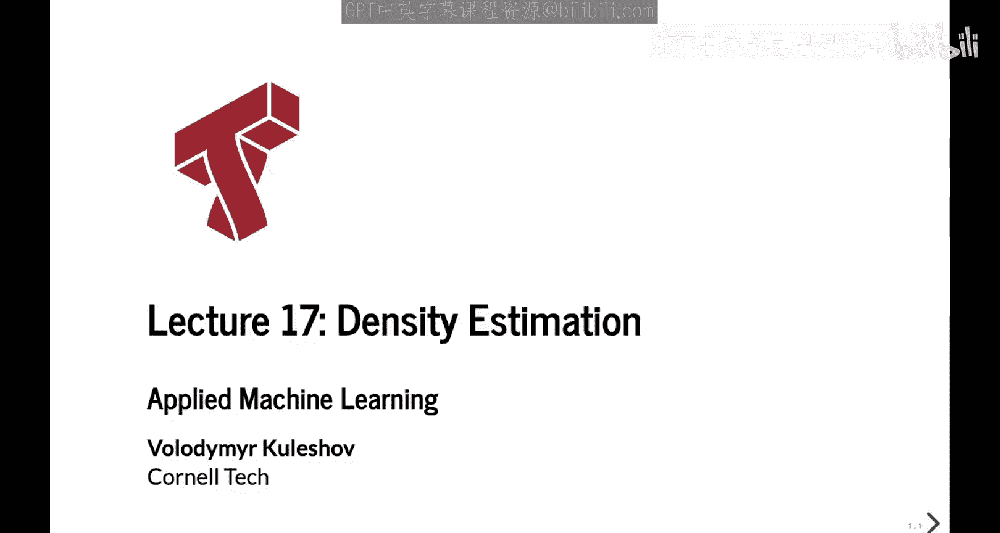
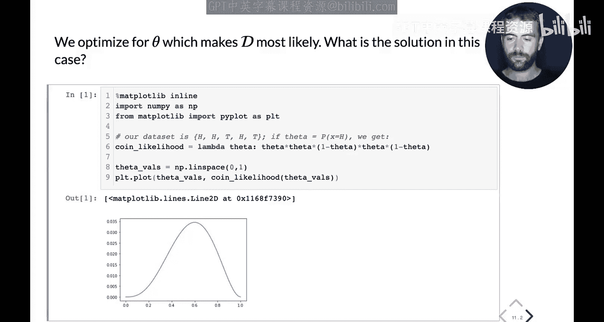

# 应用机器学习：第17讲：无监督概率模型（第一部分）

在本节课中，我们将开始学习无监督学习的第一个主题：密度估计。首先，我会介绍解决此问题所需的几个重要概念，然后定义什么是密度估计，并介绍几种进行密度估计的初步方法。

## 无监督学习中的概率模型

在之前的课程中，我们探讨了监督学习背景下的概率模型。现在，我想在无监督学习的背景下也引入它们。概率模型将成为我们执行密度估计的工具，并且在我们后续所有关于无监督学习的课程中都会用到。

首先，让我们再次设定背景。我们讨论的是无监督学习，在这种模式下，我们有一个没有标签的数据集。我们的目标是让算法观察这些数据，并从中学习到一些有趣的结构，而无需依赖人工监督。这里的“有趣结构”可能包括聚类、异常值、噪声中的有用信号（例如白噪声中的人声）等。

在之前的视频中，我们定义了无监督学习的一般设置：我们的数据集现在由特征或属性向量组成，但没有标签。我们假设这些特征来自某个数据分布，并且是该分布的独立同分布样本。然后，我们定义了无监督模型的概念，即一个将输入映射到有趣结构组件（如聚类或低维表示）的函数。与监督学习类似，我们的模型通常带有参数，记为 θ。

在监督学习中，我们假设数据来自一个数据分布，一种有趣的建模方法是参数化一个概率分布，并使其拟合以近似真实的数据分布。在无监督学习中，我们也将采用同样的方法。我们将假设概率模型是属性空间上的一个概率分布，并尝试用这个模型来近似我们的数据分布。我们使用符号 **P_θ** 来表示一个参数为 θ 的概率模型。

## 为什么概率模型有用？

我们见过不同类型的模型。在监督学习中，我们见过非概率模型和概率模型，并且非概率模型通常有等价的概率模型。在无监督学习的背景下，我们也有这两种方法。

假设我们试图用概率模型 **P** 来拟合数据。我们可以用它来解决哪些有趣的任务呢？

1.  **生成样本**：通过一些额外的技术和算法，我们可以从这个分布中抽取样本。例如，我们可以用学习到的人脸分布来生成人脸图像。
2.  **发现数据结构**：如果数据中存在聚类，我们可以检查我们的概率模型，并尝试从中恢复这些聚类。
3.  **密度估计**：这是最通用的任务，即尽可能准确地学习数据分布本身。我们的数据分布在 **x** 空间的不同部分赋予不同的权重，我们的目标是学习一个模型，使其在 **x** 空间上赋予相同或相似的权重/概率。如果我们找到了一个与数据分布结构相同的概率分布，我们就说我们准确地估计了这个密度。

密度估计是近似数据分布的问题。它是一个非常通用的任务，因为如果我们能近似数据分布，我们就能解决所有其他问题，如生成样本、表示学习、聚类或异常检测等。从这个意义上说，密度估计是我们能解决的最通用的方法。在本讲中，我们将探讨几种实现密度估计的方法，并且在后续课程中，我们也会看到密度估计的各种形式被应用于聚类或降维等实际问题。

## 分布间的距离度量

如果我们的目标是用模型近似数据分布，那么我们需要首先定义分布之间距离的概念。

在之前关于监督学习的讨论中，我们见过**KL散度**。这是在机器学习、数学和信息论中广泛使用的度量，用于精确比较两个分布。这也将是我们在本例中使用的方法。

在开始使用之前，我想提醒您KL散度的几个性质：

*   **非负性**：KL散度总是非负的。
*   **零值条件**：当且仅当两个分布 **P** 和 **Q** 完全相同时，KL散度为零。这使得它成为我们想要用 **Q** 近似 **P** 时一个有用的优化目标。
*   **不对称性**：KL散度是不对称的，这就是为什么我们称它为“散度”而不是“距离”。

如果我们使用KL散度来用模型近似数据分布，我们将优化如下形式的目标：

**D_KL(P_data || P_θ) = E_{x~P_data} [log (P_data(x) / P_θ(x))]**

展开对数项：

**= E_{x~P_data} [log P_data(x)] - E_{x~P_data} [log P_θ(x)]**

您可能会注意到，第一项 **E_{x~P_data} [log P_data(x)]** 仅依赖于数据分布，与我们的模型无关。因此，我们只关心第二项 **- E_{x~P_data} [log P_θ(x)]**，即我们之前见过的**负对数似然**的期望。

因此，为了最小化KL散度，我们可以等价地**最大化**模型的期望对数似然，即 **E_{x~P_data} [log P_θ(x)]**。

## 最大似然估计

然而，上面这个目标通常难以直接处理，因为我们不知道真实的数据分布 **P_data**，无法计算这个期望值。但是，我们拥有从数据分布中抽取的样本。因此，我们可以使用蒙特卡洛原理，用经验似然来近似这个期望。假设我们有一个包含 **D** 个点的随机数据集，这个近似就是：

**E_{x~P_data} [log P_θ(x)] ≈ (1/D) * Σ_{i=1}^{D} log P_θ(x_i)**

这简化为我们熟悉的**对数似然**目标，我们通过最大化它来学习模型参数 θ。

这样，我们就再次推导出了之前在监督学习课程中见过的原则：**最大似然估计**。您可以看到，同样的原理只需对符号稍作修改（将 **P(x, y)** 替换为 **P(x)**），就可以推导出用于学习无监督概率模型的最大似然目标。

## 一个简单示例

让我用一个简单的例子来说明这个原理如何应用。

想象一个简单的场景：我们有一个关于抛硬币结果的概率分布。假设有一枚硬币，它有一个未知的偏差，即正面朝上的概率为 **θ**，反面朝上的概率为 **1-θ**。我们抛了这枚硬币五次，观察到三次正面和两次反面。

我们可以假设一个特定的概率模型，它只有一个参数 **θ**（正面朝上的概率）。我们的数据集是三次正面和两次反面。根据模型定义，数据的似然函数为：

**L(θ) = P(数据|θ) = θ^3 * (1-θ)^2**

现在，我们可以将似然函数绘制为参数 **θ** 的函数。正如您所料，最大似然原则会选择使似然函数最大化的 **θ** 值。在这个例子中，当 **θ = 0.6**（即60%）时，似然函数达到最大。这是合理的，因为我们的数据集中有60%的正面和40%的反面。这个例子只是为了提醒您最大似然估计是如何工作的，并将其应用到一个简单问题上。

## 总结

在本节课中，我们定义了什么是概率模型，并推导出了可用于学习任何概率模型的目标函数：**最大似然估计**。对于无监督模型，最大似然估计只是对监督学习版本的一个小修改。

在接下来的视频中，我们将把这些原理应用到有趣的模型类别中，以执行密度估计。