# 康奈尔大学《应用机器学习 CS 5787_ Applied Machine Learning 2020》中英字幕（deepseek p62 -62-Lecture 17. Part 2_ Kernel Density Estimation.zh_en -BV12udzYvEFM_p62-

We are now at part two of Le 17 and in this video， we're going to now look at our first technique for performing density estimation called kernelnal density estimation。

So we previously define what is a probabilistic model and we define an objective for learning probabilistic models and now I'll define。

A particular form for probabilistic models， and we will look at how to fit these models to data and this is going to be the simplest。

 but still it's a very simple， but still an important and useful way of performing density estimation in several interesting settings。

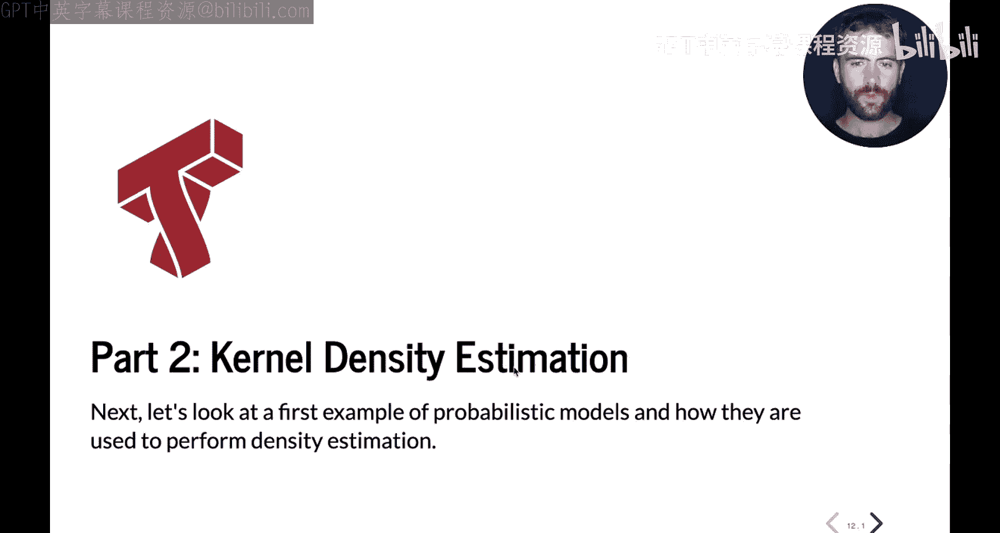

So recall that we are in the regime in which we have an unsupervised data set of attributes x。

 which is sampled IDD from a data distribution P data。

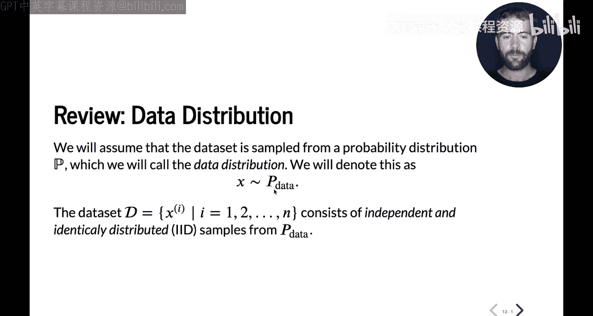

And we want to fit a probabilistic model to this data set。

 which is going to be a probability distribution over the space of X with some set of parameters of theta。

And our goal is to perform density estimation density estimation is simply the problem of choosing a P which approximates the data distribution well。

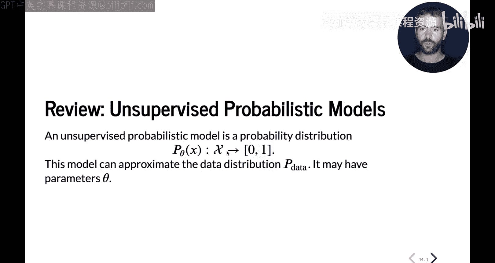

And this is a very general learning task。If we can solve density estimation。

 we can solve also many useful downstream tasks such as detecting outliers， generating new samples。

 visualizing and understanding interesting structure within the data distribution。

 these are all interesting downstream problems and so in a way density estimation is the most general problem that we can solve。

And many of the algorithms that we're going to introduce in our lectures on unsupervised learning。

 they can be seen as performing density estimation with a particular type of interesting model and then using this。

And then using it for solving。Certain useful problems like clustering。

So is this is our problem and we're going to define a first interesting。

 we're going to define a few very simple but still interesting and useful density estimation approaches based on this。

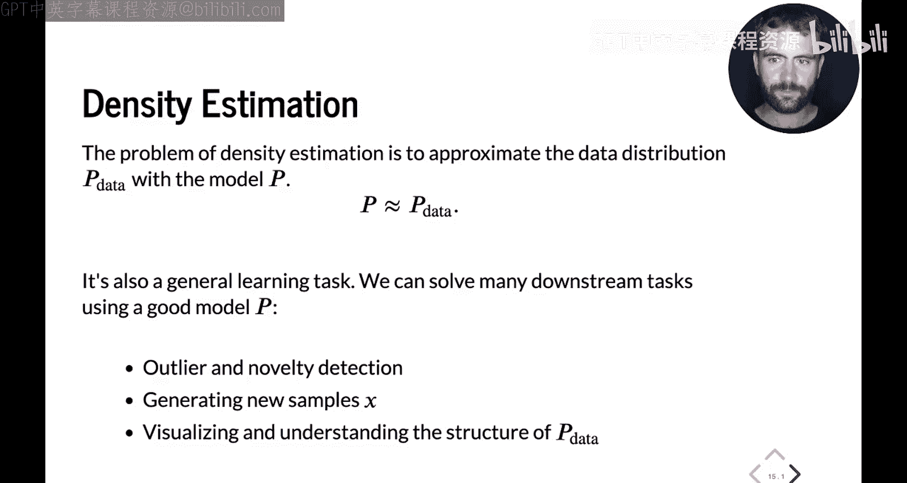

Based on this context。So perhaps the simplest way in which we could do density estimation and by the way I should add that these methods that we're going to define in this video。

 they're relatively simple， they will not solve all the problems that we have just defined。

 we're not going to be able to solve them， we're not going to be able to use them to solve every clustering or every dimensional reduction problem but they're still useful for certain kinds of problems and we're going to。

I'll mention you what they are。So let's start with the simplest possible way of estimating a distribution。

 and this is what's called histogram density estimation。

Let's say that we have some points in some de dimensionional space。

Perhaps the simplest thing we can do is we can divide this input space into a dedimensional grid and then we can count how many points fall within each cell in the grid。

 and the cell is containing more points， they will have higher probability and then we can normalize the counts and we can assign a probability to each cell。

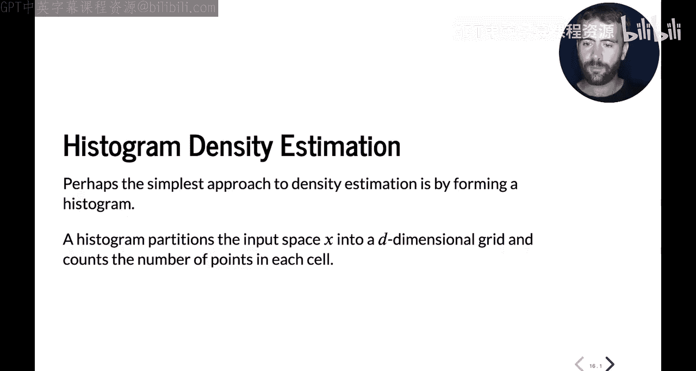

Let's look at a simple example in one dimension。I'll generate a data that is coming from the following distribution which is a mixture of two Gaussians。

 I have one Gaussian distribution here with mean zero and variance 1 and here I have another distribution with mean5 and variance one。

 the second one has 70% weight， the first one has 30% weight and now this is simply a well definedfined mixture of Gaussians and I can generate points from this data。

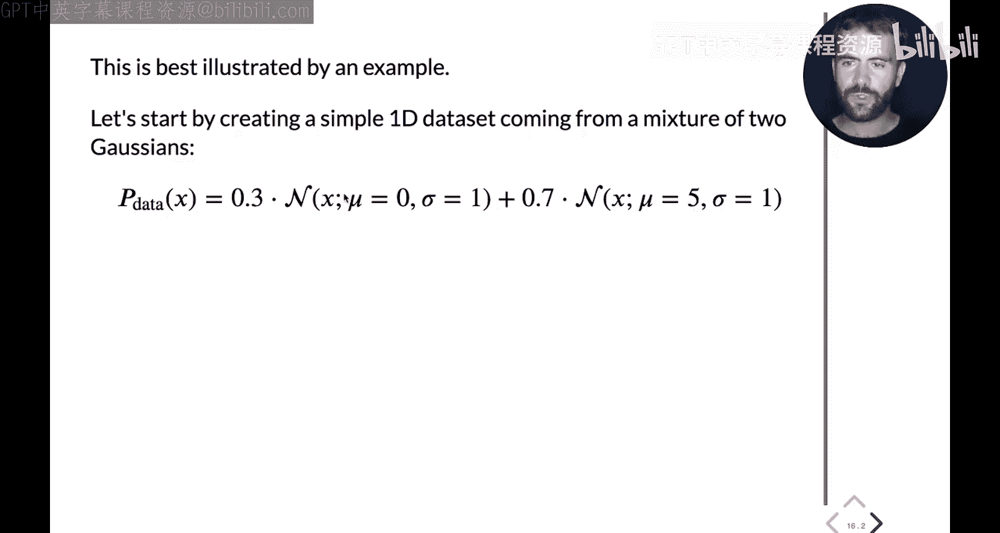

So here I'm going to use a little bit of nuy to generate these data points。

 I will generate 20 of them here I simply draw samples from the normal distribution with the parameters that I just showed you and here I Ive created this X here I print X and this is the set of points that we have there's 20 of them and let's now visualize this。

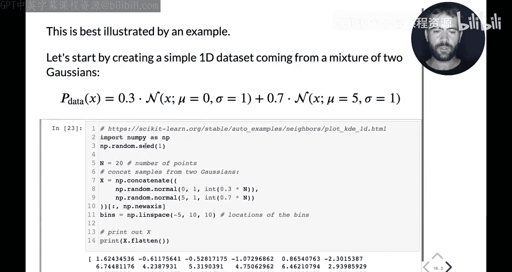

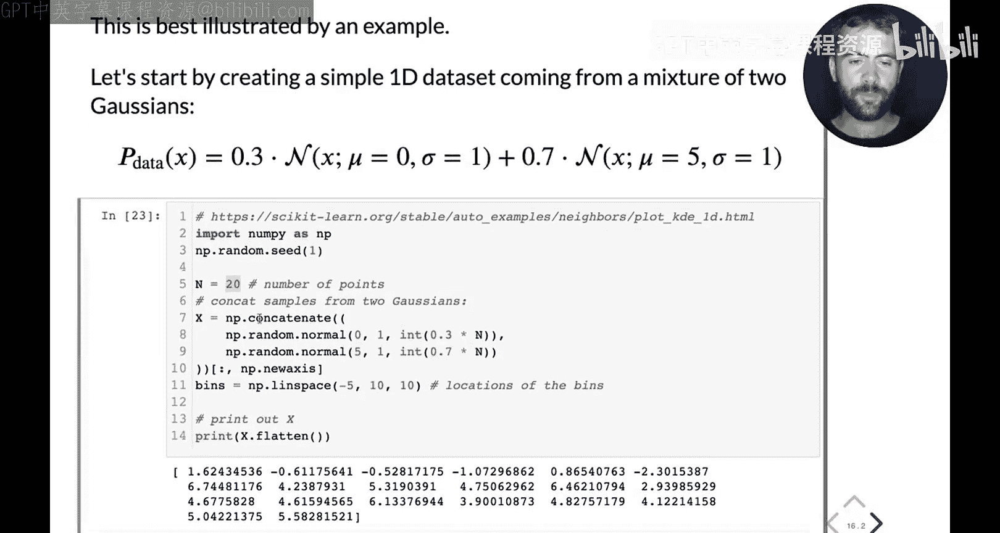

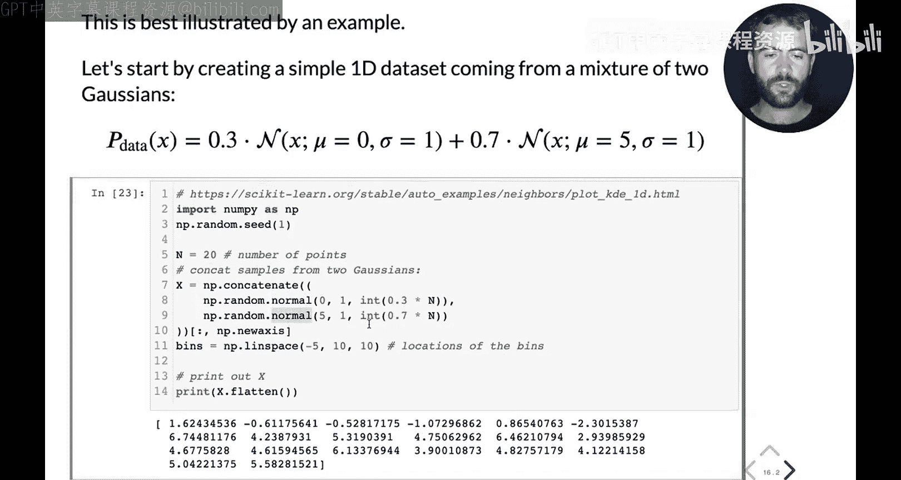

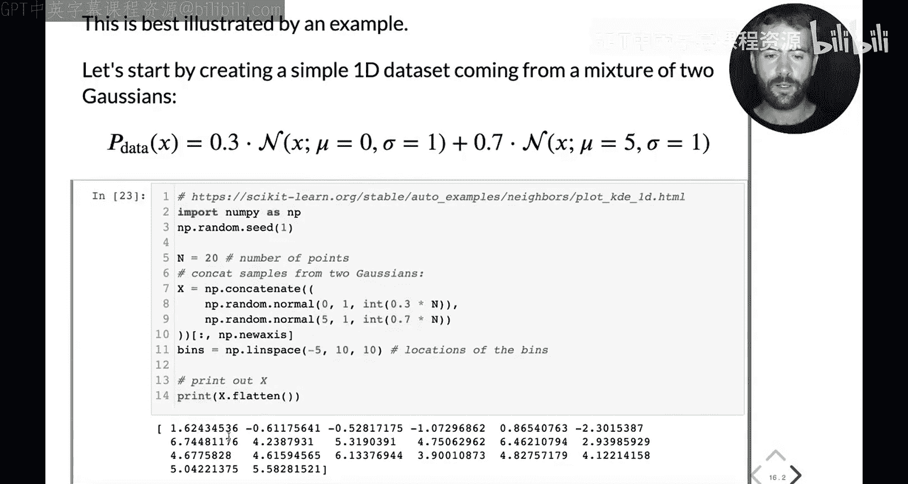

So these points fall on the they're all each point is simply a real number。

 so our x is just a real number， we're in one dimension and so they fall somewhere along the line。

 along the real line， and we can take this real line and we can break it into bins。

 I have defined these bins here have bins between five have 10 bins of equal length between minus 5 and 10 each of them has with 1。

5。

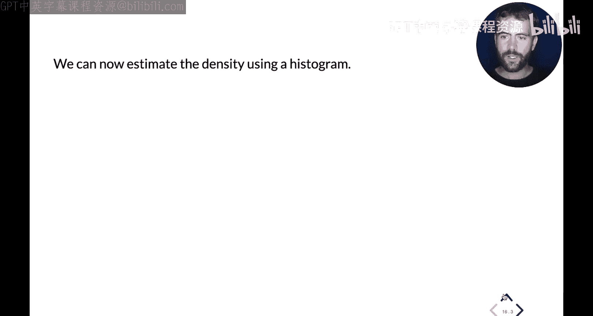

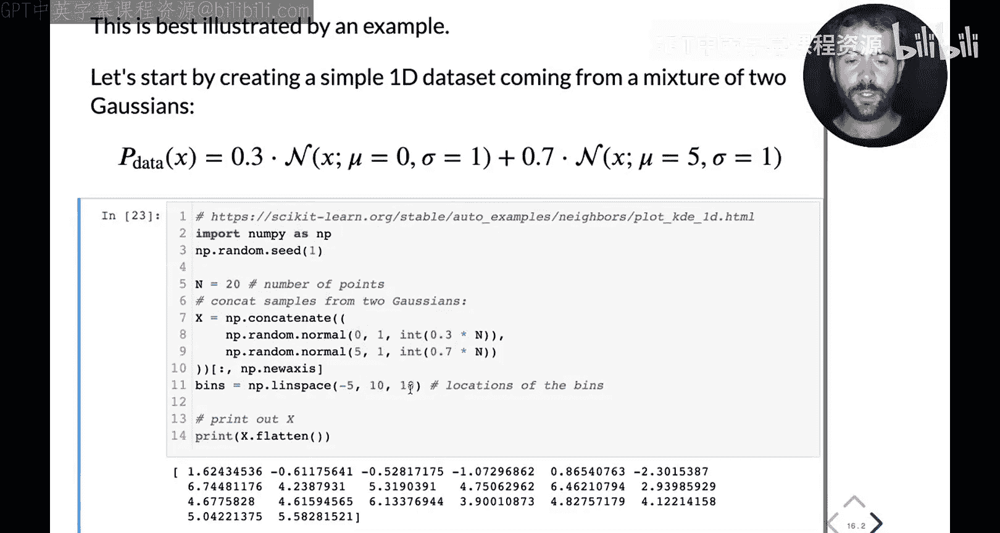

And I can。I can now do a histogram of all the points， so here I have my 10 bins here。

 the black dots are the points that we have generated and this is the histogram shape that I have。

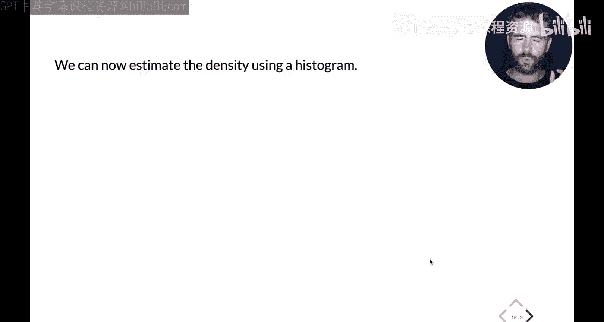

So you can see here that we have two clusters of points here this was our second Gaussian with mean 5 which5 is approximately here。

 it had 70% weight， so about 70% of the points are in this area。

And here I have also 30% of the points which are near the second Gaussian which Id mean zero and if I count how many points are in each bin。

 so each rectangle here， this one， this one， this one， this one， this one。

 these are all my bins and I can count how many points fall in each bin and I can normalize。

 and this gives me the following histogram。If you're familiar with。

What a histogram is this should be very straightforward and so here it tells me that around 21， 22。

23% of points are here in this bin。So。This is an estimate of this density that I can easily obtain in。

They can easily visualize this in one dimension and this same principle can in theory be applied to higher dimensions as well。

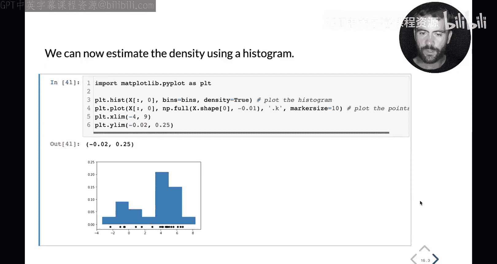

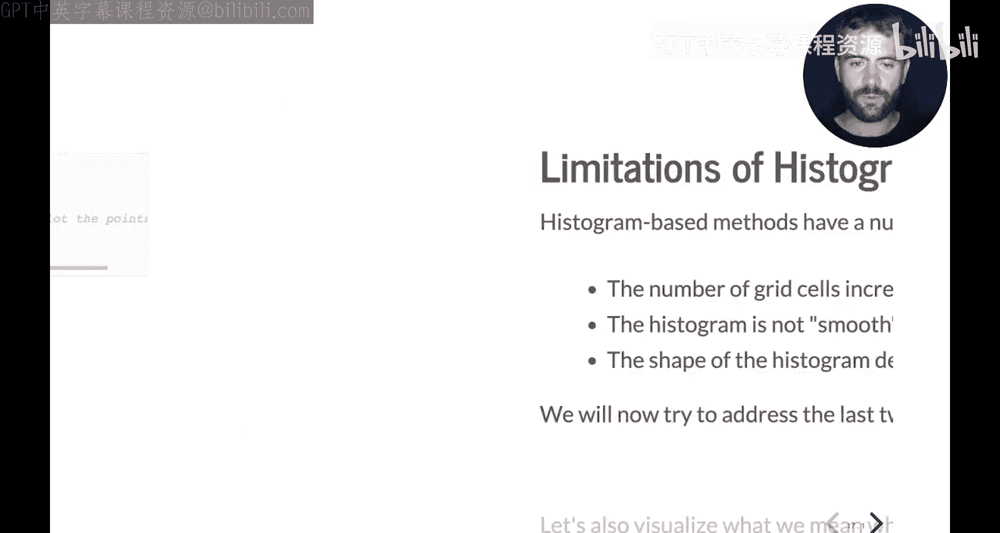

Now， of course， this is the simplest density estimation algorithm that exists and it has several shortcomings。

The main shortcoming and we're going to revisit this later。

 this is actually a fundamental limitation of this family of algorithms is that the number of grid cells increases exponentially with dimension D so if I if I want grids if I want to have cells of。

嗯。leength 1。5 and I have 10 of them that cover one dimension well into dimension it will be 10 by 10 so now we'll have 100 of them three dimension in three dimensions I have a cube so I have to I have to have a thousand of these cells with again whose dimension is 1。

5 along each axis and。In。In in dimension D， I will have 10 to the power D such cells。

 so the number of bins grows exponentially and this is one important limitation of this approach in high dimensions。

And then two other limitations that we can address are one， the histogram is not smooth。

 and also the shape of the histogram depends on the positions of the bins。

And we're going to try to address the last two limitations。

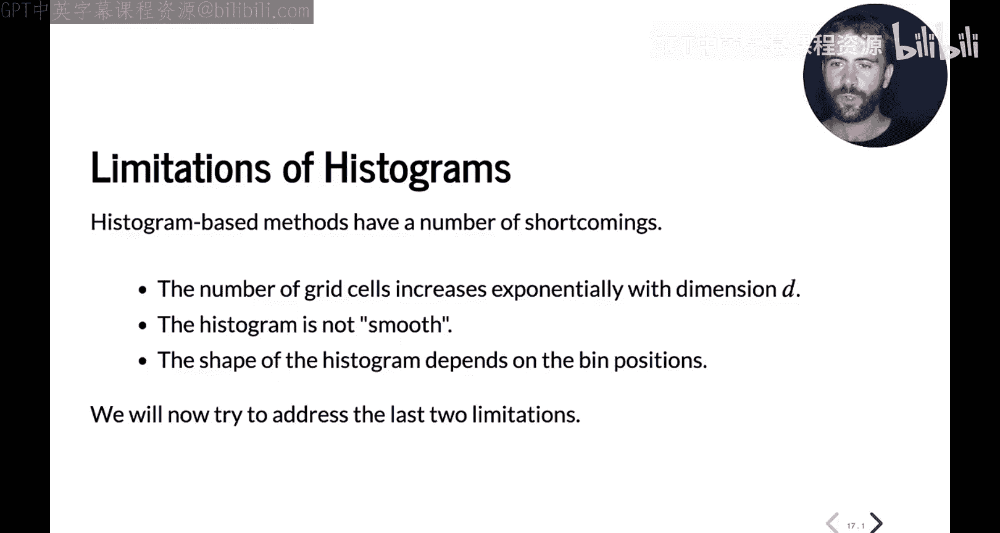

And just to make it a little bit more concrete， let me visualize what I mean by。嗯。

The shape of the histogram depends on the locations of the histogram bins。

 so here imagine if I just took these bins and I shifted each of them by 0。75 to the right。

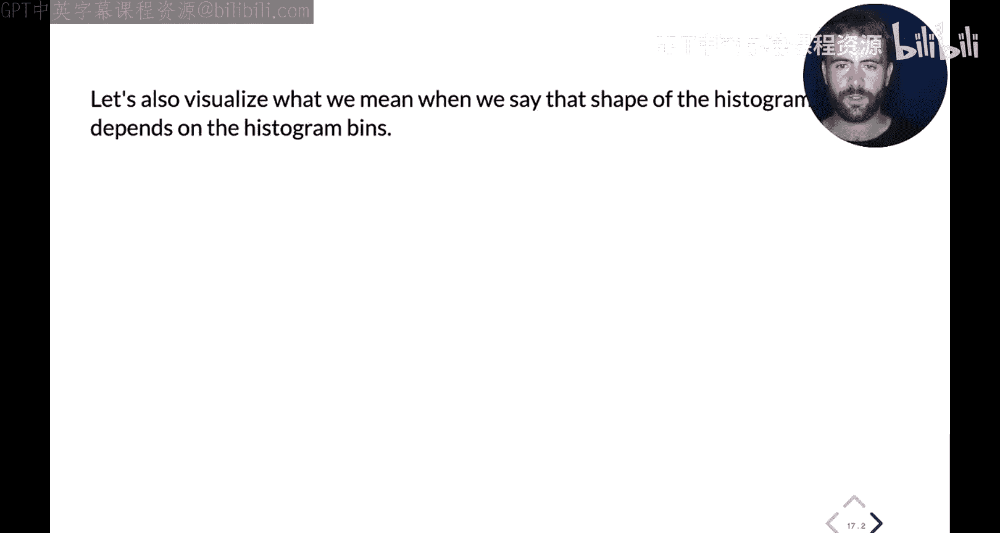

So here this bin is centered at about minus3 and now I'll just move it and the bin will be centered at。

I guess 2。25， so we'll just move these bins。To。To the side。

or in either direction and so you can see here this bin starts near minus3 and bend a little bit more and now this one starts after at minus2 point something so the bins have been shifted the locations。

 the intervals of the bins have changed and now I have a completely different shape for the histogram so here now I have a bin that only has one point another one has one point one point one point essentially these bins are placed such that here they have exactly the same density and now here theres one bin。

Here， which has almost all of the points。And then I have fewer points here。So the problem is that。

 again， because I have shifted the bin slightly to one side。

 their accountss become very different and the shape the estimation of this histogram changes。

So this is behavior that is not desirable in a good algorithm。

 and there is a simple way of removing this。

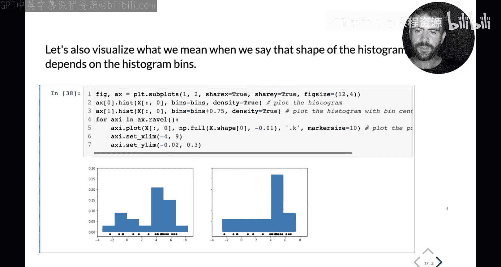

Of removing this bad behavior and it involves an idea called kernel density estimation。

Curural density estimation is the second algorithm for doing density estimation that we're going to see and it's an extension of the histogram bening idea。

When we perform histogram bidding， we choose B bins and they have some fixed width delta and we place them at certain fixed positions so we define a grid and then we count how many points of each grid。

In kernel density estimation， we effectively place a bin at each possible x。

 where x can be any point in our input space。And then to obtain the probability mass at x。

We look at that bin and we count the percentage of points that fall within that bin that's centered at x。

So in other words， if I want to know the density of X。

I count how many points are within a distance of delta within x。

And then I normalize by the total number of points that I have this is this is a very high level。

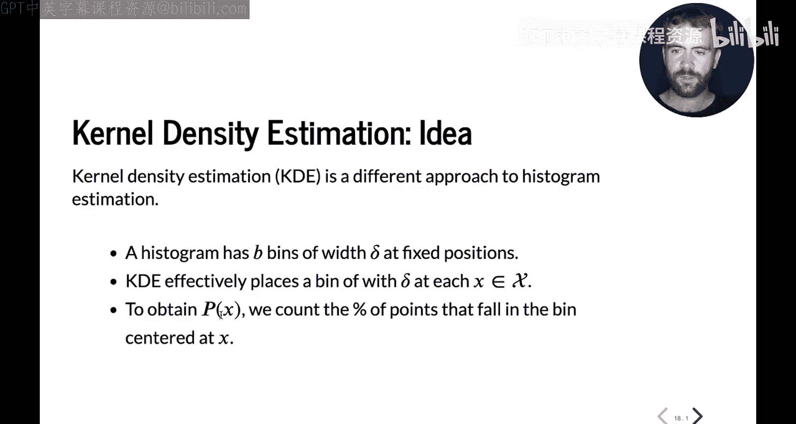

Pea here， let me just define this a little bit more precisely。

 this is one particular way of doing kernel density estimation。

 which is called top hat kernel density estimation。

I will tell you in a moment why it's called top hat， but again。

 the formula is that we define a density P with a parameter of delta which controls the width of the bin。

And the。the probability of that is assigned at a point x is simply that the number of points that are within delta divided by a total number of points。

 so here n of x is simply the number of points in my dataset such that these points are within。

So they're within distance delta over two， which means that the total bin has distance delta。

And as a。As dimension mentioned Delta。The bin has with Dlta and so points it's centered at。X。

 therefore we look at the points that are distances within delta over  two and these points can be。

On either side of x， either on the left or on the right。

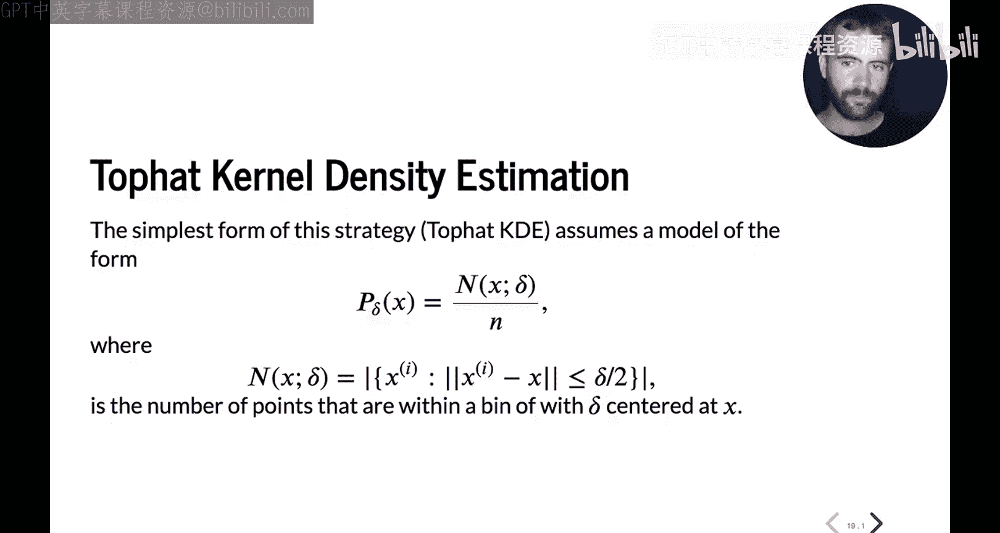

This is simply the definition of the intuition that I just gave earlier。

And we can easily understand this by looking at a picture。

 so here I use a bit of numpy to generate the following histogram。

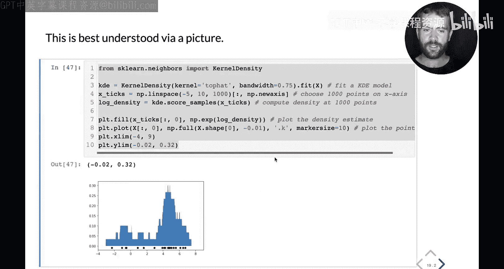

Or it's not a histogram， now it's a kernel density estimate。And you can see here that it is。

That at each point， we count。How many at each possible position on the X axis I count how many points are near it。

 how many data points are near a location in the x on the on the X axis and so if I'm in this area here well then I have two points that are opposed to it and then if I'm a little bit farther out then I only have one point then in this area I have more points and then the。

I guess the most likely point is this one it has or these two points they have。So here my width 0。75。

 so it's actually 0。75 times 2， so 1。5。At this point， within 1。5， well within 0。75 on each side。

 we have the maximum number of points。

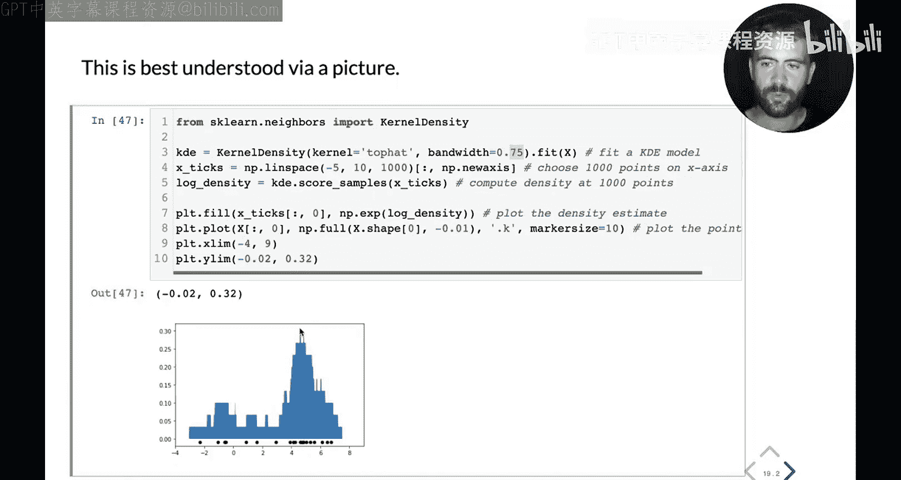

This is a simple illustration of what kernel density estimation does。

 and it produces a histogram that no longer depends on the location of the bins because we don't have new locations of the bins anymore。

 but it still has a problem in that the histogram is not smooth。

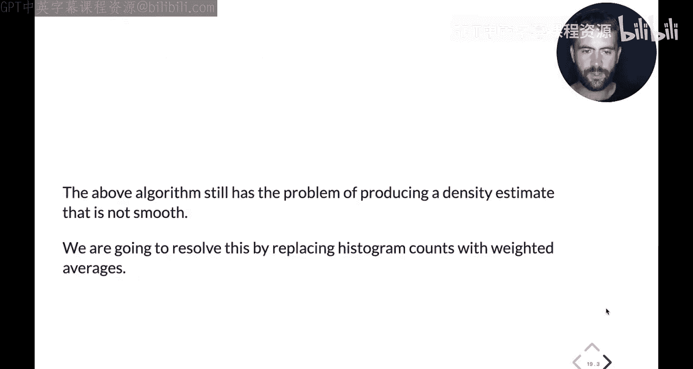

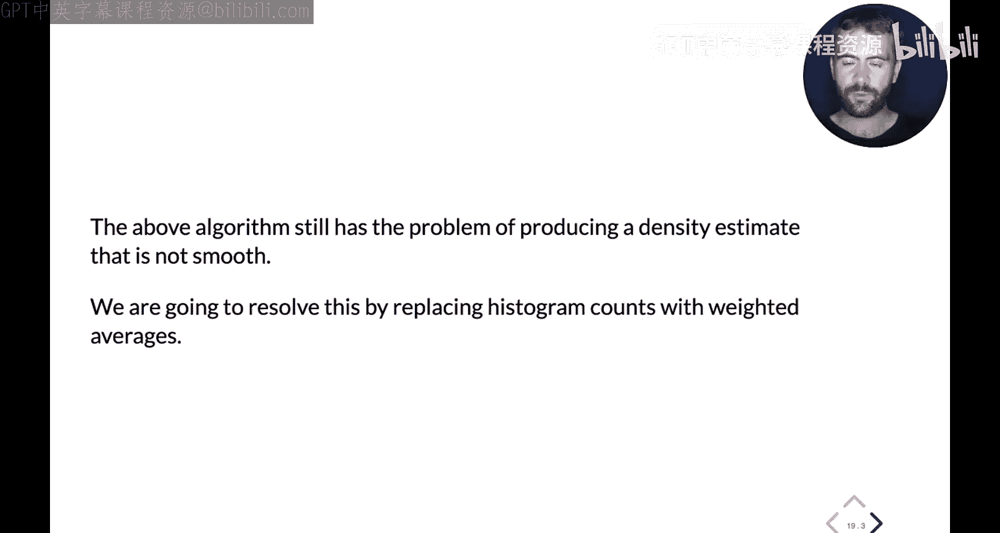

If if I look at this histogram here， we have all these irregularities， shapes。

 it comes from one value to another value in a very non smoothth way。

 so this is another limitation of this technique that we can resolve by introducing another idea that we have seen earlier。

 which is that of a kernel。

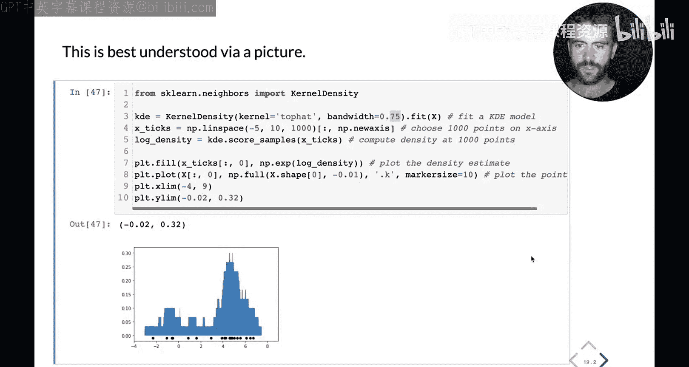

And this is what will give the method， its name kernel density estimation。

So recall that we define a kernel function as a function k that takes two vectors x and Z。

 and it maps them to a real value score。And this kernel function can be seen as computing a similarity between x and Z。

So typically， we would define a kernel function such that its value is。

Is large when X and Z are similar and low when X and Z are dissimilar。

 and we have seen many examples of such functions。In principle。

 a kernel function can be anything can be any function， but in practice。

We can construct them by computing dot products in features of high dimension。

 and even if we don't know what these features are。

 we have seen that there is a result called Mercer's theorem。

 which tells us that for many kernels which are positive semidefinite。

 we have defined this in our earlier video when we talked about kernels， for many types of kernels。

 we can show that these features do exist。And kernels actually correspond to mapping in high dimensional feature spaces。

 but this latter interpretation of feature spaces is not really important。

 we're going to use kernels in their first definition。

Which is a measure of the degree of similarity between x and Z。

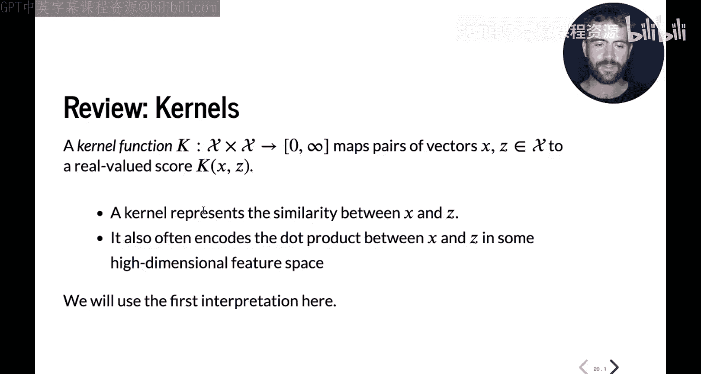

And we're going to use them as follows。Instead of having our probability be simply the count of points in a given region。

We will instead in look at a weighted average of all the points。Or in other words。

 we are going to sum over all the points， but each point will have。

Each point will have a weight that is given by its similarity to the query point x。

And so for Xs which are far away from the query point。

 this kernel function K will be small it will maybe equals0 and for points that are close toxii and this value will be large and so in that sense we can think of this formula here as being as being await weighted average instead of a simple count of points that are within a bin instead we're doing a weighted average of all the points in the data and we weigh them by their importance by the way this notation here this is called proportional to so the probability is proportional to this quantity up to a normalization constant so these kernels may not they this。

Because this is a probability， this value can integrate to。Well， sorry。

 this is a density and these kernels can also this sum can be multiplied by any constant without changing this property as long as the density is proportional to this value。

 we are good and we can make it normalized to one if we take the integral and divide by this value or we can choose kernels such that this value would hold。

嗯。And so again， this formula here can be interpreted in two different ways。

 the first way that I mentioned is that we count how many points are near x。

 but each point has this weight， which depends on the similarity between the two points。

Or we can also think of it as placinging a mini density function k， so again。

 k is large when these two are similar and so in a way this is。

A form of micro densitysity function at。Point。At point Xi。

 and then the final density is going to be there sum。

 I will explain in a second what I mean by this second interpretation。

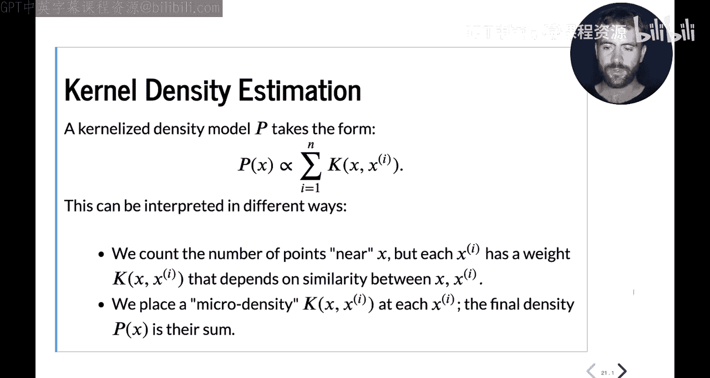

And let me first。Tell you about what a kernel might be in this context。

When we talked about support vector machines， we saw several different types of kernels and several of them will be applicable to kernel density estimation as well。

 but there are others that are also useful that we haven't seen before。

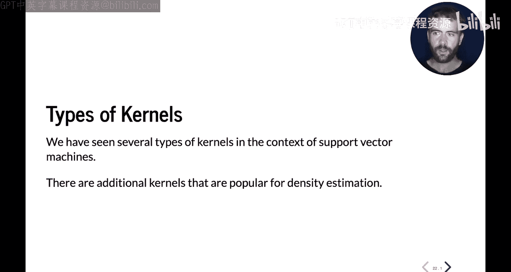

Here I'm going to give you a few examples of kernels that are。

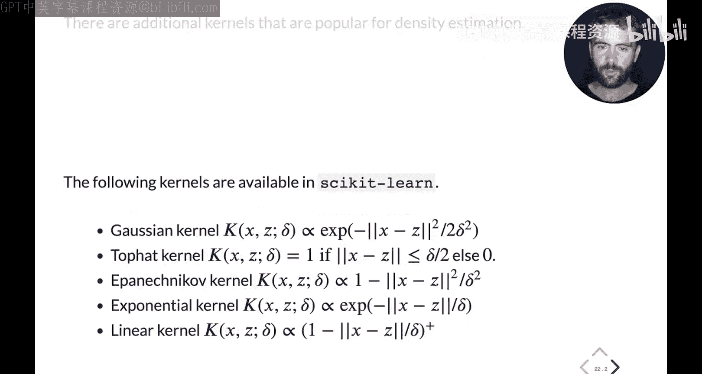

More suitable for density estimation。And here I'm giving a few formulas， but on the next slide， oh。

 and by the way， these are kernels that are available in the psyched Laent Library。

And they're just generally used in practical density estimation applications。

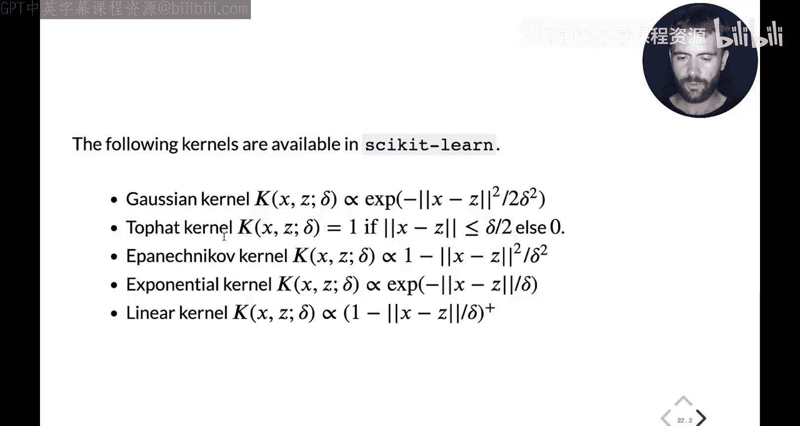

You have seen the formula， but these are best understood by a via a figure。

 so this is just code that draws all these kernels。

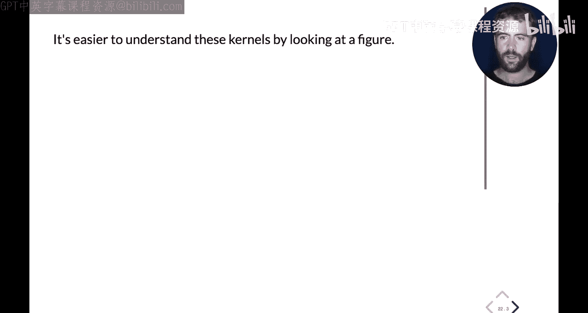

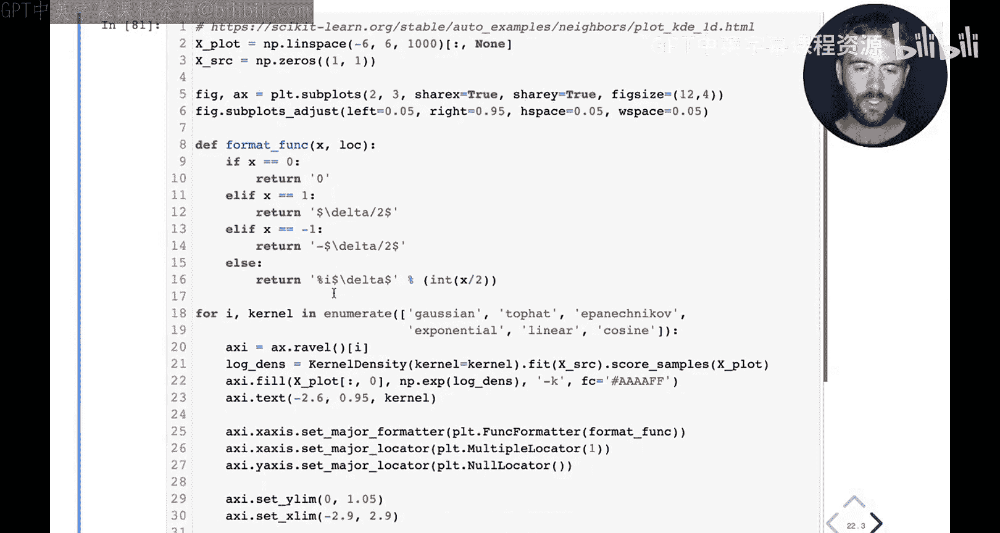

And essentially， these are their shapes。So here these curls are a function of the distance between the two points。

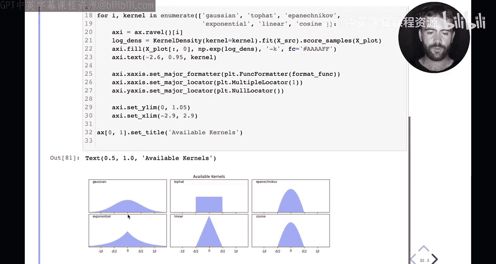

So if we have x and Z， we compute their norm， and then if their norm is zero。

 then the Gaussian kernel here gives them the highest value and then for x and z for which the distance is non-zero we decrease this to something that's larger。

 but we don't need to use this Gaussian curve we can use a linear term。

 so it decays to zero linearly and then it stays in zero or we can have this other form and the one that we have seen before is the top hat kernel and when we talked about top hat density estimation。

 this can be seen as density estimation with this particular choice of kernel。

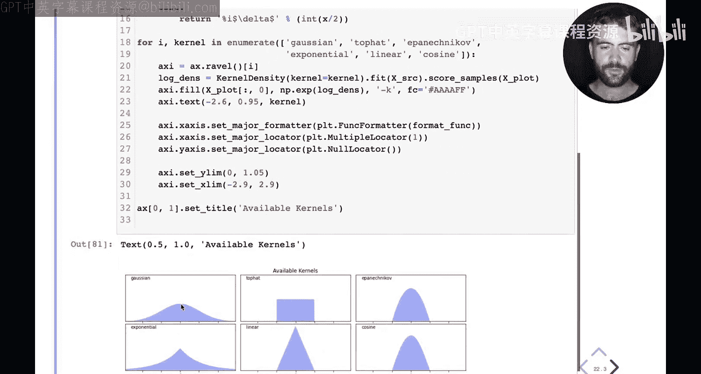

Essentially if two points x and Z are within a fixed distance of each other。

 we count them as one and if their distance is greater than this threshold。

 which is again a tuable parameter， if they're greater。

 then it's zero and so by using a top hat kernel in the formula that I gave earlier。

 we are essentially at each query point， we're simply counting how many data set points are near the query point。

But if we， and so we disregard everything that's greater than a certain distance from the queryier point。

 but if we use something like a Gaussian kernel， then we may still assign points that are assign weight to points that are farther away from the kernel。

 but this weight is going to be really small。

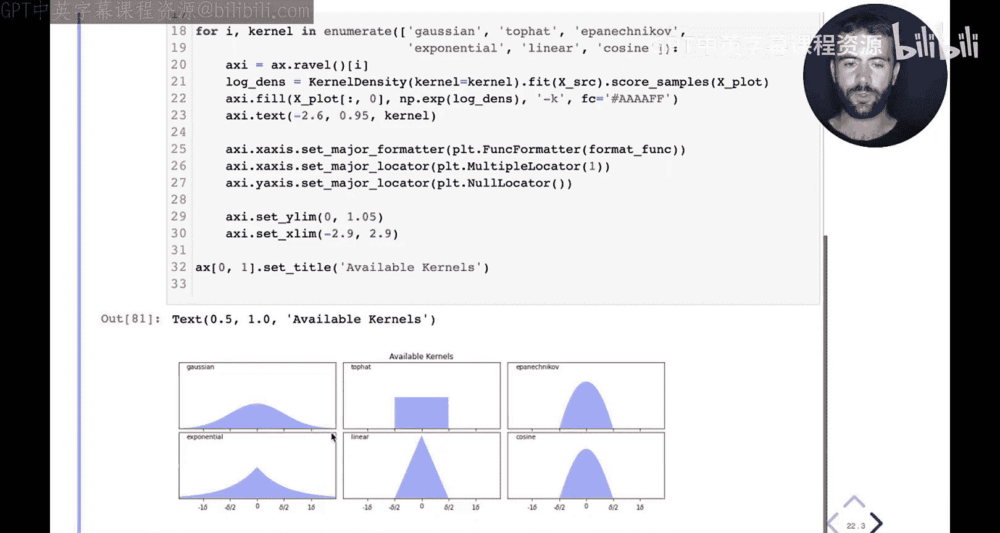

Let's now look at a simple example of kernel density estimation。In the context of。

Of our data set of one dimensional points， again， we will fit a model of the following form where each kernel here is Gausian with a parameter delta。

Which controls the width of the bell curve。

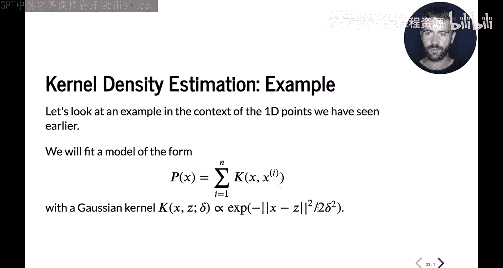

So here I'm just using the kernel density estimation glass in psychic learnne。

I feed in a Gaussian kernel with a bandwidth 0。75 and I fit it to the data and then from this kernel density estimate I can get an estimate of the log density and then I can pull up this density here。

So the blue line is the estimate of the density that we get from Gaussian kernel density estimation。

And now you can see that this is a smooth two dimensional。

A smooth one dimension will occur with two peaks， each peak corresponds to a Gaussian。

 so we recover this。True structure that's in our data that consisted of two Gaussians。

 there was one peak here， there was one peak here， and we have successfully recovered this。

And furthermore， our histogram， no sorry， our density is。Fulfully smooth。

 it doesn't have these jagged shapes that are earlier example head and in that sense this is a good estimate because it we expect the actual probability to be smooth and it is indeed we know that it is smooth because we have defined it and here this shape matches our smoothness。

Our smoothness shape。And then these little dashed red curves。These are the kernels at each point。

So here I have taken kernelel here at this location on the X axis， this location on the X axis。

And then this is simply the value of。Of the of the colon at this location。

So I have fixed one of the inputs that kernel function to be a point on the x axis that's centered here。

 and you see in dash red the value of the kernel as I vary the other parameter and so if it's different from the center of the kernel。

 then this kernel becomes smaller。And it achieves its highest point when we're bigger and the entire and so it itself has this be bell shape curve。

And the blue curve。Is proportional to the sum of all of these mini red Gaussians。And so effectively。

 I obtain the blue curve by placing this small red Gaussian at each of these black dots and then I sun them and I normalize and this is how we get this particular。

Blue shaped estimate。This blue smooth estimate is simply the sum of all of these red curves that are centered at the dots。

 which is my data set， and so in that sense， you can also think of the blue density as being a sum of these small red microdensities that are each centered at a point。

And of course， this is for the Gaussian kernel， but the same intuition would apply if we use the top hat kernel。

 and you would see the results that we had in our earlier figure。

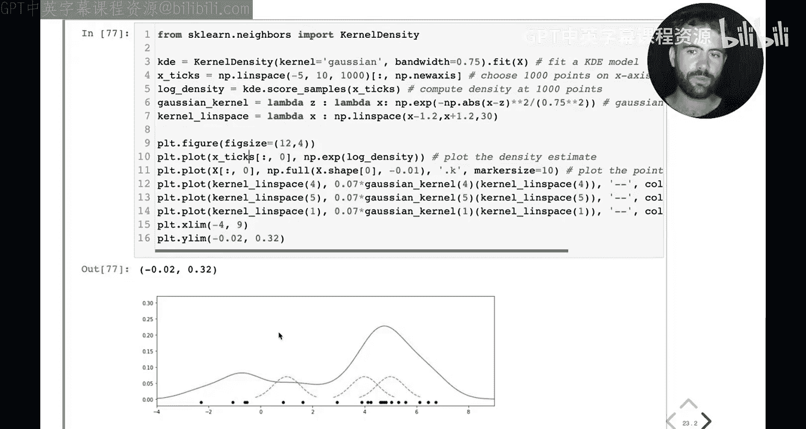

So in principle， kernel density the estimation also works in higher dimension。

 but as I mentioned earlier， our grid has the size of this grid increases exponentially。

 so if I want to have a bandwidth delta in one dimension。

 if I want to keep the same bandwidth in higher dimensions， my grid size will increase exponentially。

 unless I increase delta but if delta is fixed then。嗯。My number if I have if I have B。

Cells in one dimension， then it will have B to the D cells in multiple dimensions。

And in order to fill all these cells with data， so for example， if in one dimension。

 each cell had an average。If we had 10 cells and each on average had one data point。

Now in two dimensions， I have1 hundreds I。In one dimension I had 10 cells into dimension I have 100 cells now I need 100 data points such that one cell has one point on average and if I have1000 cells now I need 1000 data points to keep the same density and so because of that kernel density dimension requires significantly more data in higher dimensions and this limits the applications of this approach in higher dimensions but it is still in principle doable and well it is still used in dimensions of reasonable size and in lower dimensions。

 this is an important。

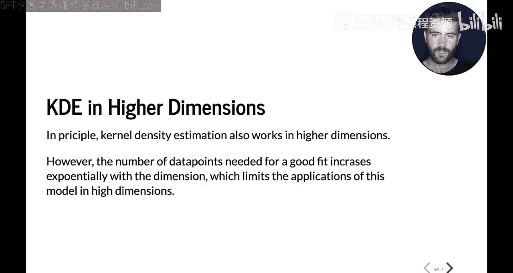

tool set that you should be it's an important tool that you should have in your tool set。Also。

 all of the methods that I defined earlier had this notion of bandwidth delta。

 it's either the shape of the Gaussian kernel or it's the width of the top head kernel which counts how many points are near our query point x。

 and this is a hyperparameter that can control the smoothness of the fit。Here。

 as in many other algorithms that we have seen， we have the question of how do we choose this hyperparameter？

And we have several options。One way is to perform the kind of heuristics that we discussed when we were talking about how to choose K for K means。

 we can use the elbow method or we can visualize the results and we can just choose an estimate that has a reasonable shape that looks good。

嗯。But also because this model that we're working with is probabilistic。

We can also use a different approach that I will talk about in the next lecture which involves estimating likelihood on a holdout data set and since since we have an objective that we can use to score the fit of our model。

 which is the log likelihood， we're going to be able to。

Estimate performance on training and holdout data in a way that's similar to what we did in supervised learning。

 but I will come back to this later for now I just want to mention that there exists these two approaches and the heuristics that we have seen for K means they are also applicable here。

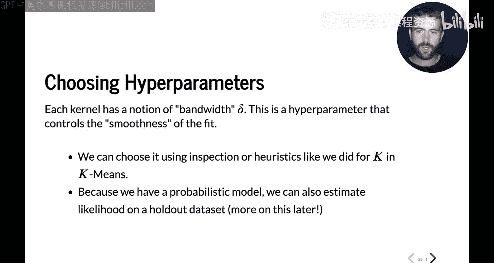

Just to give you a better sense of what it means to choose hyperparameter delta let me give you an example here on the left。

 I have said the bandwidth to be3， so the width of the Gaussian is3 and this just gives me a very smooth curve but I have lost all the structure that I had。

 I no longer have I have lost the structure in the data。

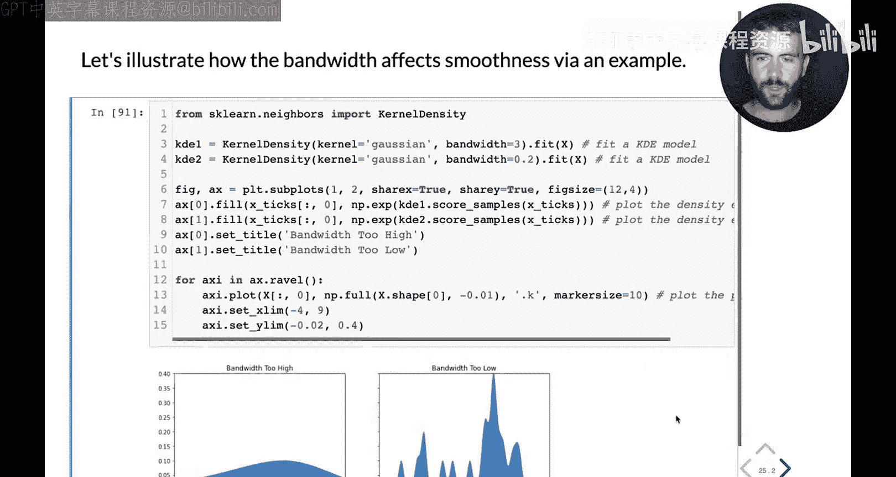

That showed that I had two components， so here this is an example of losing the signal that is important。

And here on the right， I have a small band with 0。2 and now I have all these peaks。

But I have at this point i'm fitting noise because the true distribution is actually much more smooth than this。

 so here distribution becomes highly non smooth and at this point we're fitting noise and so this will be an example of。

I would call this overfitting and on the left I would call this underfitting。

And these are two failures。When we don't choose the right bandwidth， and again， in practice。

 we can choose the right bandwidth by either heuristics or by inspecting these visually or by using an approach based on likelihood that I will talk about later。

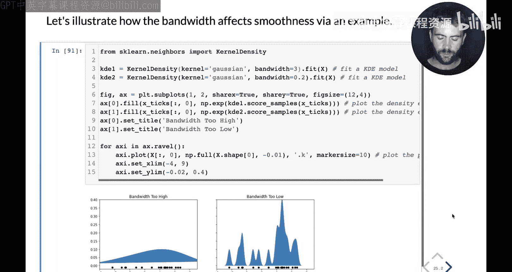

So just to summarize， we have defined an algorithm called kernel density estimation。

 it's an algorithm for unsupervised learning， it solves the density estimation problem。

 and its model family is nonparmetric。As you said earlier。

 the probability is a sum over kernels over n data points and so the number of。

Colonnals increases as we increase n。So in that sense。

 our computational requirements increase as we increase our data set size。

 which makes the model line parametric。And and then we。IChoose it to so we。

We don't really fit the model itself， but we can use the log likelihood to choose the bandwidth。

 which is a hyperparmeter of the model， and we can choose this bandwidth using grid search。

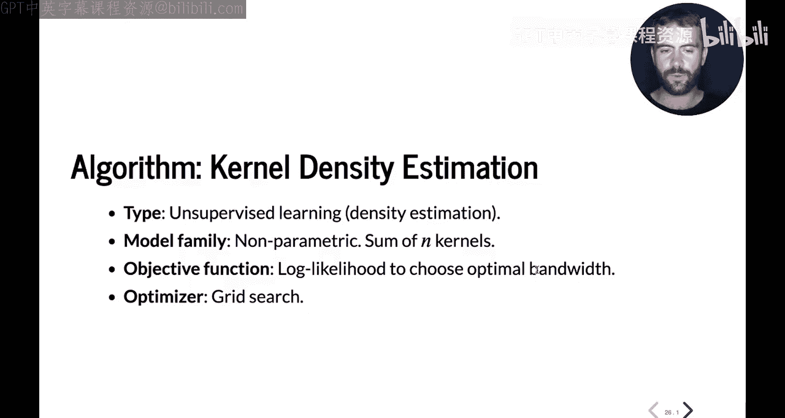

And the main advantages of current density estimation is that it can principle fit the data is distribution arbitrarily well。

 it is a non parametric model so it can fit the data distribution equally。

Arbitrarily well given it enough data， but it is computationally expensive to work with anparametric method that stores the entire data set and also the number of data needed to scale these。

Nopometric algorithms scales exponentially， which is something we call the curse of dimensionality。

 and I alluded to this earlier。So in the next few lectures and videos。

 we are going to see some more sophisticated models for density estimation that will be parametric and that will address many of the limitations that are on this slide。

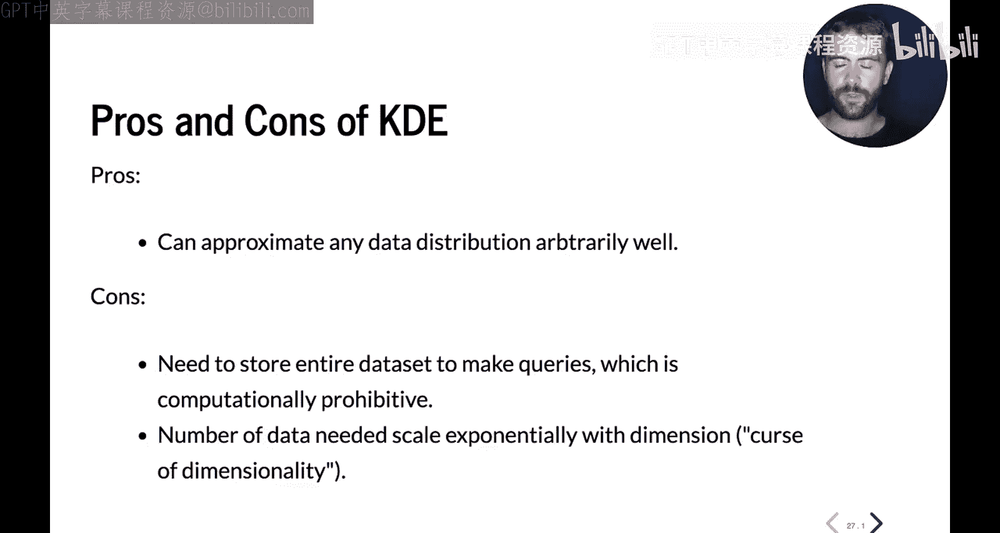