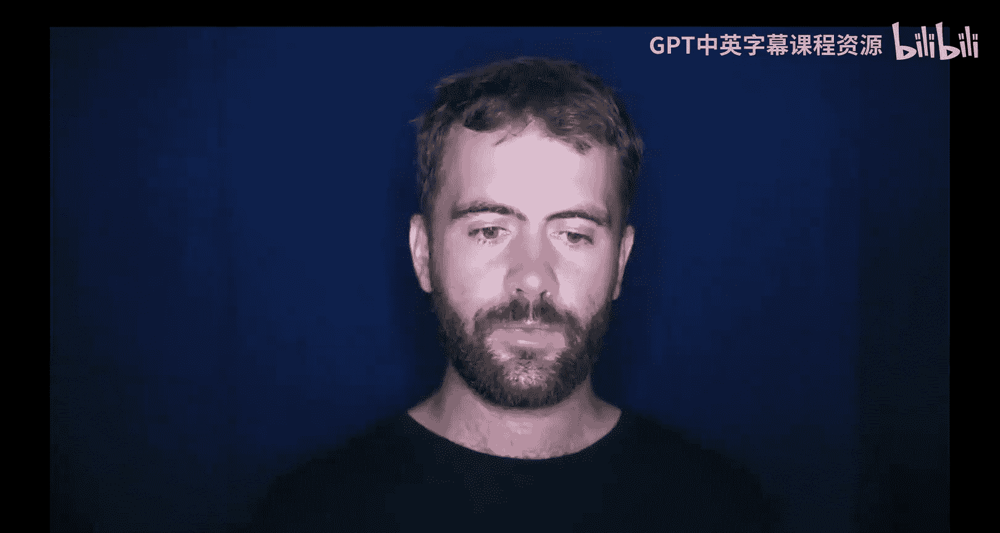
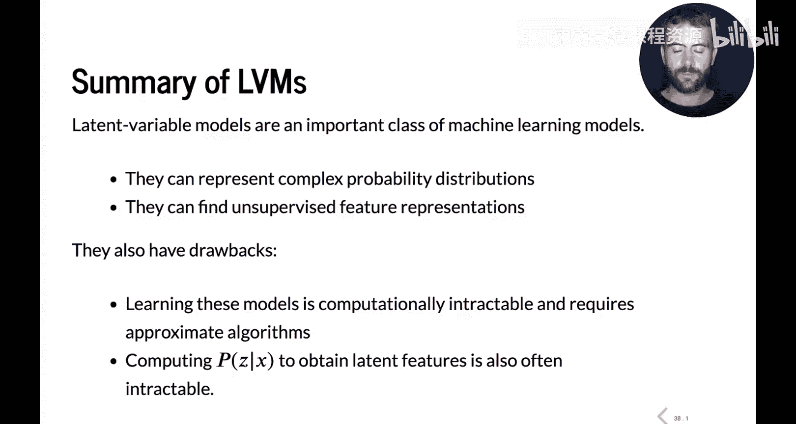

# 康奈尔大学《应用机器学习 CS 5787_ Applied Machine Learning 2020》中英字幕（deepseek p63 -63-Lecture 17. Part 3_ Latent Variable Models.zh_en -BV12udzYvEFM_p63-

This is part three of lectures 17 of applieded Ma learning。

In this video， I am going to talk about latent variable models。

Laightnt variable models are a special kind of probabilistic models that is going to be very important for defining the algorithms that we're going to see in the next few videos。

The kinds of data distributions that we're going to see are going to be often complex。

 they will have a lot of structures， for example they will have complicated cluster structure and in order to be able to fit these complex distributions we need a more expressive and a more structured。

 a more complex type of probabilistic model and latent variable models are going to be one way in which we can make our probabilistic models more expressive and more useful and give them additional functionality。

So let's see what these models are。We call that a regular probabilistic model is simply a probability distribution over the space of x's。

 and it may have parameters that we denote by theta。In order to fit these models。

 we use the principle of maximum likelihood in which we fit the following objective。

 which is the low likelihood of the data， so and this data here is a data set of IAD samples from a data distribution。

Now the motivation for defining latent variable models comes from the kinds of data sets that we often want to model。

Consider the following unsupervised data set of human faces。

These faces have a lot of interesting structure， we have male faces and female faces。

 we have different faces， we have different。Pooseses， we have different hair color， eye color。

There's a lot of variation in this data set。But it is not annotated。

 we don't have a label for whether each person is a man or is a woman。

 and they're not explicitly available， they are in a sense unobserved。

 they're unobserved or latent variables。And the idea of a latent variable model is to introduce these unobserved factor of variation as additional variables z that。

that exist but are simply not provided to us at training time。

 so at training time we have variables X， but we also assume that our model has some unknown Z that we want to model。

So more formally， a latent variable model is a probability distribution over two kinds of variables。

 x and Z。And it assigns a probability to each joint assignment of X and Z。And the x here are。

 these are the same data points that we have worked with so far， these are the high dimensional。

 well， these are the multidimensional objects that we are trying to model。

And Z are interesting aspects of structure， which are not in a draining set。

But that that are useful and that we're going to try to learn from data again。

 you can think of Z here as being an indicator of whether a person is a man or a woman or。

The color of their hair if we were to do supervised learning then this Z here might be a why and we might be learning a model that would predict whether a person is a man or a woman based on their photo and the annotation the given label but in this case we don't have a label and we're going to try to learn it from from purely unsupervised data or we will not be able to learn the label exactly but we're going to be able to perhaps differentiate between different kinds of individual in our data set depending on whether they' male or female and in order to be able to encode this structure that we're going to learn whether someone is male or female。

 we're going to introduce a variable for it and it's available that we will model but will not be part of our training dataset set。

And so a model of this form also defines a probability over the x's because we can apply the offt total probability to get rid of the Z。

 and now we have this following model and we can also use this to approximate the data distribution。

An example of what a latent variable model might be is the in the context of our image example is the following。

 so here there is some image X which is observed here this we see x but the latent variable is Z we don't see them。

 but by looking at the data we may。We may try to build a model that will discover that actually the space of images has the following structure。

 we have gender， we have pose， and we have ethnicity which affects the eye collar and the hair color。

 and we will try to learn this kind of structure in an unsupervised way from data。

And one reason why we want to have these zs， these Z variables is that it will make it easier to learn certain parts of the model。

 for example， if we know Z if we know the gender and the ethnicity and the eye color and the pose。

 then the space of images that have this this vector Z is much simpler than the space of all the images。

 and so this conditional probability distribution x given Z can be easier and simpler to learn than a distribution x that does not have any variables and does not have any structure and that has to model all the possible image faces only from data。

And also if we have these Z variables， then we can try to predict them from given an x。

 so if we have learned an x， we could look at the probability of Z given x to try to see what is the best latent representation for x and we can then use it for clustering or we can use it to just learn interesting structure about our data。

We can do this by inspecting what these variables that are。

So the simplest model that is a mixture that is a latent variable model can be it is a mixture of Gausians。

So in a mixture of Gaussians， we have a probability distribution that factorizes over a number of components。

Here we have three Gaussians that are given by these。Buts colored。Ellipses。And in general。

 the structure of a Gaussian distribution is that we have a categorical variable Z and Z is given by the probability of Z is given by categorical distribution。

 meaning that Z can take some number of discrete values in this example it's three。

And each possible value of Z has a probability phi k of reaching that value。

And then condition on a particular class， the distribution of excess is a multivariated Gaussian that is given by this particular form。

So these two terms define a mixture of models， and we can formally define the joint as follows here and just。

Using the law of total probability to here I'm just using basic definitions probability to expand this the definition of P of theta and here I am。

I insert the definition that I have for。The probability of Z and the probability of X given Z。

 and I have the following。Definition for the joint distribution of X and Z。Now。

 mixtures of Gausian are already an interesting latent variable model。

And they're interesting because they can fit more complex distribution than a single gaussian。

For example， if we have data of this form which contains two clusters。

 then the best thing we can do with a single Gaussian is something like this。

 which is clearly inadequate。But if we fit a distribution that is a mixture of Gausians。

It can approximate the data much better by placing a cluster。

 by placing a Gaussian component over this cluster and placing another one over this cluster。

 and so this is an example of how a late in the variable model by having，Ricer structure。It can fit。

More complicated data sets better this is one important advantage the of latent variable models and one that I mentioned at the very beginning is motivation for why we're looking at them。

We can also。Or here， a different example of why latent variable models are interesting is that we can also。

Given a trained model， you can also look at the posterior probability of Z given x to find useful representations。

For example， in many modern deep learning models that perform unsupervised learning。

 we can use this they do parameterize a probilistic model and we can compute this posterior to obtain a latent representation over an input X which can be something like an image and and then these Z have interesting structure in the data。

 and for example we can use them to perform arithmetic over images as we did in this example that I showed in the first lecture on unsupervised learning here we can compute a vector for a smiling woman。

 a vector for a neutral woman， we can compute the posterior Z for a neutral man and then if we perform this arithmetic。

 we can transform these images and we can find a representation for a smiling man so we can find Z for smiling a man and we can。

Compute then we can look at probability of x given the Z equal smiling manum can generate images that looks like this so this is another example of why latent variable models are useful they provide these Z which encode useful structure and again these zs are learned in a purely unsupervised way in this example。

嗯。Also。Instead of performing arithmetic over these zs， we can also just visualize them。

 we can plot them into dimensions and then we can hope to recover structure which looks like this one where we have this is over a data set of digits and here it clusters the different digits into different groups into different。

Areas of this two dimensional space。And we discovered these clusters that have actual useful meaning。

 again， I went through this example in our first lecture of unsupervised learning。

And this is the kind of result that a Ha latent variable model can provide us。

So latent variable models are interesting and they're powerful， but they also have limitations。

The main limitation is that they are difficult to learn。

We can apply the principle of maximum likelihood to learn these models so they do define a probability over x and we can take this probability。

 but of course because x is a latent variable model then this term here is actually is actually a sum over all this Z so here I'm just using definition of probability to write explicitly this term and now we have a formula for this expression but it involves a more complicated form for our objective this is still our global likelihood so it makes perfect sense to maximize this objective we will be minimizing the KL diversions between our latent variable model and our data distribution however this。

Term in order to compute it or in order to compute its gradients。

 it requires performing this sum over all possible Z。And this can be computationally intractable。

 for example， even if we have only a3 dimensional variable Z with where each dimension is either a zero or a1。

This sum here involves a sum over。This sum involves 2 to the 30。

 which is about 1 billion possible values and so for every time we need to optimize this at each step of creating the sand。

 for example， we would have to recompute the sum which should be very expensive and also these variables that can be continuous and we may have to deal with an intractable integral of this form。

And so in practice， optimizing this objective is going to be intractable in most applications。

But we can also solve it， we can often optimize it approximately。

So even though we cannot compute its gradients directly。

 there are many approximate solutions or many heuristics。

 we have seen one heuristic for k means where we solve a particular optimization problem。

 it is actually connected to maximizing the slope likelihood。

In a way that we will talk about in the next lecture。

 but it is a heuristic method and more generally most algorithms for。

Filling these kinds of variable models are they involve approximate solutions。So in summary。

When we work with probabilistic models， we can often introduce latent variables inside of them。

And these latent variables， they make the probabilistic model more expressive。

 and also they allow it to learn not just the density， not just the distribution over the data。

 but they also allow it to learn interesting structure。The Z， once the model is learned。

 the Z can often have interesting meaning。And therefore。

 they correspond to useful and supervised representations of the data。And for example。

 they can be used to solve clustering problems， they can be used to perform operations over the data。

 such as the example with the arithmetic over latent representations of images。

 but they also have limitations， these models are more complex and for example they require approximation algorithms to learn effectively and they also and even computing this posterior。

 this can also be this is also often typically intractable and requires approximation algorithms。

We're going to see in the next few lectures。Several examples of probabilistic models。

 which are latent variable models and we going to show you we're going to see how we can solve these problems and how we can learn these models。

 how we can perform inference， and how we can use them to solve interesting。

Problems in supervised learning。

