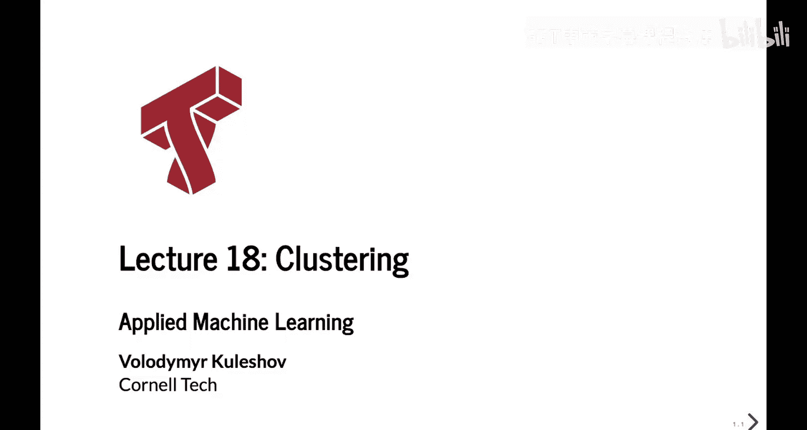
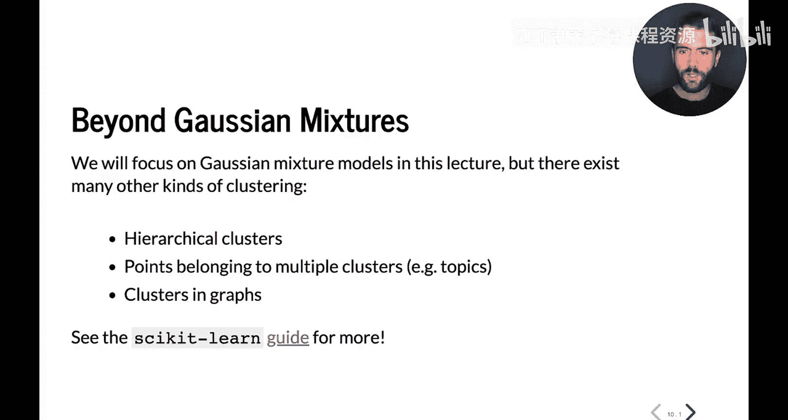

# 康奈尔大学《应用机器学习 CS 5787_ Applied Machine Learning 2020》中英字幕（deepseek p64 -64-Lecture 18. Part 1_ Gaussian Mixture Models.zh_en -BV12udzYvEFM_p64-

Hi and welcome to Lecture 18 of Appli Mach learninging in which we are going to continue our discussion of unsupervised learning。

And in this lecture， we will look at a new type of unsupervised learning problem called clustering。

We talked about clustering at the very beginning in our first lecture of unsupervised learning。

 and now we are going to look at it in more detail and we are going to define a new algorithm。

In the first part of this lecture， I would like to define clustering again。

 I would like to remind ourselves about the K means algorithm。

And then I'm going to define a new approach to clustering based on the Gaussian mixture model that we have seen earlier。

Before we begin， recall that we are in the setting of unsupervised learning in which we have data that does not contain any label。

 we have a data set of this form which only contains vectors of attributes but not labels。

 and these are all IDD samples from a data distribution。

Clustering is a problem in which we want to identify interesting structure in our data and in the data distribution。

 and in particular we want to identify components in the data。

Each component or each cluster can be thought of as a subset of the x's as the subset of the data or of the vectors of attributes。

And this subset has the property that data points within a cluster are more similar to each other than to points outside the cluster。

It's a more precise way of defining our intuition that we had earlier that a cluster is a group of points that appear closer together。

 that are clustered together in feature space and that are distinct from neighboring points。

And often clusters are defined using their centers， but also we may define their shape in other ways。

 we can define their dimension。 we can define。we can define the orientation of the cluster。

 but ultimately a cluster is defined by the set of points that belong to it and that are distinct from all the other clusters。

 all the other points。The first algorithm that we have seen for clustering was Ke means。

And recall that K meanss as a simple algorithm that tries to find K hidden clusters in the data。

 which are each characterized by their centroid or their mean。

It finds these clusters by performing an iterative procedure。

 which minimizes the following objective function。The subjective function is simply the sum of the distances between each point to its closest cluster。

 to the centroid， or the average， the mean the center of its closest cluster。

And this captures our intuition that points within a cluster should be more similar to each other。

 or they should be similar to their。To their center， to their average。

 and there should be more similar to it than to the other points or to the other cluster centroids。

This captures our intuition and we optimize this objective function using an iterative procedure which you see here in this picture and also this picture provides a visual explanation of what clustering is if we look at this data if we didn't see the colors which are the clusters that are found by K means。

 we can see that there's a group of points here which are closer to each other than to other points。

 so this appears to be one cluster there's another set of points here。

 and then there's a bigger set of points in the middle that has this property。

And the colors here represent the clusters that are identified K means after a number of iterations from the optimization algorithm。

The K means algorithm starts with a random guess of what the clusters are。

 and at each iteration it updates these guesses， it updates the centers。

 and these are the points here， that's the cross here and the circle here， these are the centroids。

 and it updates them periodically by performing an alternating minimization procedure where it alternates between assigning points to the nearest centroid and recomputing the centroid as the average of all of its points。

We saw this procedure in our earlier lecture。So this and the ultimate result of clustering is an assignment of points to clusters which are given here by the different colors。

So K means is an important and useful algorithm， but it also has its limitation。

One important limitation， and this is something that affects many clustering algorithm is that it can get stuck in local minima。

What I mean by that is。When we start K means from different initial points。

 it can converge to a different solution and some of these solutions are better and sometimes significantly better than others。

And the reason that it does that is that the objective function that we're optimizing is difficult to optimize。

 It's not a simple， linear or quadratic function。 It's a difficult function。

 We call this a non convex function， which means that it has many local optimma and these local optima can vary in their in their。

Quality and our。Heuristic for optimizing the objective is not guaranteed to reach the global optimum it can stop at any local optima。

 and therefore in practice it's important to restart Kmins multiple times before choosing a final solution。

This is a problem that's common with many clustering algorithm， not all， but many。

And other problems more specific to K means are its inability to measure clustering in a reliable way。

 we saw this again in our earlier lecture， if we can always increase the number of clusters and this looks like a better fit。

 but at some point we start fitting noise instead of fitting the actual data and this can be interpreted as a form of overfitting。

And also our cluster assignment is binary in the sense that a point either belongs or does not belong to a cluster。

 it's a hard assignment， and this assignment doesn't estimate confidence because each point could have a probability of belonging to the cluster and these confidences can be useful in downstream applications。

In order to address these limitations， I am going to define a new algorithm。

 a new clustering algorithm， which is going to be based on an approach called Gaussian mixture models。

A Gaussian mixture model， well， first of all， the Gaussian mixture modeling。

 the Gaussian mixture model clustering algorithm uses a probabilistic model。

 and this probabilistic model is the Gaussian mixture model that we have seen earlier。

Recall that the Gasian mixture model is a latent variable model。

 which is a distribution over two sets of variables， x and Z X are visible variables。

 meaning that we have them in our training set， and Z are hidden variables which we don't see in our training set。

 but we will make them part of the model and then we're going to try to infer them in an unsupervised way。

 we are going to infer their most likely values in an unsupervised way。

And so this joint distribution， which is a lit variable model， decomposes in the following form。

 it decomposes into two components， a prior distribution over Z。

 and a conditional distribution of x given Z。And the Z here is a categorical variable。

 and this denotes the value of the cluster。And it takes values from 1 to k。

 and the distribution of Z is a categorical one and each cluster has a probability of that equals phi k。

X is the visible variable， it is assumed to be continuous and it follows a Gaussian distribution conditioned on z equals k x is sampled from a Gaussian or in other words。

 a normal distribution with mean mu and variance sigma。And so the entirety of the parameters here。

 the theta， this is simply the union of all the muse。

 sigmas and phis that define this probability distribution。

So this defines our Gaussian mixture model and now we can see how we can use this for clustering。

In the context of clustering， as I said earlier， the here are the assignments to Z here tells us gives us an index of the cluster to which x belongs。

 but it is a latent variable， and we are going to infer it in a supervised way。

And which is going to require fitting this model to data。But then once we have fit this model。

 once we have a probability distribution over x and Z。

We're going to be able to ask the model for the most likely Z given in X。嗯。But this model。

 it postulates a particular distribution， which is a mixture of Gaussians and that is very suitable for clustering this model assumes that the data that we have comes from k clusters whose proportions the proportion of xs that come from each clusters are specified by phi1 phi2 up to phi k and then the points within each cluster are distributed with a normal distribution。

And to generate a new data point under this model， we would sample a cluster with according to these probabilities。

 and then we would sample a point from the Gaussian that corresponds to that cluster。

So this defines this model assumes that the data is comprised of a number of clusters。

 and then if the data is actually having that structure， then we can。

Fite a good model and can infer what the clusters are。If we were to look at this as a picture here。

 we have three clusters of different colors and they have the following configuration and we are going to try to fit a model of this form to our data。

This is an example of what happens if we fit mixtures of Gaussians to a dataset of this form here we clearly have two distinct clusters in this data set。

 if we were to fit a single Gaussian， this would clearly not be adequate。

 but we have if our model is a mixture of Gaussians， then it would learn to represent this data。

 it would learn that these are the distributions of the two Gaussians that generated this data。

 and now given a point from either of these two distributions。

 given any point in this string set effectively， we can determine which of the two Gaussians it comes from using a probabilistic query。

In particular， the formula that we would use in order to recover the index of the best cluster from the model。

 it would be this expression here this is something that is called the posterior probability。

 it's the probability of the unobserved cluster Z taking the value K given a point x。

 and we can compute this probability by simply applying base rule。

Here we first simply apply the definition of conditional probability， and then in the numerator。

 we expand it using the normal structure of our model。

And we use the loftable probability to do something similar here at the bottom。

 and this gives us a posterior probability， which is a probabilistic value for it's literally the probability that x came from the cluster with index k。

Because these values are probabilistic， they immediately address one of the limitations that I mentioned about K means。

 They provide us a soft assignment of X to clusters。 each point has an affinity to every cluster。

 and some of them are more likely than others。 So in other words， our probabilistic model here。

 provides us with a notion of confidence， which is something that is often useful in practice。Now。

 in order to learn Gaussian mixture models， we can apply the principle of likelihood。

 maximum likelihood， in in particular the principle of maximum marginal log likelihood。

 which we have seen in our video on latent variable models。

And we can optimize this this objective to learn the model。

And this will minimize the difference between our model distribution and the data distribution using the derivation that we made earlier for the likelihood。

And essentially we are still optimizing the probability of the data under our model。

 but now because we have latent variables， we have to perform this summation to compute the actual value this probability of x in order to compute it。

 we need to sum over all the zs and in a sense here we're summing over all the possible zs that can explain our data。

And it is also interesting to compare this to。One of the earlier algorithms we have seen in the section of the course on supervised learning。

 which was Gaussian discrimin analysis。In Gaussian instrument analysis。

 we fit exactly the same model， but the cluster assignments were observed。 These were our labels。

 So we assumed that data came from a mixture of Gausians and。Our labeled specified。

 we basically assume there was a Gaussian for each class and the label specified which Gaussian the point came from。

And we would optimize a similar objective， except that we wouldn't need to do this sum because。

The Z variable， which was thened by Y in that example it was specified。

 but here because it is not specified， we have to sum over all the possible possibilities that it can take。

And another observation is that because we have this summation now。

 unlike in the supervised learning case， we no longer have a simple closed form solution for the maximum theta。

 for the maximum that of this objective。It this problem will be much more complicated to optimize。

 and it will require specialized algorithms， which I'm going to introduce in the next few videos。

And also， I want to point out that this optimization procedure。

 it is not only hard to sometimes compute this subjective function。

 but the structure of this objective is more difficult， In fact。

 this marginal log likelihood objective will be necessarily hard to optimize。 it will be non convex。

 which again means that it will have multiple opttima and some of them will be better than others。

Consider this example which shows the mixture of three Gaussians。Each Gaussian is simple。

 it's a simple bell curve， and it has a single maximum。

 so here we have a maximum for the green curve， maximum for the yellow curve and for the blue curve。

But now， when we mix them together， we have this much more complex shape for distribution。

This is in a way a good thing because we are using a model that is more expressive。

 that is richer that can fit more complicated shapes than just a bell curve。

But also this model has now multiple optima， there is a maximum of the distribution that is here。

 there is another maximum that is here， and these are local maxima in this neighborhood this appears to be the largest the largest value and so for example if we try to optimize this using gradient descent if we start in this vicinity。

 gradient descent could converge here and stop and if we in this vicinity it could converge here and also stop so this is an example of how a mixture of Gausians can lead to a function with multiple optimma and it will be hard to optimize this function in general。

So we will talk about a practical algorithm for solving the optimization problem next。

 but before we go there， I just want to point out that there are also many other types of clustering that exist。

 we will not be able to cover all of them in this course。

 but I just want to mention to you that these are also interesting algorithms that are useful to know about one type of clustering that is interesting is called hierarchical clustering where clusters have structure and a hierarchy attached to them。

We can also have clusters。 We can also have points that belong to multiple clusters。

 This is often useful in areas like topic modeling。

 if we are modeling news article or tweets and they could be about a different set of topics。

 and there's a different set of words that characterizes each topic。 This is often described using。

Using multiple topics which have multiple assignments。

 and there is also a lot of work on clustering in graphs。

 If we have a graph that describes connections between entities， we may want to find components。

 subcompents of the graph which are more connected than within within within a component than overall to the rest of the graph。

 and this is another interesting type of clustering that exists。

If you are more interested in if you're interested to learn more about these kinds of algorithms。

 I encourage you to look at the psyic learn documentation which implements many of these other algorithms and often find you may also find them useful for some of the applied problems that you're working on。

