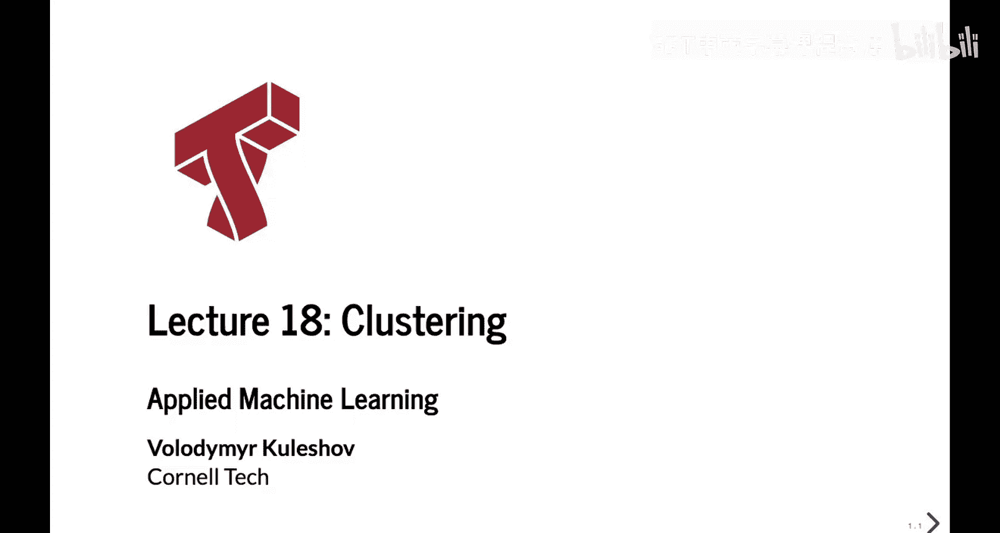
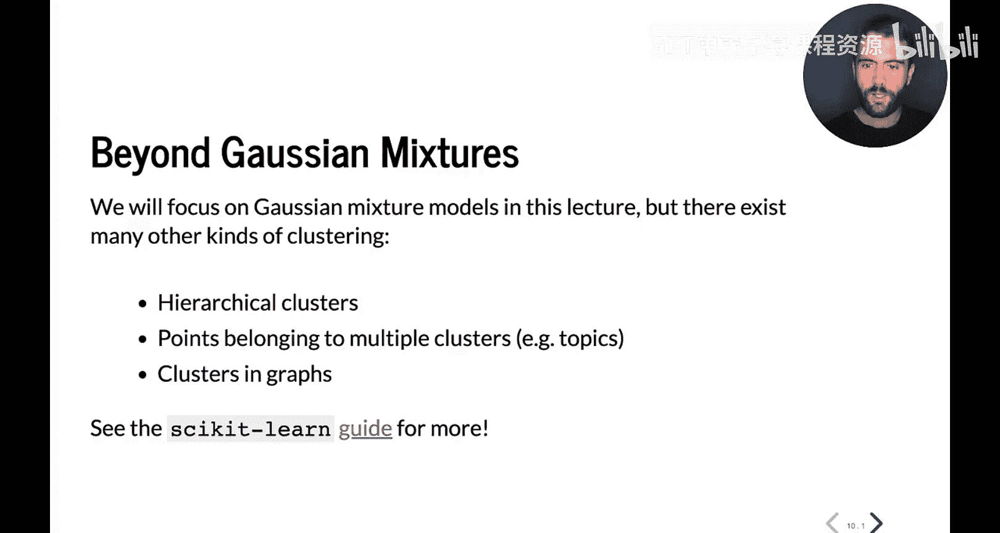

# 应用机器学习：第18讲：第一部分：高斯混合模型 🎯

在本节课中，我们将继续讨论无监督学习，并深入探讨一种称为“聚类”的新问题类型。我们将重新定义聚类，回顾K均值算法，并引入一种基于高斯混合模型的新聚类方法。

---

## 概述 📋

在无监督学习场景中，我们拥有一个仅包含属性向量、不包含标签的数据集。这些数据是从某个数据分布中独立同分布采样得到的。聚类的目标是识别数据及其分布中的有趣结构，特别是识别数据中的不同“成分”或“簇”。

一个簇可以被视为数据点的一个子集，其特点是：簇内的数据点彼此之间的相似度高于它们与簇外点的相似度。这精确地定义了我们之前的直觉：一个簇是在特征空间中聚集在一起、并与邻近点明显区分开的一组点。

---

## 回顾K均值算法 🔄

上一节我们介绍了聚类的概念，本节中我们来看看第一个具体的算法：K均值。

K均值是一个简单的算法，旨在从数据中发现K个隐藏的簇，每个簇由其质心（均值）来表征。它通过迭代过程来最小化以下目标函数：

**目标函数公式：**
`J = Σ_i ||x_i - μ_{c_i}||^2`

其中，`x_i` 是数据点，`μ_{c_i}` 是点 `x_i` 被分配到的簇的质心。这个函数是所有数据点到其所属簇质心的距离平方和。它捕捉了我们的直觉：簇内的点应该彼此更相似，或者说，更接近其簇的中心。

K均值通过一个交替最小化过程来优化这个目标函数：
1.  **分配步骤**：将每个数据点分配给距离最近的质心。
2.  **更新步骤**：将每个簇的质心重新计算为该簇所有点的平均值。

这个过程反复迭代，直到质心不再发生显著变化。

---

## K均值的局限性 ⚠️

尽管K均值重要且实用，但它也存在一些局限性。

以下是K均值算法面临的主要挑战：
*   **易陷入局部最优**：K均值优化的目标函数是非凸的，存在许多局部最优解。算法从不同的初始点开始，可能收敛到不同的解，其中一些解的质量远低于全局最优解。因此，实践中通常需要多次随机重启算法以选择最佳结果。
*   **难以可靠评估聚类效果**：增加簇的数量（K值）总是可以降低目标函数值（即“拟合得更好”），但这可能导致对噪声的过拟合，而非捕捉数据的真实结构。
*   **硬分配问题**：K均值对点的簇分配是“硬”的，即一个点要么完全属于一个簇，要么完全不属于。这种分配方式无法提供关于点属于某个簇的“置信度”或“概率”。

---

## 引入高斯混合模型 🧮

为了应对上述局限性，我们将定义一种新的聚类算法，它基于一种称为**高斯混合模型**的概率模型。

高斯混合模型是一种**隐变量模型**，它定义了可见变量 `x` 和隐变量 `z` 的联合分布。在聚类上下文中：
*   `x` 是我们在数据集中能观察到的属性向量。
*   `z` 是一个**分类变量**，表示点 `x` 所属的簇的索引（取值从1到K），但它是隐藏的、不可观测的。

该模型的联合分布分解为两部分：
**模型公式：**
`p(x, z; θ) = p(z; φ) * p(x | z; μ, Σ)`
其中：
*   `p(z=k; φ) = φ_k` 是簇 `k` 的**先验概率**。
*   `p(x | z=k; μ, Σ) = N(x; μ_k, Σ_k)` 是给定簇 `k` 后，`x` 的**条件概率分布**，这里假设为一个均值为 `μ_k`、协方差矩阵为 `Σ_k` 的**高斯（正态）分布**。

模型参数 `θ` 是所有 `φ_k`、`μ_k` 和 `Σ_k` 的集合。该模型假设数据由K个高斯分布混合生成，每个分布对应一个簇。

---

## 高斯混合模型用于聚类 🎲

现在，我们来看看如何利用这个模型进行聚类。一旦我们根据数据拟合好了高斯混合模型，就可以通过计算**后验概率**来推断任何数据点 `x` 最可能属于哪个簇。

**后验概率公式：**
`p(z=k | x; θ) = [p(z=k; φ) * p(x | z=k; μ, Σ)] / [Σ_{j=1}^K p(z=j; φ) * p(x | z=j; μ, Σ)]`

这个公式给出了点 `x` 来自簇 `k` 的概率。与K均值的“硬分配”不同，这提供了一种**软分配**，每个点对每个簇都有一个隶属概率。这直接解决了K均值无法提供置信度信息的问题。

---

## 模型学习与挑战 🧠

为了从数据中学习高斯混合模型的参数 `θ`，我们采用**最大边际似然**原则。

**学习目标函数（边际对数似然）：**
`L(θ) = Σ_i log p(x_i; θ) = Σ_i log [Σ_{k=1}^K p(z_i=k; φ) * p(x_i | z_i=k; μ, Σ)]`

我们需要最大化这个函数。与我们在监督学习中学到的高斯判别分析（GDA）相比，GDA中类别标签 `y`（相当于这里的 `z`）是已知的，因此优化更简单。而在无监督的GMM中，由于 `z` 未知，目标函数中需要对所有可能的 `z` 值求和，这使得优化问题变得复杂，没有简单的闭式解。

更重要的是，这个边际对数似然函数通常是**非凸的**，存在多个局部最优解。想象将多个单峰的高斯分布混合，得到的混合分布可能具有多个峰值（局部极大值）。使用梯度下降等算法时，从不同起点开始，可能收敛到不同的局部最优解。

---

## 其他聚类算法简介 🌐

除了K均值和高斯混合模型，还有许多其他类型的聚类算法值得了解。虽然本课程无法涵盖所有，但以下是一些有趣的类型：

以下是几种其他重要的聚类范式：
*   **层次聚类**：簇具有层次结构，可以自底向上（聚合式）或自顶向下（分裂式）构建树状图。
*   **软聚类/重叠聚类**：允许数据点同时属于多个簇，这在如主题建模等领域非常有用（例如，一篇文档可能涉及多个主题）。
*   **图聚类**：在图形数据中，寻找内部连接紧密、与外部连接相对稀疏的子图（社区发现）。

如果你对这些算法感兴趣，可以查阅如 `scikit-learn` 等库的文档，其中实现了许多此类算法，可能对你解决实际应用问题有所帮助。

---

## 总结 📝

本节课中，我们一起学习了：
1.  重新审视了聚类的核心目标：在无标签数据中发现内在的组别结构。
2.  回顾了K均值算法的原理及其交替优化过程。
3.  分析了K均值的主要局限性：局部最优、评估困难、硬分配。
4.  引入了基于概率框架的**高斯混合模型**，它通过假设数据由多个高斯分布混合生成来建模簇。
5.  解释了如何用GMM进行**软分配**，即计算数据点属于各簇的后验概率。
6.  讨论了GMM参数学习的挑战，即最大化非凸的边际对数似然函数。
7.  简要介绍了层次聚类、重叠聚类和图聚类等其他聚类范式。

在接下来的部分，我们将深入探讨用于优化高斯混合模型参数的具体实用算法——期望最大化算法。