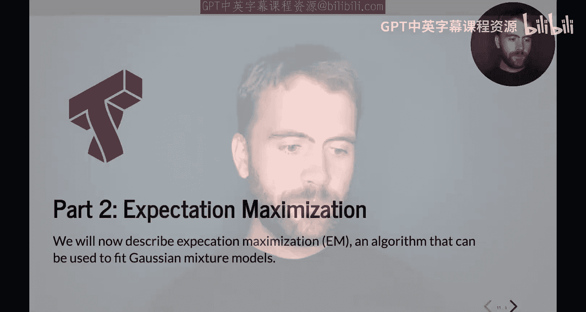
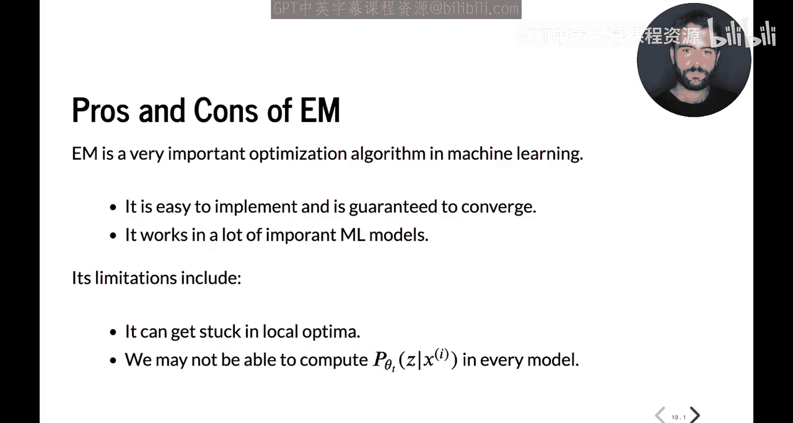

# 康奈尔大学《应用机器学习 CS 5787_ Applied Machine Learning 2020》中英字幕（deepseek p65 -65-Lecture 18. Part 2_ Expectation Maximization.zh_en -BV12udzYvEFM_p65-

Welcome to part  two of Lecture 18 of Applied Ma learninging。

In part two， we are going to now look at how we can optimize Gaussian mixture models。

 which is the new model for clustering that we defined in the previous video。And in order to do that。

 we are going to introduce a new optimization algorithm that is called expectation maximization。

Recall that we are in the unsupervised learning regime and we are optimizing model over a data set of attributes which do not have any labels attached to them。

And one approach that we defined for this particular model is the is an approach based on Gasian mixture models。

 a gassian mixture model is a probability distribution of this form。

 it's a latent variable distribution in which we have a set of。Variable Z。

 which are not part in the data， but which we're going to infer in an unsupervised way and the Z provide an index for a cluster for which a point has been generated and then x provides a model for the distribution of points that come from each cluster cluster 1 cluster2 up to cluster K This defines a joint probabilistic model and we can fit this model to data in order to find the best configuration of clusters。

 the most likely configuration of clusters that has generated our data。Now。

 learning Gaussian mixture models is hard。We have have if we follow the principle of maximum likelihood。

 we want to optimize the log probability of the data， but in order to compute the lock probability。

 we have to compute the following sum over all the Z。

And this objective here no longer has a closed form solution like it did when we use the same model for supervised learning Now in this example we have to sum over all the possible values of Z instead of having one value being specified。

 we have to sum over all the values and this makes this problem significantly more challenging。

So the expectation maximization algorithm is a general approach that we can use to fit many kinds of latent variable models。

 and in particular it will be applicable to Gaussian mixture models。

And it's an algorithm that we can use to maximize marginal log likelihood。

 which has the following form， so here we are maximizing the marginal log likelihood over a data set of points which are of the X which are observed。

 but for each point we have to compute the following sun。

 and we want to optimize this objective function。So consider this objective。

 which we are trying to optimize。And observe that if we knew the true Z。

 if instead of summing over all of them， if we knew the best cluster for this x。

 and let's call this value Z I。Then we would not have to do this entire summation。

 we could just plug it in and we would have an objective of this form。And this is a very。

Nice objective because now every variable is defined and this reduces to the supervised learning setting that we have seen earlier in the earlier lectures。

 this now becomes the same problem that we would solve using that we would solve in the Gaussian discriminant analysis algorithm and we have seen closeform solutions for this problem。

Again， this is in the context of Gaussian mixtures。

 but even if our model P is not a Gaussian mixture。

 there are typically simple algorithms for learning the parameters of a probabilistic model in which every variable is observed。

So given that we have a guess for the Z。We have this joint probability， everything is observed。

 and we can compute theta。The next observation is that if we know theta。

 well we can also compute cluster assignments by looking at this probability。

 so the probability of Z given x， it gives us a guess for what the cluster assignments might be。

And so the idea of。Expectation of maximization is to repeatedly alternate these two steps。

Given initial an initial guess for the parameters， an initial guess for for the。

For the means of each cluster， we compute the cluster assignments。

Which is going to be this guess here， this Z。And then we optimize for the best set of parameters in the model。

And then given a set of parameters， we compute the next cluster assignment and we keep alternating these。

This looks very similar to the algorithms we have used to fit K meanss。

 this step here would correspond to well， the first step would correspond to assigning。

Clus to computing the cluster centroids， and the second step would assign each point to is cluster centroid it is very similar in spirit although it is not exactly the same。

 the mechanics of it are different and it optimizes a different type of model。

 in fact it can optimize more general kinds of models， but the spirit of it is very similar。

And so again， as I mentioned earlier， expectation maximization is an algorithm which alternates between two steps。

 the E step and the M step。At the E step， given an initial estimate of the weights。

 we compute the probability of the cluster assignments and we use it to quote unquote。

 hallucinate expected cluster assignments which are deed by Z。And now。

 given that we have hallucinated these clusters assignments。

 we find a e theta by optimizing the marginal likelihood given the Z that we have obtained。

And then we repeatedly perform this process and it is guaranteed to eventually converge。

 and it's also guaranteed to increase the maximum it is guaranteed to increase the marginal likelihood of the data at each step。

So this is the intuition and let's now define this algorithm a little bit more precisely。

This is the complete full formal definition of this algorithm。It。This algorithm。

 expectation maximization， or EM for short， learns the parameter theta of a latent variable model over an unsupervised data set。

 and it performs the following procedure until convergence。First， in the E step。

 it computes for each data point， the probability of this point belonging to each cluster。

 so the probability of Z given x。And then at the next step， it performs maximization。

 meaning that given this assignment， it computes the new weights as the solution to the following optimization problem。

And this problem is really similar to， well here the probabil is fully observed。

And maybe the only interesting part here is the expectation。

 so if we only had a single best guess for Z， then we can just optimize for the sum of these lock probabilities。

 but because our estimates of Z are not，We don't have a single estimate of Z。

 number we have a probability over the cluster of Z。

We compute the expected value of this lock probability over all the zs that it can see。

So this is the M step and it produces an estimate of the parameters。

 which is an improvement over the previous set of parameters。

 and again here the previous set of parameters， theta s T is fixed here from the previous step。

 this produces a probability over cluster assignments。

 and then we compute the log probability where both assignments and we maximize the probability we maximize the expected log probability of the data and cluster assignments where the cluster assignments。

 we take their expected value。So again， I just want to reemphasize that in the ET。

 when we intuitively， I said that in the east E step we hallucinate cluster assignments。

 but given that we have a probabilistic model， we have soft assignments and so there's not really a single assignment that we should be hallucinating。

 we should be looking at all the probabilities that are given to us by our model。

And so this probability of Z given x defines a set of soft assignments。

 it defines a number for each cluster， which is the probability of x of the probability that x belongs to that given cluster。

And now given that we have vector probabilities in the M step。

 we want to maximize the expected log likelihood of the data and the cluster assignments where the expectation is taken with respect to our best guess for what the assignments are and which is given by this probability from the E step。

Just to make it clear what this objective is， I have rewritten it here。

 I have just rewritten the expectation as the sum of these k clusters and for each data point we are maximizing again the expected probability of the data given that the cluster is k so in other words I have this visible point X and I all I look at the probability of x coming from every possible cluster and I。

Weigh these probabilities by my current guess that that it does actually belong to that cluster。 And。

 of course， this achieves a high value if x。If the probability that x comes from its cluster is consistent with our guess from the E step。

 and at that point we will have converged。Now， just to summarize the pros and cons of expectation maximization。

 it is a very important and a very。Well knownn algorithm in machine learning that is used to optimize latent variable models。

 It is relatively easy to implement， and it is also guaranteed to converge， which is really good。

 and it also works in a lot of machine learning models。However。

 its limitations are that it does not work in every model。

 and in particular we need to be able to compute the posterior probability effectively。

 and it's not true that we can compute it in every model， but we can compute it in many models。

And it can also get stuck in local opttia。W is a shortcoming of both the K means algorithm and this algorithm as well。

And in fact， there exist algorithms for expectation maximization which do not suffer from the local optimum problem。

 but these are a considerably more sophisticated algorithm。

 and in practice actually EM is easy to implement and works quite well and often EM is the algorithm that is used in practice。

So in the next video， we're going to look at how we can apply EM specifically to Gaussian mixture models。

