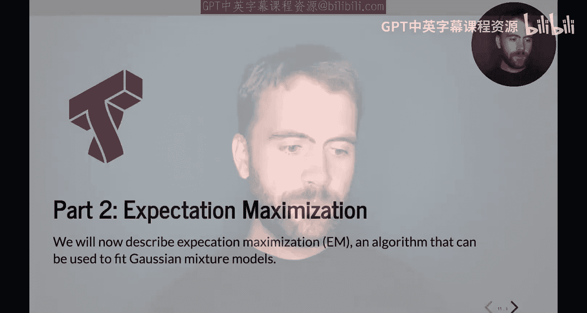
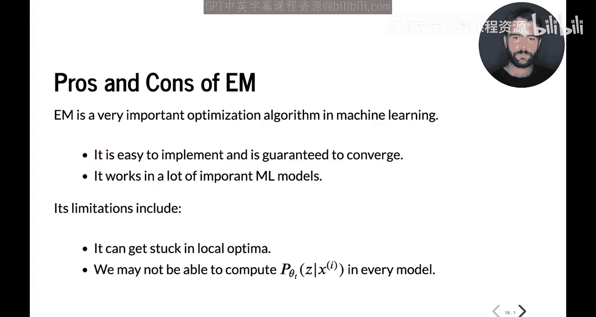

# 应用机器学习：第18讲：期望最大化算法（第二部分）🎯



在本节课中，我们将学习如何优化高斯混合模型，这是在上一节中定义的一种新的聚类模型。为此，我们将引入一种名为“期望最大化”的新优化算法。

## 概述

上一节我们介绍了高斯混合模型。本节中，我们来看看如何通过期望最大化算法来拟合这个模型。期望最大化是一种用于优化包含潜在变量模型的通用方法，尤其适用于高斯混合模型。

## 高斯混合模型回顾

我们处于无监督学习场景中，正在优化一个仅包含属性、没有标签的数据集上的模型。我们为这个特定模型定义的一种方法是基于高斯混合模型。

高斯混合模型是如下形式的概率分布：
```
P(X, Z) = P(Z) * P(X|Z)
```
它是一个潜在变量分布，其中我们有一组变量 **Z**，这些变量不在数据中，但我们将以无监督的方式推断它们。**Z** 为生成数据点的簇提供了一个索引，而 **X** 则为来自每个簇（簇1、簇2……簇K）的点的分布提供了一个模型。

这定义了一个联合概率模型。我们可以将这个模型拟合到数据中，以找到最可能的簇配置，即生成我们数据的最可能的簇配置。

## 学习高斯混合模型的挑战

学习高斯混合模型是困难的。如果我们遵循最大似然原则，我们希望优化数据的对数概率。但为了计算对数概率，我们必须计算对所有 **Z** 的以下求和：
```
log P(X) = log Σ_Z P(X, Z)
```
这个目标不再像我们在监督学习中使用相同模型时那样有封闭形式的解。在这个例子中，我们必须对所有可能的 **Z** 值求和，而不是只有一个指定的值。这使得问题显著更具挑战性。

## 期望最大化算法简介

期望最大化算法是一种通用方法，可用于拟合多种潜在变量模型，尤其适用于高斯混合模型。它是一种可用于最大化边际对数似然的算法，其形式如下：
```
max_θ Σ_i log Σ_Z P(X_i, Z_i; θ)
```
这里，我们最大化一个数据集的边际对数似然，其中 **X** 是观测到的，但对于每个点，我们必须计算上述求和，并且我们希望优化这个目标函数。

考虑我们试图优化的这个目标。观察发现，如果我们知道真实的 **Z**，即如果我们知道这个 **X** 的最佳簇（我们称之为 **Z_i**），那么我们就不需要进行整个求和，我们可以直接代入，从而得到一个形式如下的目标：
```
max_θ Σ_i log P(X_i, Z_i; θ)
```
这是一个非常好的目标，因为现在每个变量都已定义，这简化为我们在早期课程中见过的监督学习设置。现在，这变成了与我们在高斯判别分析算法中解决的问题相同的问题，并且我们已经知道这个问题的封闭形式解。

同样，这是在高斯混合模型的背景下，但即使我们的模型 **P** 不是高斯混合模型，通常也有简单的算法来学习每个变量都被观测到的概率模型的参数。

因此，给定我们对 **Z** 的猜测，我们就有了这个联合概率，所有变量都被观测到，我们可以计算参数 **θ**。下一个观察是，如果我们知道 **θ**，我们也可以通过查看这个概率来计算簇分配：
```
P(Z|X)
```
它为我们提供了簇分配可能是什么的猜测。

## 算法核心思想

期望最大化的思想是重复交替这两个步骤。给定参数的初始猜测（例如每个簇均值的初始猜测），我们计算簇分配（即这里的猜测 **Z**）。然后，我们优化模型中的最佳参数集。接着，给定一组参数，我们计算下一个簇分配，并持续交替进行。

这看起来与我们用于拟合K均值算法的过程非常相似。这里的第一个步骤对应于计算簇质心，第二个步骤对应于将每个点分配到其簇质心。虽然不完全相同，但其精神非常相似。其机制不同，并且它优化的是不同类型的模型。实际上，它可以优化更一般类型的模型，但其精神是相似的。

## 算法步骤详解

期望最大化算法交替执行两个步骤：E步和M步。

在E步中，给定权重的初始估计，我们计算每个数据点属于每个簇的概率，即 `P(Z|X)`。我们用它来“幻觉”出由 **Z** 定义的期望簇分配。

在M步中，给定我们“幻觉”出的这些簇分配，我们通过优化给定已获得的 **Z** 的边际似然来找到新的参数 **θ**。

然后我们重复执行这个过程。该算法保证最终会收敛，并且保证在每一步都会增加数据的边际似然。

## 算法形式化定义

以下是该算法的完整形式化定义。期望最大化算法（简称EM）在无监督数据集上学习潜在变量模型的参数 **θ**，并执行以下过程直到收敛。

首先，在E步中，它为每个数据点计算该点属于每个簇的概率，即 `P(Z|X)`。

然后，在下一步的M步中，给定这个分配，它通过求解以下优化问题来计算新的权重：
```
θ_{t+1} = argmax_θ Σ_i E_{Z~P(Z|X_i; θ_t)} [log P(X_i, Z_i; θ)]
```
这个问题与监督学习中的问题非常相似，因为这里的概率是完全观测到的。这里唯一有趣的部分是期望。如果我们对 **Z** 只有一个最佳猜测，那么我们可以直接优化这些对数概率的和。但是，因为我们对 **Z** 的估计不是单一的，我们有一个关于 **Z** 簇的概率分布，所以我们计算所有可能 **Z** 下这个对数概率的期望值。

M步产生一个参数估计，这是对前一组参数的改进。这里，前一组参数 **θ_t** 是从上一步固定下来的。E步产生一个关于簇分配的概率分布。然后，我们计算数据和簇分配的联合对数概率，并最大化这个联合对数概率的期望值，其中期望是关于我们从E步得到的、对簇分配的最佳猜测概率分布的。

## 目标函数解析

为了更清楚地说明这个目标是什么，我在这里重写了它。我只是将期望重写为对这些K个簇的求和。对于每个数据点，我们再次最大化数据在给定簇为k的情况下的期望概率。换句话说，我有一个可见点 **X**，我查看 **X** 来自每个可能簇的概率，并用我当前猜测的、它确实属于该簇的概率来加权这些概率。

当然，如果 **X** 来自其簇的概率与我们从E步得到的猜测一致，那么这个值就会很高。在这一点上，我们就已经收敛了。

## 期望最大化的优缺点总结

期望最大化是机器学习中一个非常重要且广为人知的算法，用于优化潜在变量模型。它相对容易实现，并且保证收敛，这非常好。它也在许多机器学习模型中有效。

然而，它的局限性在于它并非在所有模型中都能工作。特别是，我们需要能够有效地计算后验概率，但并非在所有模型中都能计算，尽管在许多模型中是可以的。此外，它可能会陷入局部最优。这是K均值算法和本算法共有的一个缺点。

实际上，存在不遭受局部最优问题困扰的期望最大化算法，但这些算法要复杂得多。在实践中，EM算法易于实现且效果相当好，因此通常是实际使用的算法。

## 总结



本节课中，我们一起学习了期望最大化算法的核心思想、形式化定义及其在高斯混合模型优化中的应用。我们了解到，EM算法通过交替执行E步（计算后验概率）和M步（最大化期望对数似然）来迭代优化模型参数，是一种强大且广泛使用的无监督学习工具。在下一节中，我们将具体探讨如何将EM算法应用于高斯混合模型。