# 康奈尔大学《应用机器学习 CS 5787_ Applied Machine Learning 2020》中英字幕（deepseek p66 -66-Lecture 18. Part 3_ Expectation Maximization in Gaussian Mixture Models. -BV12udzYvEFM_p66-

This is now part3 of Le 18 on clustering。In this video。

 I would like to look at how expectation maximization is applied in the context of Gaussian mixture models and derive this algorithm and walk through how it would be used in the context of a Gaussian mixture model。

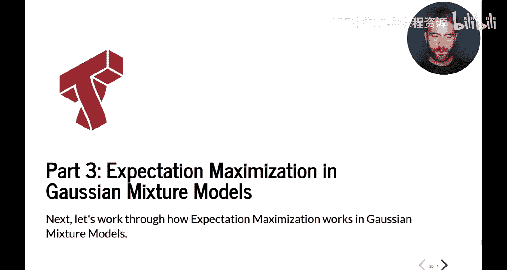

So recall that a mixture model is a probability distribution that has the following form here。

 We have a component。We have a distribution over visible variables X and latent or unobsserved variables Z。

 the Z are a cluster assignment given。A point x， it corresponding z would be the index of the cluster from which x came from and then an x is a point that is generated from one of the k possible clusters and the probability of seeing x given that the cluster is k is given by a Gasian distribution with mean mu and covariance sigma and each of these are index by k because they are different from each cluster。

And the prior probabilities of the cluster this are the Phi。

 and under this model we assume that data is generated by a process where we first choose a cluster index and these probabilities are given by the Phi。

 and then we sample a point from this Gaussian distribution。

And the entirety of the parameters are given by mu， sigma and phi。

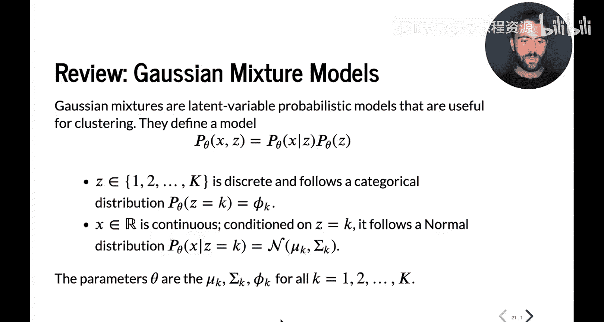

So recall that expectation maximization is an algorithm that can be used to fit any Gaussian。

 any latent variable model。It repeats the following two steps until convergence first in the E step。

 given a current estimate of the parameters， we try to hallucinate the cluster assignments。

We try to create them by looking at our best guess。

 given what the model currently tells us the best guess for the cluster for assignments。

 given what the model currently tells us， given our current guess for theta。And then given these。

 given the。Probabilistic assignments to clusters that are given to us by this post distribution。

 we compute new weights by maximizing the expected log likelihood of the data where the expectation is over the cluster assignments Z and the probability is with respect to the current best guess of the parameters。

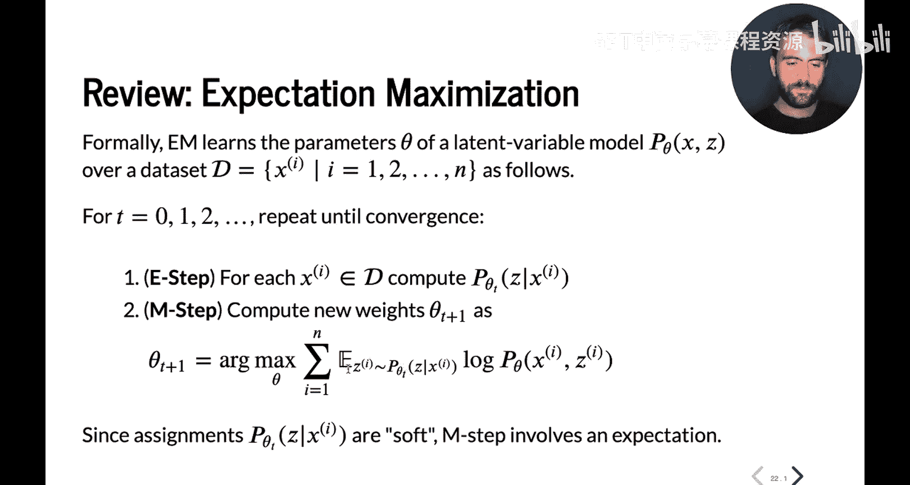

H。Now let's derive each of these steps for a Gausian mixture model。

The E step is relatively straightforward。We have seen in one of the earlier videos that we can compute the probability that x belongs to cluster K using so this is the posterior probability which we want to compute。

 which is the quantity that we want and we can apply base rule to obtain the following expression here。

 I simply apply the definition of conditional probability and then I use the definition of the model to separate theummerator into two components and then I use the loft total probability at the bottom and all the terms here are easy to compute and we can compute this probability very easily so this is the probability again。

 or again， this vector of probabilitybabilities that。

Des that given x is a vector probabilities that x originates from each component。

 given a current best guess for the parameters theta。So the E step is fairly straightforward。

 and the M step is also reasonably feasible to solve。 So recall that in the E step。

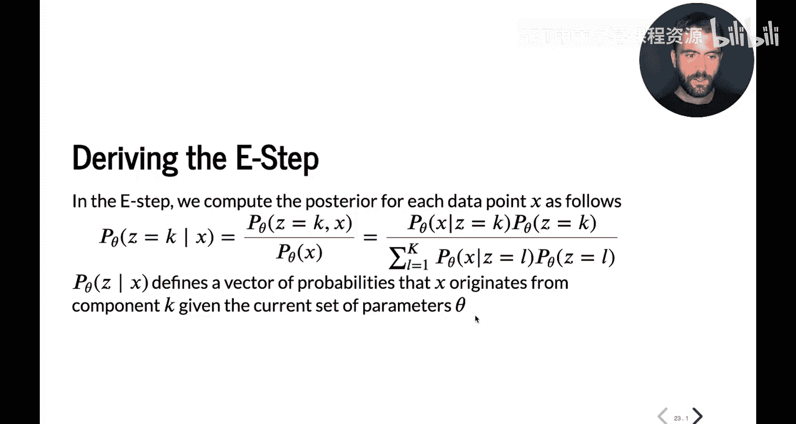

In the M step， we want to maximize the expected log probability of the data where the Z are sampled from our best guests obtained from the previous E step。

And now we to so we want to optimize this function， and when we have a Gaussian mixture model。

 we can decompose it in the following form using the law of total probability。

You should also note that the first step， the first set of components here， this， this is the set of。

Of conditional distributions x given Z and here this is the set of priors over Z and we have broken this up by simply breaking this up into probability of x given Z times probability of Z so this breaks up into these two components and this separation into two components is also what we had in our earlier when we first worked with these kinds of models in the context of supervised learning there we also divided this into two components。

 like you see here。

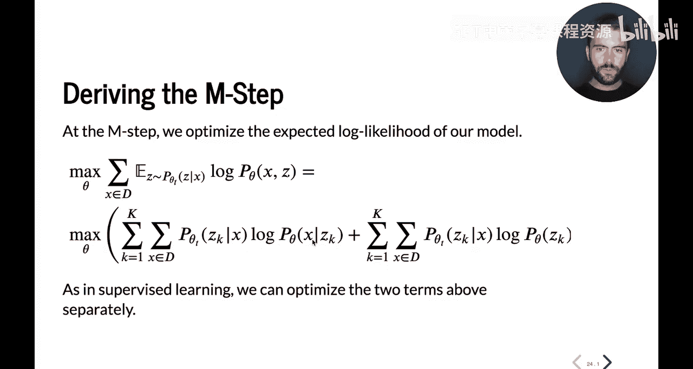

嗯。So lets now let's maximize each of these two components separately because the probabilities I should point out that here in in this example。

 we only have the the conditionals and these have the mu and the sigma parameters and then this part here only has the phi parameters and because we have a summation we can optimize each of these separately。

 so let's start with the former， we want to maximize this particular value and what we have here is so essentially this is the log likelihood。

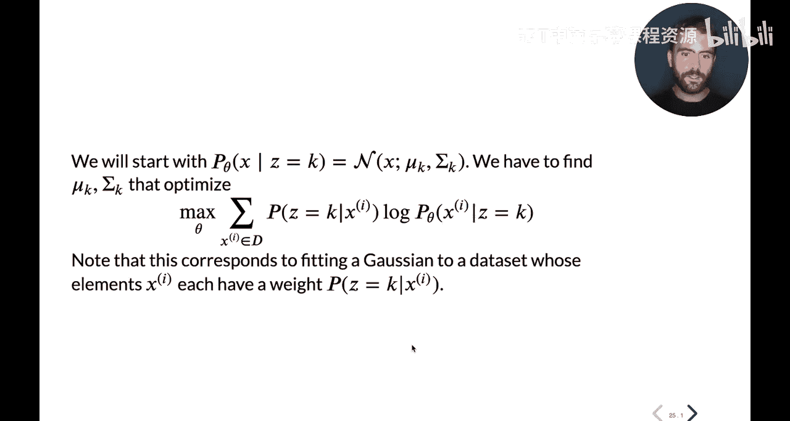

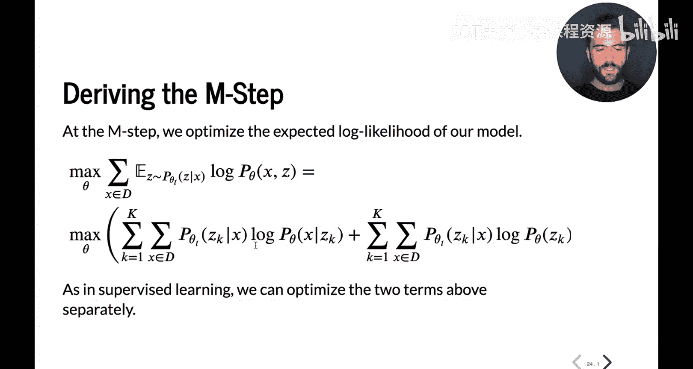

Of a Gaussian distribution。With mean mu and covariant sigma that we are fitting。

Except that we are now placing a weight to each term and we have a weight that's associated with each X here。

So， each X。Has has a weight associated to it。 And what this means is that instead of just fitting the likelihood of all of the data。

 we are fitting the likelihood of the data。When the data set is weighted and each data point has a weight that is given by this probability so that the。

The data point of it has a weight that corresponds to its probability of being to class K。And again。

 here， I have only chosen the terms from the previous summation that involves。

MK and sigma K for one particular value of k， so if you go back here we have a summation over all the possible ks and we also have a summation so I have taken this for one particular choice of k and this is the only set of terms in this entire summation that involves muK and sigma K for some value of lowercase K and therefore it's enough for me to look at these terms in order to perform this optimization。

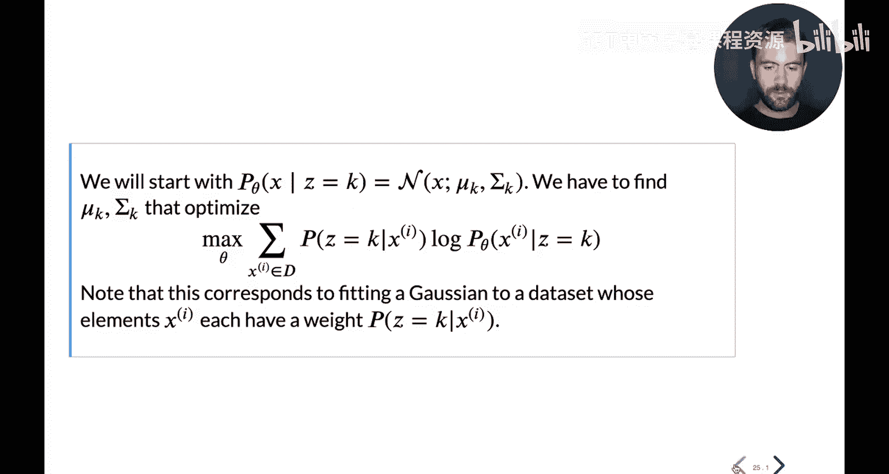

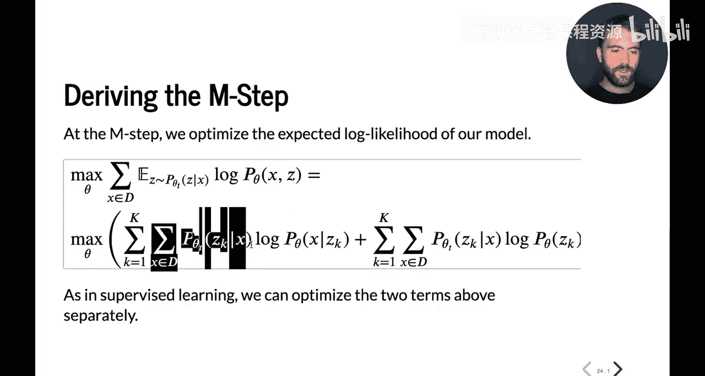

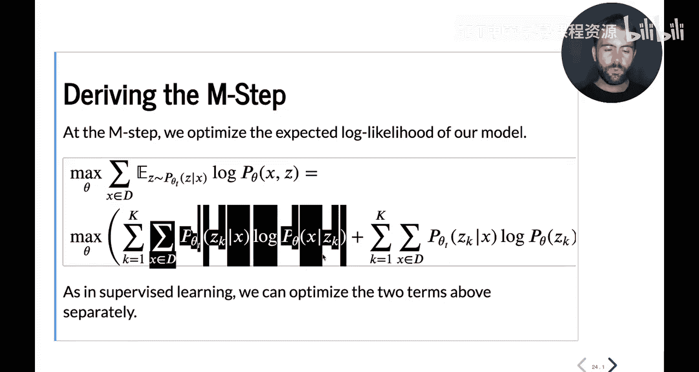

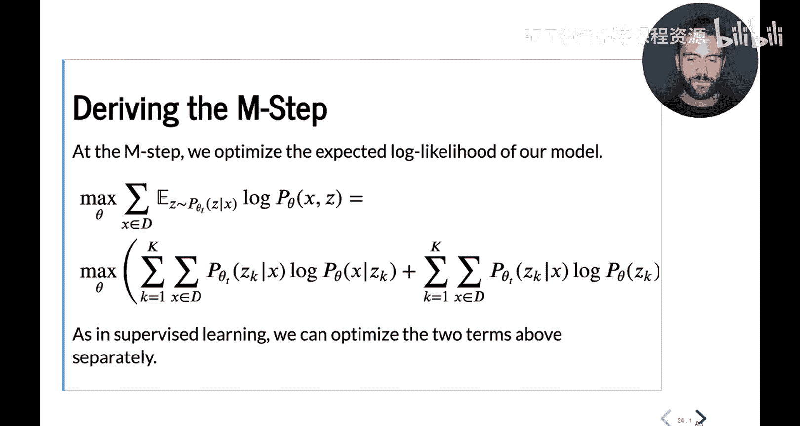

So again， here， the resulting optimization problem is simply fitting and maximizing the likelihood of a Gaussian on the data set that is weighted。

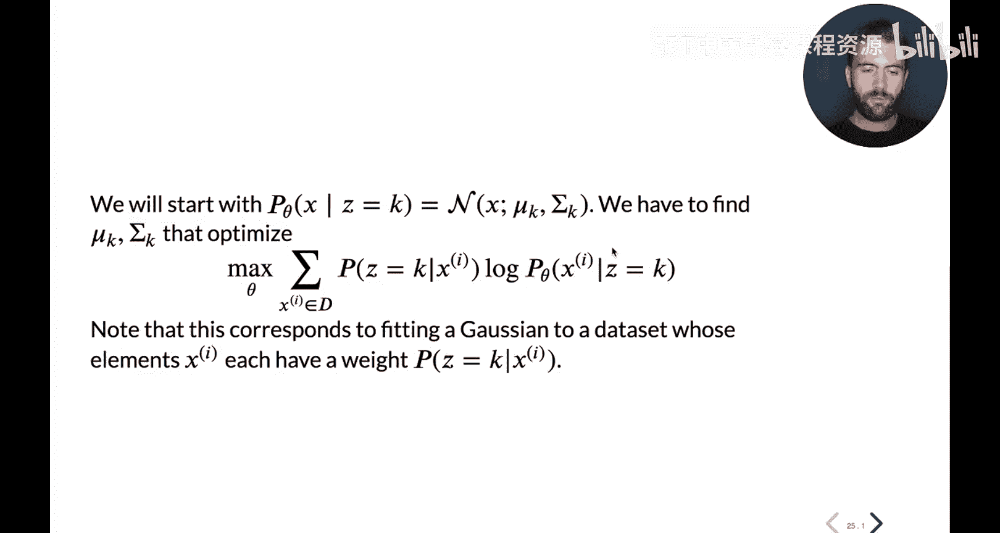

And as a result， we can also easily compute the solution for this enclosed form。

You can verify that this is true by taking the derivative of the previous expression。

 setting it to zero and solving for these parameters that should be fairly easy。

 but also you should be able to convince yourself that this makes sense because first of all。

 if when we would fit a Gaussian distribution to data that is unweighted。

Then our best estimatetimate of the mean and the variance are simply the mean and the variance of the data。

And now given that the data has weights， then the best guess for the mean of each component is the mean of the data。

 but now each point here X that contributes to the mean is also weighted by its by its probability。

And so instead of taking a regular average， we take a weighted average and similarly here we also take a weighted average of the covariances and the normalizing parameter here。

 the number of points that belong to class K， it is also。

Just the sum of probabilities that belong to class K。 So this is fairly intuitive。

 and you can verify this using simple calculus。

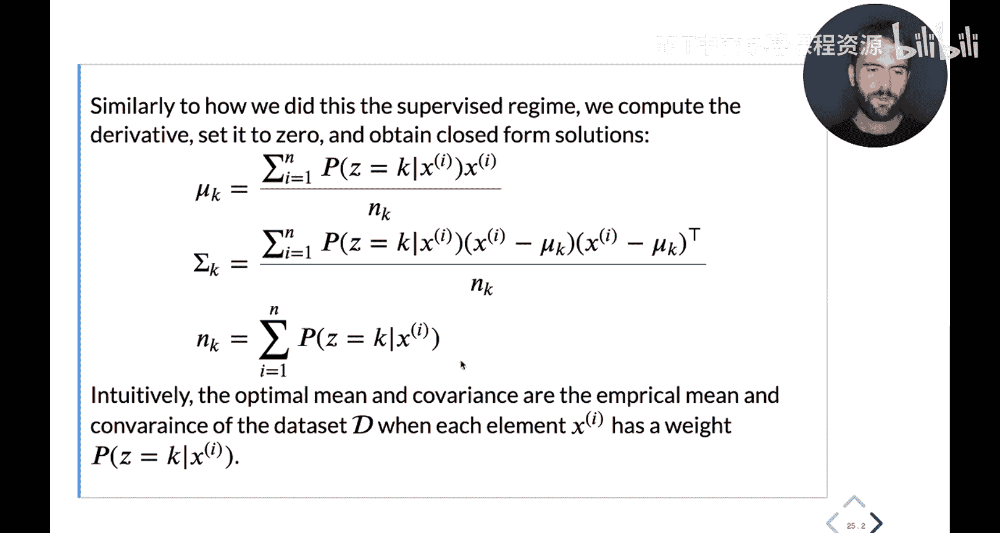

And we can make the same argument for the remaining set of terms。

 the ones that involve the parameters phi k， the best estimate for the proportion of each class。

 is the sum of the points that belong to that class so here we have Nk which is the number of points that have been associated to the class。

 but because each point doesn't get associated in a hard way， it gets associated in a soft way。

 it has an associated strength given by this probability。

 we simply count the number of points well we count the sum of all the。

wes the sum of all the probabilities that all the for each point tell us whether it belongs to each belongs to class K。

 and so this is what becomes a enumerator and before it and then we have the same denominator just to convince yourself that this is reasonable。

 imagine a hard assignment where each x is assigned to only a single cluster。

 then this reduces to simply counting the points that are assigned to cluster K。

 but given that we have here a soft assignment we sum the probabilities which are。

hich is the correct thing to do here。

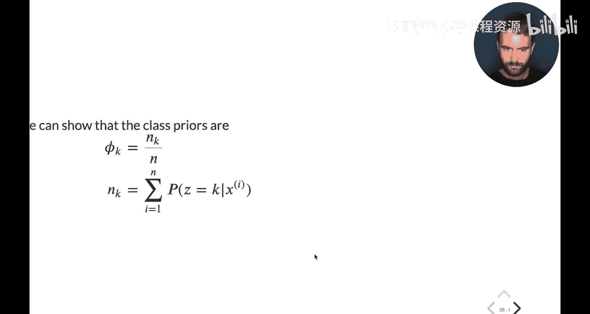

So to summarize the expectation maximization algorithm and Gaussian mixture model alternates between two steps at the E step。

 we use our formula to compute this assignment。 This is a vector of probabilities。

 it's a vector of capabilitiesbabilities for each X。And now then in the M step。

 we compute our best guess for mu Sigma and Phi using the formulas that I had in my previous few slides。

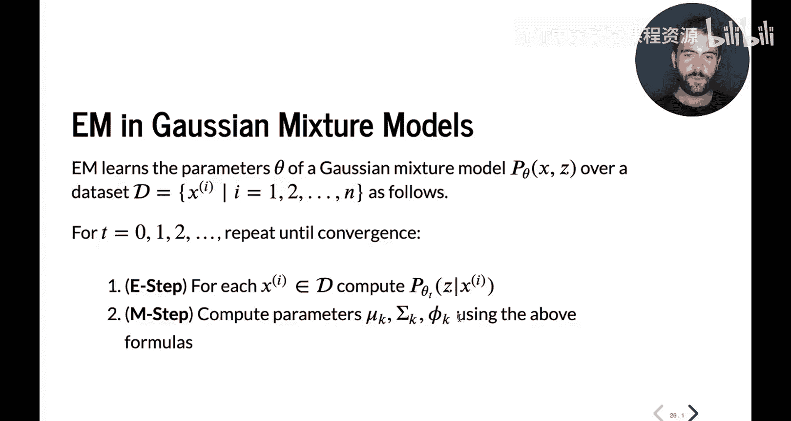

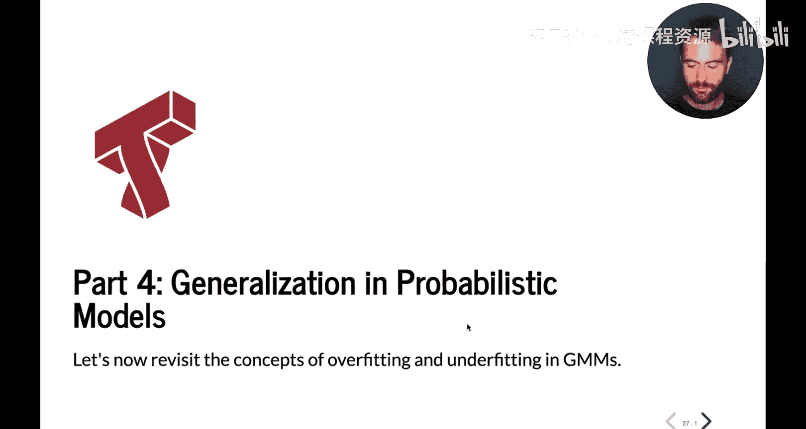