# 应用机器学习：第18讲第3节：高斯混合模型中的期望最大化算法 🧮

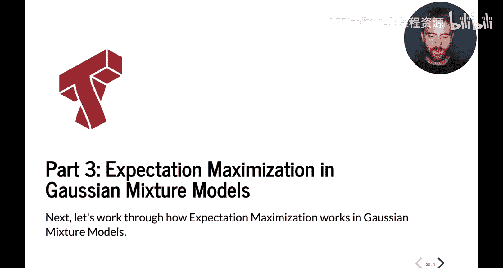

在本节课程中，我们将学习如何将期望最大化算法应用于高斯混合模型。我们将推导该算法的具体步骤，并详细讲解其在高斯混合模型中的使用方法。

## 概述

上一节我们介绍了聚类的基本概念。本节中，我们将深入探讨期望最大化算法在高斯混合模型中的具体应用。我们将推导算法的每一步，并解释其背后的数学原理。

## 高斯混合模型回顾

回忆一下，混合模型是一种具有以下形式的概率分布：

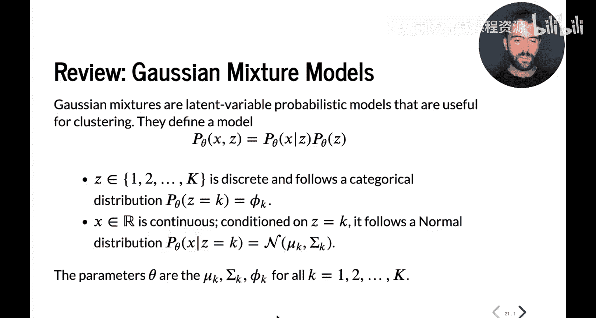

我们有一个包含可见变量 **X** 和潜在（或未观测）变量 **Z** 的分布。**Z** 是聚类分配。给定一个数据点 **x**，其对应的 **z** 表示 **x** 来自哪个聚类的索引。**x** 是从 **k** 个可能的聚类中生成的点，给定聚类 **k** 时观察到 **x** 的概率由一个均值为 **μ**、协方差为 **Σ** 的高斯分布给出。这些参数由 **k** 索引，因为每个聚类都不同。

每个聚类的先验概率由 **φ** 给出。

在该模型下，我们假设数据生成过程如下：首先根据 **φ** 给出的概率选择一个聚类索引，然后从该高斯分布中采样一个点。

所有参数由 **μ**、**Σ** 和 **φ** 组成。

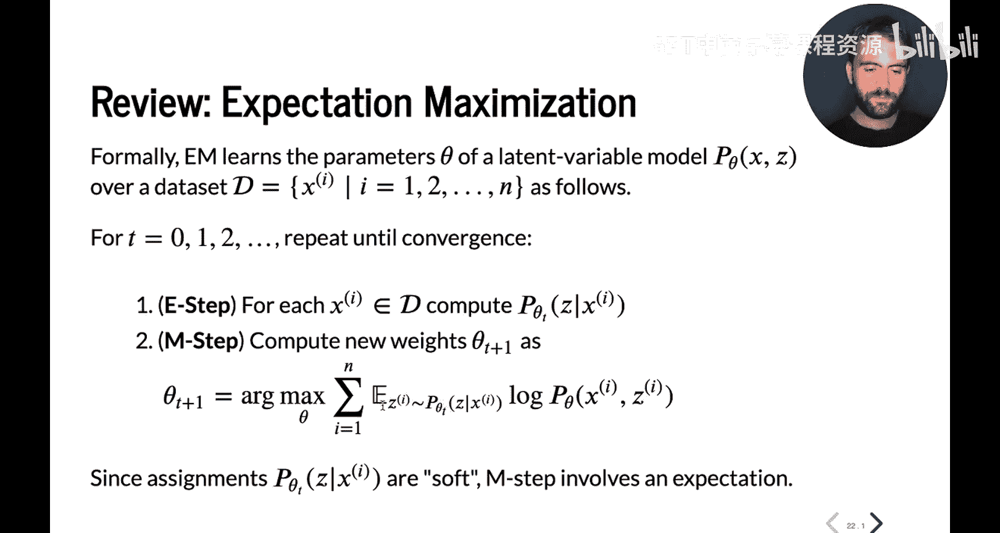

## 期望最大化算法回顾

期望最大化算法是一种可用于拟合任何潜在变量模型的算法。它重复以下两个步骤直到收敛：

1.  **E步**：给定参数的当前估计值，我们尝试“猜测”聚类分配。我们根据模型当前告诉我们的信息，计算给定当前参数 **θ** 时，聚类分配的最佳猜测。
2.  **M步**：给定由后验分布提供的这些概率性聚类分配，我们通过最大化数据的期望对数似然来计算新的参数权重，其中期望是关于聚类分配 **Z** 的，概率是关于参数的当前最佳猜测的。

## 高斯混合模型的E步推导

现在，让我们为高斯混合模型推导这些步骤。

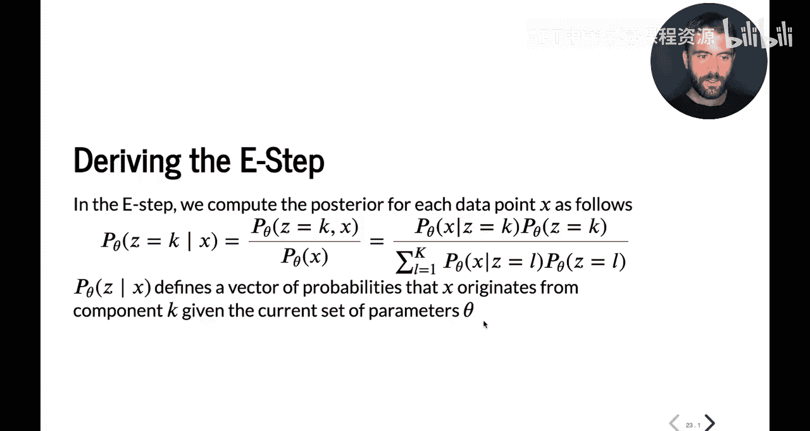

E步相对简单。我们在之前的视频中看到，可以使用贝叶斯规则计算 **x** 属于聚类 **K** 的概率：

`P(Z=k | X=x; θ) = [φ_k * N(x; μ_k, Σ_k)] / [Σ_{j=1}^{K} φ_j * N(x; μ_j, Σ_j)]`

这里，我们简单地应用了条件概率的定义，然后使用模型的定义将分子分解为两个部分，并在分母处使用了全概率公式。这里的所有项都易于计算，因此我们可以非常容易地计算这个概率。

所以，这是给定当前参数 **θ** 的最佳猜测下，**x** 源自每个分量的概率向量。因此，E步相当直接。

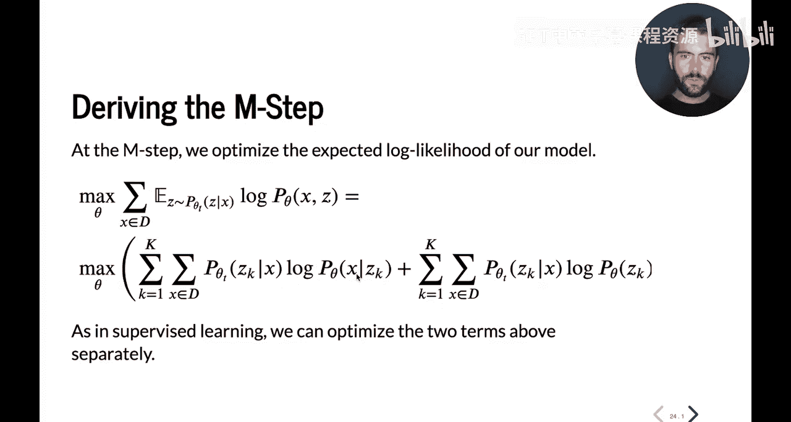

## 高斯混合模型的M步推导

M步也相对可行。回忆一下，在M步中，我们希望最大化数据的期望对数概率，其中 **Z** 是从前一步E步得到的最佳猜测中采样的。

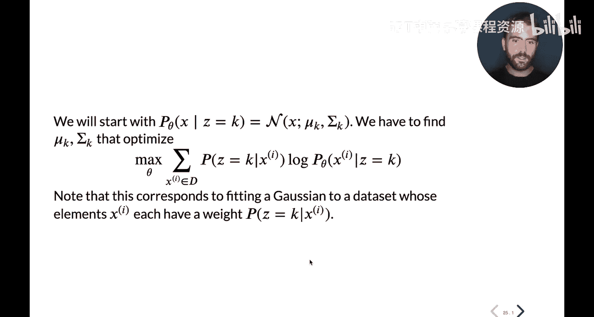

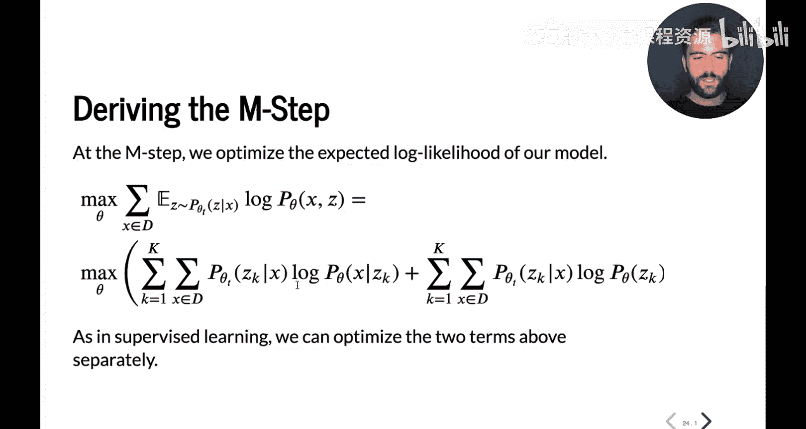

我们想要优化这个函数。对于高斯混合模型，我们可以使用全概率定律将其分解为以下形式：

`E_{Z~Q}[log P(X, Z; θ)] = Σ_{i=1}^{N} Σ_{k=1}^{K} Q(Z_i=k) [log N(X_i; μ_k, Σ_k) + log φ_k]`

这里，第一组分量是给定 **Z** 时 **X** 的条件分布，第二组是 **Z** 的先验分布。我们通过将联合概率分解为 **P(X|Z)** 乘以 **P(Z)** 来将其分解为这两个部分。这种分解在我们之前在监督学习背景下处理这类模型时也出现过。

现在，让我们分别最大化这两个部分，因为这里的条件概率部分只涉及 **μ** 和 **Σ** 参数，而先验部分只涉及 **φ** 参数。由于我们有一个求和式，我们可以分别优化它们。

让我们从前者开始，我们希望最大化这个特定值。我们这里本质上得到的是一个高斯分布的对数似然，均值为 **μ**，协方差为 **Σ**，只是现在我们为每一项分配了一个权重。每个 **X** 都有一个与之相关的权重。

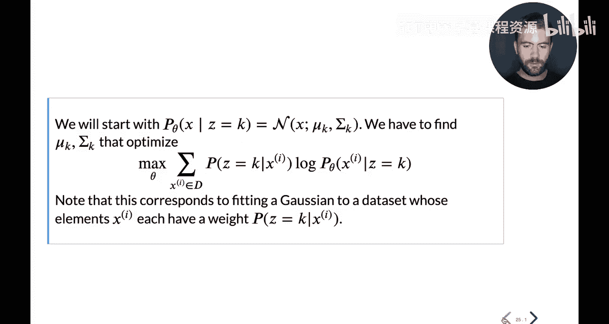

这意味着，我们不是在拟合所有数据的似然，而是在拟合**加权数据集**的似然，每个数据点的权重由其属于类别 **K** 的概率给出。这里，我只从前面的求和式中选择了涉及特定 **k** 值的 **μ_k** 和 **Σ_k** 的项。

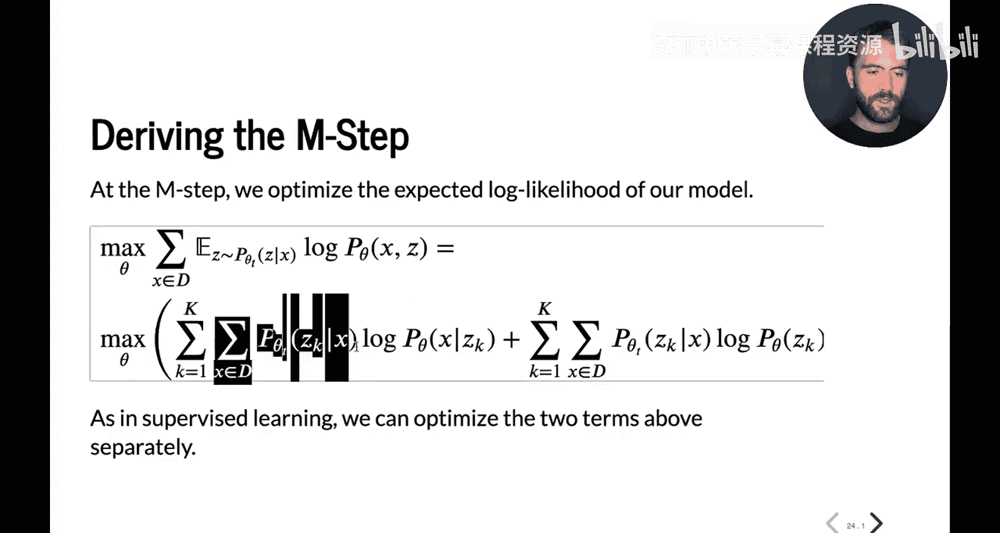

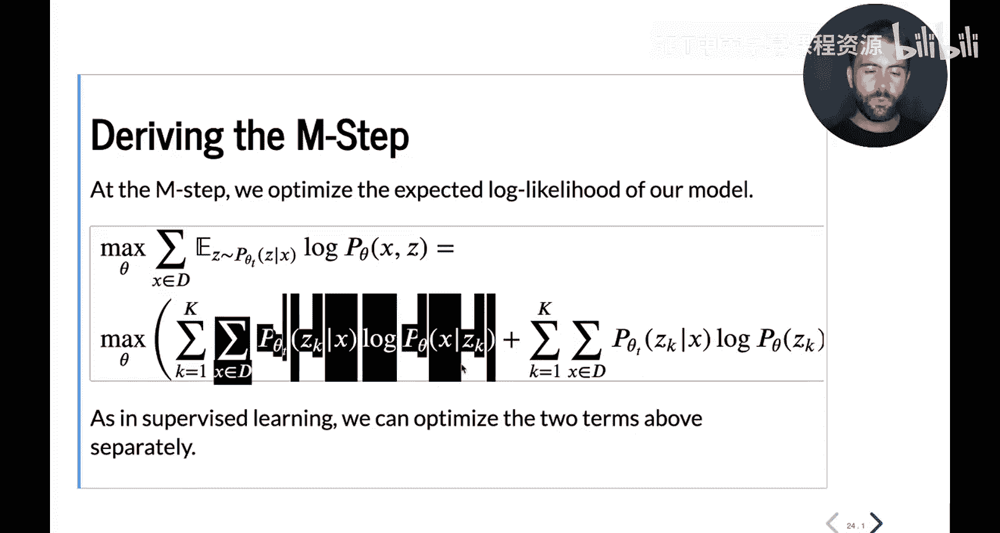

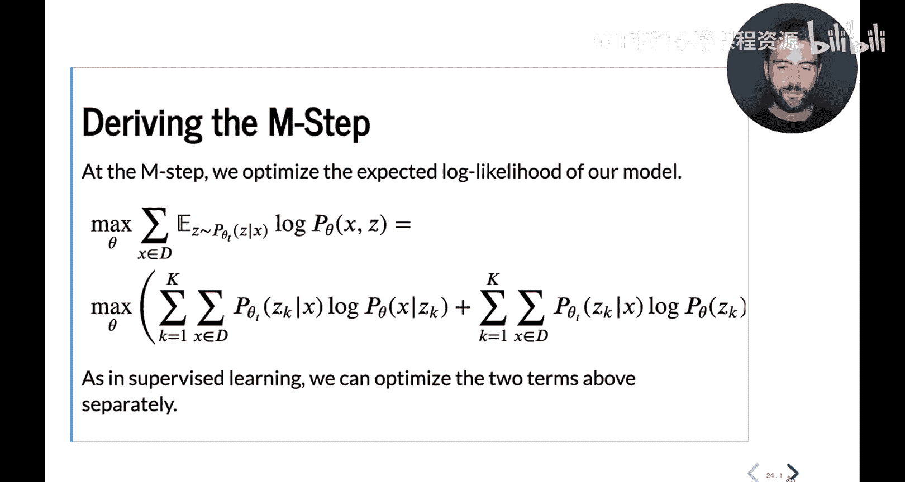

因此，最终的优化问题简化为在加权数据集上拟合并最大化一个高斯分布的似然。

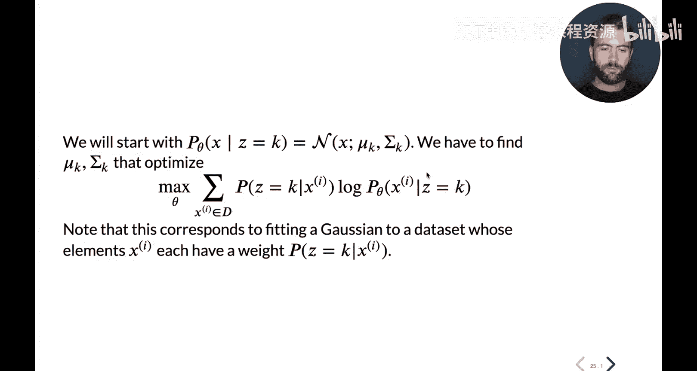

## M步的闭式解

因此，我们可以很容易地以闭式计算出该问题的解。

对于均值 **μ_k** 和协方差 **Σ_k**，最优估计为：

`μ_k = [Σ_{i=1}^{N} Q(Z_i=k) * X_i] / [Σ_{i=1}^{N} Q(Z_i=k)]`

`Σ_k = [Σ_{i=1}^{N} Q(Z_i=k) * (X_i - μ_k)(X_i - μ_k)^T] / [Σ_{i=1}^{N} Q(Z_i=k)]`

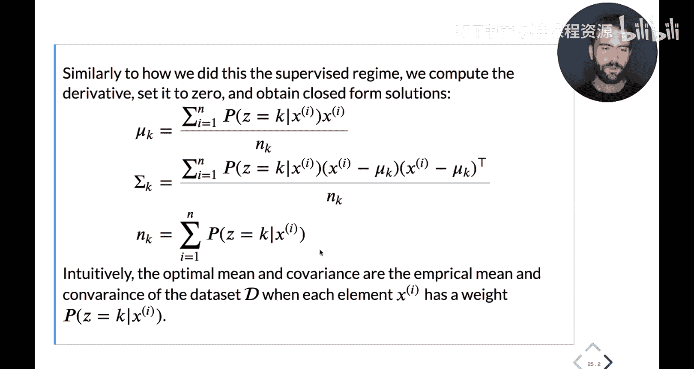

你可以通过求前面表达式的导数，设为零并求解这些参数来验证这一点。同时，你也应该能理解这是合理的：首先，如果我们对未加权的数据拟合高斯分布，那么均值和方差的最佳估计就是数据的均值和方差。现在，给定数据有权重，那么每个分量的均值的最佳猜测是数据的加权平均，每个点 **X** 对均值的贡献由其概率加权。同样，这里我们也取协方差的加权平均。这里的归一化参数 **N_k**（属于类别 **K** 的点数）也是属于类别 **K** 的概率之和。这相当直观。

对于涉及参数 **φ_k** 的剩余项，我们可以做出同样的论证。每个类别比例的最佳估计是属于该类别的点的总和。这里我们有 **N_k**，即与该类别关联的点数。但由于每个点不是以“硬”方式关联，而是以“软”方式关联，其关联强度由概率给出，我们只需对所有点属于类别 **K** 的概率求和。这就是分子。分母是所有类别的总和。为了说服自己这是合理的，想象一个“硬”分配，其中每个 **x** 只分配给一个聚类，那么这就简化为简单地计算分配给聚类 **K** 的点数。但鉴于我们这里是“软”分配，我们对概率求和，这是正确的做法。

`φ_k = [Σ_{i=1}^{N} Q(Z_i=k)] / N`

## 算法总结

总结一下，高斯混合模型中的期望最大化算法在两个步骤之间交替进行：

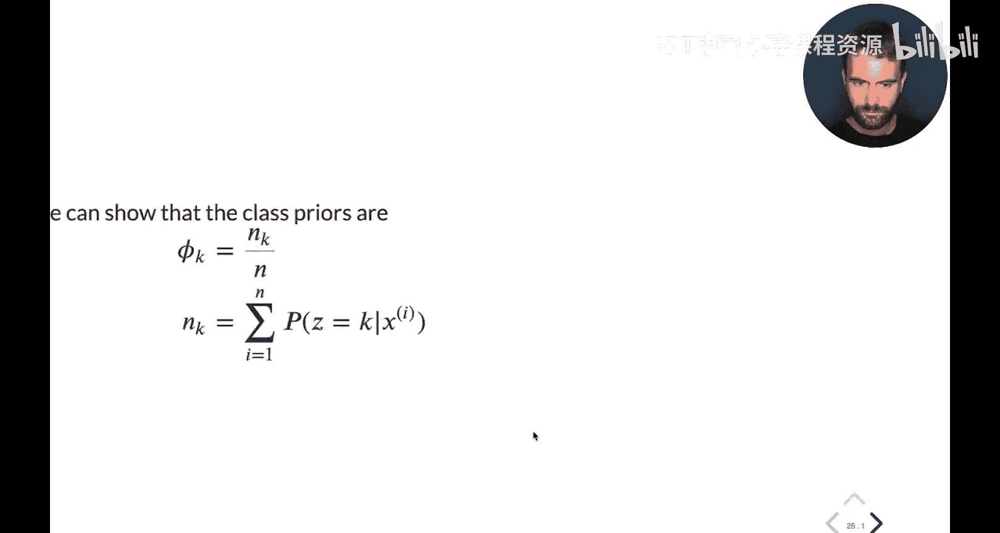

*   **E步**：使用我们的公式计算这个分配 `Q(Z_i=k)`。这是每个 **X_i** 的概率向量。
*   **M步**：使用我前面几张幻灯片中的公式计算 **μ**、**Σ** 和 **φ** 的最佳猜测。

## 本节课总结

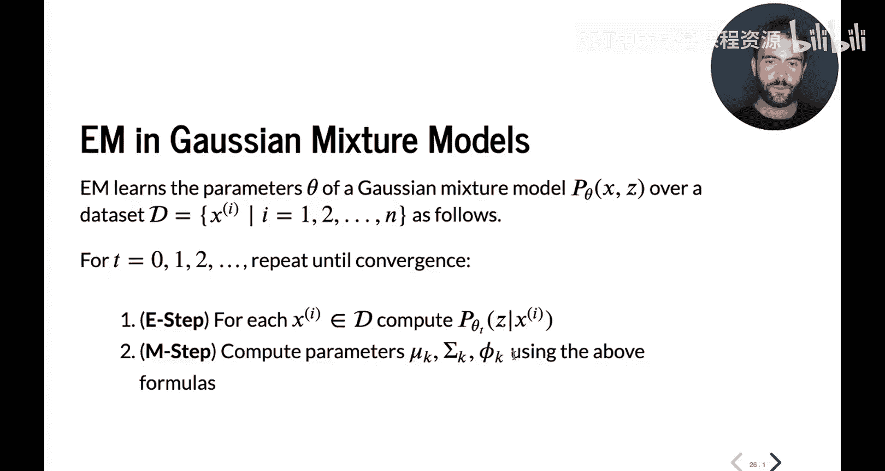

在本节课中，我们一起学习了期望最大化算法在高斯混合模型中的具体应用。我们首先回顾了高斯混合模型和期望最大化算法的基本框架。然后，我们详细推导了算法的E步和M步。在E步中，我们计算了数据点属于各个聚类的后验概率。在M步中，我们通过最大化加权数据的期望对数似然，得到了模型参数（均值、协方差和混合权重）的更新公式。这些步骤迭代进行，直到模型收敛。