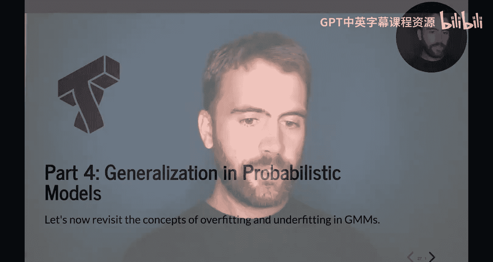
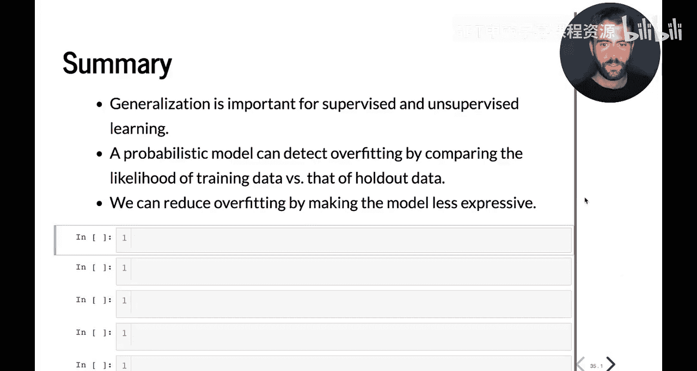

# 康奈尔大学《应用机器学习 CS 5787_ Applied Machine Learning 2020》中英字幕（deepseek p67 -67-Lecture 18. Part 4_ Generalization in Probabilistic Models -BV12udzYvEFM_p67-

We are now at part4 of lecture 18 on clustering and in this video I would like to now look at a more practical issue when applying probabilistic models and particular Gaussian mixture models and that is how it generalizes and it tend ceases to overfit and underfit the data and I would like to contrast the behavior of Gaussian mixture models to K means and the result will be an improved way of detecting overfitting which is applicable for probabilistic models like Gaussian mixture models but that doesn't work with nonprobabilistic models and it's going to be an argument for why probabilistic models are particularly interesting in unsupervised learning。

So recall that we are in unsupervised learning where we have a probability distribution that is the data distribution。

 and our data set only consists of attributes， there is no labels and it comes from the data distribution。

We worked with the following type of babaistic model called Gaussian mixture models in which we have unobserved components。

 which we're going to infer from data。 We have a set of variables Z， which。

Choose an index for each for each point。 And then given that we have chosen an index， by the way。

 these indices have probabilities that are doned by phi， given that we have chosen an index。

 then we say that x belong that x is sampled from a normal distribution belonging to this。

That's associated with this index and then has parameters， mu K and sigma K。

 This is a generative story that we postulate for how that describes how the data was generated。

 and then we infer the best parameters given given the data that we observe。

So recall that in machine learning， a really important concept is generalization This unsupervised model we fit it on a data but we're interested about whether it has learned properties that are useful beyond just this training data set and if we have a new data will list new data have the same structure that we have learned on our training set。

And I would like to now talk about how generalization applies here in the context of Gaussian mixture models and for this I'm going to create a synthetic data set and this is the same synthetic data set that we work with in our earlier discussion of K means I'm generatingring this data set from psychic learnn using this function and this basically creates a mixture of it creates points that do actually come from a Gasian mixture model which has four components。

This is a visualization of the points， as you can see they don't have labels， but in fact we。

If we were to put the labels on this figure we would have the following configuration so here yeah we have a yellow cluster a green cluster。

 a purple cluster and a blue cluster， but this is the only time when we're going to well in fact we will only use these labels for visualization they will never be used for training in any of the。

In any of the slides that you're going to see。But this just shows you that the actual data is a mixture of Gaussians。

 I have generated data from mixture of Gaussians， and now I'm going to discard the labels。

 I will forget where it came from and I will try to learn a brand new mixture of Gaussians on this data and we're going to see if it recovers this structure。

And also in addition to what I did in my video on K means。

 I'm also now going to keep 50 points as a separate holdout set。

 So this here is a different set of points there's 50 of them and I'm going to hold them for。For。

as a separate set， and they will not be used for training at all。

So let's look at what happens if we train a small Gaussian mixture model。Pen。

If if our Gaussian mixture model is too small， if it doesn't have enough components。

 then we're not going to learn the true structure here which has four components。 For example。

 if I fit a Gaussian mixture model with two components on this dataset by the way in Psyit learn the way this is done is we use the Gaussian mixture class this part of the mixture package and we simply specify the number of components and then we fit it to our data we only fit it to the x's again there are no ys that are used here。

And we can visualize its performance here or we can visualize the results here。

 similarly to what we did with K means， I am denoting the centers of the clusters as these red points and it has identified them and it has placed them in correct in interesting locations。

 but still this is not great。Because we don't recover the true structure of data。

 which has four components。Similarly to how we did with K means， we can measure the。

Object the value of our objective function on our training set。

 And now I'm also going to measure it on the holdout set。 And in this case。

 they are relatively similar。And now， of course we're clearly underfitting。

 so let's increase the number of clusters here and see what happens。

As we increase the number of clusters well here we have four of them and they actually recover the true structure in our dataset。

 but now I can further increase this。 I can have 10 of them and here I can have 20 of them and you can see here that we are no longer fitting the true structure we're starting to fit noise so here there's a small number of points that are by themselves and so these two points here。

 it thinks that these are a separate cluster。 It thinks that these three points or four points here are a separate cluster and so it's really trying to fit noise。

But it is a better fit to our data here our training log likelihood it improves from it used to be before。

 now it's 3。89， now it becomes 3。65 2。92。We achieve a lower value a lower value for for our objective function。

 We fit the data better， which is good。 but of course， we're fitting noise here。 However。

 what's interesting is that if I also measure the log likelihood on the holdout set。

 the log likelihood on the holdout set actually gets worse as we add more data。

 as we add more clusters， and this is interesting。So this instance here is the form of overfitting。

 which again means that we're fitting noise as opposed to the true signal which has four components。

And we can take this to the extreme， and we can fit data with 50 components on our data set。

 So we have about 150 points， and we have 150 components。

 So clearly we're able to fit data super well。 And the log likelihood that we have is the highest number that we've seen yet。

 it equals 1。58。 This is the highest number before it used to be with four components。 It's -3。

 And now we've reached 1。58 for the log likelihood。However， this is clearly。Fitting noise here。

 we're just fitting a cluster for these two points。But if we look at the holdoutet。

And then on the holdoutet， we no longer have performance thats this is that is that good here we actually have。

Significantly worse dog likelihood。 Our likelihood here is very bad。 It is-28。

And the reason this happens is that these points， these clusters。

 they no longer describe the data well on the holdout set。

 They describe the data really well on this set right so these two points are likely to have come from this cluster。

Here this data is consistent with a Gaussian mixture of 50 components。

 but the holdoutet is no longer consistent with this mixture with this Gaussian mixture of 50 components。

 For example， here we have points which are by themselves。

 we have sorry we have Gaus we have centers， we have Gaussian。

We have Gaussians that are by themselves and in a region with no points， which shouldn't happen。

 And we also have points which don't belong to any Gaussian at all。

 So this point is not near any of the clusters， and it doesn't。

It's very unlikely to see this point from any of our data。 and similarly， these points as well。

 they are not likely to have been generated by this distribution。

 and so therefore its stock likelihood is is very bad。

 It is very small and here we're able to correctly detect that we have not fit the data well。

 and we have。That we have overfit our training data and we see this both visually in that this holdout data doesn't seem to come from this distribution。

 and we can also measure it numerically by evaluating its slug likelihood。So more generally。

 this is a very important and very interesting observation in probabilistic models。

 we can often use the log likelihood on a holdout set as a measure of overfitting。

So in probabilistic and supervised learning models。

 we have an objective that can be used to detect overfiing versus underfiing by comparing performance between a training and a holdout set。

 and it's possible that our model will have good training accuracy。

Training itss training likelihood will be good。 It will explain the training data well， but。

We can then see whether it explains a completely different set of holdout data。

 and if it has really overfi the training data， it will not explain the holdout data well。

To see this， consider the following plot here， I'm fitting Gaussian mixture models with a number of clusters that ranges from 1 to 25。

 and I measure the。Log likelihood on the training set and the log likelihood on the holdout set here I'm using negative log likelihood。

 so lower means better and on the training set we go from basically as we increase the number of clusters。

 our performance keeps improving。But on the holdout set。

Our performance plateaus at around three or four， and here we no longer see any improvement and then after a while we are clearly overfitting and our performance becomes much worse。

And so here we clearly see that this is the kind of curve that we would expect with in supervised learning and we can get some of this in an unsupervised learning regime as well if we use a probabilistic model and that's a very useful feature of probabilistic model and it is an important reason why they're interesting and really create benefit and I am personally a big fan of probabilistic models。

Now， I also want to give you a warning。 This is not a foolproof solution。

 so it doesn't work in every possible regime。 It provides a lot of useful hints for。

For for detecting overfitting， but it's not a bulletproof solution。

 and it is not as as reliable as measuring accuracy and supervised learning。

 just to give you an example here in this particular regime。

 even though here even as we reach eight or nine clusters this performance is still not good we do not see a big increase in our negative look likelihood。

 It is relatively small compared to to the increases that we see later。 So here or off by。

We're still quite off in terms of the optimal K， but we don't have a big increase in the log likelihood。

We could， however， detect this that here we seem to be we seem to start to overfit here because the。

The curve are no longer parallel starting at four， but this is not obvious to see。

And also there are some paradoxical behaviors in that if we had significantly more data。

 then this flat region of the curve would last for much。

 much longer and it would make it even more difficult to detect these kinds of overfitting problems So again。

 even though the log likelihood can help us detect overfitting it is a useful technique but it's not entirely bulletproof and you should play with it you can play with the example in the code in this example to better understand its limitations。

So in other words， to summarize， generalization is important for supervised and unsupervised learning and in probabilistic models like Gaussian mixture models。

 we can detect it by comparing the log likelihood over the hold outet and in the training data。

 and if we need to reduce overfitting the same techniques that we have seen earlier we can。

 for example， reduce the number of components in the Gaussian mixture model。

