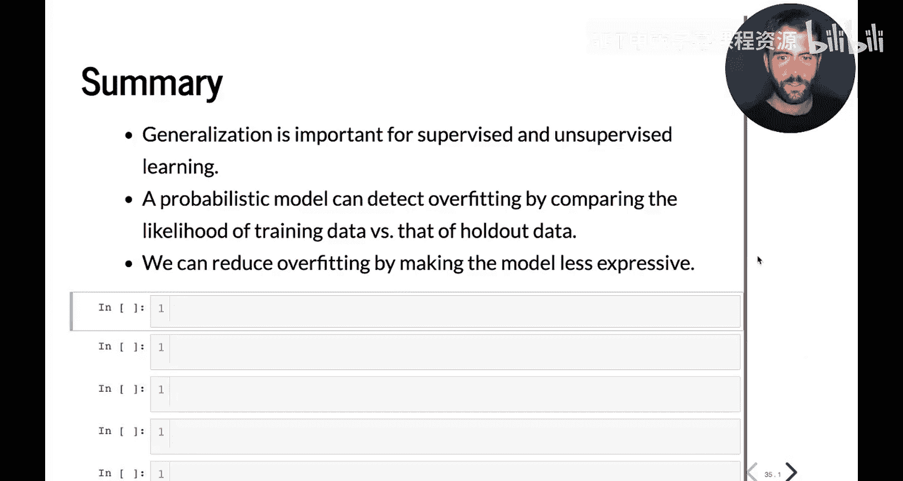

# 应用机器学习：第18讲：第4部分 - 概率模型的泛化能力 🎯

在本节课中，我们将探讨概率模型（特别是高斯混合模型）在实际应用中的一个重要问题：泛化能力。我们将分析模型如何避免过拟合与欠拟合，并将其与K均值聚类进行对比。通过这一对比，我们将介绍一种适用于概率模型的改进过拟合检测方法，并解释为何概率模型在无监督学习中具有独特价值。

---


## 数据分布与高斯混合模型回顾

上一节我们介绍了聚类的基本概念，本节中我们来看看概率模型在无监督学习中的应用。在无监督学习中，我们假设数据来自某个未知的概率分布，数据集仅包含属性特征，没有标签。

我们使用一种称为**高斯混合模型**的概率模型。该模型假设数据由多个高斯分布混合生成，每个数据点属于其中一个成分。模型包含以下要素：

*   **隐变量 Z**：为每个数据点分配一个成分索引。
*   **混合权重 φ**：表示每个成分被选中的先验概率。
*   **高斯分布参数**：每个成分 `k` 有其均值 `μ_k` 和协方差 `Σ_k`。

生成过程可描述为：首先根据 `φ` 选择一个成分索引 `z`，然后从对应的高斯分布 `N(μ_z, Σ_z)` 中采样得到观测数据 `x`。我们的目标是根据观测到的数据 `x`，推断出最佳的模型参数 `(φ, μ, Σ)`。

## 泛化能力与合成数据集

机器学习中的一个核心概念是**泛化能力**。我们基于训练数据拟合模型，但更关心模型是否学到了超越训练集的有用特性，能否对新数据做出良好解释。

为了探讨高斯混合模型的泛化问题，我们创建一个合成数据集。该数据集使用以下代码生成，它实际上来自一个具有四个成分的高斯混合模型。

```python
# 示例代码：使用scikit-learn生成高斯混合数据
from sklearn.datasets import make_blobs
X, y_true = make_blobs(n_samples=150, centers=4, cluster_std=0.60, random_state=0)
```

下图可视化了生成的数据点。虽然我们看不到标签，但为了说明，我们用颜色标出了其真实的四个成分来源。在实际训练中，我们**不会使用这些标签**。


此外，我们还预留了50个数据点作为**独立验证集**，它们将不参与任何训练过程。

## 不同组件数量下的模型表现

现在，我们尝试用不同组件数量的高斯混合模型来拟合训练数据，并观察其表现。

### 组件过少：欠拟合

如果我们使用组件数量过少的模型（例如2个组件），将无法捕捉数据中真实的四个成分结构。

以下是使用scikit-learn拟合两个组件模型的方法：
```python
from sklearn.mixture import GaussianMixture
gmm = GaussianMixture(n_components=2)
gmm.fit(X_train) # 仅使用特征X，没有标签y
```

可视化结果显示，模型找到了两个聚类中心（红点），但显然未能恢复数据的真实结构。此时，模型在训练集和验证集上的对数似然值相近，但都较差，这是典型的**欠拟合**。

### 组件适中：良好拟合

当我们将组件数量增加到4个时，模型成功恢复了数据的真实结构。训练对数似然值得到改善。

### 组件过多：过拟合

如果我们继续增加组件数量（例如10个或20个），模型开始拟合数据中的噪声。例如，它会将少数几个离群点单独划分为一个簇。

虽然模型在训练集上的对数似然值持续提升（从-3.89到-2.92，值越大越好），表明对训练数据的拟合越来越好，但这可能是以捕捉噪声为代价的。

关键观察点在于：此时，模型在**验证集**上的对数似然值开始**下降**。这表明模型学到的结构不能很好地泛化到新数据，出现了**过拟合**。

### 极端情况：严重过拟合

在极端情况下，我们使用与数据点数量相近的组件（如150个点使用50个组件）进行拟合。模型在训练集上的对数似然达到最高（-1.58），但对验证集的拟合极差（对数似然降至-28）。

原因在于，模型为训练集中的微小噪声（如两个紧邻的点）也创建了组件。这些组件在验证集对应的区域可能没有数据点，导致验证集中的点来自任何组件的概率都非常低，因此对数似然值很差。

## 利用对数似然检测过拟合

以上实验揭示了一个对于概率模型非常重要且有趣的观察：**我们可以使用验证集上的对数似然作为检测过拟合的指标**。

在概率模型中，我们有一个明确的评估指标——对数似然。通过比较模型在训练集和验证集上的对数似然，我们可以判断其泛化能力：
*   如果模型在训练集上似然高，但在验证集上似然低，则很可能发生了过拟合。
*   如果两者都低，则可能是欠拟合。

为了更清晰地展示这一规律，我们绘制了以下图表：横轴为高斯混合模型的组件数量（从1到25），纵轴为**负对数似然**（值越低越好）。



从图中可以看到：
*   **训练集曲线（蓝色）**：随着组件数量增加，负对数似然持续下降，拟合能力不断增强。
*   **验证集曲线（橙色）**：在组件数量达到3或4个时，性能达到最佳并进入平台期。此后继续增加组件，验证集性能不再提升甚至恶化，明确指示了过拟合。

这种曲线形态与监督学习中的训练/验证误差曲线非常相似。这表明，在无监督的概率模型中，我们同样可以获得用于模型选择和复杂度控制的实用工具，这是概率模型的一大优势。

## 方法局限与注意事项

尽管使用验证集对数似然检测过拟合非常有用，但我们需要指出，这并非一个万无一失的解决方案。

它提供了检测过拟合的重要线索，但不如监督学习中测量分类准确率那样直接可靠。例如，在上图的特定情况下，即使组件数量达到8或9个，验证集负对数似然的上升幅度也并不非常剧烈，可能使最佳K值的选择不够明显。

此外，如果数据量显著增大，验证集性能的平台期可能会持续更久，使得过拟合的拐点更难被察觉。

因此，对数似然比较是一个应当掌握和使用的强大技术，但在实践中仍需谨慎，并结合其他检查手段。你可以通过修改本例附带的代码，调整参数，来更深入地理解其优势和局限。

---

## 总结

本节课中，我们一起学习了概率模型泛化能力的重要性。我们了解到，泛化能力对于监督学习和无监督学习同样关键。

在高斯混合模型这类概率模型中，我们可以通过**比较模型在训练集和独立验证集上的对数似然**来有效检测过拟合。如果发现过拟合，可以采用与之前类似的技术来缓解，例如**减少高斯混合模型中的组件数量**。


这种基于概率的评估框架，为无监督学习中的模型选择与验证提供了坚实的理论基础和实用工具。