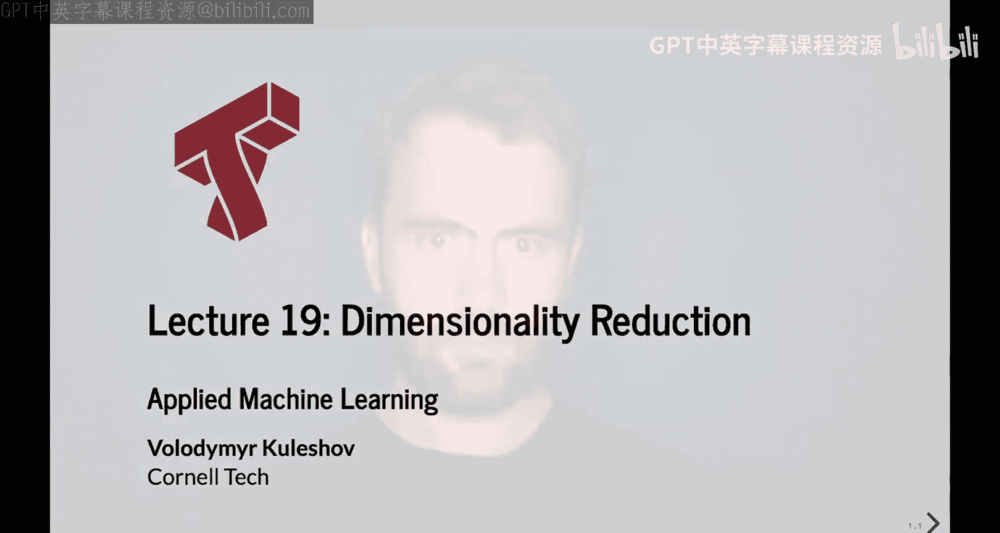
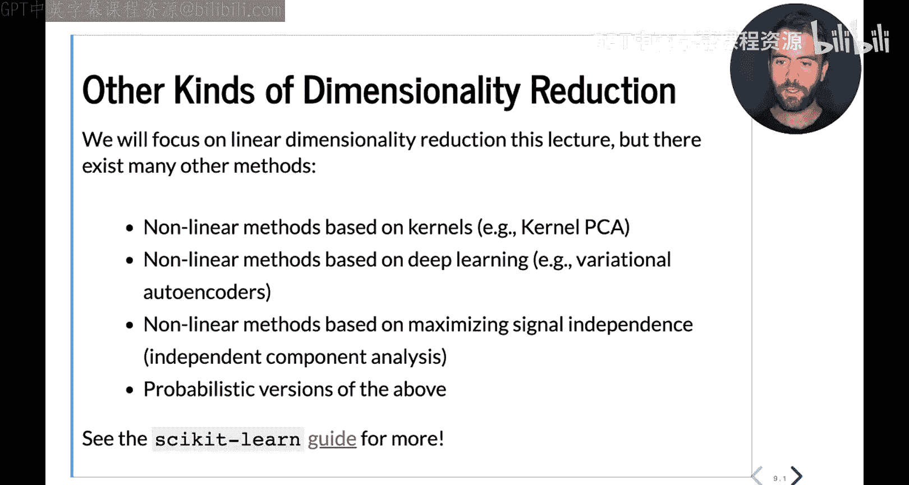

# 康奈尔大学《应用机器学习 CS 5787_ Applied Machine Learning 2020》中英字幕（deepseek p68 -68-Lecture 19. Part 1_ What is Dimensionality Reduction_.zh_en -BV12udzYvEFM_p68-

Hi and welcome to lecturec 19 of Apped machine learning in which we are going to continue our set of topics on unsupervised learning。

 and we are going to start a new topic within unsupervised learning called dimensionality reduction This is going to be our third unsupervised learning problem that we're going to be talking about after density estimation and clustering。

 and it's also going to be a really important one。

In this first video， I would like to define what dimensionality reduction is and give you a few examples of what it can do and why dimensionality reduction is useful。

Before I start recall that our general setting in this lecture is that of unsupervised learning。

 and so we have a data set that comes without any labels and our goal is to learn something interesting about the structure of the data from this data。

This may include things like finding hidden clusters or uncovering outliers or separating signal from noise。

The particular problem that we will look at in this lecture is， again， dimensionality reduction。

And in order to introduce this problem， let me start with an example。

Imagine that we're working with an unsupervised learning data set that has this particular form and it's a data set of motorcycles。

Each input corresponds to a motorcycle， and we have a vector of attributes such as the motorcycle size。

 its color， its maximum speed， and other attributes of this form。

And imagine now that within these attributes， we have two。

 which I'm going to do the node by Xj and Xk， which represent its maximum speed。And one of them。

 Xj has the maximum speed in miles per hour here。And the other one has the speed。

 the maximum speed in kilometers per hour。So clearly these two attributes are highly redundant。

 one of them is a multiple of the other。And in practice。

 we could remove one of them and not lose any signal and therefore or to put it differently。

 one of them determines the other。And so the real dimensionality of the data here， it's not D。

 it is something closer to d minus1 or perhaps even smaller。

The idea of dimensionality reduction is to find these kinds of redundant features or perhaps not entirely redundant。

 but features which are closely correlated， and that can be replaced with a smaller and lower dimensional set of features or attributes。

And do this automatically。And some of the reasons why we might want to do this is because the smaller set of features is going to be easier to think about。

 it's going to be computationally more tractable， it will be easier to visualize。

 and it can also be used as input to other algorithms。

 and this includes both unsupervised algorithms and also supervised classification algorithms。

 which might work better if the data has been transformed into a more useful space。

This example have you may feel like it's a little bit contrived。

 so let me give you another example which might be a little bit more realistic This is going to be an example that will be based on the Iris Fer data that we have been working with in earlier lectures in this course and here Im using psychicLn to load this dataset。

Now， consider a data set in which I have taken or consider this data set and consider the first two features of this data set。

 which are the Sepel width and the Sepel length。And recall that sepel is a part of the flower。

Here I'm visualizing these two attributes in two dimensions。And you can see that these measurements。

 which are both in centimeters， are closely correlated。Essentially。

 when a flower has a large sepel length， it also has a large sepel width。And of course。

 this is fairly reasonable if a plant is large， then the measurements of all of its parts will also be large。

And so what this implies is that there is actually。呃。

A dimension that is that explains or there's an attribute which explains both of these two measurements。

 and this attribute is plant size。And so if we wanted to reduce the size of this data set。

 we could replace both of these two coordinates by a measure of the size of the plant。

 which we could infer from these measurements here。

And one way in which we could do this is we could draw this line passing through through all of the points and depending where each flower lies on this line。

 So， for example， if it has this set of measurements， if it has， say。

4 and three as the measurements that it would roughly fall here on this line。

 depending on where it is， if ends if it tends to be more on this side or on this side of the line。

 we would attribute， we would give this flower a high value of the of the plant size attribute。

 if it falls here and a low value， if it falls here。 So by tracing this line。

 we are in a way finding the we are visualizing the the values that this。Plant size。

 attribute could take。And if we wanted to simplify our downstream analysis， we could， in fact。

 get rid of this of these two attributes， we could replace it with plant flower size。

 and it could make our analysis of this data set easier and more generally in most。

In a lot of machine learning dataset sets， we see this kind of redundancy。

 we see correlated features because they originally are derived from a more fundamental attribute。

 and the idea of dimensionality reduction is to discover these sets of related attributes and replace them by a more fundamental set of attributes。

 which is going to be of which they are going to be fewer， their dimensionality will be lower。

 and again this will make the resulting data in the new set of attributes。

 it will make it easier to analyze and easier to work with。So more formally。

 we can define the problem of dimensionality reduction as an unsupervised learning problem in which we are trying to learn an unsupervised learning model of the following form here the model is denoted by F。

 it has a set of parameters theta， and it's a mapping between inputs X and points in a different set Z which is the set in which in which live the low dimensional representations of the data。

So in other words， given an input X F applied to x will give us fx。

 which is going to be a low dimensional representation， which we're going to denote by lowercase z。

A particularly popular and important case of dimensionality reduction is linear dimensionality reduction。

In linear dimensionality reduction， we are going to say that the input live in a D dimensional space here of the real numbers。

And we're going to choose the latent set or the slow dimensional set as a p dimensional set of real numbers where P is going to be less than D。

And so this function F will map a D dimensional vector into a lower dimensional p dimensional vector。

And in particular， this function is going to be linear。 In other words。

 the parameters theta are going to be ones that define a linear mapping。

 which we can associate with a matrix W。And the formula for for low dimensional representation Z is going to be a linear function of x。

 which we can represent using linear algebra as a linear transformation where we multiply x by the matrix W。

And so this latent dimension is obtained via this linear matrix multiplication operation。

This setting is， even though it's much simpler than the general one。

 it still has a lot of applications and many important machine learning algorithms they perform linear dimensionality reduction。

So what are some ways in which dimensionality reduction can be useful？

One example that we have seen earlier is this example with digits here in this example we have a dataset set of digits which are 28 by 28 which are which have 28 by 28 pixels so there are 784 dimensional vectors and using dimensionality reduction algorithm here it's a nonlinear algorithm that is based on neural networks we can take this input and transform it into a two dimensional data set so we can use a nonlinear mapping to compute two dimensions and within these two dimensions the digits are very well separated from each other and even though here you see colors thatote the different digits。

 these colors， these labels were not used at all for computing this。To dimensional representation。

And so now that we have projected the data in this space。

 we can really easily learn these classes by just having a few labels associated with each cluster and we could learn what these digits are with the very simple algorithm that will just determine the outlines of these groups of points。

And of course it's also really interesting for visualization。

 it uncovers additional structure within the data， for example。

 here we have three different ways of writing the letter6。

 we have two different ways of writing the letter two。

 and this dimensionality reduction approach has found them， but here the mapping is quite complex。

This mapping doesn't have to be complex， we can also use nonlinear we can use simpler linear transformations to also find interesting structure in the data。

 This is an example to which I alluded to earlier in which we have we perform dimensionality reduction now this time on vectors of DNA sequences so each X here is a vector of attribute where each attribute specifies the presence or absence of certain nucleotides at certain positions in the genome so that defines a long vector and we can perform dimensionality reduction。

On these large， on these long vectors。 And it turns out that two of the most important。呃。

Lant lowdial axes that are useful for representing their data They turn out to correlate with with geography。

 so they correlate with the north south and eastwest axes。

 And so if we project now this very high dimensional data in this into this two dimensional space that we have learned completely in an unsupervised way。

 we recover the map of Europe and I guess what this says is that the main source of variation that the main essential characteristics which determine variation in human genomes happen to be happen to be geographical coordinates and that is simply because people tend to have kids with people to to which they're physically close and therefore。

And therefore， individuals。Genomes are much more similar if they are from a country that is if they're from the same country or if they're from a neighboring country。

So this is an interesting application of dimensionality reduction。

 which reveals something that's scientifically interesting。

 and also it helps us work with this data in other kinds of applications。

So the focus of this lecture is going to be on linear dimensionality reduction。

 but I also want to mention that there exists many other kinds of algorithms for doing dimensionality reduction。

 there are many nonlinear methods including ones which are based on kernels。

The the kernel techniques that we have used earlier in supervised learning algorithms。

 they can also be applied within the algorithms that we're going to see in this lecture to generate。

No nonlinear versions of them again， anytime where we see a dot product。

 we can replace it with a kernel and that gives we can apply the kernel trick and we can do it equally well in unsupervised learning a lot of modern dimensionality reduction methods involve deep learning and they are very powerful the digits example was one that you saw a few slides back and then also there are important classes of algorithms that work by maximizing signal properties like independence and these are useful for denoisizing human speech or for separating audio signals from two people are that are talking at the same time。

 are a lot of interesting applications of dimensionality reduction like this and also。

Even though I will talk a lot about nonprobabilistic versions， there are also probabilistic methods。

 probabilistic versions of most of these algorithms， so they can be mapped to a probabilistic model。

 similarly to how K means and Gaussian mixture models were related in the context of clustering。

 there are also probabilistic models of a lot of dimensionality reduction algorithms。

 and this allows us to make use of all of the benefits that our probabilistic model would give us such as uncertainty estimates or being able to use the log likelihood as a measure of overfitting。

If you want to learn more about dimensionality reduction。

 a good start is the second Learn guide that describes several of these models。So next。

 we are going to look at a few particular types of。

The missionality reduction algorithms that are particularly popular and important。

