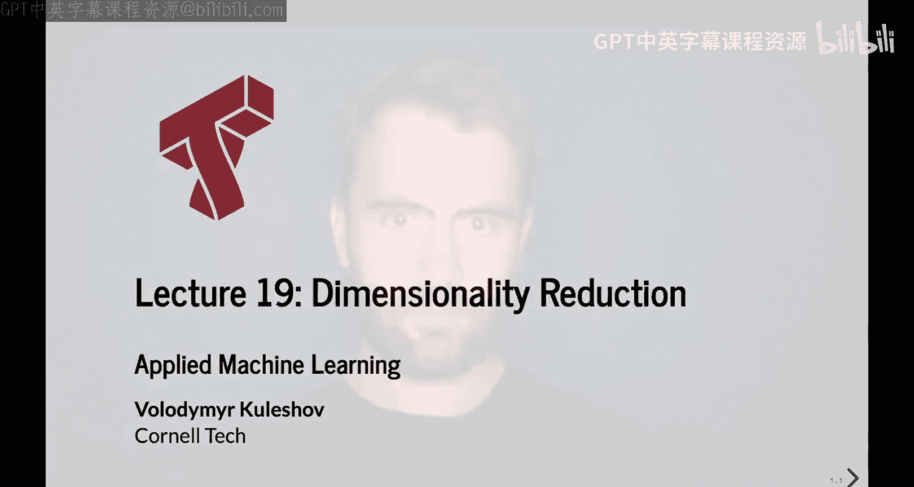
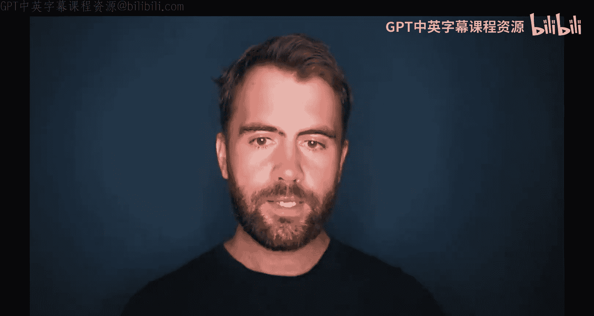
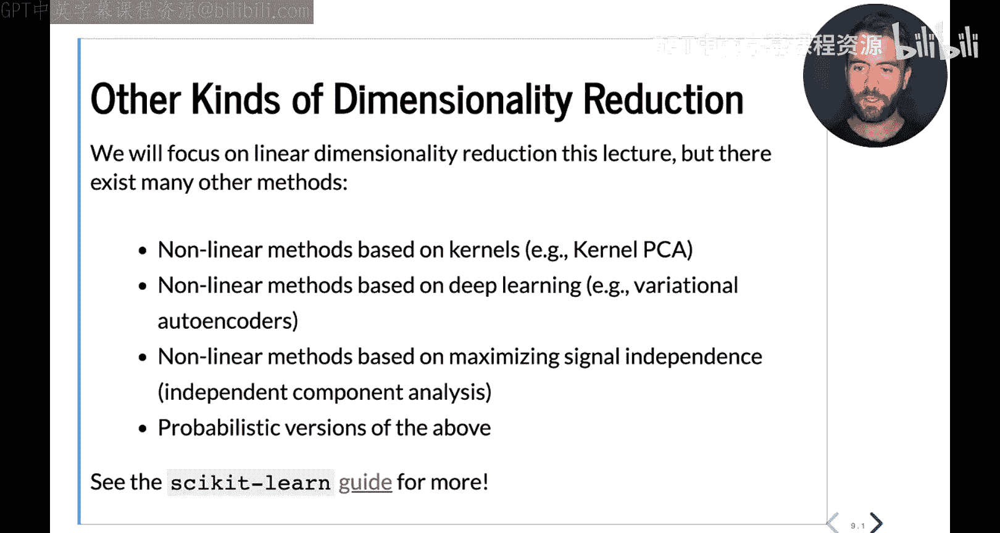

# 应用机器学习：第19讲：什么是降维？ 📉

在本节课中，我们将继续学习无监督学习的主题，并开始探讨一个名为“降维”的新问题。这是继密度估计和聚类之后，我们将讨论的第三个无监督学习问题，也是一个非常重要的主题。

## 概述

降维旨在发现数据中的冗余特征或高度相关的特征，并用更少、更低维度的特征集自动替换它们。这样做可以使数据更易于思考、计算更高效、可视化更直观，并作为其他算法的输入，提升整体分析效果。

## 降维的定义与动机

上一节我们介绍了无监督学习的通用设定。本节中，我们来看看降维的具体定义及其应用场景。

降维可以被形式化地定义为一种无监督学习问题。其目标是学习一个模型 **F**，该模型具有参数 **θ**，并将输入 **X** 映射到另一个集合 **Z** 中的点。**Z** 是数据的低维表示所在的空间。用公式表示即：

**z = F(x; θ)**

一个特别重要且流行的降维类型是线性降维。在线性降维中，我们假设输入存在于 **ℝ^D** 空间，并选择潜在的低维集合为 **ℝ^P** 空间，其中 **P < D**。此时，函数 **F** 是一个线性映射，其参数 **θ** 可以关联到一个矩阵 **W**。低维表示 **z** 的计算公式为：

**z = Wx**

以下是降维有用的一些具体原因：

*   **简化数据**：更少的特征使数据更易于理解和处理。
*   **提升计算效率**：低维数据能加速后续算法的运行。
*   **改善可视化**：将数据降至2维或3维，便于我们直观观察其结构和模式。
*   **作为预处理步骤**：降维后的数据可以作为其他无监督或有监督算法（如分类）的输入，有时能获得更好的性能。

## 降维实例

为了更具体地理解降维，让我们看几个实际例子。

第一个例子涉及鸢尾花数据集。考虑花瓣长度和花瓣宽度这两个特征，它们都以厘米为单位，并且高度相关。这暗示存在一个更根本的属性（例如“植物大小”）可以解释这两个测量值。通过降维，我们可以用这个单一的“植物大小”属性来替代原来的两个特征，从而简化数据分析。

另一个例子是手写数字数据集。原始图像是28x28像素，即784维的向量。通过一种基于神经网络的非线性降维算法，我们可以将这些高维数据转换为2维表示。在这个2维空间中，即使没有使用标签信息，不同数字也形成了清晰分离的簇，这极大地便利了后续的分类和可视化。

第三个例子是关于人类DNA序列的分析。每个数据点是一个表示基因组中特定位置核苷酸存在与否的高维向量。通过降维，我们发现学到的两个最重要的低维轴竟然与地理坐标（南北和东西）高度相关。将数据投影到这个2维空间后，我们几乎重现了欧洲地图。这揭示了人类基因组变异的主要来源与地理邻近性相关，这是一个有趣的科学发现。

## 降维方法的类型

降维领域拥有丰富多样的算法。虽然本课程的重点将放在线性降维方法上，但了解其他类型也很有帮助。

以下是几种主要的降维方法类别：

*   **线性方法**：例如主成分分析（PCA），它通过线性变换寻找数据中方差最大的方向。
*   **非线性方法**：包括基于核函数的方法，可以将线性算法（如PCA）扩展为非线性版本。
*   **基于深度学习的方法**：利用神经网络学习复杂的非线性映射，功能非常强大。
*   **基于独立性的方法**：例如独立成分分析（ICA），通过最大化信号间的独立性，常用于语音去噪或盲源分离。
*   **概率方法**：为降维算法建立概率模型（如概率PCA），从而提供不确定性估计，并能使用对数似然来衡量过拟合。

## 总结

本节课我们一起学习了降维的核心概念。我们了解到，降维是一种旨在发现并压缩数据中冗余或相关特征的无监督学习技术。我们通过鸢尾花数据、手写数字和基因组数据等实例，看到了降维在简化数据、提升可解释性、改善可视化以及揭示潜在结构方面的强大作用。最后，我们简要回顾了线性、非线性、深度学习和概率性等多种降维方法。在接下来的课程中，我们将深入探讨几种特别重要和流行的具体降维算法。