# 康奈尔大学《应用机器学习 CS 5787_ Applied Machine Learning 2020》中英字幕（deepseek p69 -69-Lecture 19. Part 3_ Principal Component Analysis.zh_en -BV12udzYvEFM_p69-

We are now at part two of lecture 19 and in part two。

 we are going to look at our first algorithm for dimensionality reduction called principal component analysis Pri component analysis is a very important algorithm in machine learning and this video is going to introduce it from the very beginning。

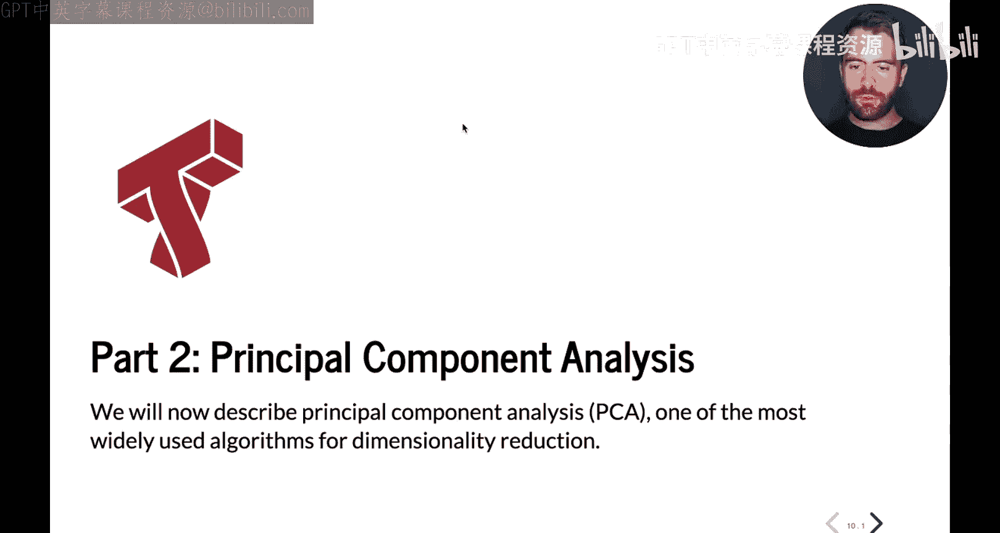

First of all， recall that the components of an unsupervised learning problem include a data set and learning algorithm。

 where the data set， unlike in the supervised learning regime。

 comes without any labels and has this structure here。

 and the learning algorithm starts with a model class and an objective。

 the objective determines the degree to which the model fits the data。

 and the optimizer chooses the model class which optimizes the objective。

And the output of a learning algorithm， combined with a data set， is an unsupervised learning model。

And in the previous video I defined what a model for dimensionality reduction is。

 it is a function which outputs a lower dimensional representation for a data input and now I'm going to define our first algorithm which is going to be PCA principal component analysis and I will define it by again defining the model class defining an objective that we want to optimize and then I will tell you how we're going to optimize this objective。

 so this is going to be the structure of this video。

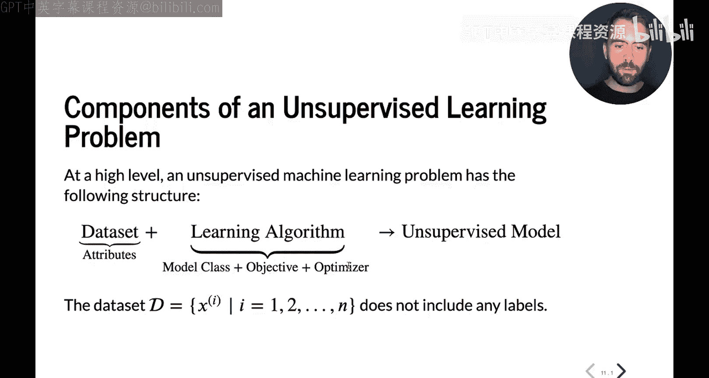

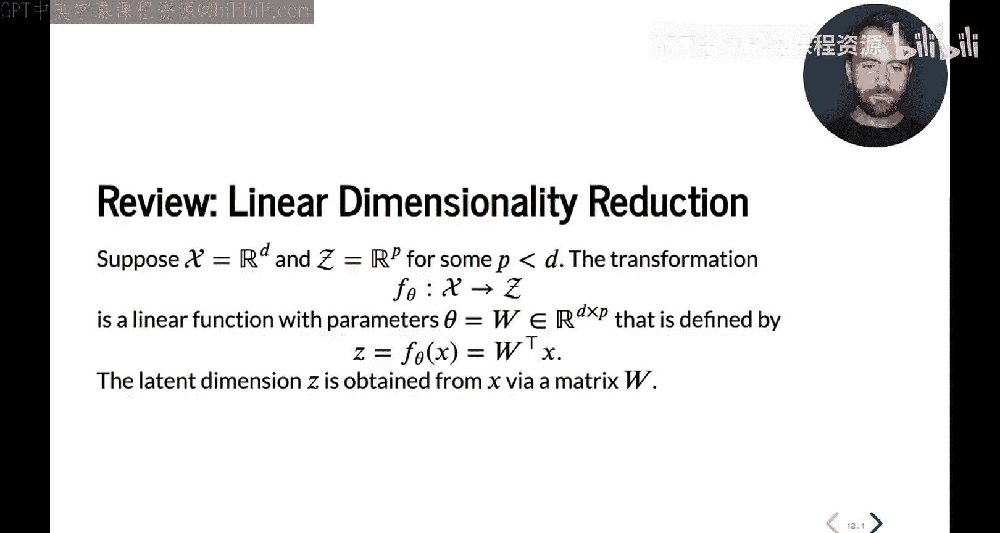

And recall that the problem that we are trying to solve is that of linear dimensionality reduction our data lives in a D dimensional space x。

 and we want to find a lower dimensional spaces Z of dimension P where P is less than d。

Such that Z is a good representation for the data that we have。

And because we're doing linear dimensionality reduction， we assume that this model here， F。

 which maps x to Z， has the following form， so it's a linear function and because it's a linear function。

 it can be represented by a matrix multiplication， and so Z is going to be a linear transformation of the input X。

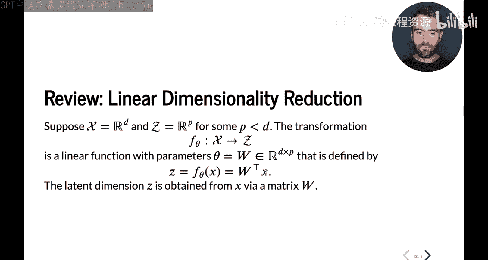

So the principal component models， the principal component model。

Starts with the following assumptions about how the data behaves。

It assumes that even though our data is de dimensionsional。

 most points live close to a low dimensional subspace of dimension P。

And because this is a linear subspace， we can choose a set of orthonormal vectors for this subspace。

 which will be the basis of of this。The subset R and the data， when it lives in this。

Since most data lives。In or close to this subspace。

 we can approximate any data point x by an approximation x tilde。

 which is a point that lives in this slow dimensional space Z。

 and therefore it can be written as a linear combination of the basis of vectors that span the space and that is simply the linear this is the definition of a set of linear vectors。

 and we can write it of。Of。A combination of linear vectors。

 and we can write it in this form as a matrix。So this is just a set of assumptions that we make on our data when we apply PCA。

 and it's easier to understand these via an example。

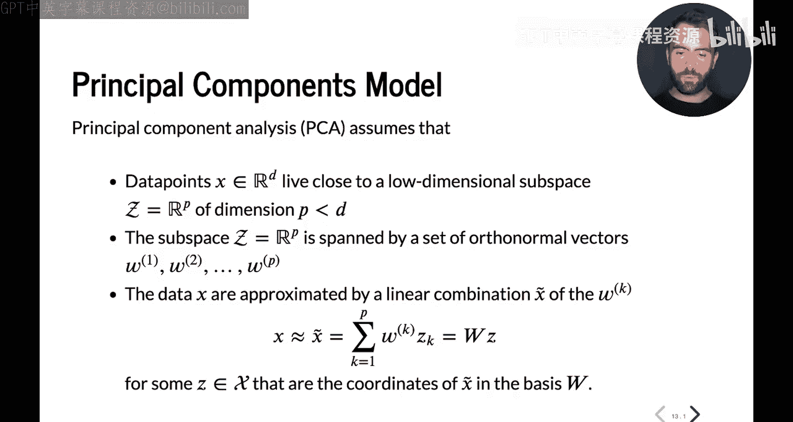

So when I say that the data lives in a lower dimensional subspace。

 one way to imagine this is that imagine points in a three dimensional space。

But even though the space is three dimensional， most points are close to this two dimensional plane。

And so in this case， the data essentially lives in this lower two dimensional subspace。

 this is the blue plane， and that is the space that we're going to learn。

 which is going to be our set Z， and it lives within the bigger set x， which is three dimensional。

 but it's a lower but it's a lower dimensional version of it。

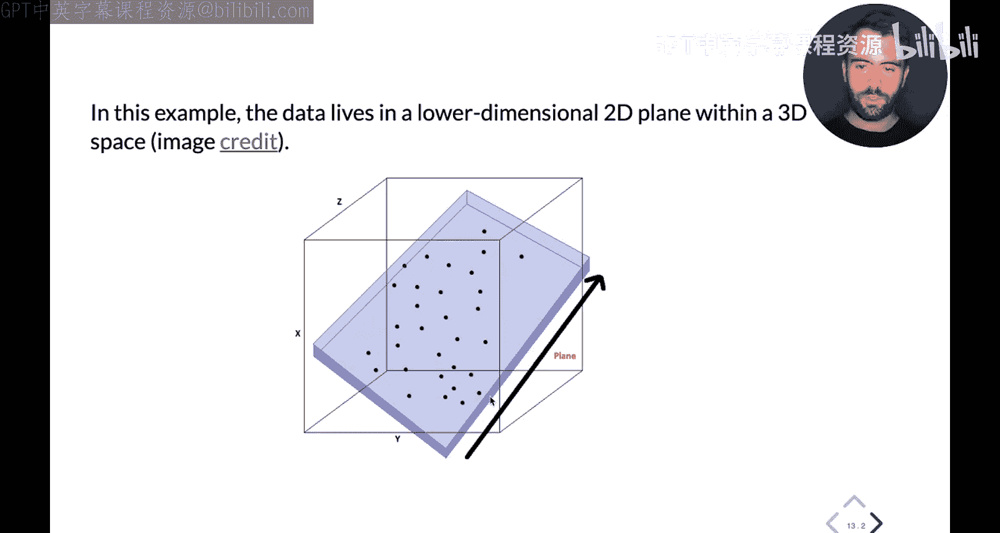

Given that we have this plane。We can find a basis for it。

 so if we have a plane which looks like this， we can find two vectors which serve as the basis of this space and this is these are the vectors which have been denoting by doubled U。

 That's the orthoormal basis for this plane we can find two such vectors and then the latent representation Z is going to be coordinates in this particular space。

So in other words， if these two vectors correspond to my basis。

 then it's as if they place axes along these two dimension along this two dimensional plane and the values of they define a new coordinate system within this plane。

 and for each point we can find its location on this plane。

 in the new coordinate system which has Z1 and Z2， and so a point that lives here in this three dimensional space of x。

 I can find its coordinates in the Z system by projecting it here and then。

Finding that its coordinate and its basis， and it will fall somewhere here in this plane。

So this is an intuitive explanation of what we would like to do with PCA。

 we would like to find this plane this or any other lower dimensional space。

 and we would like to find the representation of the points in these planes using a system of coordinates based on a set of vectors W which spans this space。

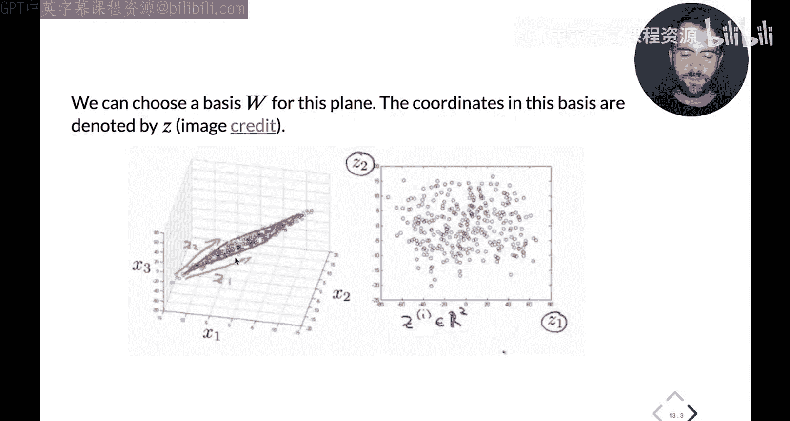

So more formally， a model， so in PCA， we learn a function F sub theta。

 which is going to be our model and as in standard linear dimensionality reduction， F maps x to Z。

And the parameters of this model， the theta， that is going to be a matrix W。

 which is going to be a D by P matrix of p orthonormal column vectors， so in other words within PCA。

 we also choose a linear transformation which can be written as an orthonormal matrix as a matrix of p orthoormal column vectors。

And the result of this operation is going to be the representation of x in this new coordinate system that is defined by these earth normalmal colon vectors。

Using this kind of model， we can perform two tasks。We can perform the following operation。

 which I'm going to call encoding because based on an x。

 we find a low dimensional representation of the input。And similarly。

 we can perform decoding because W is。Is a normal is a matrix with orthoormal columns。

 can we can apply w to it again。 and the resulting we can multiply this by W。

 and the result is going to be an x tilde， which is the point in the which is a point that lies。

On the in the low dimensional subspace。 But now this point is represented in the X coordinate system。

 So in other words， we can perform this operation to recover a high dimensional approximation of high dimensional representation of the of this。

Of this point， based on its low dimensional representation。And again， just to summarize。

 this is the model that is defined by PCA。

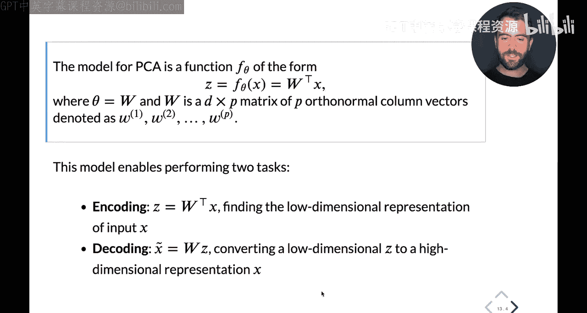

Now， given this model， how do we learn it。PCA can be thought as optimizing two different objectives。

 which I'm going to later show that are equivalent。

One way of defining this subjective and it's a very natural one is called the reconstruction error。

So the question that this objective tries to solve is， how do we find a good subspace。

 a good low dimensional subspace where our data lives？

That would be useful for would be a good low dimensional representation。Well。

The reconstruction of UFBCA。Says that。A good objective to minimize is the difference between each point。

And its closest approximation within within within this low dimensional space that we have defined。

 So in other words， if we start with a point X， we encode this point here to obtain a vector Z。

 and now we decode that point。By applying this transformation。

 by applying our decoding transformation。 And now we get back a decoded version of the same X。

 It will not equal the same。X generally it will be our best approximation。

 so since obtaining this Z is a lossy operation， so x is d dimensional now we get a point that's p dimensional and and then we map it back to a d dimensional space。

 but when we brought it down to p dimensions， we lost something so this x tilde will never equal the original x but it will be close and a good subspace is when our reconstruction matches closely the value of the original point。

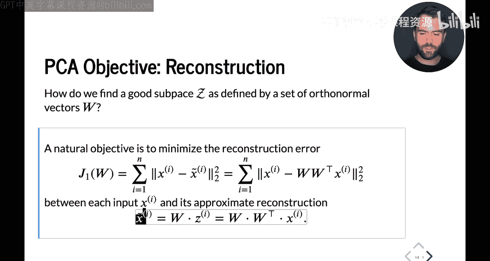

Co。Again， we can look at this via an image。Here I have this two dimensional subspace that is defined by a basis。

 but most points will not lie exactly on this plane。

 they will lie a little bit outside they will be a little bit above or a little bit below。

 you can see here if you look carefully these points are not all precisely on the plane。

 there's a little bit of noise around and so each point will be slightly above or below the plane that we're going to choose。

 but the best plane that we can choose is one that comes as close as possible to all of the points。

And so this is what the above reconstruction objective is trying to minimize。

 is trying to choose a plane that is as close as possible to all of the points such that x delta。

 which is going to be the projection of each x on this plane。

 is as close as possible to its original point。

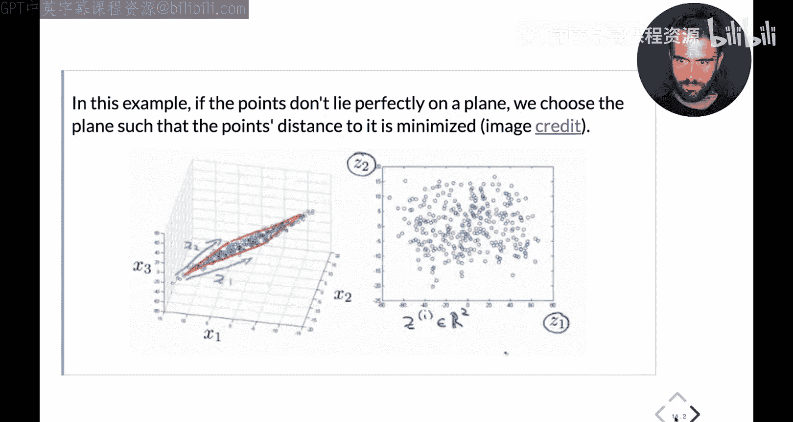

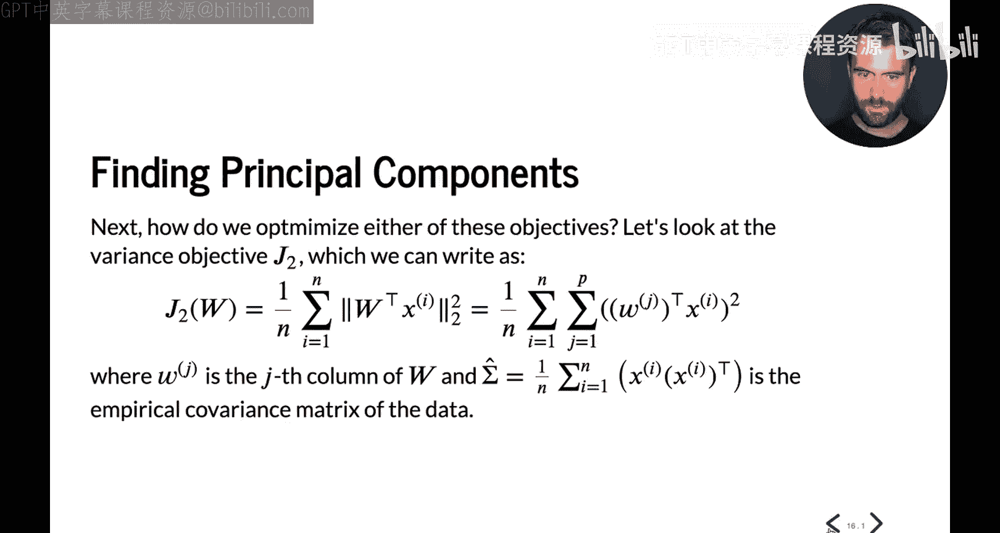

嗯。好丹。嗯。

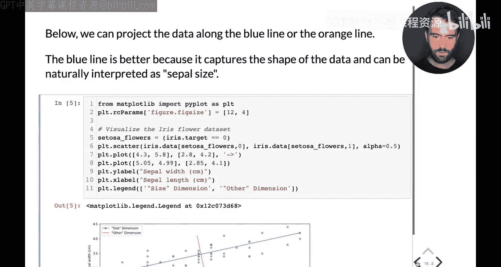

Sorry， technical here。

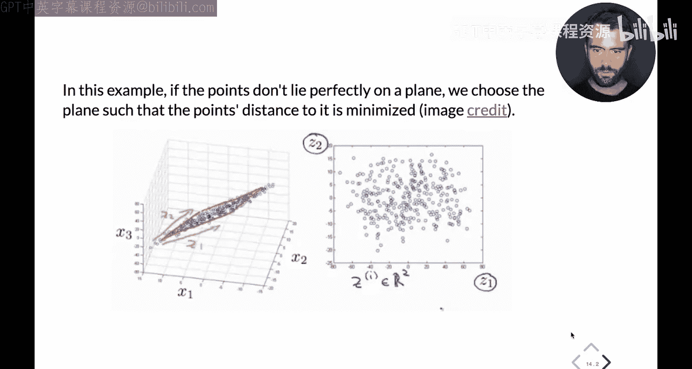

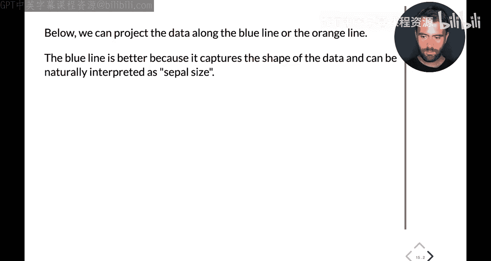

Now， another objective that we could use for PCA is called variance maximization。

In order to explain what this means， we're going to look at an example。

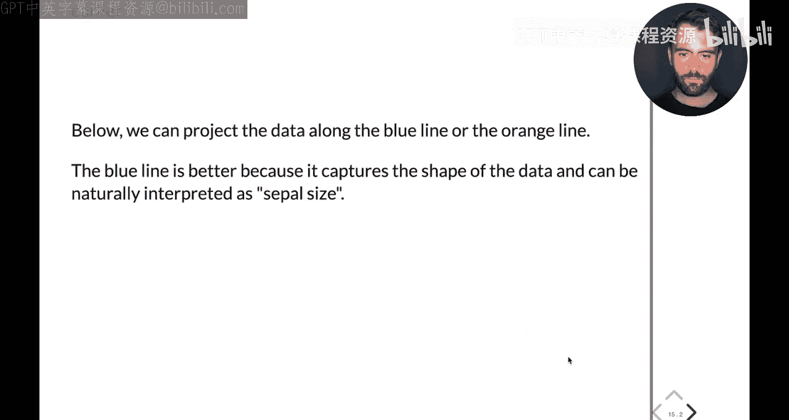

Consider again， our data set of iris flowers， which I am displaying here。

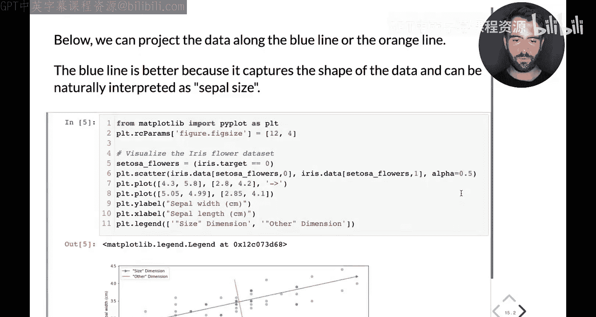

In here I have drawn two lines， the blue line that we saw earlier， and another orange line。

 which is perpendicular to the blue one。

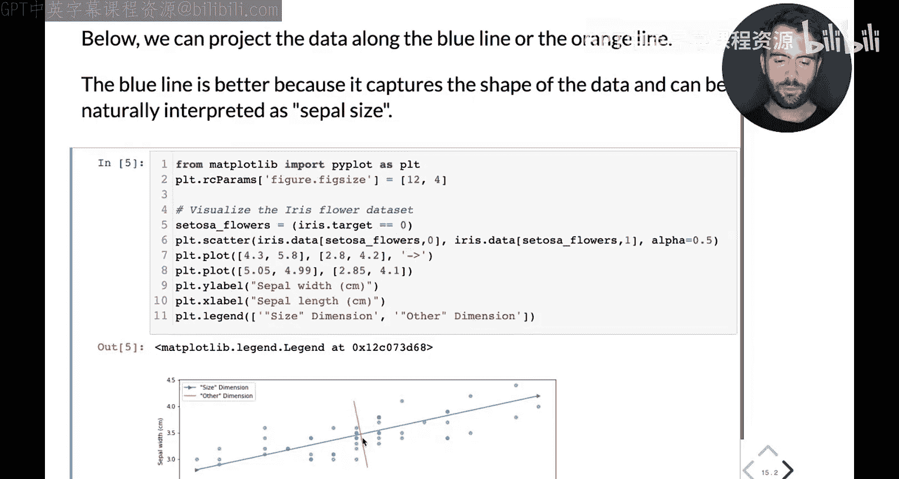

And we can try to choose between these two lines， which would represent a better low dimensional subspace for this data。

 So here we're projecting from dimension 2 into a dimension of one。

 and here I have given two options， blue and orange。

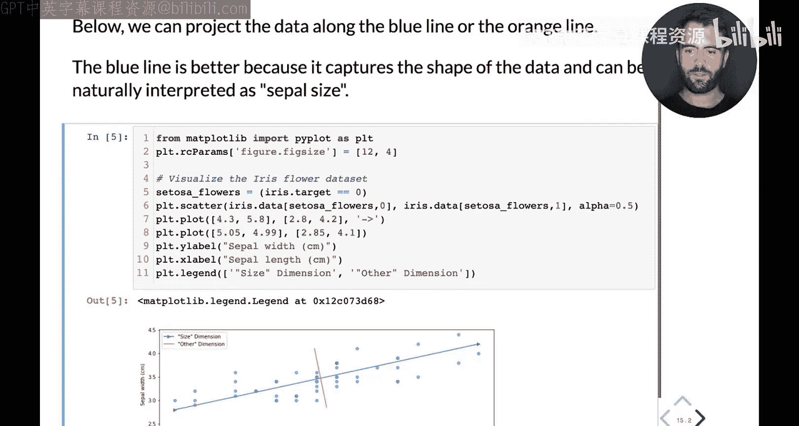

Intuitively， the blue line is clearly better because it captures this data。

 it captures the shape of this data much better。The orange line， on the other hand。

 it captures the shape of this data the least。And so intuitively， the blue line is better。

And we would like to identify automatically the fact that this blue line is better。

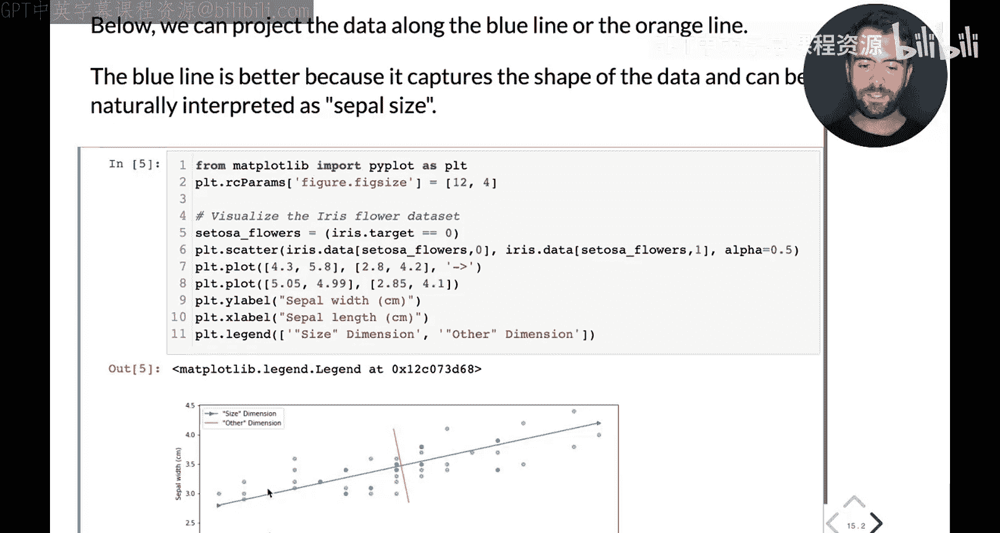

So how can we do this。One way in which we can do this is via the observation that the points here。

 if we were to project them on the blue line， they would be more spread out than if we were to project all of them on the orange line。

And this is what we mean by maximizing the variance of the data。

If the intuitively the blue line is better because the points when projected on it are more spread out and this is the intuition that I'm going to look at again in a second。

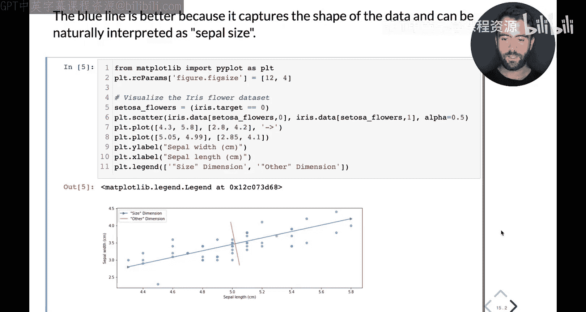

So to make this a little bit again more precise， let's look at the following simpler data set here。

 we only have five points。One way in which we could reduce the dimensionality is to use the following line。

 And here I have the projections of the data on this one plane。

This data here is tightly clustered around the mean。

And this we call this projection as having low variance， so the black points。

 which are the projections on this low dimensional plane， they are all similar to each other。

 and so they have low variance。

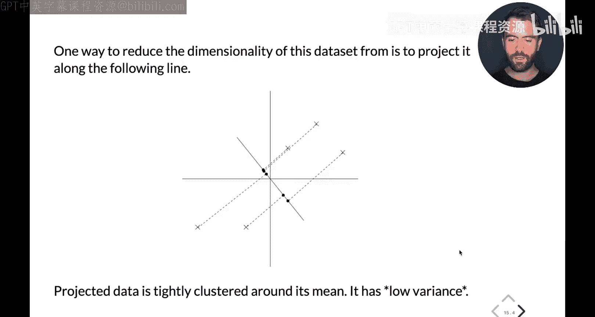

An alternative approach is to project along the following lines。

And now our points here which are in black， they have high variance。

 the mean is somewhere here near zero， but the data is much more spread out along this direction。

And our goal is to identify this high variance direction automatically from data。

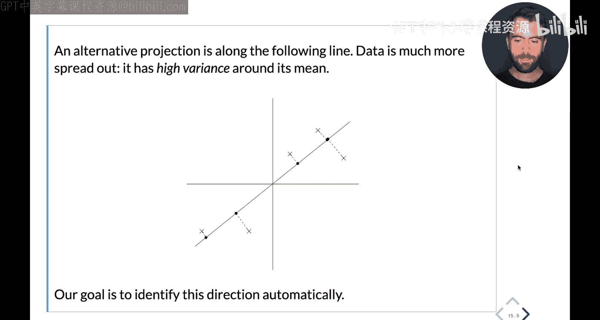

So let's define what it means mathematically to have high variance。

 and then we're going to derive an objective for this definition。

So let's introduce the following notation expectation with little hat to denote the empirical expectation of any kind of value and by empirical expectation I mean simply the average over over our input data points。

 so we have these input data points Xi and we assume that they come from a probability where each point Xi has a probability of 1 over n and therefore the expected value of any function with respect to this distribution over the X is going to be simply the average。

 so this is just a notation that I'm defining here。

And also we're going to assume that the data has been centered。

 meaning that we have chosen the x such that the mean is is is0 and if this is not true。

 then we would apply a transformation called a centering transformation to make sure that this is the case by subtracting out mean from all the data points and in fact this is an operation that we normally need to do when we apply PCA I will come back to this a little bit later and so given that we have performed this operation。

 our data is centered， then the expected value of the data then the average of the data which is here equals0 and also the expected value of the projected data will equal0 it' simply because of the definition of an expectation W here is an orthoormal matrix and this is a linear operation。

 we can take this。And。Then just applying following the previous definition。

 we get that the expected value of the projected data is also zero。

The the mean projected point is also 0。And so now we can compute a formula for the expected variance of the projected data again。

 the data in the projected coordinates equals Z， which is the transformation of x。

 and we want to minimize this， or at least we want to have a formula for this variance。

 which is how much does the data in the projected coordinates vary around its mean。Now， of course。

 the definition of Z is simply a transformation of a point x。

 and so we can replace the Z here with its definition， but since we perform this transformation。

 well this value is going to equal0 and so we're only left with the following value。

 which is the definition of the variance of the data。

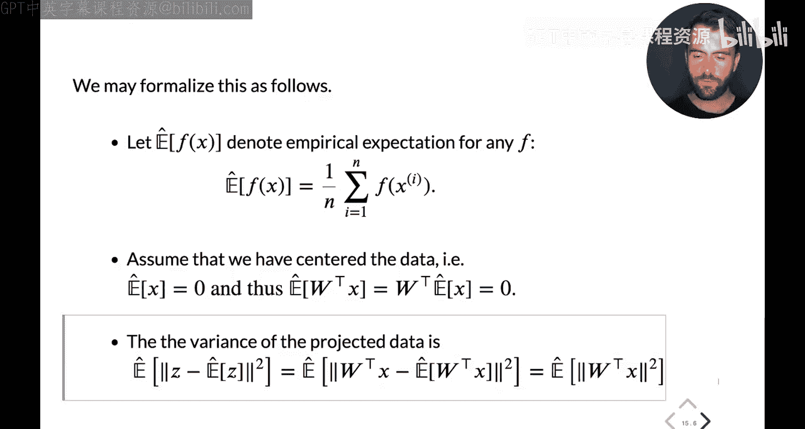

And therefore， we can define a second objective， which is the variance objective download by J2。

 which is the definition I had earlier。 and again， if I write out what this expectation here means。

 that is simply the the average of the。The average norm of a projected data point。

 and because all of these projected data points， on average will have mean zero。

 their magnitude is a definition of the variance。

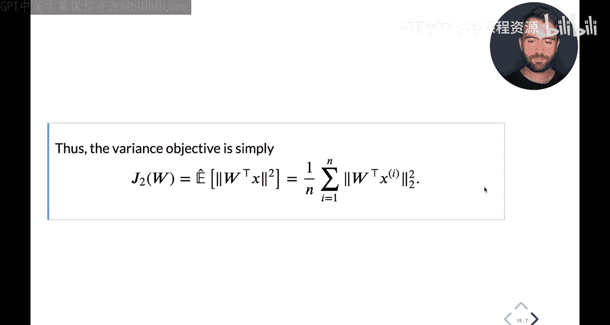

Now， the interesting fact is that both of these objectives are equivalent。

And so if we were to maximize one， or if were to actually minimize if we were to maximize the variance。

 but if we were to minimize the objective。

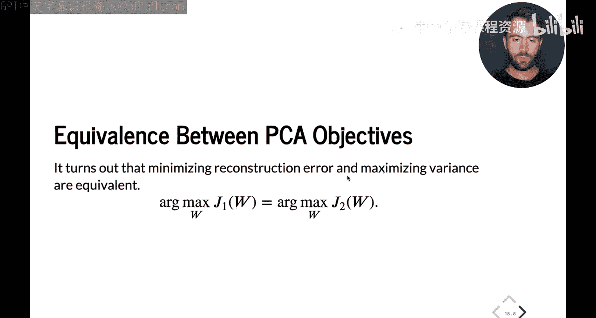

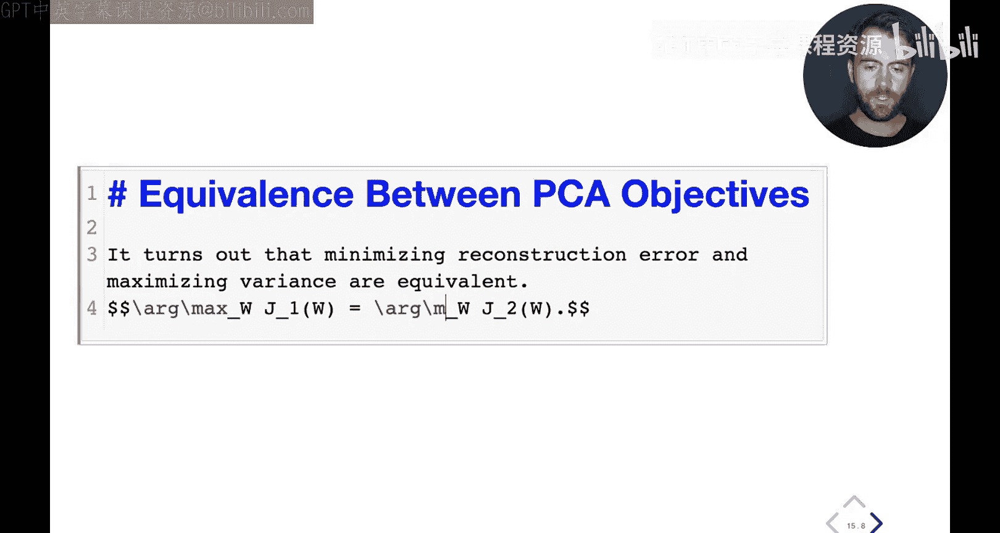

The reconstruction objective， then these two would be equivalent。

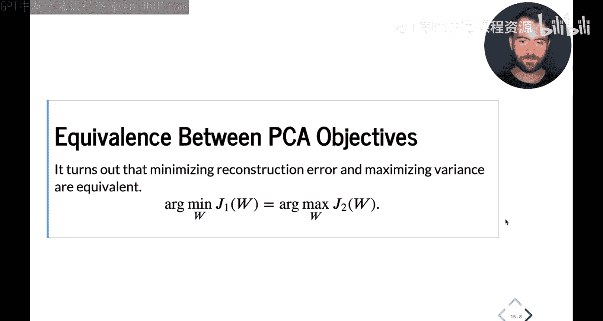

Here is an example that shows the intuition behind this。

So imagine that we have this one dimensional plane and we're projecting these two dimensional points on it。

 or we're seeking the best one dimensional plane。One solution， which is the reconstruction view。

 is that we want to choose the plane that is as close as possible to these black points。

And so we want to minimize the size of these red points。 That is one view。

Another view is that a variance maximization， which is that these red points which are on this line。

 which are the projections， these points should be as spread out as possible。

And it turns out that the line that maximizes the spread and the line that minimizes the distance to the points。

 those are the same lines， so basically this is the reconstruction loss。

 this is the variance maximization version and both of them are equivalent。

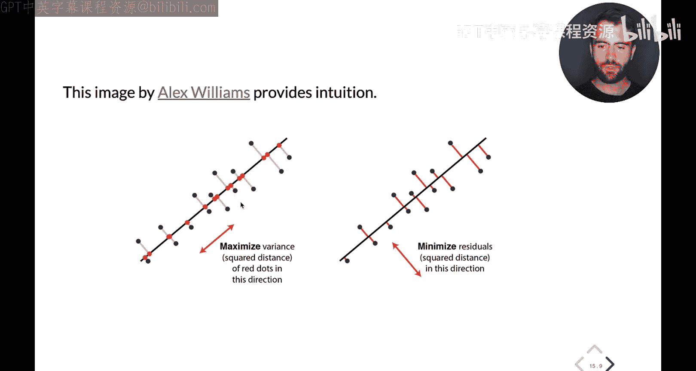

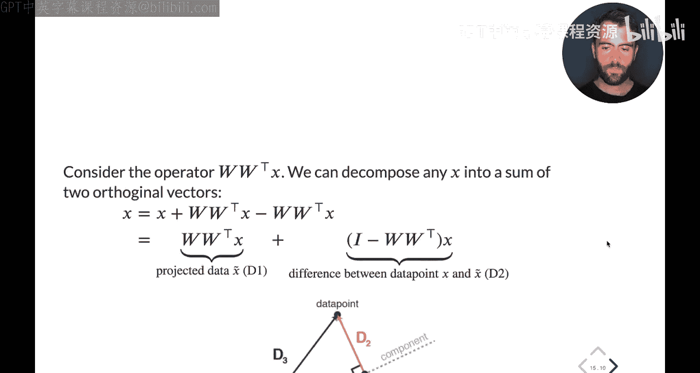

Now， we can also show that this is true mathematically。

This requires two steps first here I'm going to take an input X and just by a few algebraic operations here I add and subtract this quantity。

 I can decompose it as the sum of two vectors。This one and this one。 These are two vectors。

And the first one corresponds to the coordinates。 Well， no， it corresponds。 Well。

 it corresponds to the coordinates of the projected data point in the。Exiemental space。

 so here again we're taking x， we're encoding x and now we're decoding x。

 this gives us a point x tlde， which is going to live here。

 and so the length of this vector here equals d1 and this other vector that's simply the difference between x and its projection x delde and that would correspond to the point d here。

And you can see that they are orthogonal because we're performing in orthogonal projection。

 because we're projecting down to this the upperpendicular line。

 these two components are perpendicular and you can also verify them by working out the math。

All right， but so far this is just a simple identity。

 and I claim that these vectors are also orthogonal via the following and I giving the following images and intuition。

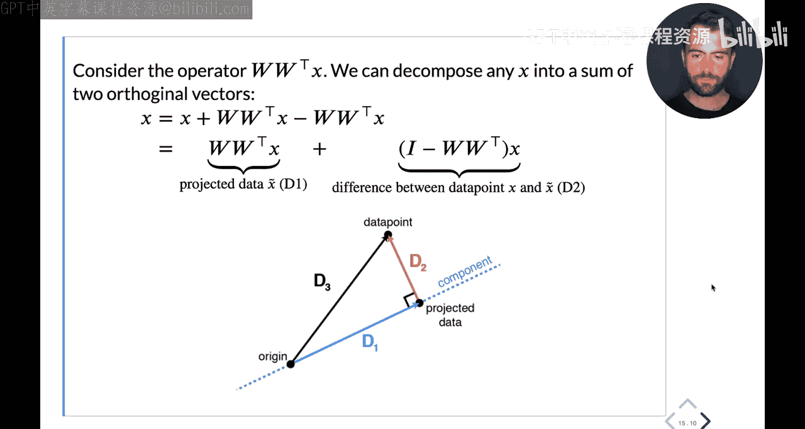

So now if we assume that they are， well， if we have this identity。

 now I can compute the norm of both the left and the right of what I had in the previous slide。

This is what I do here on the first line， then on the second line。

 I use the fact that they are orthogonal to say that their sum is the norm of their sum is the sum of their norms。

And then here I just perform one transformation， I replace this vector by this vector because w is an orthonormal matrix and multiplying a vector by an orthonormal matrix does not change its norm。

 and so the third line is also true。So now we have derived this identity， which is the third line。

And the observation here is that this。

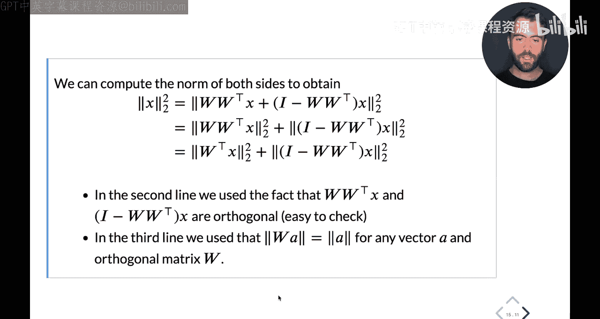

This really closely matches our objectives， in fact。

 here this is simply our variance objective and this is our reconstruction objective and their sum equals a constant。

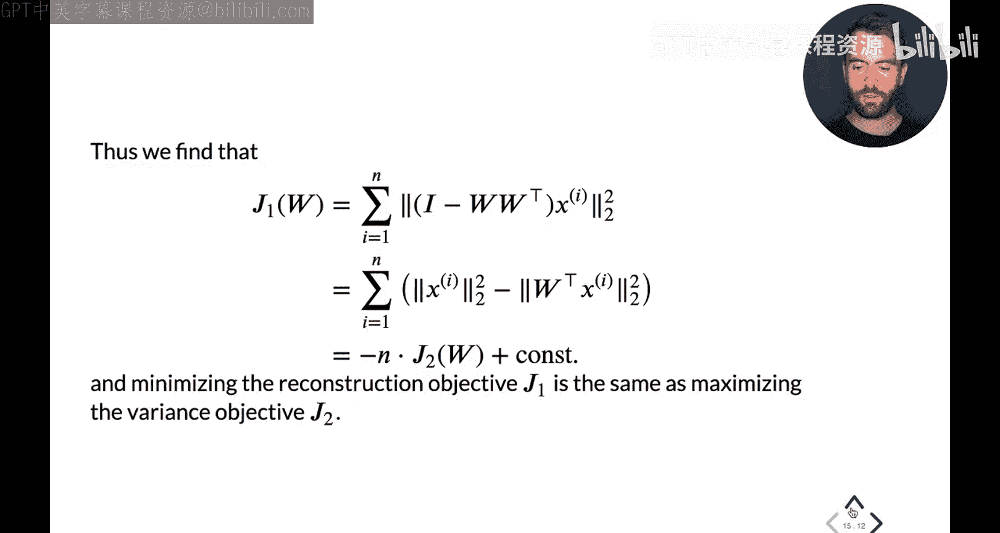

Therefore， what it means is that when we're maximizing one， we're minimizing the other。

 or to put it a little bit more mathematically here， this is the definition of our objective。

 and now I just plug in my previous identity into this term and I get something which looks like my second objective plus a constant and multiplying by n。

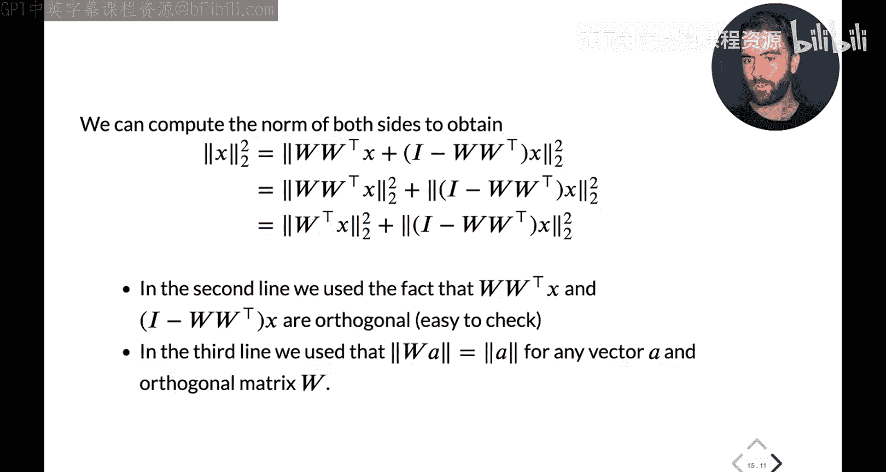

So in this sense， these two objectives are equivalent。

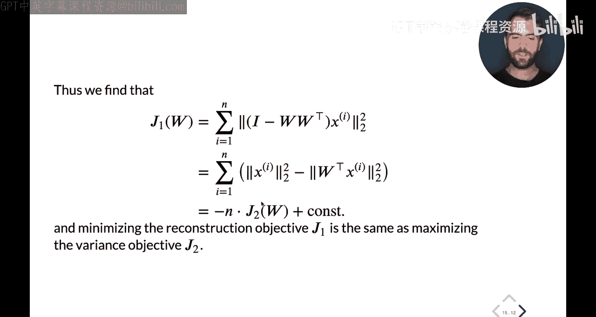

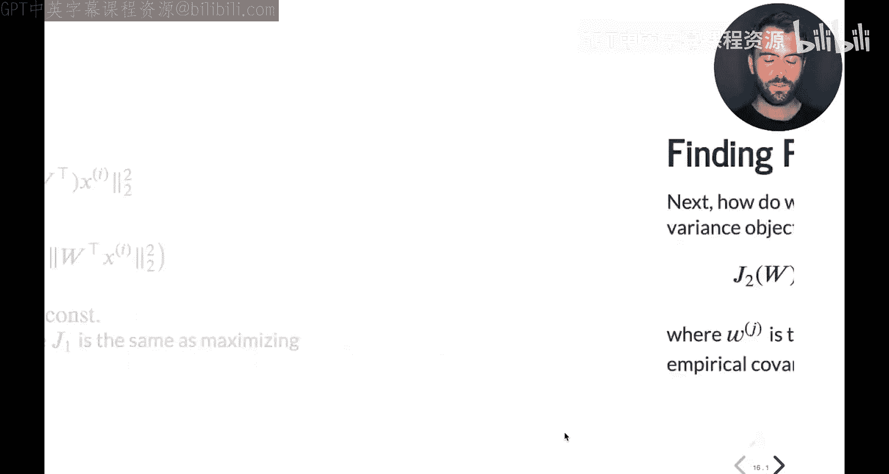

So I have defined now two objectives for principal components。

And the question is now how do we optimize either of these objectives We can choose either and we're going to choose the one that performs variance maximization。

 we're going to choose J2 and recall that this is the form of J2 and here I'm just writing explicitly what this means so w is again recall that this is a matrix where each column is a ortho normalormal vector and that is our ortho normalmal basis and I can just expand the definition of the L2 norm and this objective is going to be is going to have this particular form。

 this is just the definition of the L2 norm。嗯。

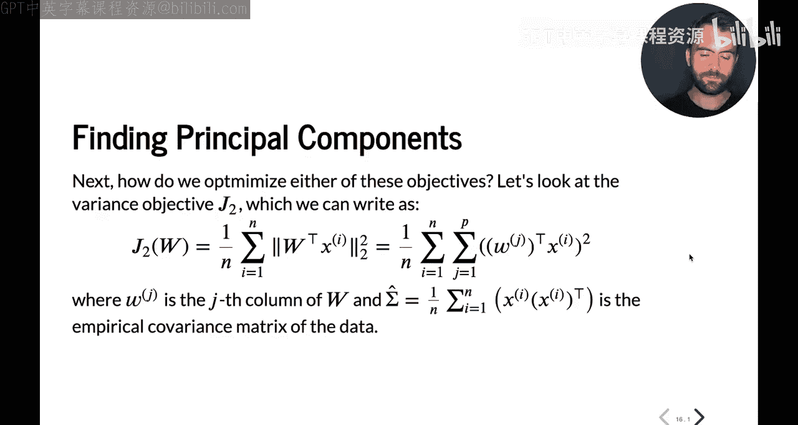

So in order to understand how to optimize this objective。

 let's rewrite it in a slightly different way。Here。

 this is the definition of the objective that we had earlier， this is copied from the previous slide。

And now， well， this is just a term squared， so it's this term multiplied by this term。

 this is just the definition of a square in the second line。

 I've just written out the square as multiplying the same number twice。And now in the third line。

 all I'm doing is that I'm rearranging some terms and I'm switching the order of summation。So。

Instead of。I guess what I can do here is I can take the otherer summation and I can bring it inside since it only applies to these vectors and I can also change the order in which these vector multiplications are operated and instead of are performed and instead of performing them in this order I can first operate over the two x's which is here in the middle and then I can operate with on the Ws。

 so here I have just change the order of the operations。And finally in the last line。

 I have replaced this expression here， so first of all this is an outer product between two vectors。

 this has dimension D by D and now I have added n of these and so this here is a D by D matrix。

Which is which I'm going to denote by sigma hat。 This is a D by D matrix。

 and this also happens to be the empirical covariance matrix of D。So。

To summarize all of this is that this is a set of algebraic manipulations。

 which starts with our variance subjective and transforms it into。

Into a sum of P terms where in each term we're multiplying， we have this matrix sigma。

 and we're multiplying by w from each side。This is just a different way of rewriting the same objective。

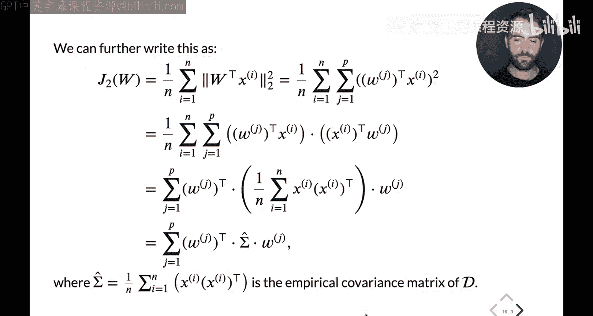

Now， this matrix sigma， it is positive semidefinite。

 You can easily check this by the definition by applying the。

Just the definition of a positive semi deffinite matrix and checking that it holds and because of that it has an eigen decomposition。

 which is a decomposition of this form， we can write a sigma hat as a multiplication of three matrices。

 Q lambda and Q transpose。Where Q is a matrix whose scs are the orthonormal eigenvectors of this matrix and lambda。

Is a diagonal matrix with entries of0 everywhere except on the diagonal and the diagonal entries going from top to bottom are going to be Lada 1。

 Lambda 2 up to Lada D， and those are going to be the eigenvalues。

And we can also rewrite this expression in the following form where we have sum of the outer products of the eigenvectors that are weighted by the lambmbdajs。

All right， so here I have just。This is just applying the definition of the eigen decomposition。

 this is just a straightforward fact from linear algebra。

But now we can use this fact to derive a formula for the optimal solution to our variance maximization objective。

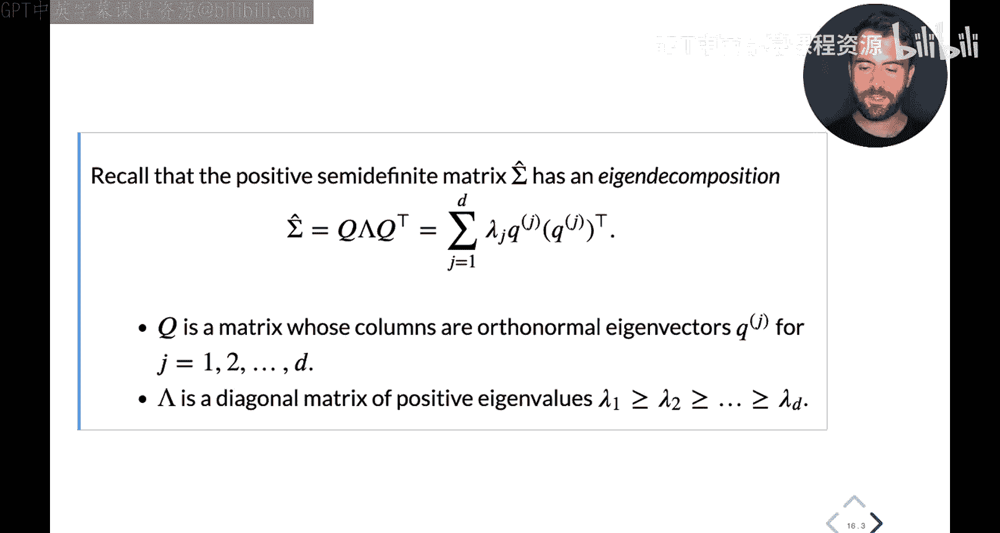

First， let's look at a simpler case when P equals 1。When p equals1， well。

 this is the objective that we have to optimize。 We only have a single vector W that we optimize。

 and we want to choose the best， the best w that。Maximizes the following objective。

So how do we choose this W。Well， using the eigen decomposition。

 we can write this objective as follows。So here I'm just applying the definition of the eigenecomposition and this is the second definition of the eigen decomposition。

 and so what we have here is a sum of d terms where we have the lambda Js and we're multiplying the dot product between W and each of the eigenvectors。

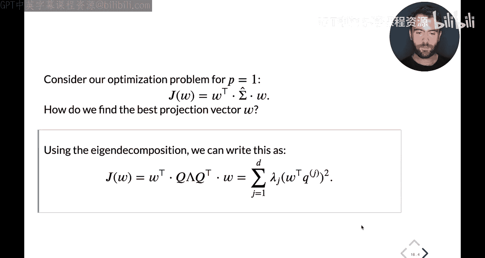

So I claim that the optimal solution to this problem is attained when w equals to the first eigenvector。

And the optimum solution of this objective， the value that is attained by the objective is Lambda 1。

 which is the value of the largest eigenvector。So this is our solution。Why is this true。First。

 let's define these terms。 So this is the form of our objective。

 and I can define each of these dot products as I can call them As sub J。

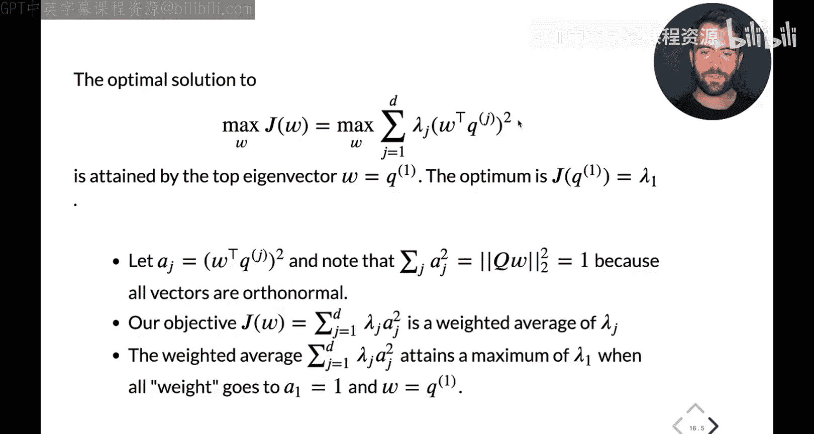

And you should observe that the sum of the squares of these AJ squares， basically this sum。

 it is simply the。It is simply the value of this vector。 so I'm multiplying Q by W。

 I'm taking its L to norm squared。 and because w is ortho normal and because all the Qs are ortho normalmal here we just have。

We're multiplying orthoormal vectors。We we're doingduct products between orthoormal vectors。

 And so this value is going to be one。 And so the sum of the alpha Js is going to be one。

Now our objective here has this form where I have just plugged in my definition of AJ。

And so because the sum of the Aj squared is1， this is essentially a weighted average over the lambda Js。

 so here we have one unit of weight， basically they have the sum to 1。

 and so this is going to be sum average between the lambda Js is's going to be a weighted average where the weights are between 0 and 1。

 the sum to 1 and they are the Aj squared。And so because we have this weighted average。

 this weighted average is maximized when。It's maximized and it attains its maximum of lambda 1。

 which is the largest possible eigenvalue when all the weight goes to a1。

 And so when a1 equals 1 and all the other。A is equals 0。 Then this value attains its's possible。

 its maximum possible value of lambda 1。And if this was not the case。

 if a1 was less than1 and some of the other A's were was nonze。

 then we would have an average between lambda 1 and another eigenvalue that is smaller than lambda 1。

 which would give us a smaller value for the objective。 So a1 has to equal 1。And when does a1 equal1。

 Well， it equals when this dot product when the dot product of w with Q1 with largest eigenvector。

 when it equals 1 and the dot product between two vectorctors equals one when the vectors are the same。

 So therefore， the optimal solution to this to this value is the optimal。

The optimum of this objectiveive function is attained when w equals Q1。

 which is the leading eigenvector。

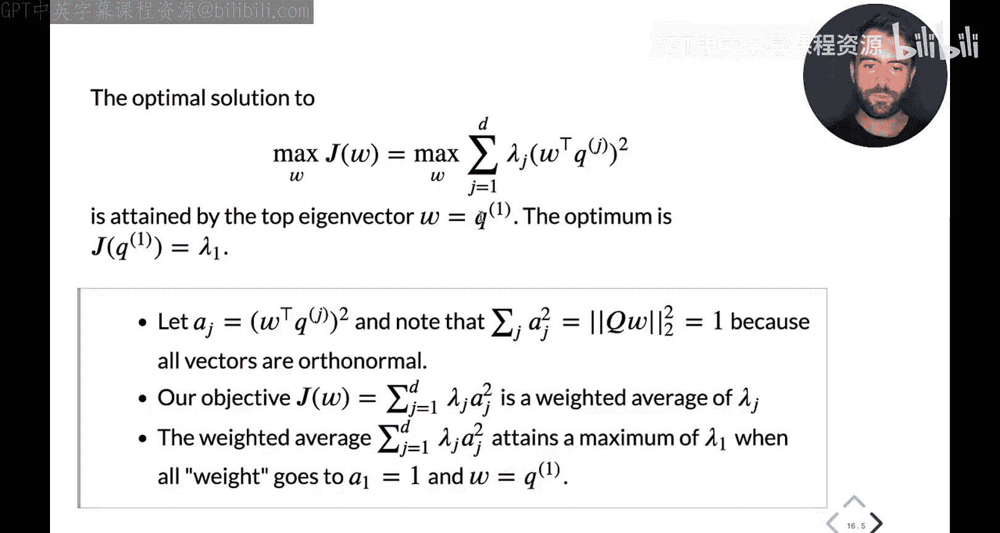

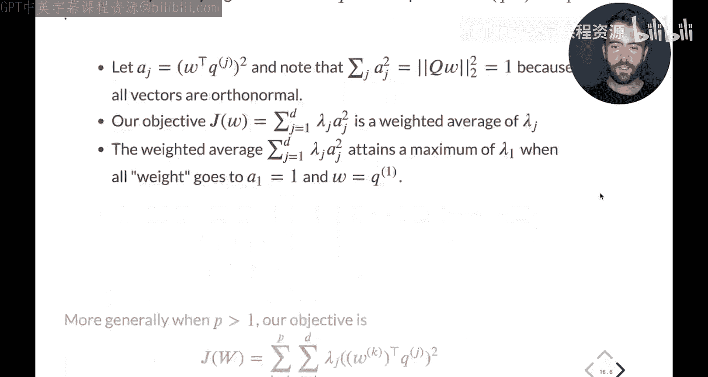

And finally， I gave this example for the one dimensional setting， but the same holds for NEP。

When P is greater than one， our objective is。Is a is is a sum like this。

And this sum is maximized as in the previous example when each of the ws。

 when basically the PWs are the P largest eigenvectors。

 and then the maximum value that is attained is the sum of the P largest eigenvalues。

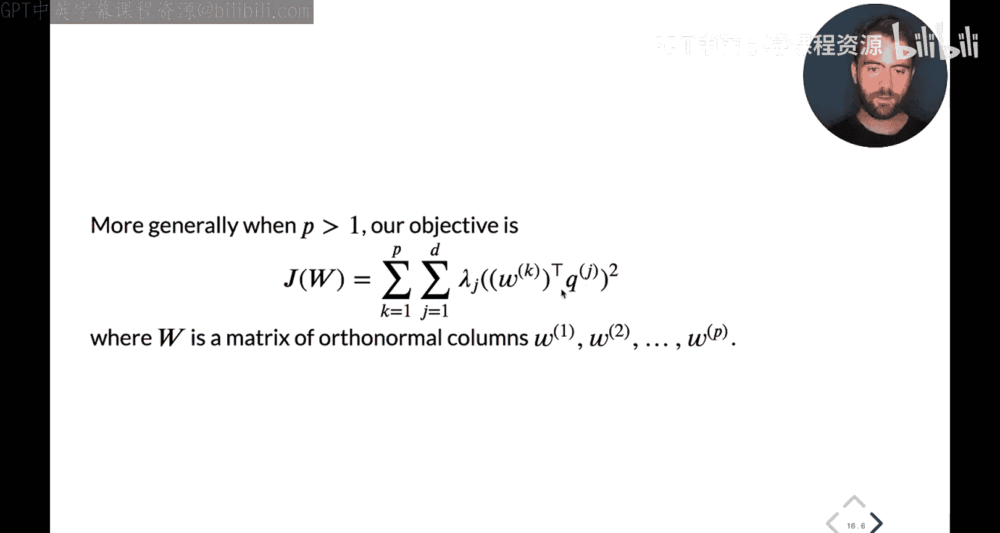

And again， if this was not the case， then we will be。

tThen we would be adding we would be taking out a lambda here and replacing it with a smaller lambda and that would just make the objective value smaller。

So this here， the sum of these lambda。We can can refer to it as the variance explained by the lower dimensional projection。

If p equals D， then we're going to recover all our eigenvalues and this number will equal 1。

And the idea would be to find a P such that P is still low。

 but we can still explain most of the variation in the data as explained by this fraction。

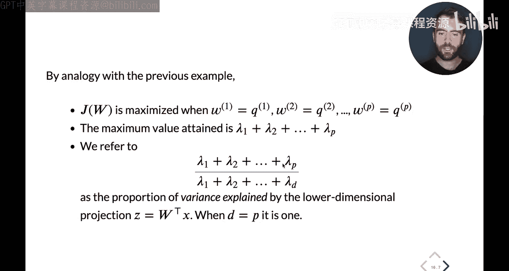

So finally， all of what I just mentioned defines the entirety of the algorithm of principal component analysis。

So as I said earlier， it's an algorithm for unsupervised learning and in particular for dimensionality reduction。

And it optimizes a model family， which is a set of linear projections of this form。

We have to choose this matrix W， and we choose it by optimizing one of two objectives。

 either the reconstruction error or variance maximization。

And the way that this is done is by performing an operation called matrix eigen decomposition。

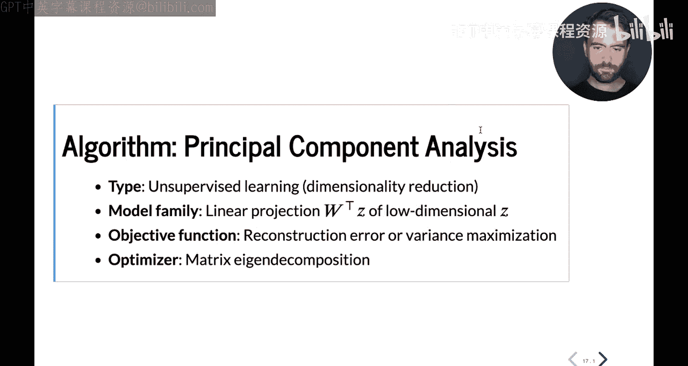

Now， when applying this algorithm， there are a few practical considerations that are worth to keep in mind。

 The first is one to which I alluded earlier， which is that。When when applying PCA。

 it's important to normalize the data to have zero mean and unit variance。

And what this means is that for each data point and for each dimension。

 we compute the empirical average of the data along that dimension。

 and we subtract it away in order to make sure that the average of the data points along this dimension along each dimension equals0。

And similarly， we also compute the standard deviation of the data along this dimension。

 and we divide by the standard deviation to make sure that the standard deviation of the data equals1。

And the reason we want to do this is because we want to address all sorts of scaling issues that might arise due to the choice of units。

 So for example in my example with motorcycle speed。

 if we were to use kilometers per hour or if we were to switch from kilometers per hour to centimeters per hour then we would inflate the value of that attribute by a lot and it would look like it's an attribute that we basically stretch our data along that one attribute。

 it would look like a highly varying attribute that is really important。

 but that's only because we chose that's only because we change the units。

 so by transforming by performing this kind of operation we're making everything unit agnostic and therefore it doesn't matter as much what what kind of unit we use and therefore it's more robust to how the data specified。

And finally， number of an important decision that we need to make when applying PCA is what is the dimensionality P of the data that we choose。

As in K means there is not a simple solution to this and in practice we resort to heuristics like the elbow method in other words。

 apply we try different values of P。 well first of all。

 if we're doing something like visualization and we want to have a two dimensional plot then it's clear that P equals 2 but if we're looking for high dimensional space。

A technique that is often used is to try different values of P and look at the values of some of our objective functions。

 such as the variance or the reconstruction error， and when we see an elbow in the curve。

 like we did for k means that it means that we have probably found a good value of P for our data。

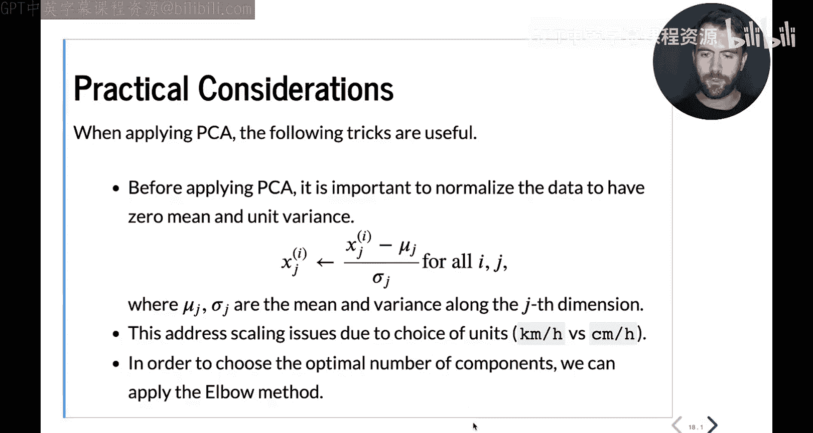

Now as an example of applying PCA， let me implement a simple version of it on the flower dataset that we have seen earlier。

 so recall that our flower data set it is actually four dimensional。

 in most examples I've only been using the first two dimensions， but in fact it's higher dimensional。

 it has four dimensions and here I'm visualizing it in here I'm visualizing the first three dimensions which are sepal length sple width and pal length and there's also four dimension that I'm not visualizing in this particular plot。

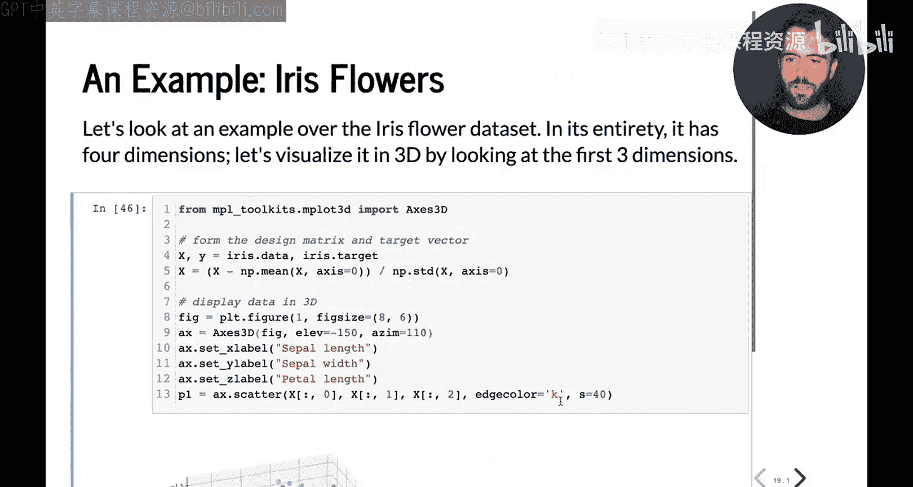

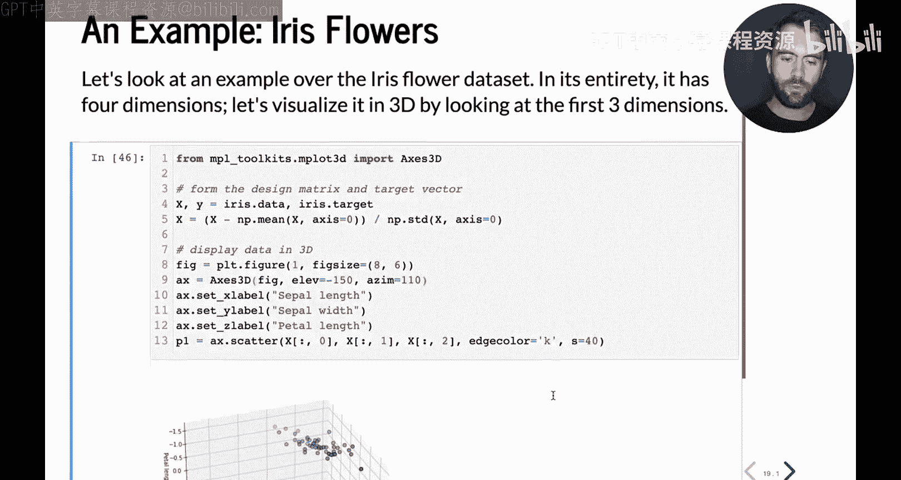

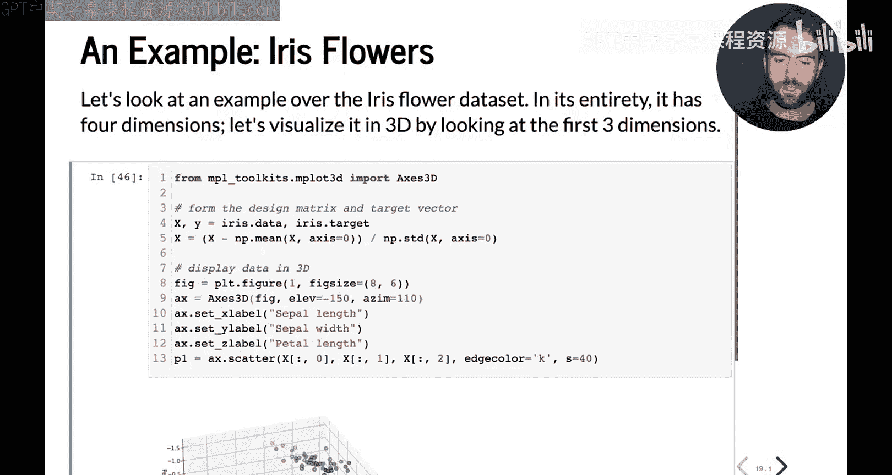

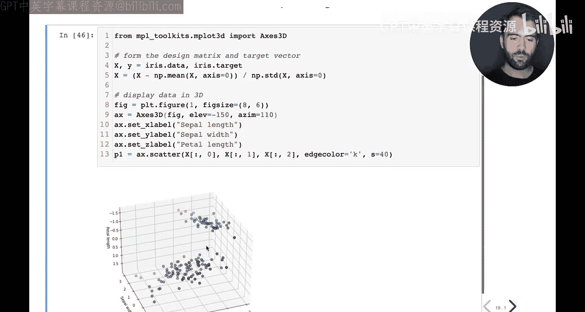

So how can we apply PCA to transform this data into a lower two dimensional space？

Well， the implementation of PCA and this data the implementation of PCA in Numbai is in fact。

 really simple。So x here is our design matrix。It's an N by D matrix。

And we can compute the value of the matrix sigma here using a little bit of nonpi。

 We can form the covariance matrix。And now we can perform the eigen decomposition of sigma to obtain the vector of eigenvalues eigenvectors Q。

 we choose w to be the top P eigenvectors， and then we project the data along these eigenvectors and that is everything that PCA does。

Oh， and by the way， again， I just want to highlight here that when I loaded my IIS data set。

 I whitened the data or I centered and I normalized the data to have standard deviation of one。

 and again I just want to reemphasized that this is important to do when applying PCA。

All right， so here we have defined PCA。And now we can apply it to our data set。

The application is very simple。 We apply this projection Z， and now I can visualize the data。

 and I have these two distinct clusters which were the Iris sattosa and the Iris non Satosa flowers。

I can confirm the structure by visualizing them with the labels， which I have discarded。

 but now I can use them here to verify the quality of my clusters。

 and you can see that the different clusters are reasonably well separated。

 even these two clusters here they' are somehow mixed。

 but overall theyre still a really good level of separation。And this level of separation is。

 in general， better than what we had earlier when we just used the first two dimensions here。

 the points， especially the yellow and brown points here were not as well separated as they were。

And one way to verify that PCA is giving us a more useful and a better projection in which。

TheA better two dimensional visualization of the data than just taking the two dimension。

 the first two dimensions and a representation in which the data is reasonably well split is that we can train classifiers over this data。

So here I'm training a softmax classifier only on the data without PCA that only uses the first two dimensions。

 which is the kind of projection we have been using so far in all of our examples in this lecture and then I can also do the same thing。

 but instead I'm using now the data in the PCA coordinates。And the accuracy of a selfmax classifier。

 I recall this is multinomial logistic regression that is the same thing as a softmax classifier。

 the accuracy of the supervised algorithm is significantly higher on the PCA dimensions than it is just on the first two dimensions in the data。

So this concludes our discussion and our example of PCA and I just want to conclude by summarizing a few strengths and weaknesses of this method。

 it is very simple and intuitive and fast to implement and also it works in practice really well it provides a lot of good visualizations For example the DNA analysis example from the previous video this was obtained using simple PCA on sequence data。

So， this method is really powerful but。It is still linear and you will eventually find applications where a linear dimensionality reduction method is not sufficiently flexible。

 in particular， if you work with data sets like images， then there are more effective。

Unsupervised dimensionality reduction methods， which would be based on deep learning techniques。

 which would work better with modalities like images or or audio or sensor data and PCA would work less well。

 although it can still find interesting signal even in images but more modern deep learning methods would be better on on that kind of input and also。

Bing。An unsupervised method， choosing hyperparameter like P can be a bit of an art for this kind of method。

However， despite these limitations， PCA is a very important and supervised learning algorithm that is an important tool for applying machine learning in practice。

