# 康奈尔大学《应用机器学习 CS 5787_ Applied Machine Learning 2020》中英字幕（deepseek p70 -70-Lecture 20. Part 1_ Machine Learning Development Workflow.zh_en -BV12udzYvEFM_p70-

Hi and welcome to Lecture 20 of Applied Ma learninging。In Le 20。

 we are going to start a new topic in the course， which will focus on techniques for building machine learning models。

 for understanding their performance and for improving this performance in a principled iterative way。

As a motivation for what we're going to look at， consider the following example。

 suppose that you trained an image classifier on a data set and now you have reached a point where you have 80% accuracy。

What do you do next？You could try to further improve the accuracy by adding more data to the algorithm or you could try to look at whether the algorithm is being properly optimized。

 and you could try to train the algorithm for longer。 You could try to use a bigger model。

 a smaller model， you could regularize， you could add features。

These are all kinds of design decisions and improvements that you could make in order to try to improve your accuracy。

The focus of this part of the course will be on principled approaches and methodologies for prioritizing these decisions and improving the performance of machine learning models in a principled way。

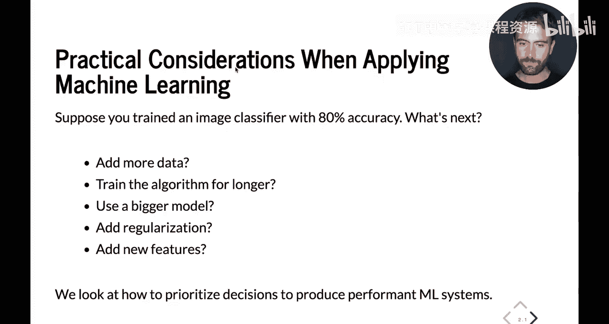

The first part of this lecture is going to focus on a particular machine learning development workflow that I will introduce。

 which is essentially a principled approach for improving and iterating on machine learning models。

I will start by giving a high level overview of this workflow and then next in the rest of this lecture and in the following lecture。

 we are going to look at specifics and look at the details of various steps in this workflow。

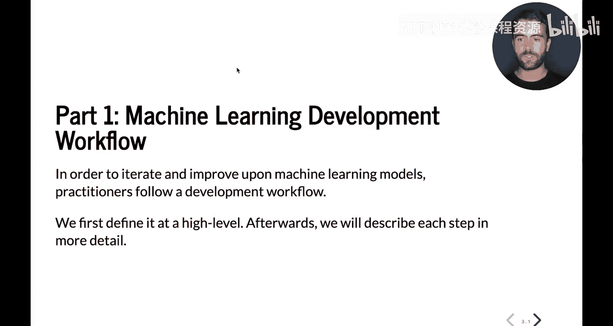

Before we begin， let look at let's remind ourselves about the general setting in which we're in when we do machine learning here for this lecture I'm going to use supervised learning as my running example。

 but these ideas also can be extended to unsupervised learning as well。

And recall that in supervised learning， we assume that the data that we work with is coming from a probability distribution called a data distribution。

 and our data set here de by D is a set of IID or independently and identically distributed samples from the distribution P。

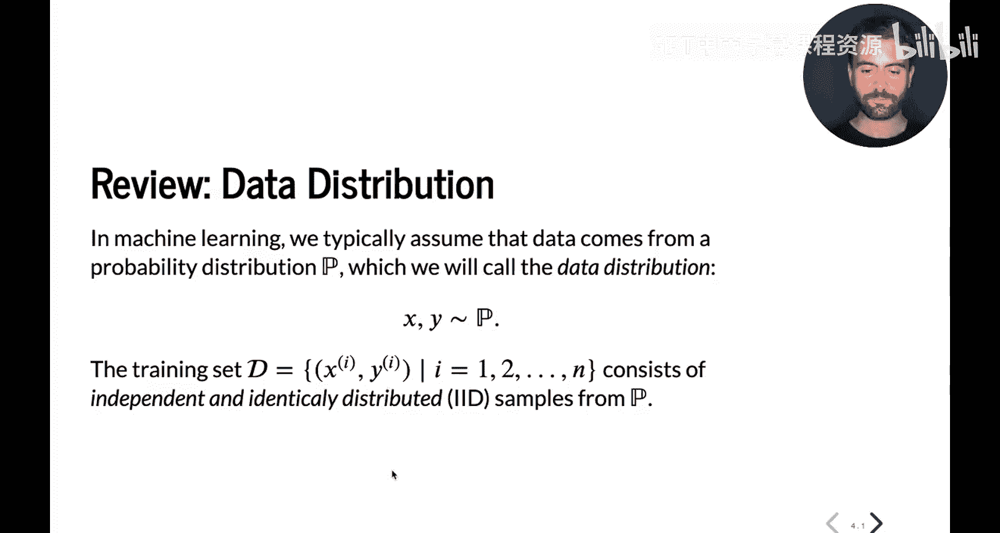

Now， when we build machine learning models， we typically， especially in supervised learning。

 we optimize their performance over our training set。

But as we have seen at the beginning of the course， that is not the real goal of machine learning。

 Our machine learning algorithms work if they generalize well to new data。

And in order to estimate whether our algorithms generalize well。

 we introduced this concept of a holdout set， which is a data set from the same distribution。

 but that is distinct from the training set and if we have correctly learned。

If we have correctly learned the signal that's in the data。

Then we should generalize to this new data set and we should also have a high accuracy on this separate holdout set that is how we know whether we have successfully trained a machine learning model。

So in this video， I'm going to present a workflow algorithms that for building models that have this property of generalizing well to new data and working well in practical deployments of machine learning algorithms。

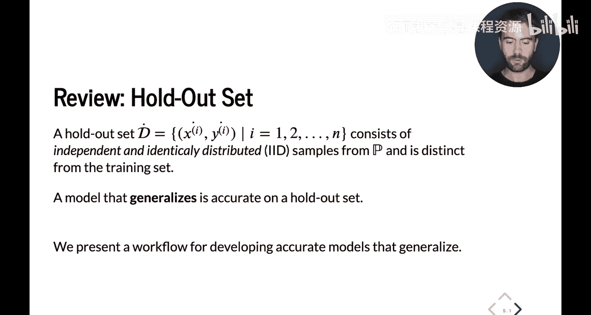

So when we work with machine learning。It is typically it is the norm to break our data into a number of different subsets。

The main and usually the biggest subset of the data is what we call the training set and that is what we have worked with throughout the entirety of this course。

 and that is the core data on which we train our algorithms on which we minimize an objective function。

In addition it is the norm to also work with what is called a development set。

 also known as a validation or a holdout validation set or holdout set。

 and this is a separate data set that is going to be used to tune algorithms for example。

 we can use it to perform hyperparameter selection we can use it for example。

 to choose the optimal strength of our regularizer。

And so this is a data set that we use for developing the model as the name implies。And finally。

 we also often have a separate data set called the test set。

 which is a data set that we use to evaluate the final performance of the model once we have finished developing it。

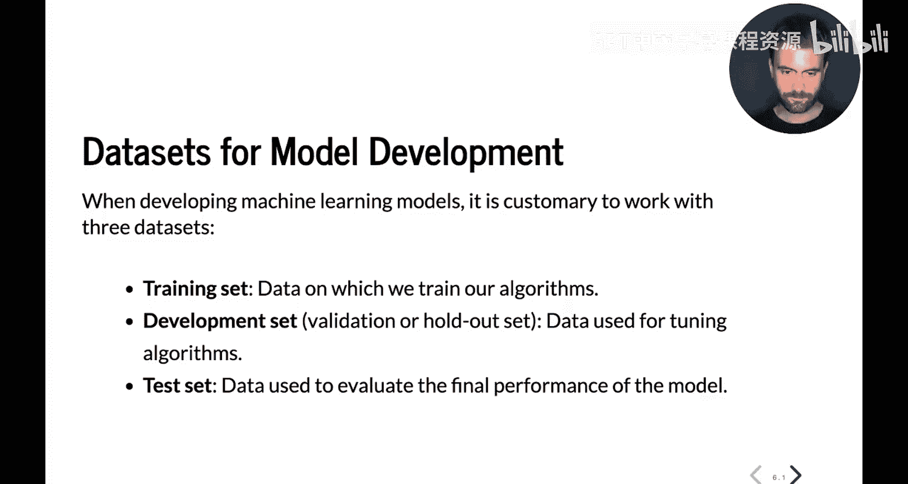

These three data sets define the following workflow for building and iterating upon machine learning models。

So normally when we begin building a machine learning model。

 we start with an initial idea and then we fit it on the training set。

Then we observe its performance on the development set。

 and we use metrics to evaluate its performance on the development set。

 which is a set that is distinct from the training set。

 and so this gives us an initial idea of how well this model would perform in the real world。

 whether whether it is overfitting or its performance is sufficient。

And then based on what we observe of this performance， we think of improvements to the model。

 so we perform what is called model selection， we may then make changes to the model， for example。

 we could change certain hyperparameters like the regularization strength or maybe we could try a novel neural network architecture or maybe we want to add new features to the model。

 we make these decisions。And then well based on the performance at step two。

 we decide what kind of changes we would want to make， then we make those changes。

 we go back to step1， we retrain the model， then we again observe its performance on the development set。

 if our changes were successful we normally keep them， then we can try other ideas。

 we again retrain the model with these new ideas， and then we keep repeating steps one and two while the performance of the model is improving on our development set。

 on our holdout development set。Then finally， once we're satisfied with the performance of the model。

 we evaluate it on our test set and if we are happy with the performance。

 then we deploy the model and its performance on the test set is our most accurate estimate of how we expect the model to perform once we deploy it into the real world。

So this is a very high level workflow and in this video and the following videos in the following lectures。

 I will tell you about the details of this workflow， for example， which metrics use。

 how do you use the results of these metrics to determine what changes to make to the model， etc。

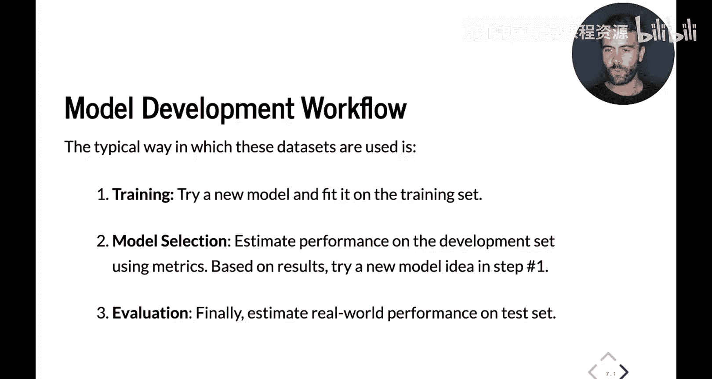

I also want to make a few high level observations about this procedure。

The first observation is that this process inherently involves trial and error and machine learning is a field where at least on the applied side there is often a lot of trial and error。

 we believe that certain features or certain architectural changes are useful， we try them。

 wetrain our model， we see how it performs based on that we probably have some intuition as to whether these changes are successful or whether we need to perform different changes and then we perform this trial and error process as long as a performance improves。

And this workflow that I described， it helps to iterate on models really quickly and when you start building a machine learning model。

 the first step is to establish data sets， the training set， the development set， the test set。

 establish performance metrics， and then just run this workflow and quickly and quickly iterate on its performance on the performance of the model and start start working towards a first prototype that solves the problem to some degree and then quickly make changes and improve it。

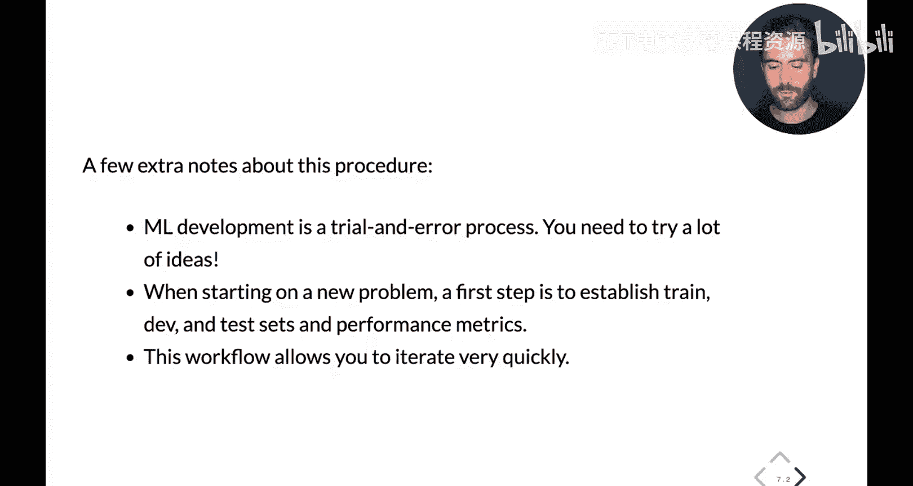

So now within this workflow， one important decision is how do we choose the development and the test sets？

First of all， let's look at their goals。 The goal of the development set， as I mentioned earlier。

 is to fundamentally， it is to detect changes in model performance。

 We're using the development set to test whether various changes that we're making to the model。

 whether they are improving our performance and whether we are。

Reaching towards whether we're improving our system as we make iterative changes。

And then the goal of the test set is to confidently estimate real world performance once we have done with experimenting and it rating on the model。

Because we repeatedly choose the best model on the development set。

 we eventually are at risk at overfitting the performance on the development set so if we perform hundreds of iterations and we always only choose the best model that perform well on the development set then it is likely that we will be over optimistic and we're going to be choosing models that perform better on the development set then they perform on the overall data distribution and this is why it's important to have a separate test set because once we have made all the changes and once we have really optimized the model to work well on the development set we we likely to have slightly over optimizeimized it and we want to have a separate unbiased estimate of our future performance and this is why we have our test set for that so we run the model on the test set and now we know finally what is our what is our level of performance once we deploy the model in the real world。

ically this may be a little bit lower than what we had on the development set。

And so in order to be able to have this unbiased and confident estimate of future performance。

 it's important to leave the test set aside and to leave it untouched while we iterate on the model。

If we also start iterating on the test set or if we look at the test set too often。

 then we are also at risk of making changes to the model that are optimized for the test set and therefore the test set will no longer be an accurate estimation of future performance。

 so this is an important practical detail that is it's a rule that is important to follow when you're building a machine learning system in practice。

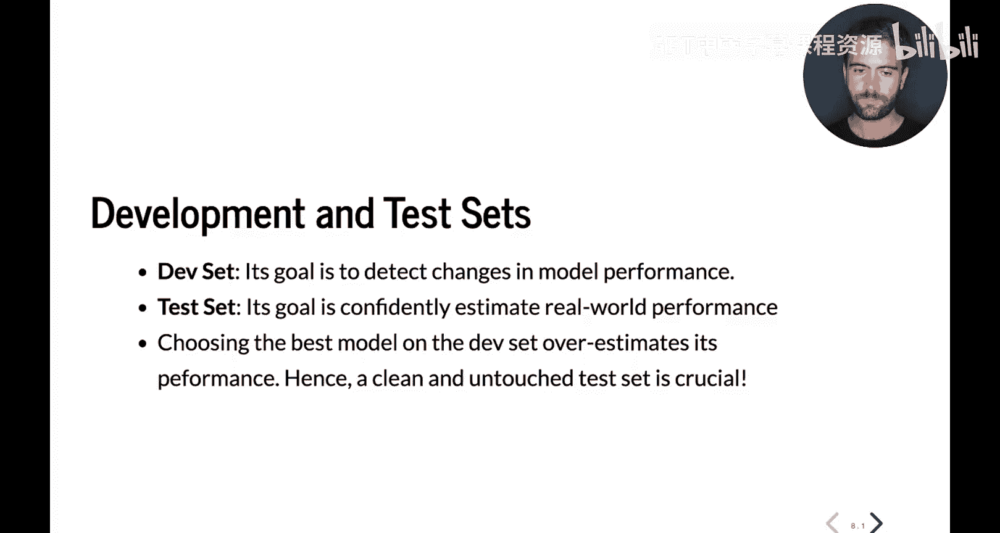

So now how do we choose these two data sets， I would like to highlight two important considerations。

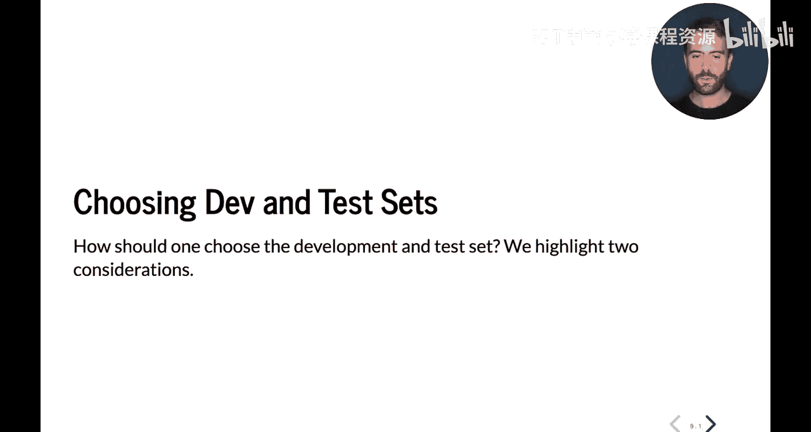

The first consideration is that the estimate of future performance that we obtain from these data sets。

 it has to be representative of the actual performance that we're going to see in the real world。

 and so the data that's in these data sets should come from the same data distribution that we anticipate seeing in production。

When I say in production， I mean in the real world or once we have deployed our model and it is doing something useful in the real world。

 we're going to see a set of we're going to see some data and the distribution of this data should be as close as possible to the data that's in our development and test set。

 this is how we're going to know how well our model will work once it has been deployed。嗯。

As an example， consider an image classifier that detects whether a particular image contains a dog。

So if we want to predict how well our algorithm will be classifying will be detecting dogs。

 we want to have a set of images of dogs in our holdout and validation in our development and test sets。

And the training data， the training data often also comes from the same distribution。

 but it is not strictly necessary， for example， we could be performing a form of we could。

 for example， try to augment our data with additional images of other animals during training。

 which is a form of data augmentation， it's a form of training。

 machine learning models and we could augment this data with additional inputs。

At training in order to try to improve our performance。

But we are interested ultimately in dog classification accuracy。

 which is why our data should be consisting of dogscs， or another example。

 is if we have high resolution or low resolution images and we know that in the real world we will only see low resolution images。

 then it's important to have those images in the data set in the test set in development set。

 or if we see images or inputs from different geographical regions， for example。

 from Europe and North America and we know that our system will only be produced but will be deployed in Europe。

We should only have European inputs in the test set。

 but we could add some North American inputs into the training set if we find that it helps the model to learn additional signal by just having more data。

 it is something that could in principle help us at training time， although it is un guaranteeded。

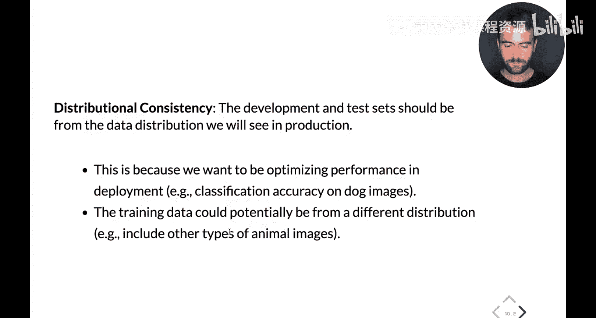

The other question is how big these data sets should be。And in classical machine learning。

 there used to be a rule that around。30%20 to 30% of the data should be reserved for the Dev and test sets。

Now in modern machine learning our data sets are typically large， for example。

 we could have data sets with hundreds of thousands of millions of images。

And since our ultimate goal is to estimate future performance， we do not need for 30% of the data。

 so we don't need for 300，000 images to be in our test set。

 it is likely that we can estimate our test set our future performance with a test set of 3000 inputs or 5。

000 inputs and so the actual number of data points that we need it depends mostly on the complexity of the task。

 but it is better to think of it as an absolute number， what number gives us sufficient variation。

Or which number reduces the variance of this and the uncertainty of this estimate by a sufficiently large amount。

And one way to estimate this would be to。Subsample various inputs of size 3000 and look at the variance between them。

 and if various subsets of size 3000 give us similar performance。

 then probably a random subset of 3000 is a stable estimate of future performance。

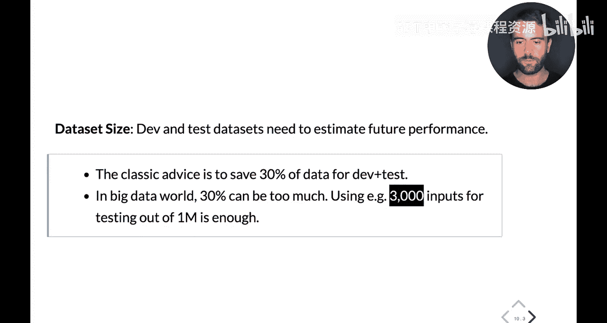

So this was a discussion for how to choose the data sets that we work with。

I also want to highlight two practical considerations when performing model selection。

 so which model when choosing which changes to make to the model at the model selection step。

The key decision that needs to be made as part of this workflow is which metrics we want to optimize。

In order to improve machine learning models in a principled way， we need a notion。

 we need an accurate and quantitative notion of what is a good machine learning model and what is a bad machine learning model。

And this can mean something simple like accuracy， or it can be something more complex， for example。

 if we're in a sensitive medical application and the number of we have a strict threshold on the number of false positive or false positives or false negatives。

 then this can also be baked in as part of our metric。If we're interested in if we're， for example。

 doing an information retrieval system， then maybe precision and recall are useful metrics。

 we are going to see what precision and recall is later。

And in order to iterate them on the model in a principled way。

 we need to somehow combine all the considerations。

 all the metrics that we have into a single number， into a single master metric。

This is just in order for us to be able to determine whether a particular change is useful or not。

 this is a binary decision， and so it has to be done according to some single quantitative measure。

And if we have multiple metrics that we're interested in， for example。

 if we're interested in precision and recall， we can combine them into a single metric by taking their average or some combination of them。

 in this example， combining precision and recall gives us something called the F score。

 or if we have other metrics like computational performance could be one or the number of false positive could be another one。

 we could also add these as constraints and if a change violates our tolerance on the worst computational complexity。

 then we do not make this change the model。But again。

 it is really crucial in order to be able to perform this systematic iteration。

 we need to have a single measure of what makes a classifier good or bad so that we can determine at each step each time we evaluate a new idea on our development set。

 we need to be able to accept or reject this idea and this requires a quantitative measure of performance that we can say whether it's better or not relative to what we had before。

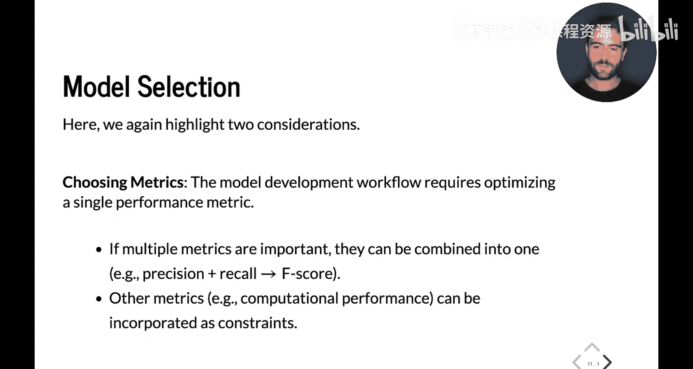

And finally， a remaining question is， how do we update the model？

We are going to look at this in much more detail， but essentially once we have observed our performance。

 we want to determine whether we want to keep this model or whether we want to make changes and this can be based on our intuition for example。

 if we notice that the model is overfitting well then we need to well then we know we need to regularize it more so that we'll inform the kinds of new ideas that we're going to try at the next iteration or we could follow a systematic approach where we perform some kind of grid search and there are even more specialized algorithms from fields with names like Bayesian optimization that can be used for this procedure and we are going to provide a lot more intuition on this later。

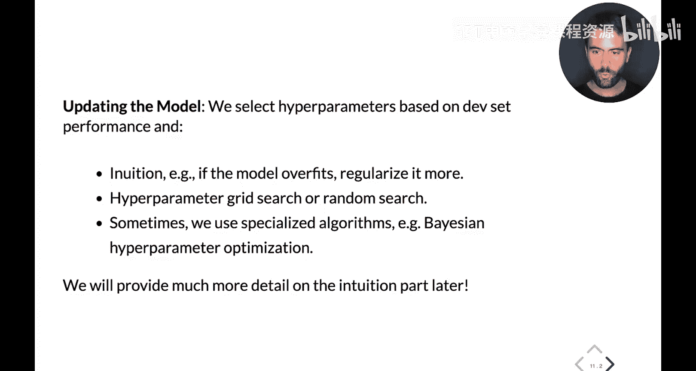

And finally， I would like to conclude with an example so imagine that we're training a neural network and there is a particular and we want to apply this workflow to training a neural network。

So let's say that initially we want to perform image classification。

 so we start with a con neural network and we have 90% accuracy on our dev set。

Then we can look at its performance and we see that it overfis the data a little bit so then we can perform grid search on the strength of the dropout layer to see if we can make its performance a little bit higher。

 then we realize that with a different value we can get a deficit of 95%。

 then that is our next best model。And then we may even try a completely new idea。

 so we can try some new architectural elements such as adding residual connections inside the network。

 now we're changing the architecture and suppose that we do do that and now we have an even greater increase in performance on our development set。

 so we retrain the new architecture on the training set。

 we evaluate on the development set and now we have 99% performance， which is even better。

 so now we're very happy and we estimate this performance on the test set and now we have slightly lower performance。

 97% which is still quite good but it shows that we have slightly overfit our performance on the development set because we only chose changes that worked well on the development set so 97% is still good and now we can deploy our model in production and we can we can assert that the performance of this。

Model is likely to be around 97% once it starts being deployed on real images。

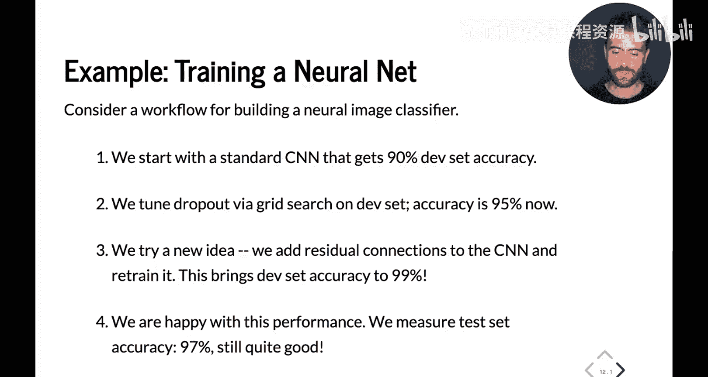

And finally this entire workflow is not without some limitations， as I mentioned。

 overfitting the depth set is a consideration that it's a problem that we may run into and also in the real world once the model is running and it's receiving real inputs often the kinds of inputs that user feed to the model change。

 so maybe if we're deploying this model into regions in Europe and North America we may have more users from Europe over time which look different from the Europe from the North American users。

 and so the distribution that we see in production may change。And also。

 we may realize at some point that the metric that we have been optimizing is not really what our users care about。

 we need to further change it。So in these cases， we need to go back and we need to make changes to our procedure。

 we want to either change the metric if over time we realize this is not what we care about。

 and we may periodically need to update our development and test sets if we have overfit them or if we're not。

 or if they are no longer representative of the overall distribution。

So these are all limitations that you should be aware of。

 and next we are going to look at some more specific details about how we can evaluate the performance of machine learning systems within this workflow。

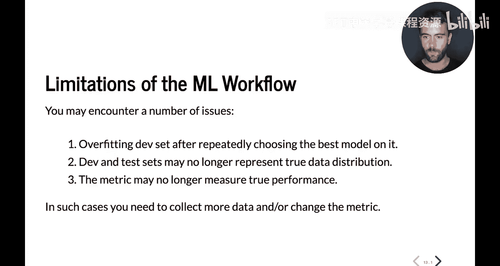