# 康奈尔大学《应用机器学习 CS 5787_ Applied Machine Learning 2020》中英字幕（deepseek p71 -71-Lecture 20. Part 2_ Evaluating Classification Models.zh_en -BV12udzYvEFM_p71-

This is now part two of lecture 20 of applieded machine learning and in this lecture in this video。

 we are going to look at how to evaluate machine learning models。In the previous video。

 I presented a workflow for building and iterating and improving on machine learning models in a principled way。

 and a crucial step of that workflow was to understand and quantify how well our current model is doing and how well is the next duration of the model doing。

In this video， I will define a set of important metrics that are applicable to many machine learning algorithms。

 and these are important metrics that are used throughout machine learning and they will serve as accurate ways of quantifying our performance。

And in this video， we are going to start with classification problems。

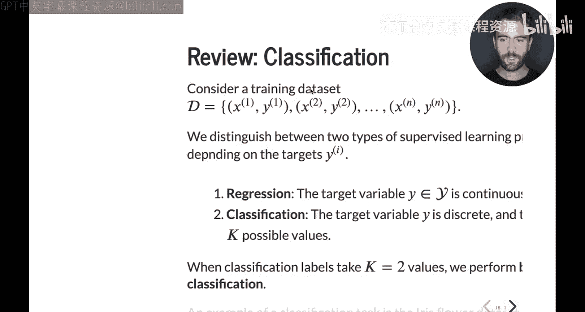

Recall that classification is a form of supervised learning in which our targets， y are discrete。

 and they take one of K possible values where K is the number of classes。If k equals2。

 then we have a special case called binary classification in which we only have two classes。

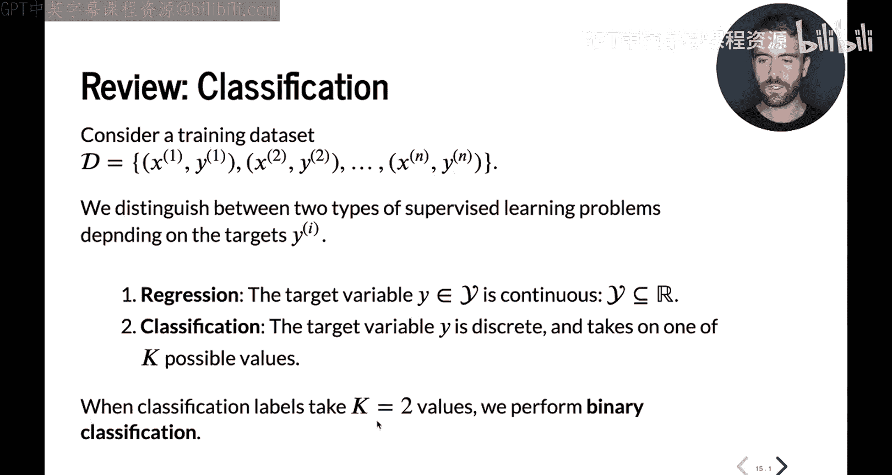

An example of a classification task is the IIS Fer data set that we have been using throughout this course。

Here I'm loading this dataset from the dataset submodule of PsyLn。

 I'm loading it here and for this video I will create a slightly modified version of this dataset in which I am going to have fewer examples of one of the three classes so typically in this dataset there are three classes and 50 examples of each class。

 but now I will only take 120 examples， I will take 50 from the first two classes and 20 from the third class。

 so I will make this data artificially imbalanced。And in addition。

 I will I'm using this function here to split the data set into two subsets。

The first one denoted by X is going to be our standard training set。

 and then another data set of S 50 is going to be our holdout set。

And we are doing this split at random。

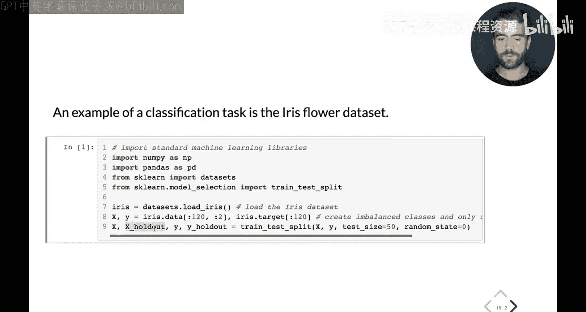

We can visualize this data set into dimensions like we did earlier and here each color corresponds to one of the three different classes。

And you can see that there are fewer points of the brown class than there are of the other classes。

 and that is again because I sub sampleampled this dataset set。

And also for the analysis that we're going to be doing in this video。

 I will be only looking at the following two features that are in this plot。

 so all points are going to be two dimensional。

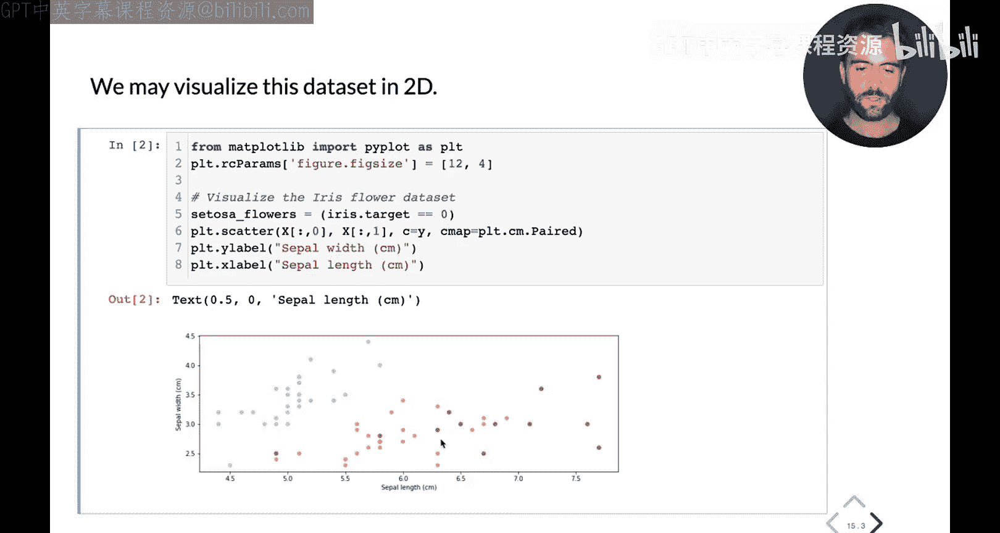

Now because this is supervised learning， we're working with machine learning models that have this particular form。

 we have an input X and our model F transforms x into a target y。

We can train a model of this form on the dataset that we have just created here I'm going to fit a softmax model which is implemented as part of the psy of the logistic regression class in psychit learn I instantiate this model here then I fit it on the training set and then I generate predictions from this model on our holdout set and this set of predictions will live in the vector Ypreread and the metrics that we're going to see in this video are going to quantify the accuracy of the vector or they will quantify the performance and the quality of the vector of predictions YPread。

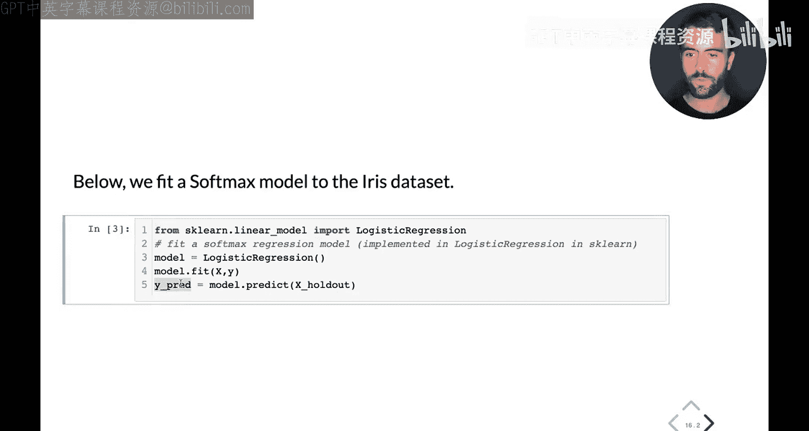

Now， the simplest measure of performance that we could use is the accuracy of our classifier。

 which is simply the percentage of points for which we have predicted the correct label。

So this equals 100% when we're maximally accurate and 0% where we're completely inaccurate。

 and on this particular data we can easily measure our accuracy。

 we can do this with only one line of NI and our accuracy on this data is 84%。

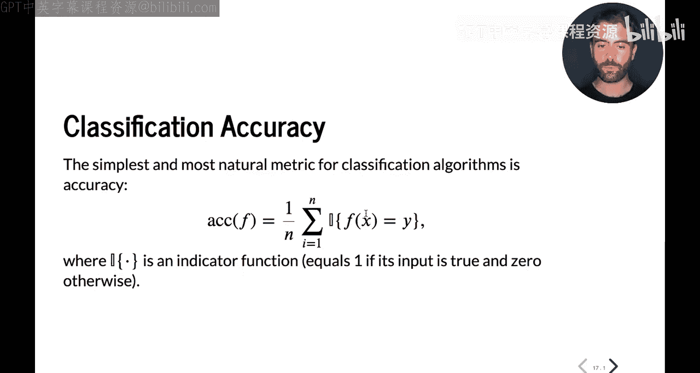

And again， note that we are evaluating our accuracy on the holdout set because that is the actual set of predictions that matters for estimating our future performance。

 and this is also if we were doing model iteration or model selection if we were trying different model ideas。

 we would like to use thus holdout set or as it will be known the development set accuracy to guide the design of our models。

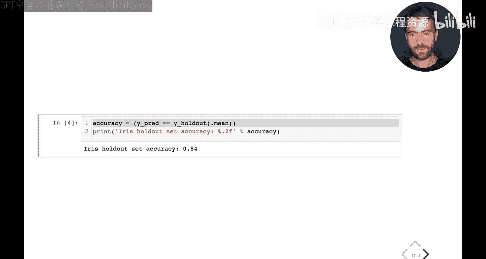

Now， accuracy is not the only way of looking at the performance of a classifier。

One other useful tool is something that's called the confusion matrix。

The confusion matrix is simply a two by two table where if we have K classes。

 then we have K rows and K Collins。And I'm going to index the rows on the y axis as this variable yj and the columns on the x axis as this variable y hat k。

And the cell that's going to be at row Yj and column Y hat K。

 it contains the number of samples of class Yj that were classified as class Yk。

Let me give you a specific example of what this means here I'm using the plot confusion matrix function in psy learn to generate a confusion matrix for our holdout set from the ir data set and here as I said。

 because we have k class because we have k equals three classes we have three rows and three columns and each column is indexed by the class index 01 or2 same thing here same thing for along this axis and this axis and if I look at the cell thats at 0。

0， this is the number of points of class 0 that were correctly assigned class0 and I have 19 such points。

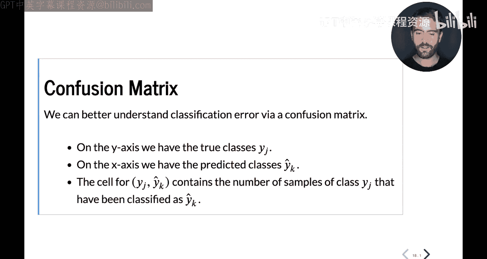

And at cell 11， I have the number of points whose true label is one and whose predicted label is also one。

 so they were classified correctly and I have 22 such points。

But I also have two other points of class 1， and one point was incorrectly assigned label 0。

 and the other one was incorrectly assigned label 2。 So out of 24 points。

22 are classified correctly and two are classified incorrectly。 And for classes 0。

 we have 19 points of class 0 in total， and they are all classified correctly。

 So these two classes were doing really well on them。But if we look at the third class。

 the one that has label 2， then there we have seven points in total of that class。

 but six of them are classified incorrectly， and they are incorrectly assigned label 1。So actually。

 even though overall our accuracy on this data set is a respectable 84%。

 we are almost entirely misclassifying all the labels that have class 2。

 so that's an important additional piece of information that we can obtain by looking at something like a confusion matrix。

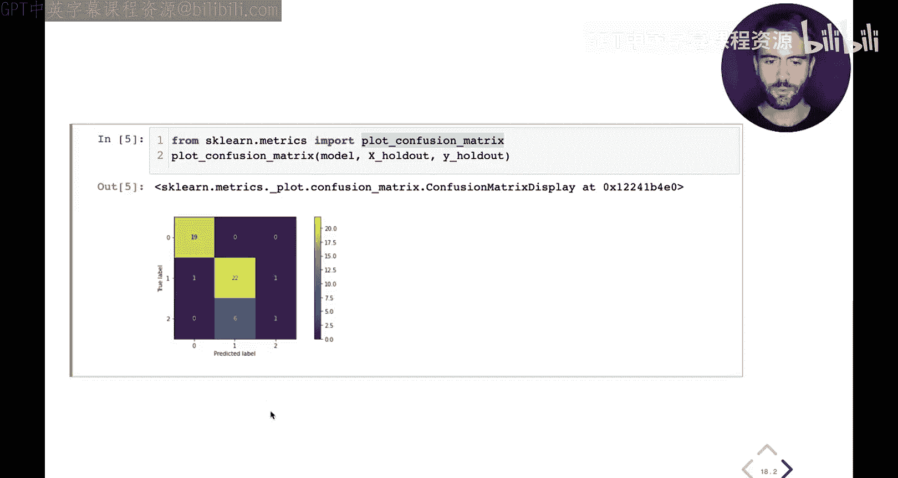

Now， the confusion matrix can also be used to derive several important concepts several important definitions and metrics that are used for measuring the performance of classifiers and it will be easiest to define them first in the context of binary classification。

So in binary classification， our confusion matrix is simply a two by two table here again here our two rows are the two possible classes and the columns also correspond to the two classes and because we have binary classification。

 I randomly labeled one of the two classes as being positive and y equals1。

 and the other one is negative and y equals zero。And then within the positive class。

 within the points that are truly positive， some number are correctly classified as positive。

 and these are true positives。 and their number lives in this cell。

But then some are incorrectly misclassified as negatives。

 and so their number lives in the false negative cell， and they are called the false negatives。

And similarly， we have false positives and true negatives for the other class。So these terms。

 true positive， false， positive， false negatives， those are really important terms they are used throughout machine learning and statistics and it's important to know what they are and it's easy to understand what they are by looking at this simple2 by2 confusion matrix。

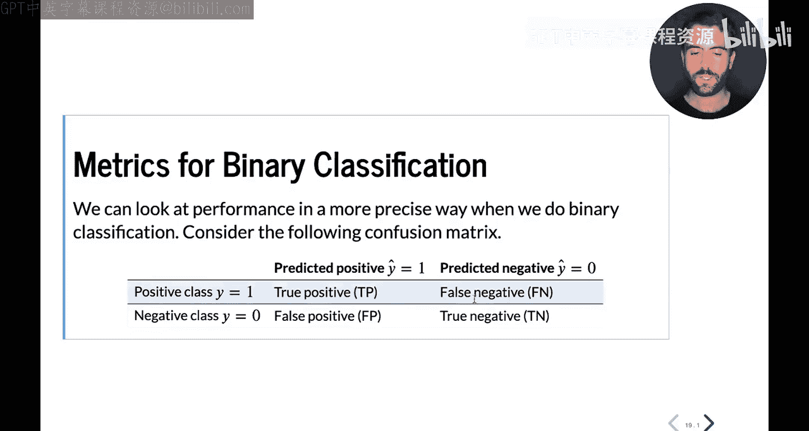

We can also use these terms to define accuracy， which we saw earlier。

 so accuracy is simply the number of correct predictions over the number of total predictions。

 and the number of correct predictions is the number of true positives and true negatives。

And is divided by all the predictions， so it's divided by the number that's in all the cells。

 and that is simply the definition of accuracy that we had earlier。

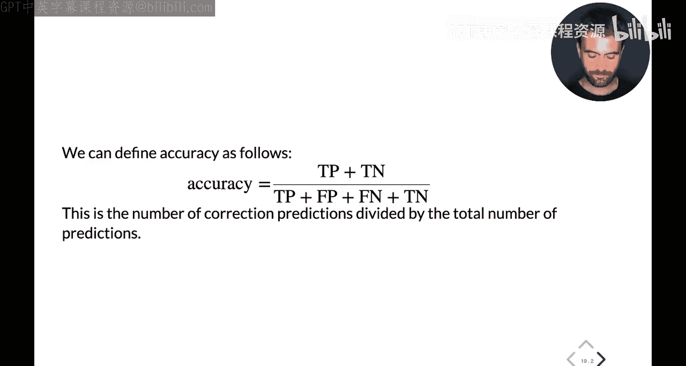

Now， accuracy is we can define more precise notions of accuracy called sensitivity and specificity。

In many applications， for example， and in medical applications。

 we also want to measure and have a minimum level of performance on each class。

So we want to be accurate on the positive examples and on the negative examples。

 And this is what sensitivity and specificity are capturing。The sensitivity。

 also known as the recall or the true positive rate。

 is simply or you can think of it as being the accuracy on the positive class。

So this is the number of points whose true class is positive that we correctly classify as positive。

 and so in the numerator we have the number of true positives and in the denominator we have the number of points of the positive class。

 which is the number of true positives plus the number of false negatives。And similarly。

 the specificity is the accuracy quote unquote， the accuracy on the negative class。

hich is the number of true negatives over points of the negative class。

 and the points of the negative class is the number of true negatives plus the number of false positives。

Sensitivity and specificity are used very often in machine learning and in statistics to measure the performance of binary classifiers。

 and it's really important to understand and know these concepts。

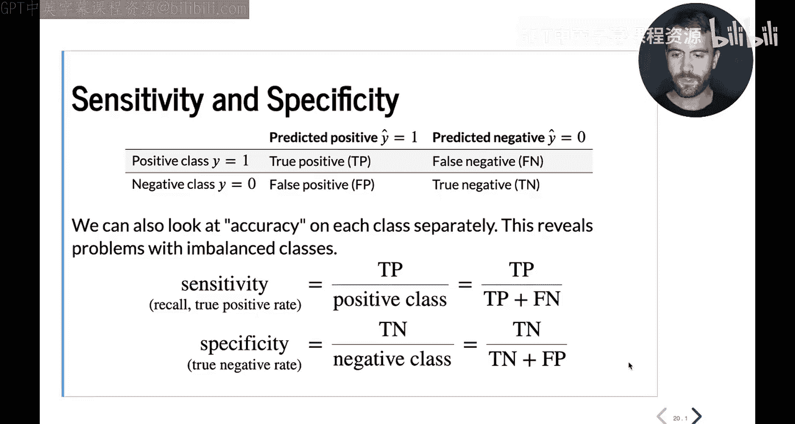

One reason why specificity and sensitivity is useful is because it's easy to have it is possible often to have very high specificity。

 but very poor sensitivity especially if the classes are imbalanced could even have very high accuracy and very high say specificity。

 but the sensitivity can be low or vice versa we could have one that's very high but the other one is very low and so it's important to look at both and we can also look at a single measure that combines them here that simply takes the average called the balanced accuracy and this measure can be useful for detecting when we have imbalanced classes and when certain points are when one of these two measures is bad。

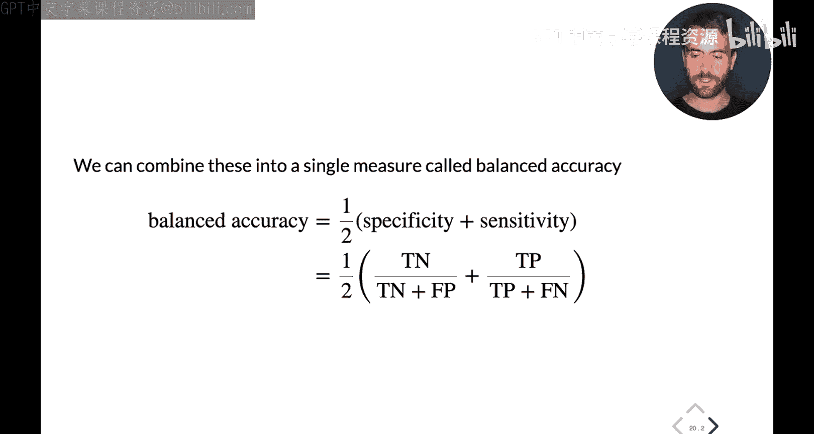

Another important set of metrics that are similar to sensitivity and specificity。

 but that are not quite the same are precision and recall。

So precision it's also known as the positive predictive value。

And that is the number of true positives out of all the points that we predicted as being positive。

So we the number of predicted positives is that here is the number of true positives plus false positives。

 but these are all the points for which we assigned the positive label。

 and so they live in this column here。And then the recall is the same thing as the sensitivity。

 so it's the number of points of the positive class that were identified correctly。

And these two measures are useful in applications of machine learning。

 where we are interested in it is is often used in applications such as information retrieval， where。

 for instance， we are building a search engine and we want to know of all the。Relevant results。

 which is the positive class。 Are we of of the results that we classify as relevant。

 how many of them are actually relevant， That is the precision and of all the relevant results that exist。

 How many did we capture， which is the recall。That is an application where we can think of precision and recall。

 so again， if we're building a search engine and the positive examples are the pages that are relevant。

 then precision looks at of all the web pages returned by the search engine how many are truly irrelevant。

 and then the recall measures how many relevant pages we found。

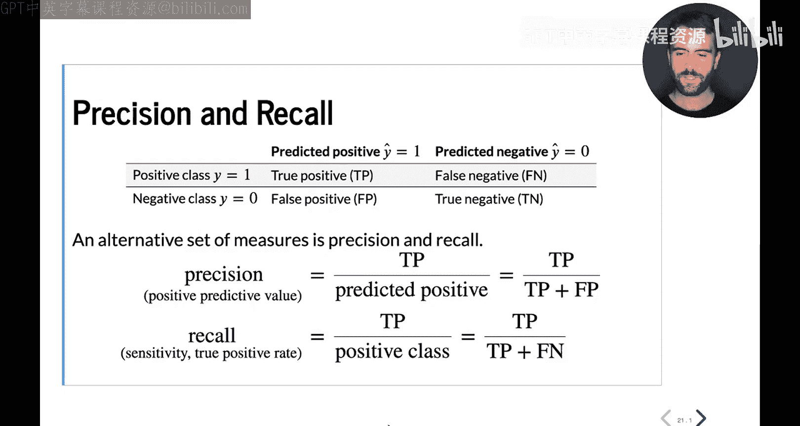

And one important note is that this doesn't really report any sort of performance on the negatives。

 This only reports performance on the positive predictions。

 and we are not quantifying how accurate we are on the negative examples。

 The reason we don't do that is because in。In applications such as search engine。

 we assume that there's a very large class of negative points there but we're not really interested in whether we are identifying those points as negative we only interested in the points that are returned that is the only thing that the user sees and this is what we want to look accurate and the negative points the user of the search engine well never see them。

 so therefore it's not as important to focus our analysis on those points。

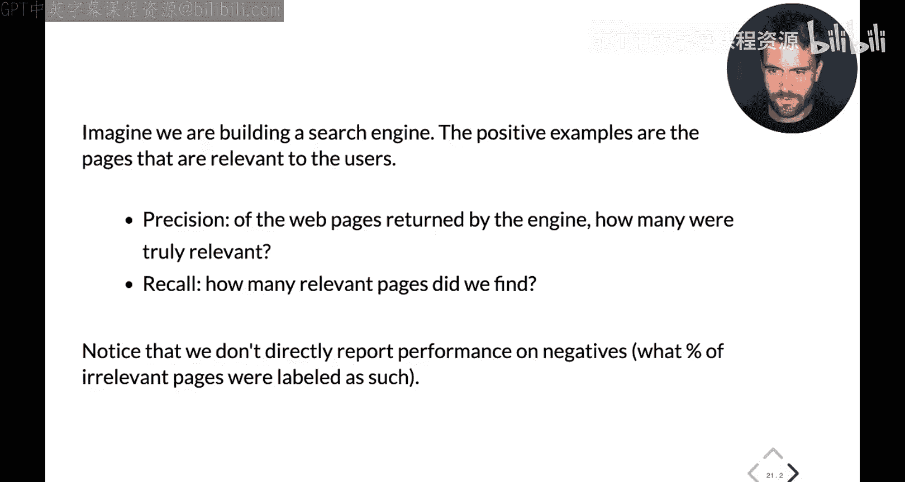

So precision recall is useful in such applications。

And this provides also an intuition for when we might want to use precision and recall versus sensitivity and specificity。

I want to point out that if we have perfect precision recall。

 we will also have perfect sensitivity and specificity and vice versa。

 so these measures are not they both measure performance of the classifier。

 but they tend to reveal certain properties more than others。And so for example。

 if we're in a setting where we don't care about true negatives。

 like in a search engine and we' only care about identifying correct positives and not missing any the precision recall are more useful but if we are。

 for example， in a medical setting where we are detecting whether a person has a certain disease。

 then we want to report our performance on both the positive examples where we are predicting the disease or on the examples where the disease is truly present and also on patients they don't have the disease we also want to correctly provide them response and saying that they don't have the disease。

 so if both of these values are important， then we get a more clear。

 a more intuitive picture of the performance of our system by looking at specificity and sensitivity。

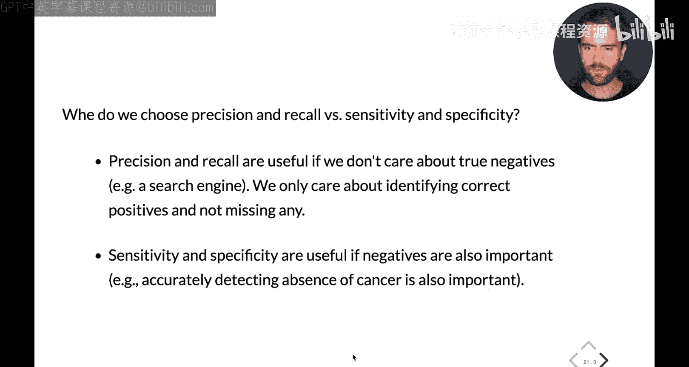

And finally， it is possible to combine these measures into a single one called the F score。

 and the F score is defined as the geometric mean of the precision and recall。

So the geometric mean is simply it is defined using this formula and instead of taking the average。

 we look at the reciprocals of the precision and recall。

 and then we apply this formula and this has the property of combining them。

 but also it is useful because well first of all it equals one if we have perfect precision and perfect recall。

 which is what we want， but also it equals zero if either the precision or the recall is0 and this is more useful than the arithmetic average which could still be non-zero if we have zero recall so it better captures the behavior that we want in the extreme cases。

So sensitivity， specificity， precision and recall are really fundamental metrics in classification algorithms that you should be aware of。

 and in next video we are going to look at a few slightly more advanced versions of classification metrics。

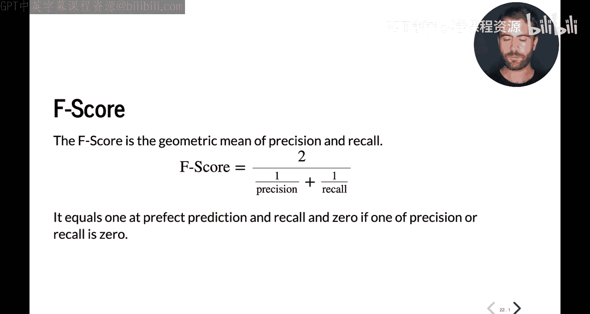