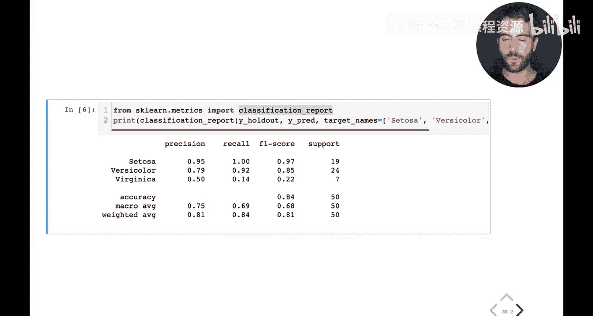

# 康奈尔大学《应用机器学习 CS 5787_ Applied Machine Learning 2020》中英字幕（deepseek p72 -72-Lecture 20. Part 3_ Advanced Classification Metrics.zh_en -BV12udzYvEFM_p72-

Hi， this is now part 3 of lecture 20 of applied machine learning and in this lecture in this video we are going to continue our discussion of classification metrics and we are going to look at a few additional ones that are slightly more advanced。

Recall that classification is a form of supervised learning where the targets Y take a number of discrete classes and this is deed by k。

 and have k equals2 when we only have two classes， then we call this binary classification。

And in the previous video， we define in the context of binary classification these two fundamental metrics called sensitivity and specificity。

 sensitivity。 You can think of it as the accuracy on the points whose true class is positive and specificity is effectively the accuracy on the points whose true class is negative。

 So sensitivity is the number of。😊，Points that are positive and work classified as positive。

 That's the true positives over all the points whose class was positive。

 which includes the true positives， but also the false negatives。

Now in many applications we may need to trade off sensitivity and specificity in some applications。

 having been really accurate on the positive examples。

 is more important than being accurate on the negative examples， so for example。

 if we're diagnosing some very important disease and we really must catch every person that has this disease but it's okay if we have a few false positives if we have a few people who don't really have the disease that we classify as such then that may be okay。

 so we may want to be able we may want to catch more of the positives or we may want to catch more of the negatives and we may want to trade off between the two。

One way in which we can do this is to output the positive class only on examples on which our model is very confident。

So by doing that， we will be well in this case， if we do this。

 then we are going to be more stringent for when we choose an example to be positive and in that case our accuracy on the positive points will increase。

 but the performance of the negative examples will decrease because we will be labeling many more points negative。

 even though we're not really sure that they're negative。

This is one way in which we can trade off sensitivity and specificity。

 and most machine learning classifiers enable us to do this because they come with confidence scores or they come with。

Scores that correlate with confidence and that enable us to to do this procedure that I described on this slide。

For example， in the softmax model that we have trained over the IIS data set。

 we have these confidence measures because we have a probabilistic model and it outputs probabilities so we know how confident the point is within each example。

So for example， here I here I can ask the model to output prediction probabilities over all the points in our holdout set。

 and here I'm visualizing them I'm visualizing the probability that the class for the class with label 0 and these are the the probabilities for the first 10 points。

 So for the very first point， we are very confident this is class 0， we're 90% confident here were。

We don't we think it's very unlikely that the class is zero for this point， we are still confident。

 but not as much as the first point， etc cea。And we can transform these into actual predictions in different ways。

So in particular we can choose a threshold we could if we wanted to detect every possible instance of class 0。

 then we can set this threshold to something really low anything that's above 25%， we'd say。

 okay it's sufficiently likely that this will be class0， less predicted to be class  zero。

 so even a point like this might receive class  zero or we could be very。

 very stringent and we could only predict points that have higher than 90% probability in which case we would not classify this point which is at 87% so then we would be more stringent。

That is the intuition。And we can quantify this more precisely via a tool called the receiver operating characteristicistic or ROC curve。

The ROC curve helps us visualize the trade off between specificity and sensitivity as we vary this threshold which goes from being more stringent to less stringent for predicting points of a certain class。

So in particular， the receiving operating characteristic curve。It visualizes two values。

 is the true is the true positive rate， which is again the same thing as the sensitivity or also known as the recall。

 and the number of positive examples that are classified correctly and it compares this to the false positive rate which is defined as one minus the specificity and that's one minus the true negative class。

 so that is simply that is effectively our error rate on the negative class。

 So it's the number of points that were incorrectly classified within the points that were truly negative。

And the R C curve plots these two values as we change our threshold。

So suppose that we wanted to create this curve for the IIS data set and specifically for class2。

What we could do is we could compute the probability of the class that the class of any point equals2 for each point x。

And then we could choose various thresholds T， and for any threshold。

 we can label this point x as belonging class 2 if its probability is less than the threshold。

And again， if we have a small threshold， then we're very lenient。

 we classify a lot of points as class equals 2， and so as a result。

 we will have a high true positive rate， we will identify all the positive instances。

 which means that we will every time when we really have class 2。

 we will identify we will identify it and we're going to be correct。

 but we will also have a higher false positive rate because there are many points which are not class 2。

 which we are going to determine as such。And similarly， a high T will mean that we're very stringent。

 We only predict on points for which we're very confident。 And so well have a low。We will have a low。

 true positive rate， meaning that we will identify a small number of positives。

 but we're also going to have a low false positive rate。

 meaning that when we do when we do an identify a point as being positive， it is very likely。

It is very likely to be correctly classified。And here we are showing the ROC curve in psychic learn。

Oh sorry I generate this curve in psychic learn， I here I compute the probability of 4 class 2 as I did in the earlier example and here this is the vector of correct assignments for whether class the point is class2 or not and here I can compute the ROC curve and I can get a set of false and false positive rates and true positive rates and we can visualize these as follows。

Here what you have is a receiver operating correct curve。

And each point on the curve is obtained by using a different value of the threshold。

 and as we change these points， we go from something that false that has a low， true positive rate。

 but also a low false positive rate， meaning that we identify a small number of points。

 but we identify them really accurately。Versus so that's when we have a high threshold for T and on this end。

 we have a very low threshold for T， meaning that we identify all the points correctly。

 but when we identify those points，We identify all the positive points correctly。As being positive。

 we identify all the class 2 as being class 2， but we also predict a lot of other points that are class 2。

 which are not really class 2。 And therefore， the false positive rate here is also going to be really high at 1。

 So at the bottom corner， we have 0，0。 and at the top corner， we have 1，1。And our our curve here。

 this orange curve， it interpolates between00 when we are at the most stringent point where we don't predict any point at all to be class 2 and where we're at least stringent where every point is predicted to have class2。

 so it interpolates between these two points of this plot。And of course。

 the ideal point that we would like to be is the top left corner。

We would like to find a classifier for which there is a threshold such that this orange curve goes really close to this top top left corner。

 because in the top left corner， our true positive rate is1。

 meaning that all the positive points are classified correctly， but the false positive rate is 0。

 meaning that。That all the points that are classified as positive， they are truly positive。

So here we have perfect accuracy if we're in the top left corner。And this dashed line。

 this actually corresponds to the performance of random guessing。

So imagine that we go through all the points and we randomly flip a coin and with probability P。

 we label this point as being positive and with probability 1 minus p， we label it as being negative。

So because p% of the points will be classified as positive。

 then also p percent the points of the positive points will be classified as positive。

 so our true positive rate is going to be P。And but then the false positive rate also is going to be oh。

 it's going to be11 minus p because we are。 no， it's going to be also P because we are going to be classifying。

P percent of the points of the negative points incorrectly as being positive。

 So because we're just doing random guessing。 So if we， for example。

 predict 50% of the points as being positive， then 50%。

 then our accuracy over the positive and our accuracy over the negative example is going to be 50%。

 And so we're going to be in the middle point of this curve。

 And as we change P then we also interpolate between these two corners。

So the performance and here P acts as our threshold， and we vary this value。

 So the performance of a random classifier is this dashed diagonal。

 The performance of the ideal classifier is something that goes here。

 and this orange curve will be in between them。 and the closer it is to this ideal number。

 the better。And that's how we， how you can read the R C curve。

 If you see a curve that's really close to the diagonal， then it's not very good。

 If it's coming really close to this point to the top left point， then it is really good。

 And we can read out the specifics by looking at the specific points that the curve reaches。

Here on this slide， I just summarize the observations that I made。Now。

 we can furthermore convert all of these observations into a single measure of performance by looking at the area under the curve of the ROC curve。

Again， as I， as I mentioned to you， the ideal classifier， it reaches the very top left corner。

 so it will have an area under the curve that is close to one。But a random classifier。

 the diagonal dash line has a curve of 0。5。And so we can use the area under the curve as a single measure of the performance of the classifier that measures the extent to which it's able to balance precision and recall and furthermore。

 it does so by considering all the possible thresholds at which we could make a tradeoff between precision and recall so it's a particular measure of performance and here we can measure it using the AUC function in psychicLn to find out that it's 85。

6% for the example that we just saw。Now， specificity， sensitivity。

 and most of these examples I were defined for a single class。

But we can also define them in multi class classification as well， in fact， I。

II actually did this just now for the RC example without really highlighting that I did this。

 but effectively， when we have a multi class problem。

We can consider it as we can form the confusion matrix。

 and then we can look at each row of the confusion matrix， and we can combine all the other rows。

If we have K glasses， we can essentially look at this problem as being K instances of one versus all classification。

And so in other words， for each class for each class of within our set of K classes。

 we can compute a concept of sensitivity and specificity for that class by taking that class to be positive and taking。

Not predicting that class as being negative。Then that defines a two by two。

Confu matrix for that class， we can compute specificity and specificity for it。

 and now that defines sensitivity and specificity for that class within a multiclass problem and now we can repeat this for each class and we can have K values of specificity and sensitivity for our multiclass classification problem。

One question that arises is how do we average then these values。

 and there are two high level ways of doing this called macro averaging and micro averaging。

One way in which this can be done is macro averaging。

 which is simply averaging the precision over all the。Over all the classes。

 So recall that precision is。Our accuracy over when we predicted to be positive。

 So it's number of true positives versus true positives and false positives。

 And if we have a concept of。We can define a concept of true positives for each class again。

 by viewing how accurate we were on that class relative to。Any other prediction。 So， for example。

 if we classified something correctly， if something was predicted S class K and we classified as correctly S class K。

 that is the set of true positives and set of false positives as everything that was predicted S class K。

 but that was not class K。 So this defines a concept of precision for that class and a macro averaging simply averages everything from all the classes。

There is also a concept called weighted averaging where instead of being a simple average。

 this this is weighted by the number of points in class K。

 So this is a form of macro averaging and then a form of micro averaging is simply so now the summation is inside this。

Is it both in the numerator and thenominator and we average a binary metric at each point。

 so instead of averaging over all the classes， we average over all the points directly and in the context of micro precisionci we have something like this。

This is a quick overview of how these can be averaged and I encourage you to look at the Psy learn guide for more details。

 both on this kind of averaging and on other types of model evaluation。And just as a quick example。

 we can easily compute these for the different classes that we have via the classification report function and here we have a notion of precision and recall for both for each class that we consider both Sotosa and versic or Virginiaica these are the three types of flowers and you can see here that our。

If you recall from the previous video， we noticed that our performance for this particular for the third class was not very good。

 and we can see it here by looking at the precision and recall。

And the precision recall is so it's only 50% and actually our recall is really bad。

 we are so out of 7。6 are classified incorrectly So this is why our recall is so it's the accuracy over points of this class。

 it is very low， it is 0。14。 And if we average these we have up when we perform macro averaging。

 it have a recall that is。Well， both precision recall are close to 0。7， which is lower than the 0。

84 average and this。whichhich is lower than our 0。8 for accuracy。

 and here we're able to identify that our performance over this class is not good。

 or that we have a problem within our classification using this notion of averaging。

So this concludes our discussion of classification metrics。

 and in the next video we are going to look at regression metrics。

