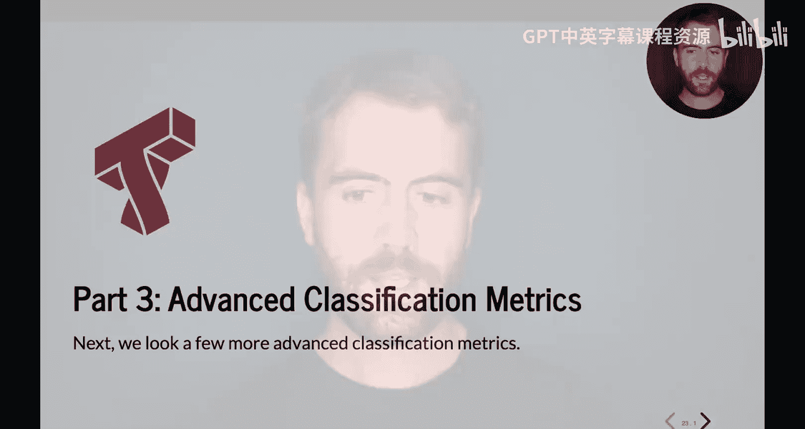
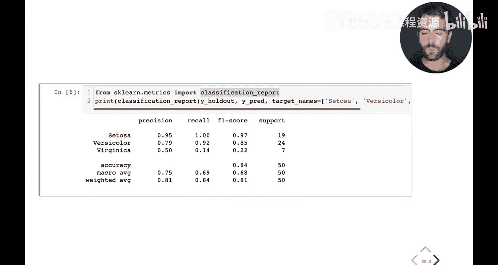

# 应用机器学习：第20讲第3部分：高级分类指标 📊



在本节课中，我们将继续讨论分类指标，并学习一些更高级的指标。我们将重点介绍如何通过调整阈值来平衡敏感性和特异性，以及如何使用ROC曲线和AUC来评估分类器的性能。此外，我们还将探讨在多类分类问题中如何计算和平均这些指标。

---

## 分类回顾

上一节我们介绍了分类的基本概念，特别是二分类问题中的敏感性和特异性。本节中，我们将看看如何通过调整分类器的置信度阈值来平衡这两个指标。

分类是一种监督学习形式，其中目标变量Y取离散的类别值，类别数量为K。当K=2时，我们称之为二分类。

在之前的视频中，我们定义了二分类中的两个基本指标：敏感性和特异性。敏感性可以理解为在真实类别为正的样本上的准确率，而特异性则是在真实类别为负的样本上的准确率。

**敏感性公式**：
\[
\text{Sensitivity} = \frac{\text{True Positives}}{\text{True Positives} + \text{False Negatives}}
\]

**特异性公式**：
\[
\text{Specificity} = \frac{\text{True Negatives}}{\text{True Negatives} + \text{False Positives}}
\]

在许多应用中，我们可能需要在敏感性和特异性之间进行权衡。例如，在诊断某种重要疾病时，我们可能希望尽可能捕捉到所有阳性病例，即使这意味着会产生一些假阳性。

---

## 通过阈值调整进行权衡

一种实现敏感性和特异性权衡的方法是，仅在我们模型非常确信的情况下才将样本预测为正类。通过提高预测为正类的置信度阈值，我们可以提高在正类样本上的准确性（即敏感性），但可能会降低在负类样本上的性能（即特异性）。

大多数机器学习分类器都允许我们这样做，因为它们会输出置信度分数或与置信度相关的分数。例如，在我们训练过的IIS数据集的softmax模型中，模型会输出每个类别的概率，这些概率可以作为置信度度量。

以下是使用Python代码获取预测概率的示例：

```python
# 假设 model 是已训练好的分类器，X_holdout 是测试集
prediction_probabilities = model.predict_proba(X_holdout)
# 获取第一个样本属于类别0的概率
prob_class_0 = prediction_probabilities[0, 0]
```

我们可以通过设置不同的阈值T来将这些概率转换为实际预测。例如，如果我们希望检测所有可能的类别0实例，可以将阈值设得较低（如25%）。相反，如果我们希望预测非常准确，可以将阈值设得较高（如90%）。

---

## ROC曲线与AUC

为了更精确地量化敏感性和特异性之间的权衡，我们使用接收者操作特征曲线（ROC曲线）。ROC曲线通过可视化不同阈值下的真阳性率（TPR，即敏感性）和假阳性率（FPR，即1-特异性）来展示这种权衡。

**真阳性率（TPR）公式**：
\[
\text{TPR} = \frac{\text{True Positives}}{\text{True Positives} + \text{False Negatives}}
\]

**假阳性率（FPR）公式**：
\[
\text{FPR} = \frac{\text{False Positives}}{\text{False Positives} + \text{True Negatives}}
\]

以下是绘制ROC曲线的步骤：

1.  计算每个样本属于特定类别（如类别2）的概率。
2.  选择一系列阈值T。
3.  对于每个阈值，将概率大于T的样本预测为该类别。
4.  计算每个阈值下的TPR和FPR。
5.  以FPR为横轴，TPR为纵轴绘制曲线。

在ROC曲线图中：
*   **左下角 (0,0)**：对应最严格的阈值，不预测任何样本为正类。
*   **右上角 (1,1)**：对应最宽松的阈值，将所有样本预测为正类。
*   **左上角 (0,1)**：是理想点，表示所有正类样本都被正确分类，且没有负类样本被错误分类。
*   **对角线**：表示随机猜测分类器的性能。

曲线越接近左上角，分类器的性能越好。

我们还可以将ROC曲线的性能汇总为单一指标，即曲线下面积（AUC）。AUC值越接近1，表示分类器性能越好；随机分类器的AUC为0.5。

在Scikit-learn中，可以使用以下代码计算AUC：

```python
from sklearn.metrics import roc_curve, auc

# 计算属于类别2的概率
probs_class_2 = prediction_probabilities[:, 2]
# 计算ROC曲线
fpr, tpr, thresholds = roc_curve(y_true, probs_class_2)
# 计算AUC
roc_auc = auc(fpr, tpr)
```

---

## 多类分类中的指标

以上讨论主要针对单个类别（二分类或一对多）。在多类分类中，我们也可以为每个类别计算敏感性和特异性。具体方法是：将当前类别视为“正类”，将所有其他类别合并视为“负类”，从而为每个类别构建一个二分类混淆矩阵，并计算相应的指标。

计算完每个类别的指标（如精确率、召回率）后，我们需要将它们合并为一个整体评估指标。主要有两种平均方法：

以下是两种主要的平均方法：

*   **宏平均（Macro-averaging）**：平等对待每个类别，直接计算所有类别指标的平均值。
    *   **宏精确率公式**：
        \[
        \text{Macro Precision} = \frac{1}{K} \sum_{k=1}^{K} \text{Precision}_k
        \]
*   **微平均（Micro-averaging）**：平等对待每个样本，通过汇总所有类别的真阳性、假阳性等计数来计算全局指标。
    *   **微精确率公式**：
        \[
        \text{Micro Precision} = \frac{\sum_{k=1}^{K} \text{TP}_k}{\sum_{k=1}^{K} (\text{TP}_k + \text{FP}_k)}
        \]

此外，还有**加权平均**，它是宏平均的一种变体，根据每个类别的样本数量进行加权。

在Scikit-learn中，可以方便地使用`classification_report`函数查看每个类别的精确率、召回率以及宏平均和加权平均结果。

```python
from sklearn.metrics import classification_report
print(classification_report(y_true, y_pred))
```

该报告能帮助我们识别模型在哪些特定类别上表现不佳。例如，如果某个类别的召回率很低，说明模型很难正确识别该类的样本。

---

## 总结

本节课中，我们一起学习了高级分类指标。我们首先回顾了如何通过调整置信度阈值来权衡敏感性和特异性。接着，我们深入探讨了ROC曲线和AUC，这两个工具能帮助我们可视化并量化分类器在不同阈值下的性能。最后，我们介绍了如何将二分类指标扩展到多类分类问题，并讲解了宏平均和微平均这两种汇总方法。



掌握这些指标对于全面评估和比较不同分类模型的性能至关重要。在下一讲中，我们将把注意力转向回归问题的评估指标。