# 康奈尔大学《应用机器学习 CS 5787_ Applied Machine Learning 2020》中英字幕（deepseek p73 -73-Lecture 20. Part 4_ Evaluating Regression Models.zh_en -BV12udzYvEFM_p73-

This is now part four of lecture 20 of Apped machine learning。

 and in part4 we are going to look at metrics for regression problems。

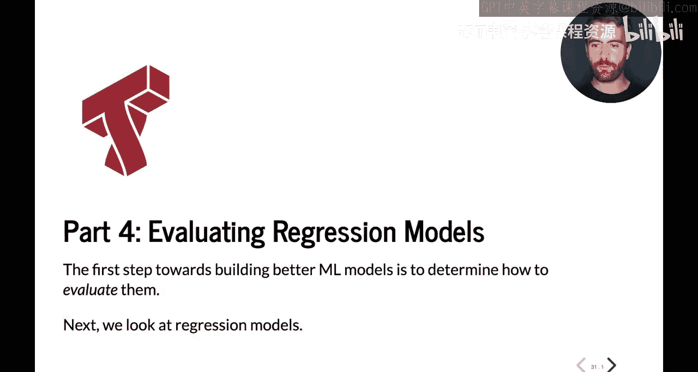

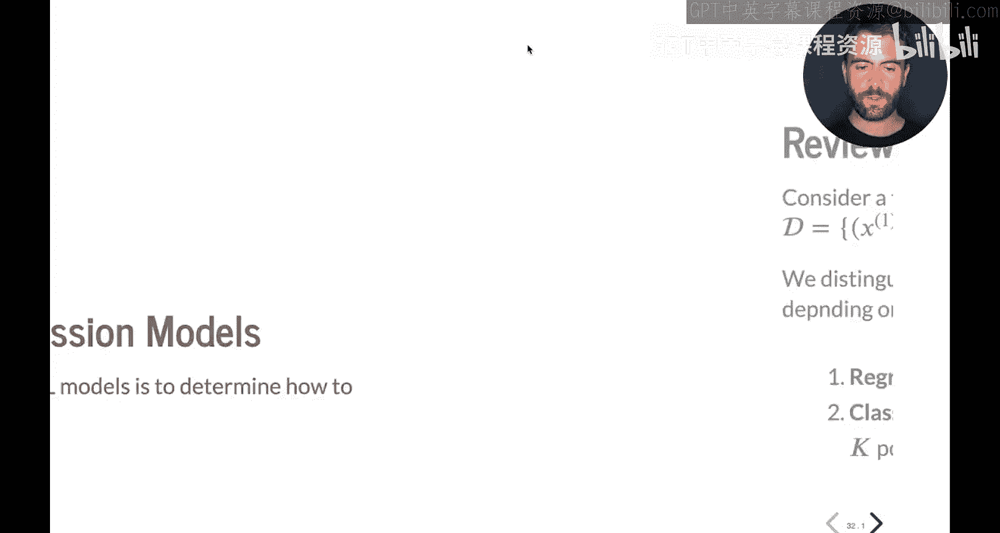

Recall that regression is a form of supervised learning in which our targets Y are continuous instead of discrete。

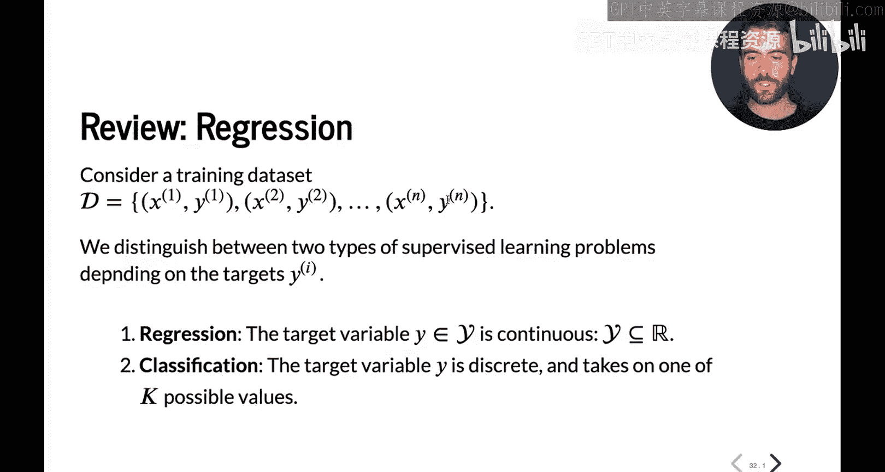

And we are interested in quantifying the performance of regression models。

 which are functions of this form， the map input X to targets y。

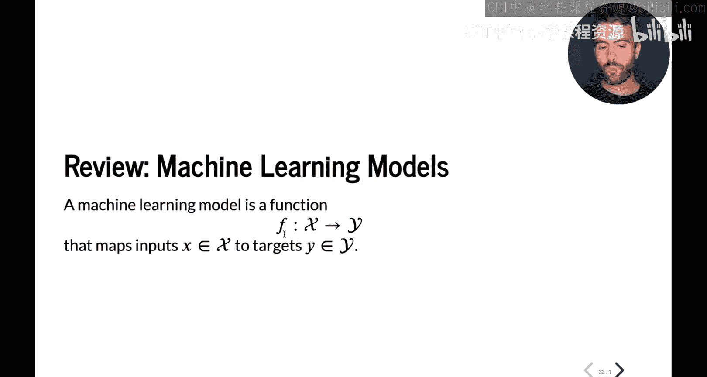

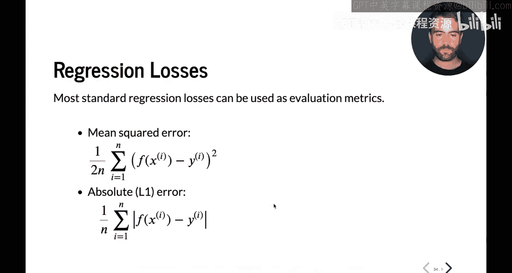

Now we saw many instances of regression and in most regression problems we were working with regression losses。

 the most common loss that we have seen is the mean squared error， which is here。

 and we also saw a concept of an absolute error or the L1 loss。Wch is this particular。

 so it's the mean absolute error。Which has this particular form。

 so we look at the absolute value between the prediction and the target instead of the squared value。

And these are objectives for training regression models。

 but we can also use them as metrics to evaluate the performance of a regression model。

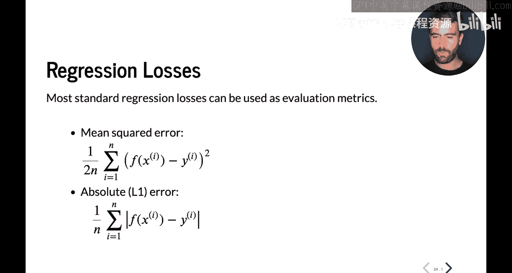

And here we can import them from psychic learnn and we can easily compute them on a toy data set and here we see that they give us slightly different values。

But still。They're relatively similar and comparable to each other。

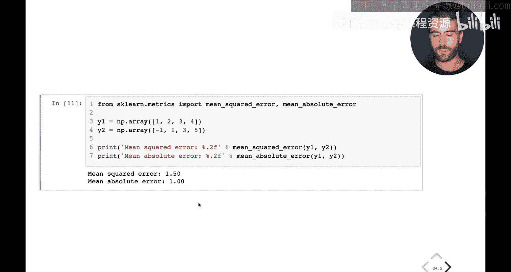

Now， using these kinds of metrics has a number of limitations。

1 is that they don't really take the scale of the input into account。 So if we have an error of of。

 let's say， an error of 10， but the true target is， or let's say we have an error of 5。

 but the target that we're predicting is 10。 then an error of 5 on a target of 10 is large。

 but an error of 5 on a target of 100 is small。 So they're not really predicting。

They don't really scale with the size of the input and further the scale of the target。

 and furthermore， we could have within the same data set we could have certain targets of 100 certain targets of 10。

 and the same error could mean very different things on the same input。So there is one limitation。

And then another limitation is that they are overall not interpretable。

 even if all the points were in our data were internally in the same scale。

 it is not obvious how to interpret these kinds of errors。 For example。

 is an error of it's an L1 error of 10 I that good or is that bad it be it could depend。

 and similarly， as you saw in the earlier slide， Different regression objectives can give us different values so we can have an error an L1 error of 10。

 we can have an L2 error of 15 and。It's unclear what this means and it's unclear whether 10 or 15 is better。

 So in that sense， these straightforward metrics in regression。

 they are less convenient to work with than in classification because in classification。

 the easiest concept of performance is accuracy and accuracyies immediately really interpretable here our most obvious metrics are not very interpretable。

 and were going to see。

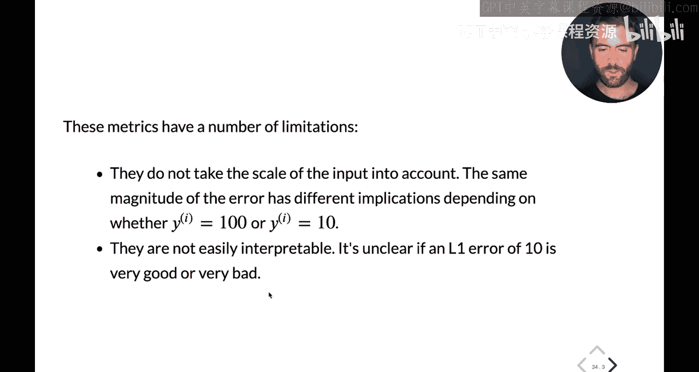

Different ways， both in this video and in the next lecture of dealing with that。

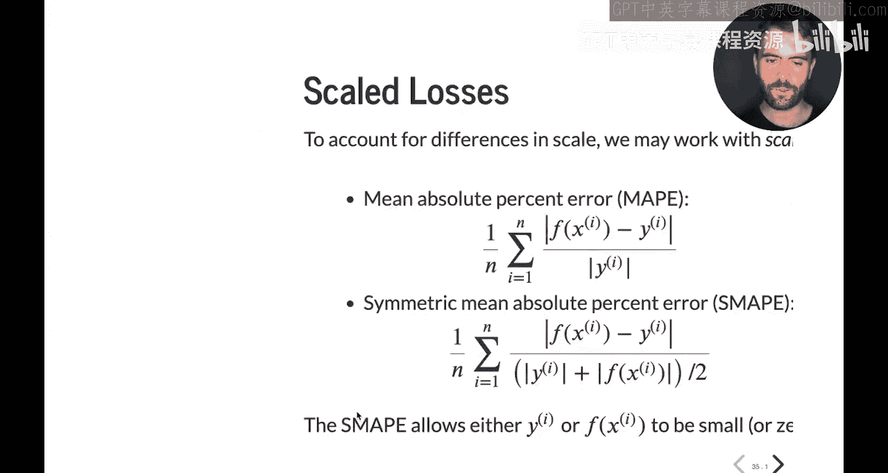

So one way to deal class with the magnitude with the problem of differences in scale is via so called scale losses。

When scale is a problem， we can switch to losses that are of this form， there are many。

 but here are two， we could use something such as the mean absolute percent error or the MEPE。

Which is the L1 error， but we scale each term by the magnitude of the input。

 so now our error would correspond to something like so if we make an error of 10 on if we make an error of5 on a prediction on a target of 100。

 then our error is 5% which now is also more interpretable， we can say that we have a 5% error。

And if the true target is 10 and our error is 5， then we have an error of 50%。

 which is a much higher error。 And so this this makes our model much more much more interpretable。

 And if we were to average these， then we would average。嗯呃。5% with 50%。

 and we would have a high value meaning that there are points which we're making bad predictions。Now。

 one problem with this error is that if y is very small or if y equals 0。

 then because we're dividing by a tiny number， this error can blow up。

 and in order to make it more stable， there are versions of it， for example。

 called there's one called the symmetric mean absolute percent error where instead of dividing by the target we divide by an average of the target and the prediction which addresses this error to which addresses this issue of。

Expllooding denominator to a certain degree。

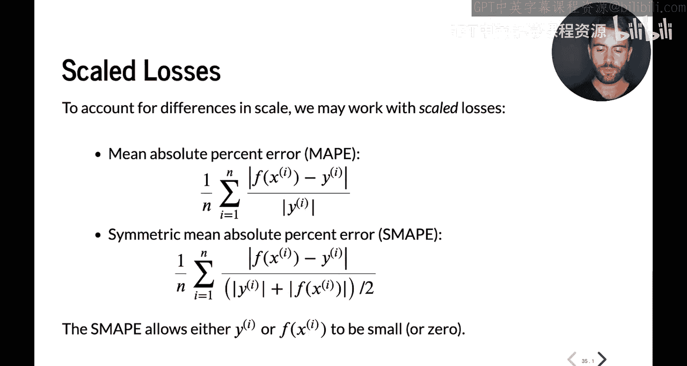

Another way of dealing with differences in scale is via logarithmic losses。

 instead of if our data has different magnitudes， we could bring it to a similar level of magnitude by taking the log and so if we have a 10 and an 100 as our target。

 then taking the log， it will bring them to something smaller。

 if it's based then it will be1 and two， which is going to be which will address the scaling issue。

And now we can simply compute the L1 error on the。Loarithmic input。

 which will and now the data will be roughly the same on the same magnitude。

 So it will address that problem。 and notice here that we have log 1 plus y that is simply in order to avoid in order to make this value。

In order to prevent this log from going to minus infinity as it approaches 0。

 we start by adding a1 here。 This is another class of objective functions for regression that are used。

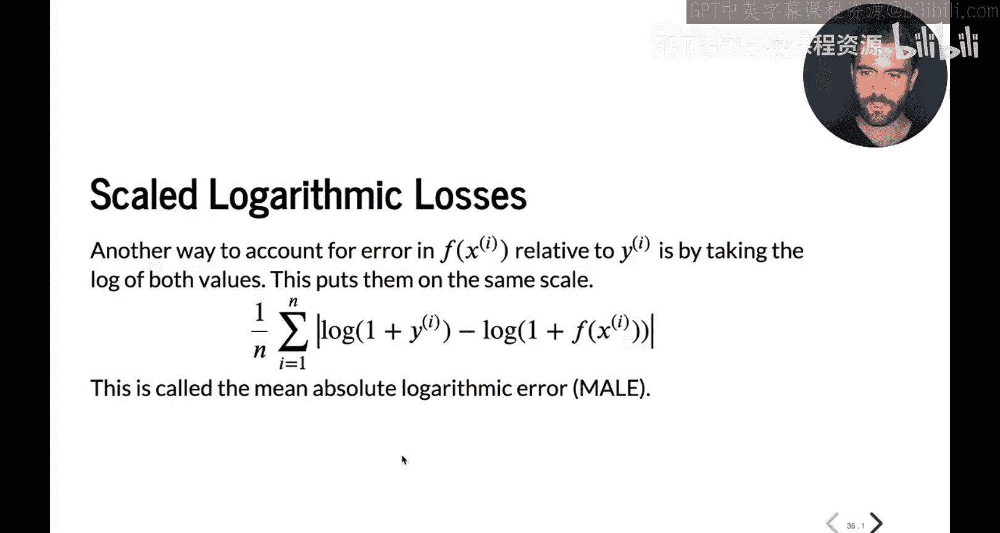

And finally， the last interesting type of loss that's used for aggression is called the coefficient of determination。

And this is the。The formula for this is as follows， essentially。

 this amounts to comparing the performance of a model F to the performance of a constant prediction。

So imagine that instead of predicting F， we simply took all our targets， all the ys。

 and we just computed the average and everywhere we predicted the average。

Then we would have the following squared error between all the points and the average。

The coefficient of determination also it's typically denoted by R2 measures。

how how much more accurate are we relative to this average prediction。

If our model simply outputs the prediction， then the numerator and the denominator are equal。

 then we have here 1， 1 minus1 equals 0， and so in R square of0 measures。

 it means that we are doing just as well as predicting the constant prediction。

But if on the other hand， we're fully accurate and our loss here is zero。

 we're predicting every target perfectly accurately， then the numerator will be 0。

 and so the r squared will be 1。So this here will give us typically a value between 0 and 1。

 although we could also be worse than predicting the average， but then in R squared will be negative。

 but that's especially bad。But yeah， in principle， this will give us a value。Between  zero and 1。

 and it tells us the extent to which we are better than a simple constant value。

And this is something that's useful because now it easier。

 it is easier to interpret our performance in the context of this baseline performance where we just predict the average。

 and so in that sense， the R square measure is a more interpretable definition of accuracy for it's a more interpretable definition of performance for our regression model。

Now there exist other types of regression metrics， these are the main ones。

 but if you are interested in learning more， I encourage you to again look at the Psyit learn documentation for more details。

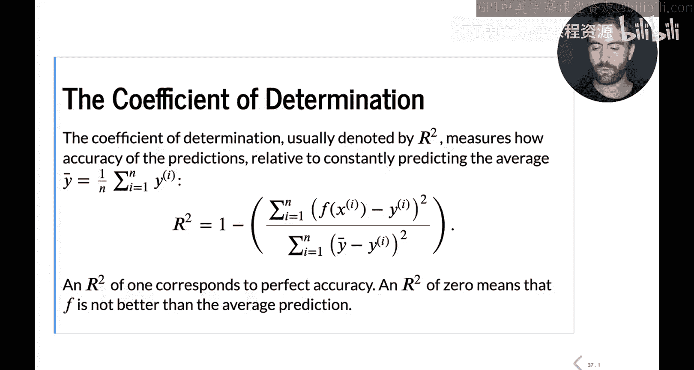