# 应用机器学习：第20讲：第4部分：回归模型评估指标 📊

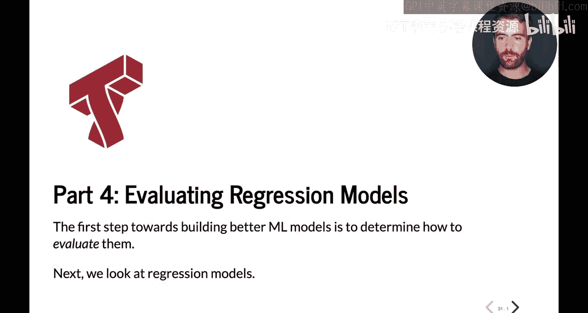

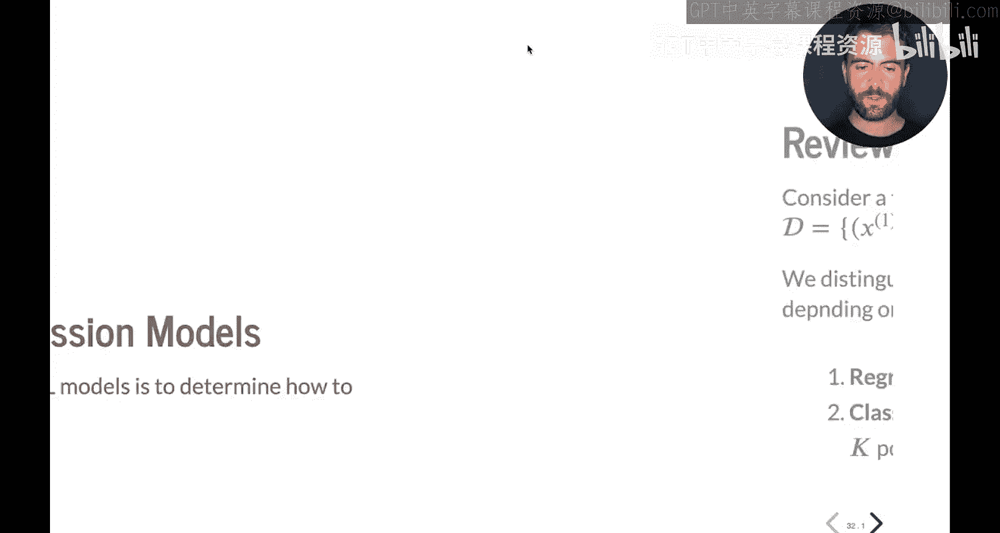

在本节课中，我们将学习如何评估回归模型的性能。我们将介绍几种常用的回归评估指标，并讨论它们的优缺点，帮助你理解如何选择和使用这些指标来衡量模型的预测效果。

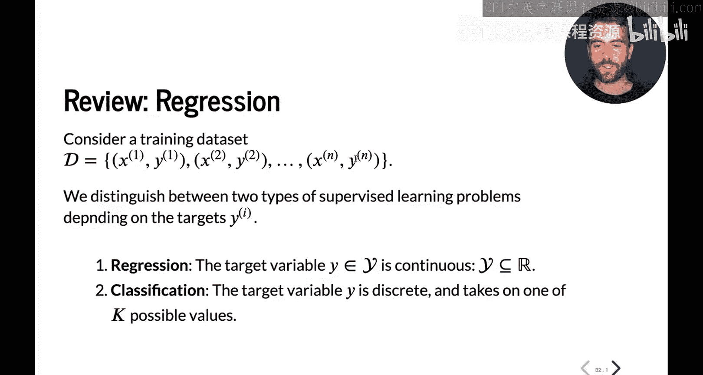

---

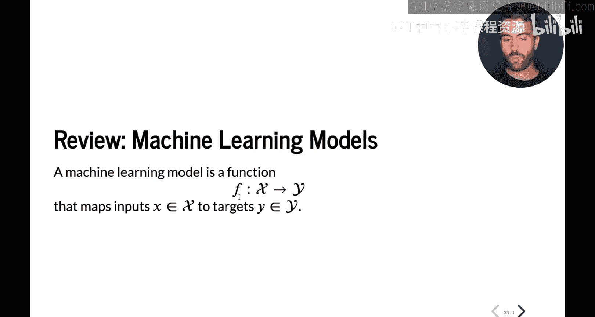

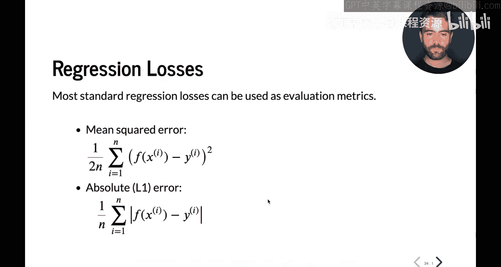

## 回归问题回顾

上一节我们介绍了回归模型的基本概念。本节中，我们来看看如何量化回归模型的性能。

回归是监督学习的一种形式，其目标变量 **Y** 是连续的，而非离散的。我们关注的是量化回归模型的性能，这些模型是将输入 **X** 映射到目标 **y** 的函数。

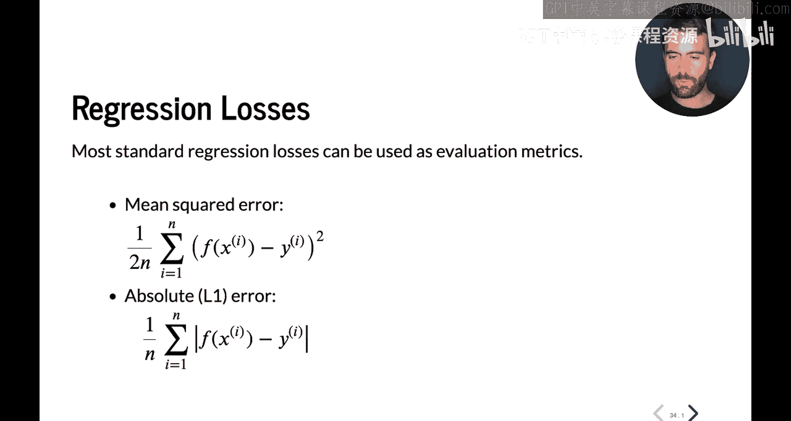

---

## 常用回归损失函数

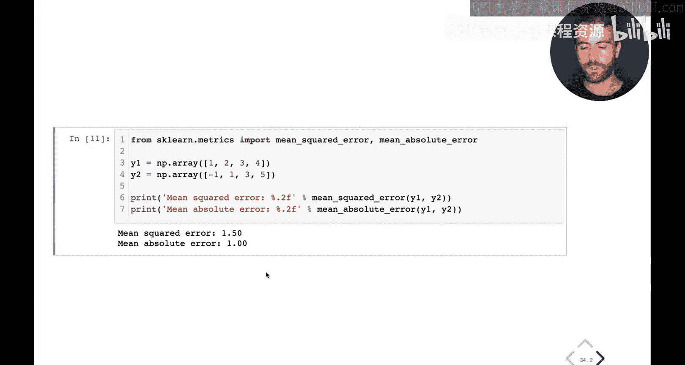

以下是两种最常见的回归损失函数，它们既可作为训练目标，也可作为评估指标。

1.  **均方误差**：计算预测值与真实值之间差值的平方的平均值。
    **公式**：`MSE = (1/n) * Σ(y_i - ŷ_i)^2`

2.  **平均绝对误差**：计算预测值与真实值之间差值的绝对值的平均值。
    **公式**：`MAE = (1/n) * Σ|y_i - ŷ_i|`

这些指标可以直接计算，但存在一些局限性。

---

## 标准损失函数的局限性

使用上述指标存在两个主要问题。

1.  **未考虑目标变量的尺度**：例如，误差为5，对于真实值为10的目标来说很大（误差率50%），但对于真实值为100的目标来说很小（误差率5%）。同一数据集内，不同尺度的目标会使相同误差值代表不同的含义。

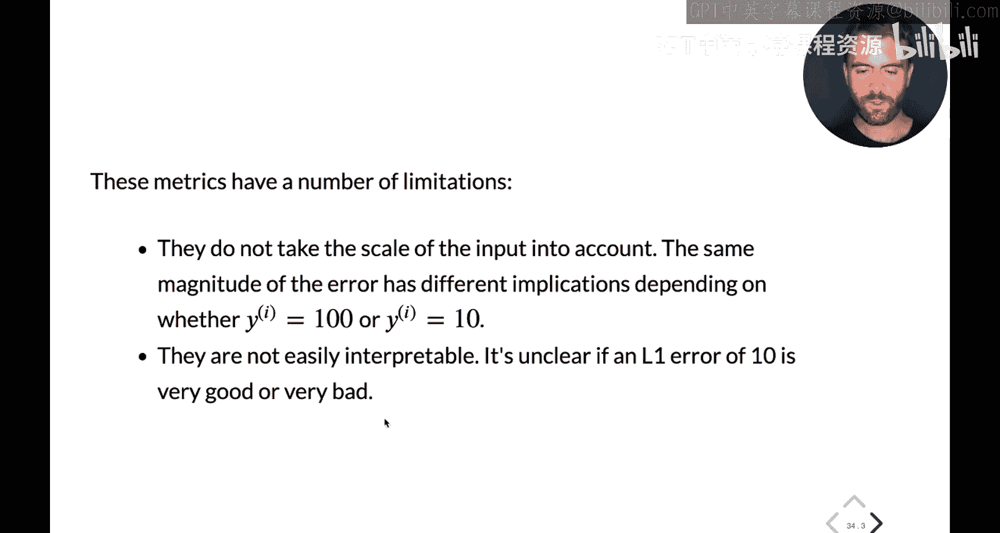

2.  **可解释性差**：很难直观判断一个误差值（如MAE=10）是好是坏。此外，不同指标（如MSE和MAE）给出的数值不同，难以直接比较优劣。

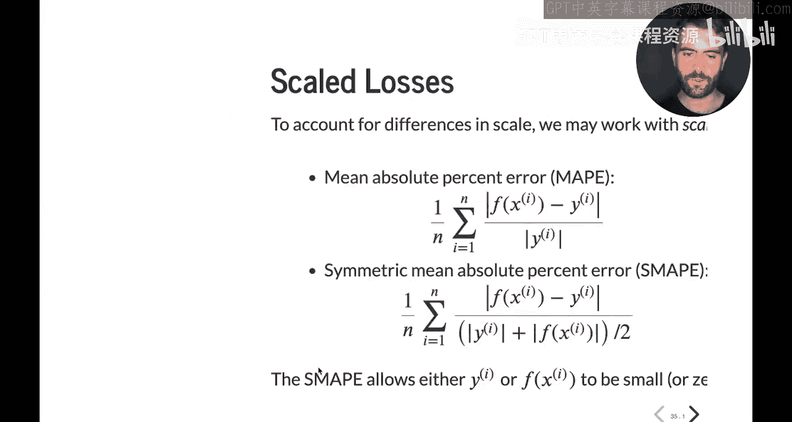

因此，这些简单的回归指标不如分类中的准确率那样直观易懂。接下来，我们将探讨解决这些问题的几种方法。

---

## 处理尺度问题的方法

当数据尺度差异较大时，可以使用以下方法调整评估指标。

### 1. 比例损失

比例损失通过除以目标值来标准化误差，使其成为相对误差。

*   **平均绝对百分比误差**：计算绝对误差相对于真实值的百分比。
    **公式**：`MAPE = (1/n) * Σ|(y_i - ŷ_i) / y_i| * 100%`
    **注意**：当真实值 **y** 接近或等于0时，此公式可能不稳定（分母过小）。

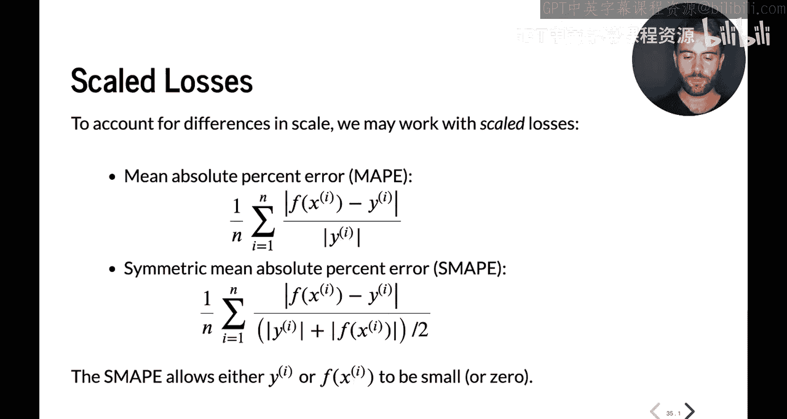

*   **对称平均绝对百分比误差**：为了缓解分母过小的问题，使用预测值和真实值的平均值作为分母。
    **公式**：`sMAPE = (1/n) * Σ|y_i - ŷ_i| / ((|y_i| + |ŷ_i|)/2) * 100%`

### 2. 对数损失

另一种方法是先对目标值取对数，将数据转换到相近的尺度，再计算误差。

*   **均方根对数误差**：一种常见形式，计算对数变换后的均方误差。
    **公式**：`RMSLE = sqrt( (1/n) * Σ(log(1 + y_i) - log(1 + ŷ_i))^2 )`
    **注意**：公式中的 `+1` 是为了防止当 **y** 接近0时，对数函数趋向负无穷。

---

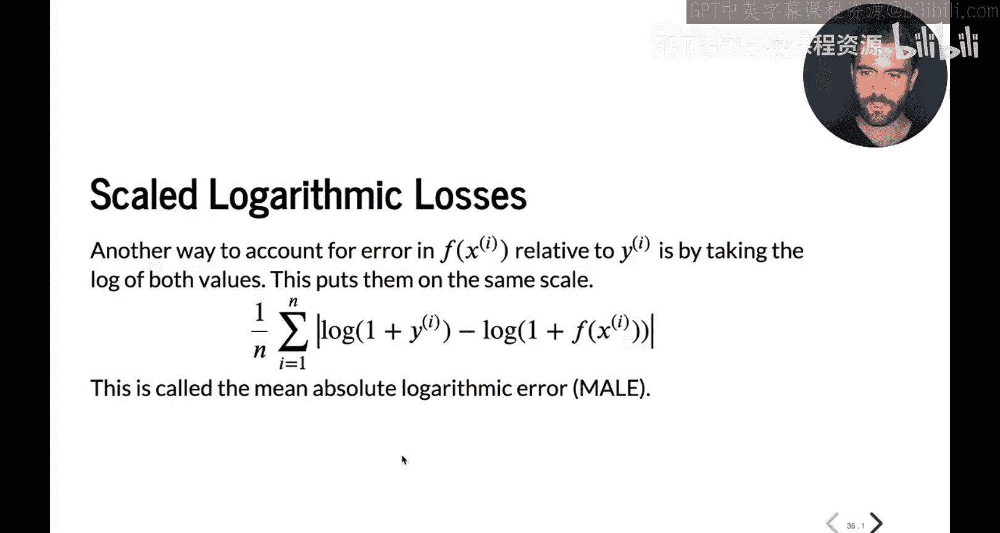

## 决定系数

最后，我们介绍一个非常有用且可解释性强的指标：决定系数。

决定系数衡量的是模型预测相对于简单基准模型（即始终预测目标平均值）的改进程度。

**公式**：`R² = 1 - (Σ(y_i - ŷ_i)^2) / (Σ(y_i - ȳ)^2)`
其中，`ȳ` 是目标变量 **y** 的平均值。

*   **R² = 1**：表示模型完美预测了所有数据点（误差为0）。
*   **R² = 0**：表示模型的预测效果与仅预测平均值相当。
*   **R² < 0**：表示模型的预测效果比仅预测平均值还要差（通常意味着模型存在严重问题）。

R²的值通常在0到1之间，值越接近1，说明模型相对于简单基准的改进越大，性能越好。这为我们提供了一个清晰的、基于基准比较的性能评估框架。

---

## 总结

本节课中，我们一起学习了评估回归模型性能的多种指标。

*   我们回顾了**均方误差**和**平均绝对误差**这两个基础但存在尺度与解释性问题的指标。
*   为了解决尺度问题，我们介绍了**比例损失**和**对数损失**。
*   最后，我们重点讲解了**决定系数**，它是一个将模型性能与简单常数预测基准进行比较的、高度可解释的指标。

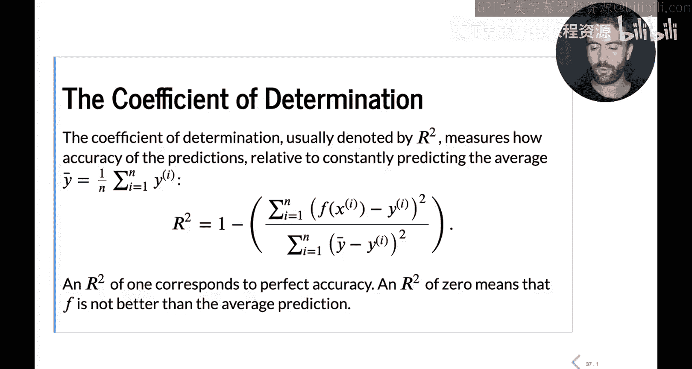

理解这些指标的特点和适用场景，对于正确评估和比较不同回归模型至关重要。如需了解更多回归评估指标，建议查阅相关机器学习库（如Scikit-learn）的官方文档。