# 康奈尔大学《应用机器学习 CS 5787_ Applied Machine Learning 2020》中英字幕（deepseek p74 -74-Lecture 21. Part 1_ Error Analysis.zh_en -BV12udzYvEFM_p74-

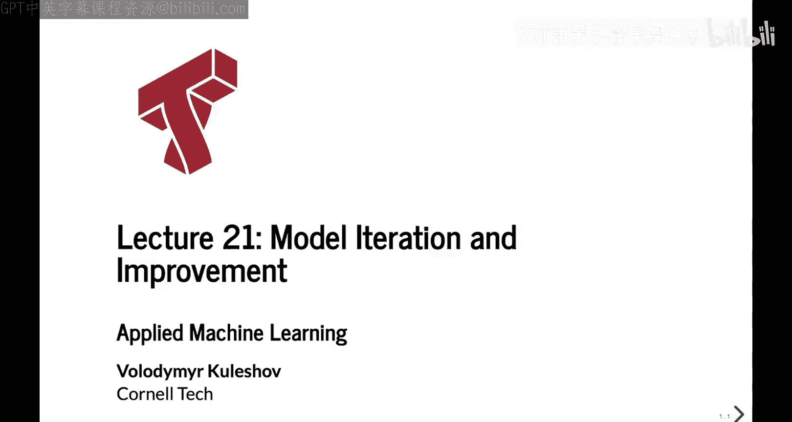

Hi and welcome to Lecture 21 of Applied Machine learninging。

 in which we are going to continue the topic that we started in the previous lecture。

 which is how to apply machine learning in the real world and what are some principal techniques and approaches for getting good performance out of machine learning models？

And the specific focus of this lecture is going to be on model iteration and improvement。

 so how do you make changes to a machine learning model in order to improve its performance and how to do this efficiently？

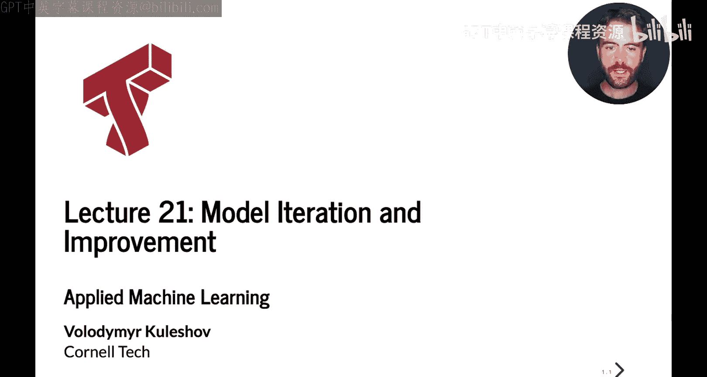

Recall that the high level motivation for what we're coveringing in this lecture is the following。

 imagine you have trained a machine learning classifier and it's giving you 80% accuracy on some data set。

What do you do next。You could try to add more data to the model。

 You could try to make the model bigger。 You could try to add more features。

 or you could add regularization。 There are many different。

Things that you could do to try to improve the performance of this model。

And the goal of this lecture is to present ways and principled techniques for making these decisions and for prioritizing all the different ideas that you have for how to improve the model。

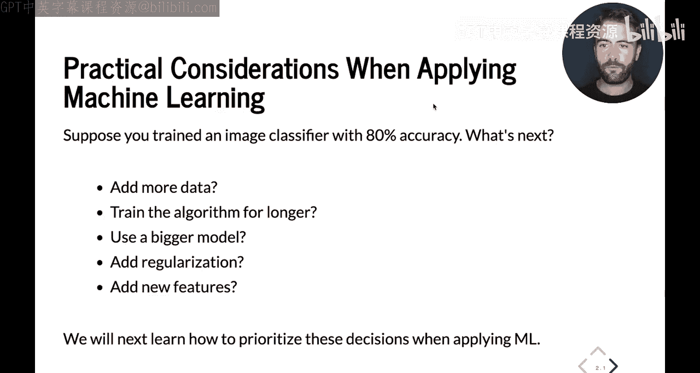

And the key theme that is going to be running through this lecture is that of fast and data driven model iteration。

And the key word here is data driven。In many applications of machine learning。

We are not the domain experts， so in some applications it might be possible to derive the structure of a good machine learning system using our intuition but often we do not have this kind of intuition and therefore we have to rely on a principled approach that examines in detail how the model is doing on the data and examines in detail the errors that it's making and the metrics that it achieves and then based on these metrics。

 we quickly update the model we implement ideas that are guided by the errors and the metrics that we see and doing so will quickly run multiple iteration will quickly produce multiple iterations of the initial model which are going to gradually improve the metrics and improve。

Performance in a systematic and principled way。And so by starting with an initial quick prototype that solves the problem end to end with some initial but not necessarily great level of accuracy。

 and then by quickly fixing， observing and fixing the actual errors that the system is making。

 it is possible to very quickly and efficiently develop a good working machine learning system。

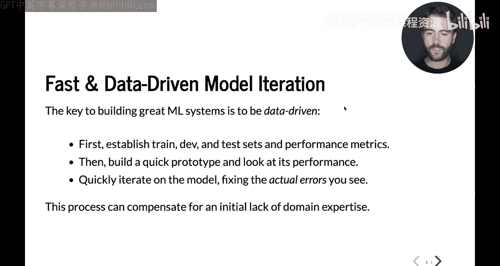

So in this video， I will focus on one particular way of examining the performance of machine learning models。

 which is called error analysis。

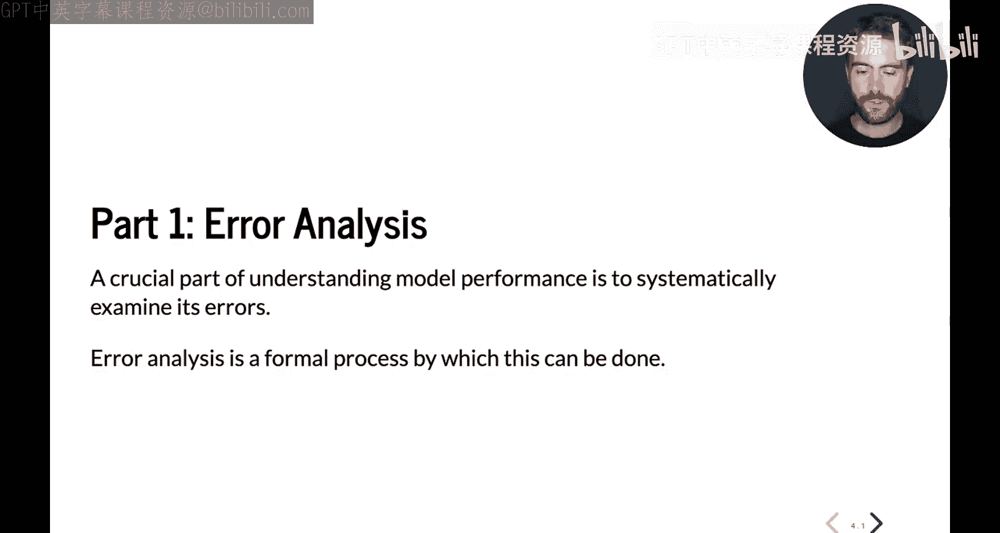

Recall that in the previous lecture I define the following high level workflow for developing machine learning models and it involves three steps at the training step we start with our current iteration of our best guess for a machine learning model for this problem and we fit it on the training set。

Then at the second stage， we estimate its performance on a separate development set。

 which is distinct from our training set using a set of metrics。

 and then based on what we observe of its performance and what we see on the metrics。

 we come up with a set of ideas， and then we come up with a new version of our model。

We train it again on the training set， we again observe its performance on the development set。

 we again make changes， and we repeat these two steps until we have a model whose performance we're satisfied with。

And then in the last step， we take a test set that is distinct from both the training and the development set。

 and we evaluate the performance of the model on the test set。

 and that is going to be our best guess for how the model will perform in production once it is deployed to actual users。

So the focus of this lecture is going to be on the model selection step。 How do we。

How do we observe and how do we measure the performance of our model on a development set。

 and then what changes should we be making to this model based on what we see of its performance？

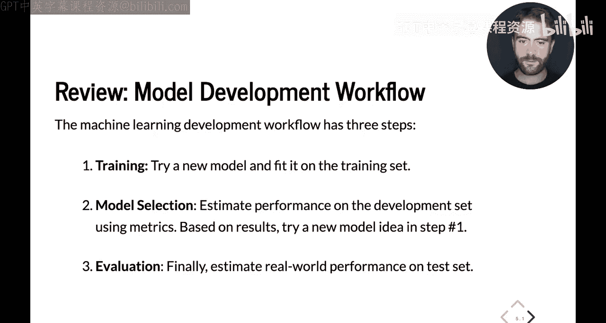

As a motivating example for why this is important， consider the following example。

Imagine you have trained an image classifier on animal photos。

And you created a first version and then you hear anecdotes from its users that some dogs are being misclassified as cats。

And you have the option to integrate with a commercial classifier for dogs。

 you may want to create a model ensemble where you look for the internet。

 you look on the internet for the best possible dogc classifier。

 and then you ensemble it with your own model to try to improve accuracy。

 and you estimate that it's going to take you about a month of work to get this done。

So should you move forward with this integration， should you try to spend this month to improve your accuracy on dog images？

The key to making this decision is to again be data driven and to examine in a systematic and objective way the actual performance of the model。

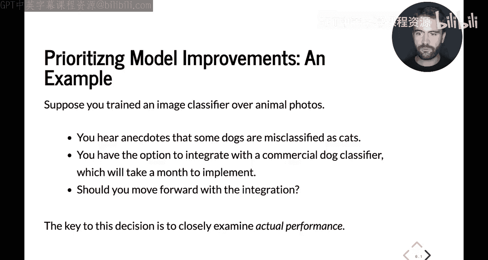

What I mean by this is that in order to make this decision。

The best way to do it would be to collect a random set of examples from the development set。

Say 100 examples。 and then counting examples on which the system has made an error。

 So 100 examples of random 100 random examples of errors from the development set。

 And then you can look at these examples。 and you can see how many of them have the error that you're trying to fix。

 how many of them are misclassifying dogs as cats。And if 5% of misclassified examples have the problem that you're trying to fix。

 well， maybe it's not that important to fix this problem yet， but if 50% do。

 then this seems like an error that you should be prioritizing and an error that you should fix。

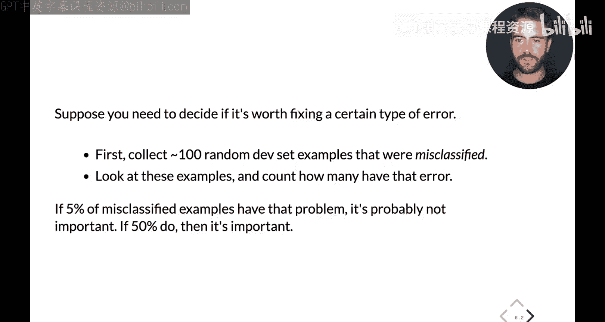

So this example that I gave you， it is an example of a general process called error analysis whose idea is to systematically identify the most common errors made by the model such that we can prioritize fixing the most common and most important error types。

And essentially， error analysis works as follows。Once you have trained an initial model。

You you run it on the development set and you collect a random subset of samples from your development set where the model is making errors。

 For example， it could be making misclassification errors。

And then you go manually through these errors and you examine them and you try to identify patterns in the errors that you're seeing。

 and you try to identify common types or common categories of errors。

And once you have a sense of what the common types of errors are， then you count how many。

Inputs how many of these misclassified deficit set examples belong to each of the error categories。

And once you have these counts， you should prioritize the most important errors。

Or at least you should use this information and perhaps other information。

 like how much time would it take to fix any of these errors？In using all this information。

 you can make an informed decision for what to do next。

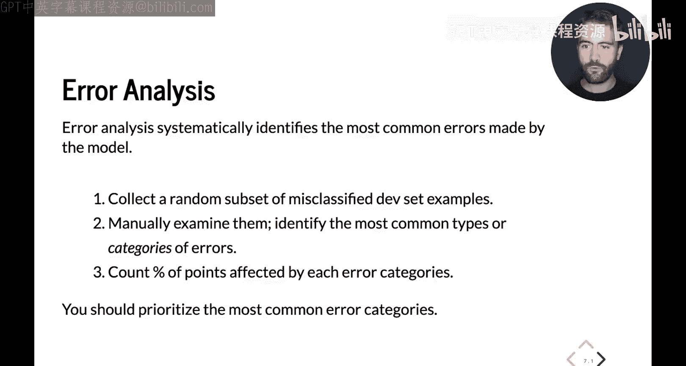

Here is an example of what this could be， supposeose that you're training an image classifier and you have looked at the first so first you train it。

 you run it in your development set and then you sample a random set of errors and you look at the first 20 or 30 and then you will realize that you happen to realized in this example that。

The first 20 or 30 errors they're all either due to images being blurry or flipped or sometimes they're really mislabeled。

 actually your system is correct， but it has but your dev set has the wrong label。

So these can now become your error categories， so after examining an initial set of points。

 you see what the different error types are。

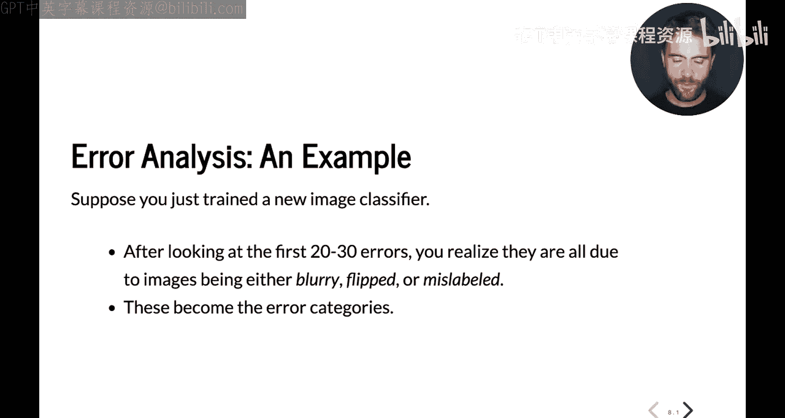

And then you can go through the entire set of random。

 the entire random subset of errors and assign them to categories using something which looks like this table。

 So here the rows are all the images that I have in my random subset of errors。

 and here I put an X in the column that corresponds to the category that is affecting each error。

 each image。 So here in this example， my third image， it is misclassified because well。

 or it appears to be to be misclassified because actually our development set has an incorrect labeled from it。

 And the second image， well， actually our data has noise。

 and it happens to be flipped And so therefore the。The modelel cannot classify it accurately。

 And here the first image， is actually affected by two error types。 It is both blurry and flipped。

Once I have done this for all the images， I can count what percentage is blurry and what percentages flipped and what percentage is misclassified。

And in this example， I see that half the images。Have errors because we are feeding flipped images to our machine learning model。

 and the model has not been properly tuned to deal with these flipped images。

 and this suggests that fixing the flipped error is the most important use of our timeme in this case。

We could fix this error， for example， by taking every image in our training set and creating a second flipped image。

 and then we would train the model on both flipped and non flippedpped images and they would have the same labels。

 and this could be one way of fixing the flipped error。And also notice that a reasonably large。

Fraction of points are misclassified， 30% is quite high。

 and this also probably suggests that we should spend time cleaning our data and trying to fix the labeling problems that we have observed。

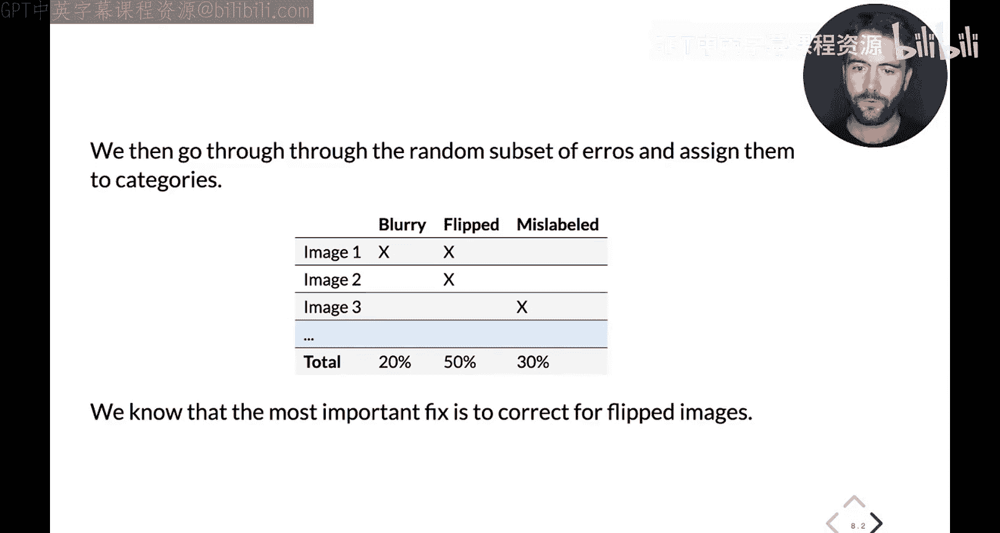

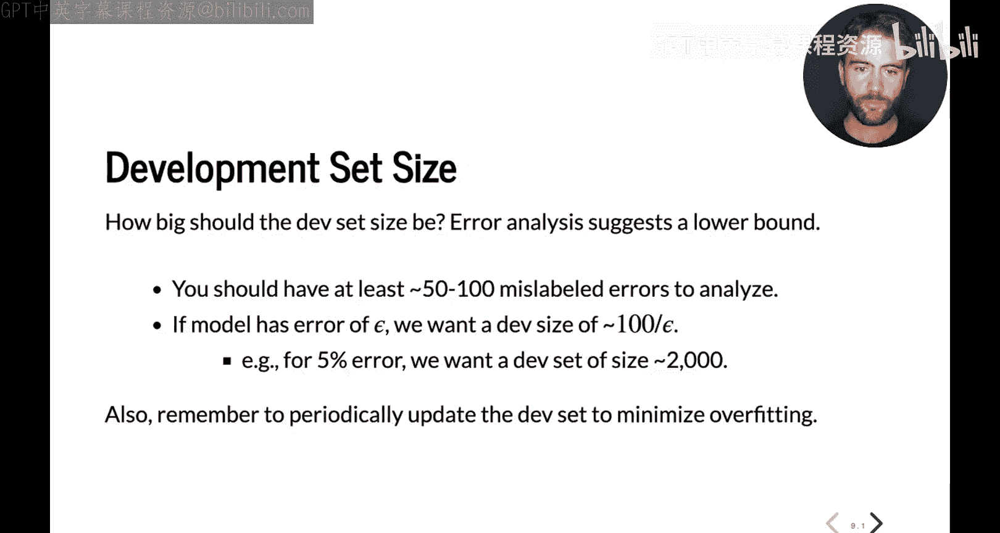

So this is an example of what error analysis is。And air analysis also。

Suggests a particular lower bound on the size of our development set。

If our error analysis is to be useful， we need to see enough different types of errors that the model will be making and ideally we would want 50 to 100 at least if we can have a little bit more that's great。

 but 0 between 50 and 100 seems like a reasonable number and in order to observe this many errors。

 we have to have set a data set that's large enough in particular。

 if the error of the model is epsilon， so it is making an error with fraction of the time that equals epsilon。

 then we want a development size of about 100 divided by epsilon so if the model has 5% error。

 then in order to see about 100 errors， we need a development set size of about 2000。And finally。

 the other important note here in terms of the development set is that you will tend to overfit the development set by fixing errors that happen on the development set。

 and so it will be important to periodically update this set in order to minimize this form of overfitting。

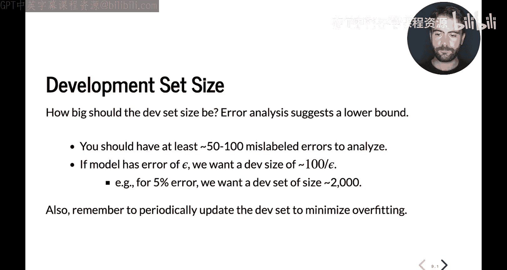

Another consideration with error analysis is whether it is useful to perform it on the。

Development set or on the training set。In my earlier definition。

 I said that we should be using the development set。

And this is correct because we ultimately want to understand the errors that will occur in production once the system is deployed。

 and if we have constructed our development set correctly。

 it will come from the same distribution as the data that we're going to see in production and it will be the best estimate of the errors that we will be seeing in the deployed system。

However， if a model is making errors on the training set。

 that is also a problem because if it makes errors on the training set。

 it will also make errors on the development set or it will make them in production。

 this is very likely， and so in order to fix our model we also want to fix errors on the training set。

Because if we don't fix errors on the training set。

 we will not fix errors in production either in most cases。

 and in order to understand which errors we need to fix。

 it is also useful to perform error analysis on the training set。So therefore。

 the the correct approach is to perform。Both types of error analysis。

 depending on whether we are fixing， we are more interested in fixing problems on the development set or the training set。

 both are important and both have their uses。

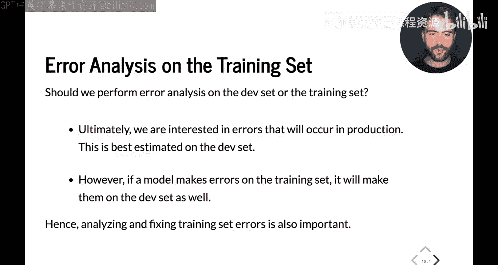

Now， let's look at one last example of error analysis on an actual data set that I'm going to execute in this on code that I'm going to execute in this notebook。

All right or in these slides， so I will walk through one more example that involves the digits data set from Se learnn。

 which is a downscale version of the Mnes digit dataset。

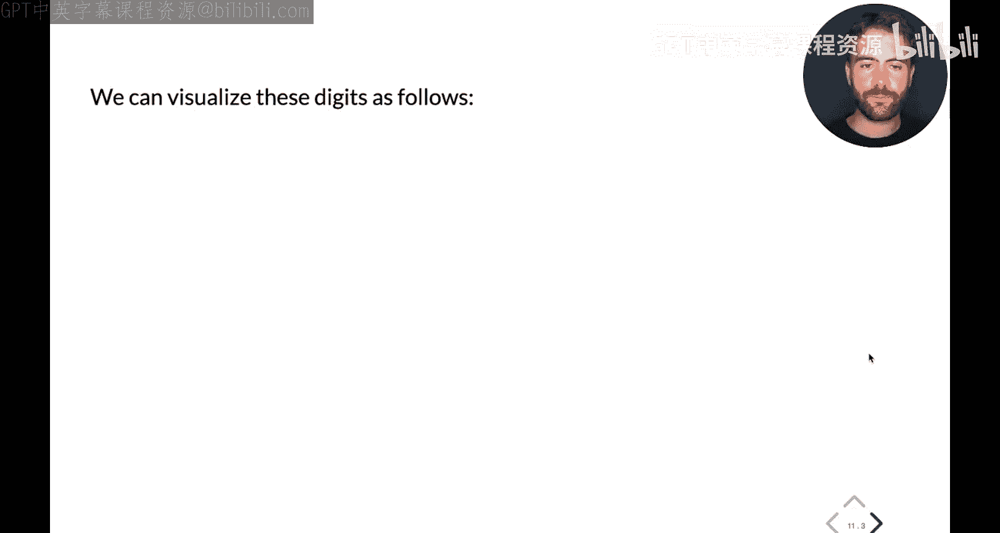

I have just loaded it and we can visualize these digits in PsyitLearn or using MatpllootLi as follows here I have printed one sample from each digit and you can see that there's 10 of them and they look like the digit in question。

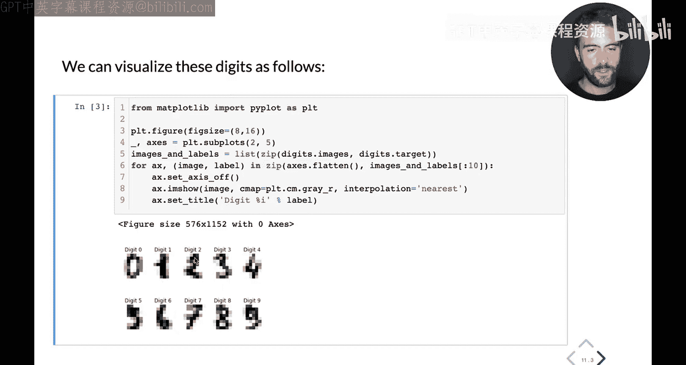

So I'm going to start by separating this data into two equal size data sets。

 a training set and a development set here I'm using the psychic learn function Tra test split in order to split my data in two randomly。

 and I'm calling these two subsets Xtrain and X dev。

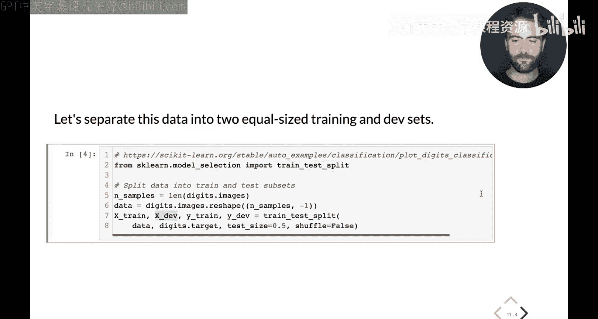

嗯。Now given a training set， I have a multiclass classification problem and I'm going to train a softmax classifier。

 so a softmax model which as you may recall， is implemented within the logistic regression class in PsyitL and here I'm instantiating this class and I'm fitting it on the training set and I'm generating predictions on the development set。

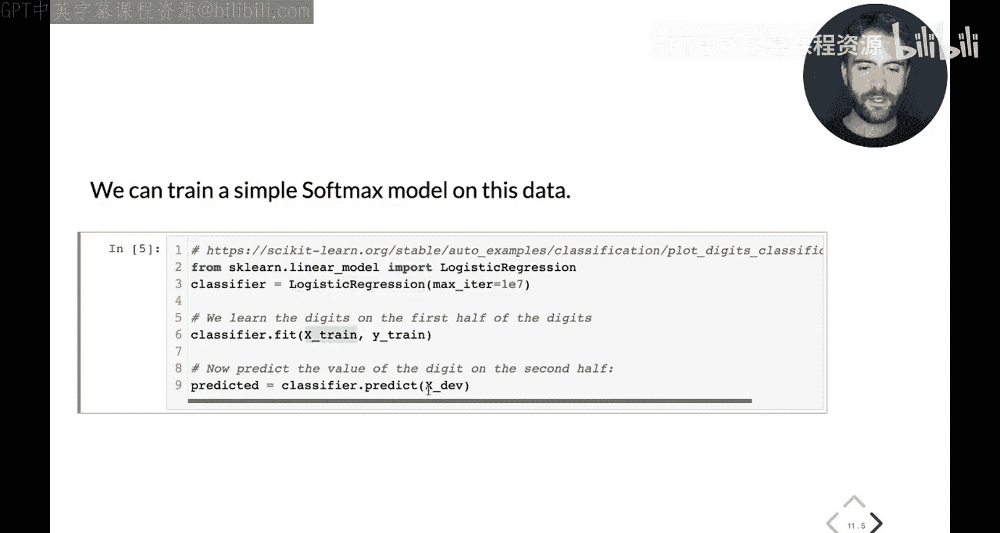

And examining the accuracy， I see that it has about 93% accuracy on the development set。

 which is respectable， but it is not perfect。So why do we not have perfect accuracy and what can we do to improve it。

I am first going to hypothesize that certain digits are misclassified more often than others。

And this is a way of using my prior knowledge to define something which is like an error category for the errors that we're going to see。

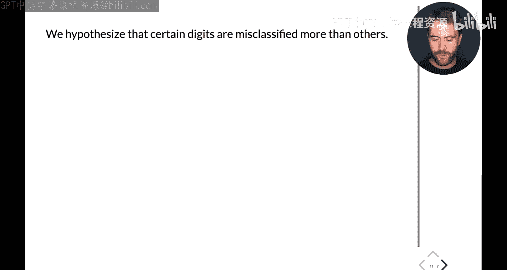

And I can examine the data in a quantitative way here'm creating here I'm looking at the points on which we are making errors and I'm looking at their labels here。

 this is the vector of labels of points on which we have made errors。

And plotting the histogram of these labels， I see that the histogram is very uneven。

 And so some labels， as expected， are classified correctly， more often。

 and some are misclassified more often。 in particular， here。

 the largest numbers over which we're making errors are three ones and7s。

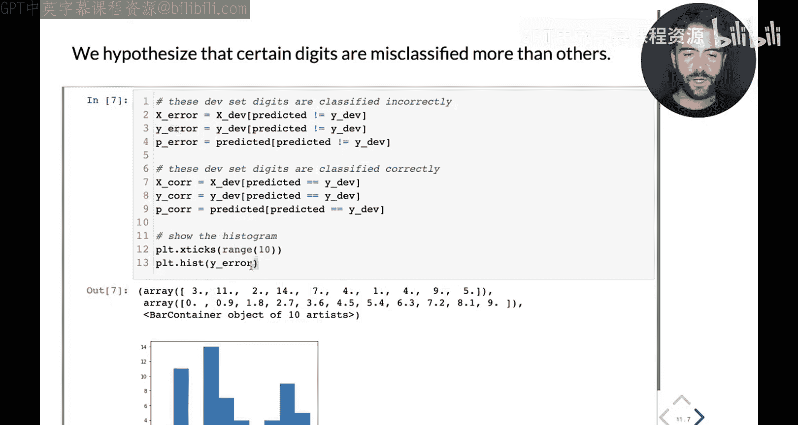

So this is already useful information and this begins to look like a set of error categories。

 in fact you may consider these as being effectively one form of error categories that I have generated automatically without even manually inspecting this data。

So let's look at the most common type of error here， which is when we're misclassifying a three。

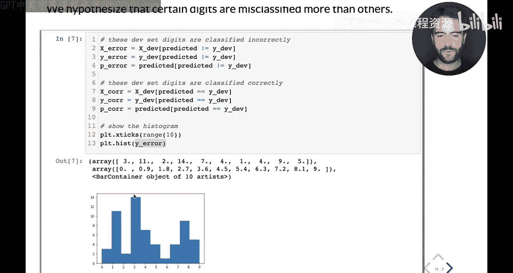

We can investigate this issue further by displaying a subset of the misclassified threes and compare them to threes that are classified correctly。

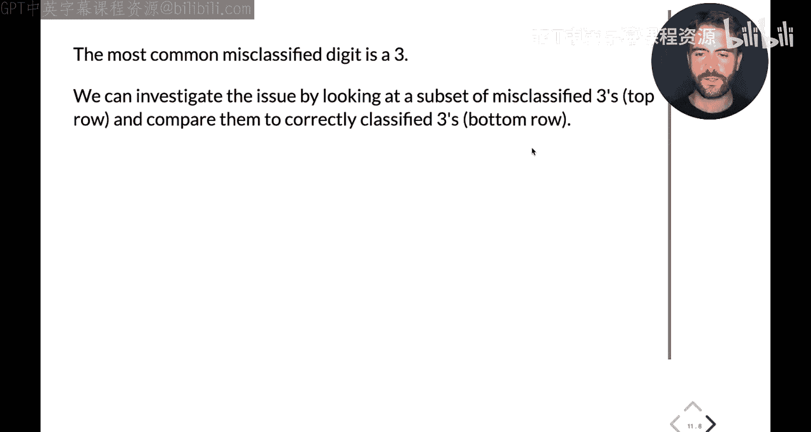

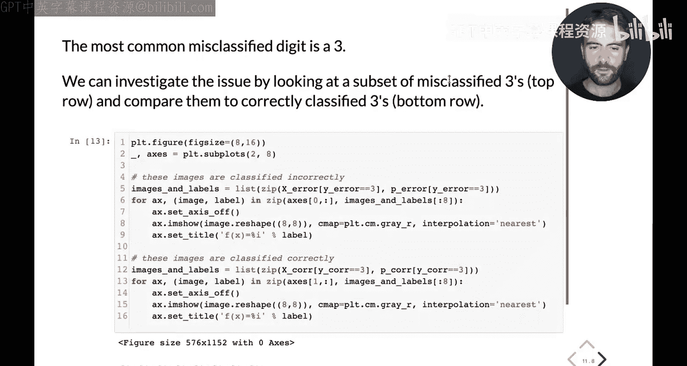

So this code does precisely that and here I have two rows on the top I have threes which are misclassified。

 and here these are the threes that are classified correctly。

And you can immediately see a pattern in this in these results here。

 the threes at the bottom are more smooth。 They look like a well written three。

 and then the threes at the top are。They look more like scribbles and。Intuitively。

 the model is having more difficulty classifying the threes which look in a sense， worse。

 and you can see this one， it looks very close to a 7。 and in fact。

 here its prediction is a7 in this case。

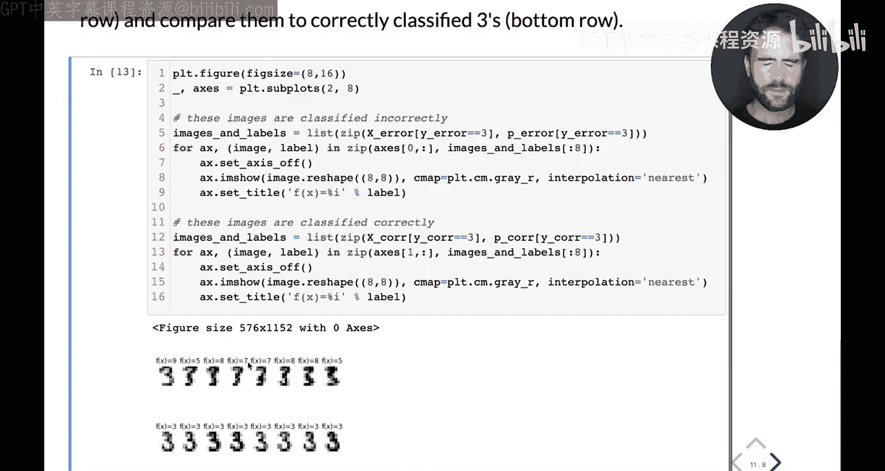

So by inspecting the errors in this case， we have identified a particular type of error。

 which is that there is a certain style in which we can write a3 that is causing the model to make errors and if we wanted to investigate this further。

 we could then try to look more deeply as to why the model is making this particular error on those threes。

 and we could propose fixes or perhaps we could give it more examples of those threes。

 there are many different solutions that could be done。

 but we have identified this error as being particularly important for this particular model and data。

So this was our last example of error analysis， and to conclude I also want to identify certain limitations that error analysis has。

As I mentioned earlier， it is easy to overfit the development set when you do error analysis because at every step。

 every time you try a new model， you are examining in detail and you're spending a lot of energy and your guiding all your changes by the specific errors on a development set and as a result you will very quickly have a model that works really well in your development set。

 but you will only be aware of the errors on that data set and therefore you will tend to overfit it。

Also， air analysis is a process that requires work， it's laborious。

 but nonetheless it is still important。And finally。

 one higher level criticism of error analysis is that it focuses on very， very specific errors。

 so those threes which are misclassified， but it can sometimes miss the big picture。

 for example we may be just overfitting the data in a very bad way and it will not be obvious from looking at the very minute details。

So certain bigger trains can be missed。And this is something that's going to motivate other types of analysis。

 which I'm going to discuss in the rest of this lecture。

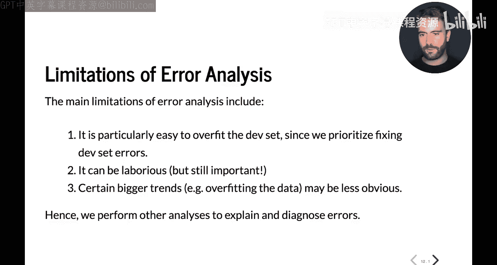