# 应用机器学习：第21讲：第1部分：误差分析 📊

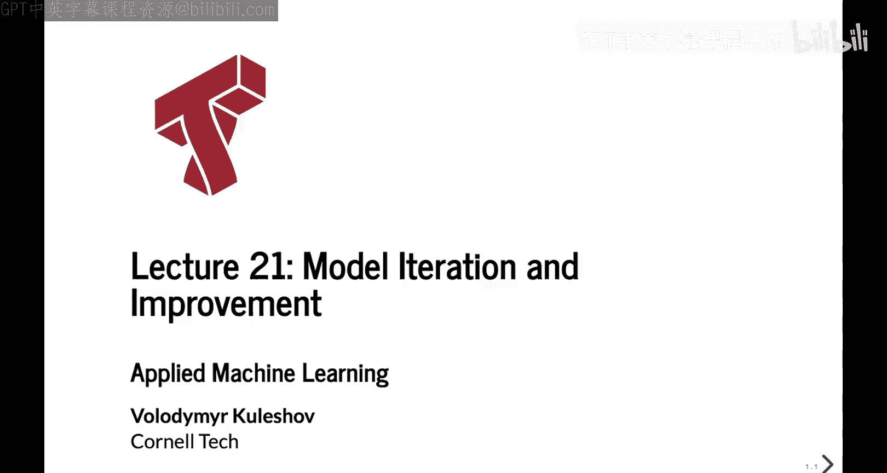

在本节课中，我们将继续上一讲的主题，探讨如何在现实世界中应用机器学习，以及有哪些核心技术和策略可以提升机器学习模型的性能。本节课的重点是模型的迭代与改进，即如何高效地对机器学习模型进行修改以提升其表现。

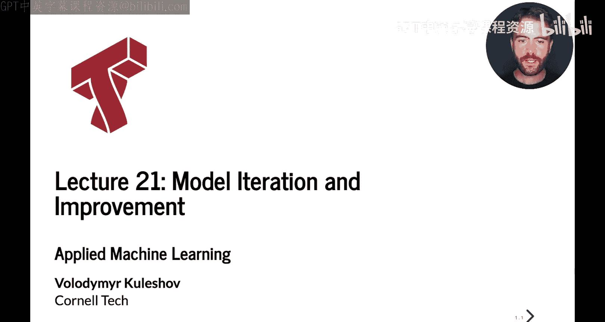

## 概述

想象一下，你训练了一个机器学习分类器，它在某个数据集上达到了80%的准确率。接下来你该做什么？你可以尝试添加更多数据、扩大模型规模、增加特征，或者添加正则化。有太多不同的改进思路。本节课的目标就是介绍一些原则性的方法和技术，帮助你做出决策，并优先处理那些能最有效提升模型性能的想法。

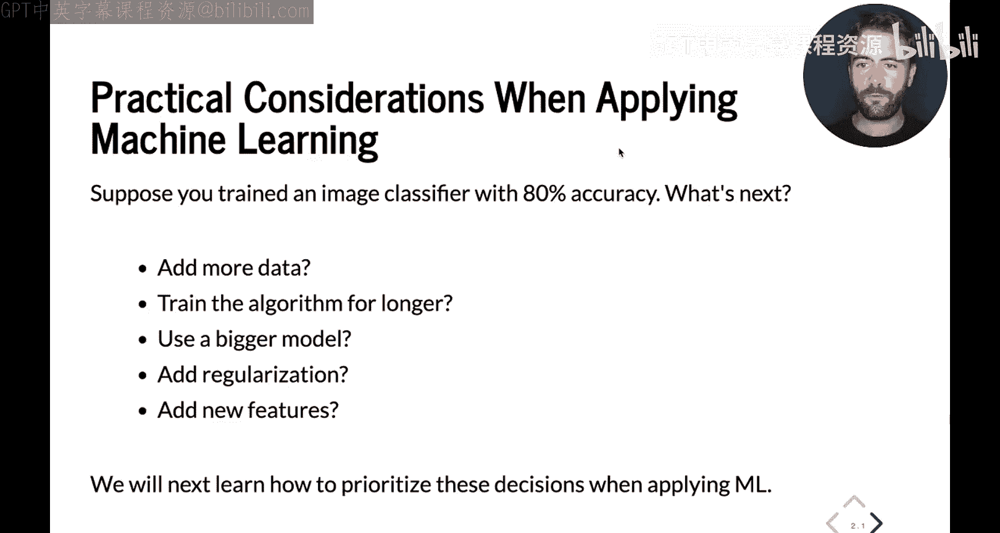

贯穿本节课的一个核心主题是**快速、数据驱动的模型迭代**。这里的**数据驱动**是关键。在许多机器学习应用中，我们并非领域专家，因此不能仅凭直觉来构建一个好的系统。我们必须依赖一种原则性的方法：详细检查模型在数据上的表现，分析其产生的错误和评估指标，然后基于这些观察结果，快速更新模型，并实施有针对性的改进。通过这种方式，我们可以快速迭代出多个模型版本，系统地提升性能。

## 机器学习模型开发流程回顾 🔄

在上一讲中，我们定义了开发机器学习模型的高级工作流程，它包含三个步骤：

1.  **训练阶段**：从当前最佳模型猜想开始，在训练集上拟合模型。
2.  **评估与迭代阶段**：在一个独立的开发集上评估模型性能，使用一组评估指标。根据观察到的性能和指标，提出一系列改进想法，并生成模型的新版本。然后重复训练和评估步骤，直到对模型性能满意为止。
3.  **最终测试阶段**：在一个与训练集和开发集都不同的测试集上评估模型性能，这将是模型部署到实际用户后性能的最佳估计。

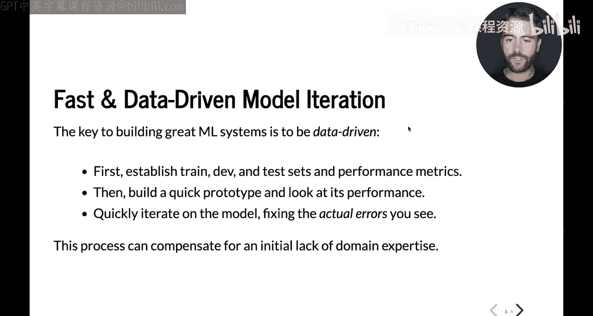

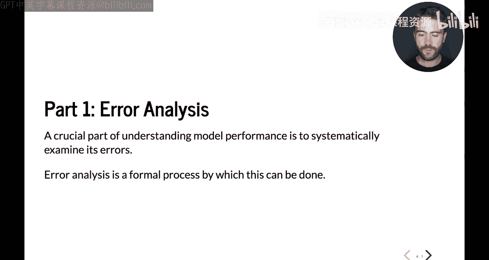

本节课的重点是**模型选择步骤**，即我们如何观察和衡量模型在开发集上的性能，以及基于这些观察结果，我们应该对模型做出哪些改变。

## 为什么需要数据驱动的决策？ 🤔

为了说明这一点的重要性，我们来看一个例子。假设你训练了一个动物图片分类器。你创建了第一个版本，然后从用户那里听到一些反馈，说有些狗被错误地分类为猫。你有一个选择：可以集成一个商业的狗分类器。你可能想创建一个模型集成，在网上寻找最好的狗分类器，然后将其与你自己的模型集成以提高准确率。你估计完成这项工作大约需要一个月的时间。

那么，你应该推进这个集成工作吗？你应该花这一个月时间来提升模型在狗图片上的准确率吗？做出这个决策的关键在于**数据驱动**，即以系统、客观的方式检查模型的实际性能。

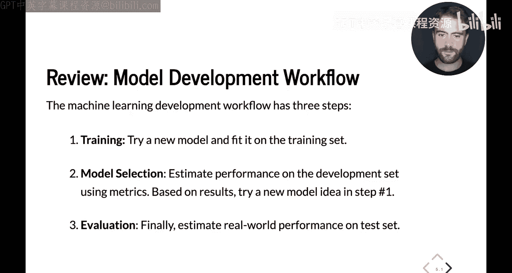

## 误差分析：系统识别常见错误 🎯

具体来说，最好的决策方式是：从开发集中随机抽取一组样本（例如100个样本），然后统计模型在这些样本上犯错的次数。接着，查看这些错误样本，看看有多少属于你试图修复的问题（例如，将狗误分类为猫）。如果只有5%的错误样本存在这个问题，那么修复它可能不那么紧迫；但如果50%的错误样本都是这个问题，那么这似乎是一个应该优先处理并修复的错误。

这个例子展示了一个通用过程，称为**误差分析**。其核心思想是**系统地识别模型最常见的错误类型，以便我们能够优先修复最常见和最重要的错误**。

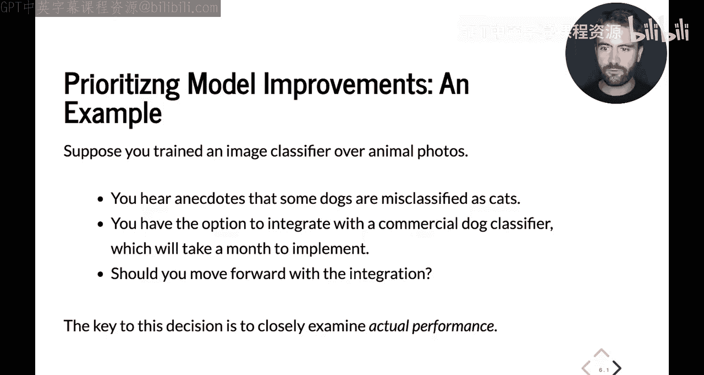

本质上，误差分析的工作流程如下：

1.  训练一个初始模型。
2.  在开发集上运行该模型，并收集模型出错的随机样本子集（例如分类错误的样本）。
3.  手动检查这些错误，尝试识别其中的模式和常见的错误类别。
4.  一旦对常见错误类型有了概念，就统计每个错误类别下有多少个开发集样本。
5.  根据这些统计结果，优先处理最重要的错误。在决策时，还应结合其他信息，例如修复每种错误所需的时间。

## 误差分析实例：图像分类器 📸

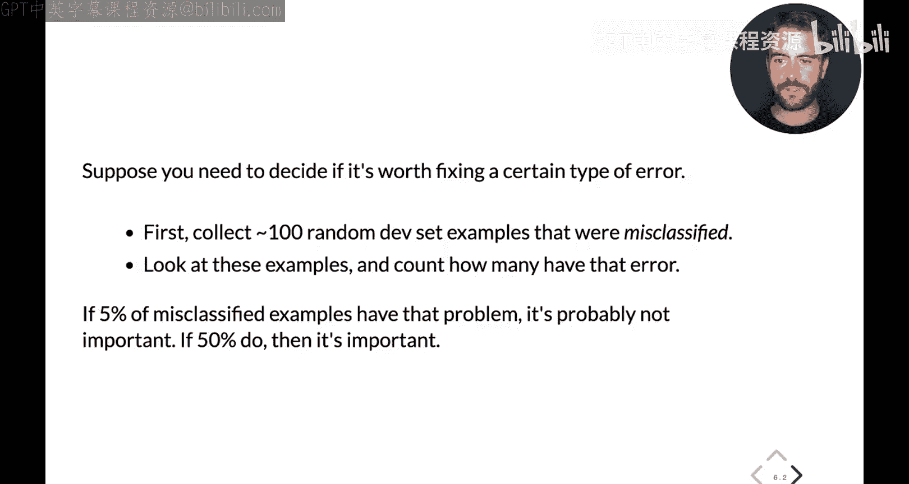

假设你在训练一个图像分类器。你训练了模型，在开发集上运行，然后随机抽取了一组错误样本。在查看了前20或30个错误后，你发现这些错误要么是因为图像模糊，要么是因为图像被翻转了，或者有时是数据标签本身标错了（实际上你的系统预测正确，但开发集的标签是错的）。

于是，这些发现就成为了你的错误类别。在检查了初始样本后，你看到了不同的错误类型。

接下来，你可以遍历整个随机错误样本子集，并使用一个类似下表的工具将它们归类：

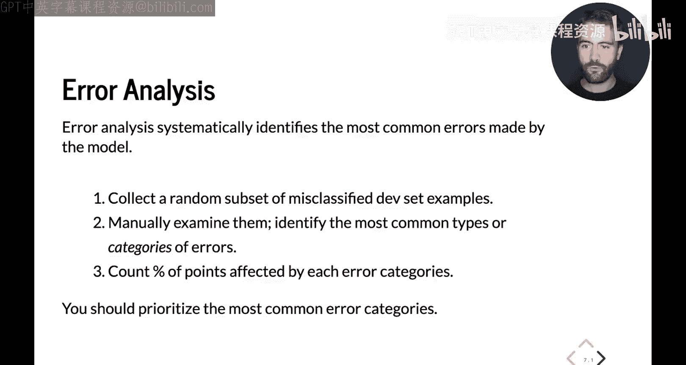

| 图像编号 | 模糊 | 翻转 | 标签错误 |
| :--- | :--- | :--- | :--- |
| 1 | X | X | |
| 2 | | X | |
| 3 | | | X |
| ... | ... | ... | ... |

在这个例子中，第三张图像被“误分类”是因为开发集的标签本身有误。第二张图像因为被翻转而导致模型无法准确分类。第一张图像同时受到两种错误类型的影响：既模糊又被翻转。

为所有图像完成分类后，我可以计算模糊、翻转和标签错误各自所占的百分比。在这个例子中，我发现一半的图像错误是因为我们向模型输入了翻转的图像，而模型没有经过适当的调整来处理这类图像。这表明，**修复翻转错误是我们当前最应该优先投入时间的地方**。

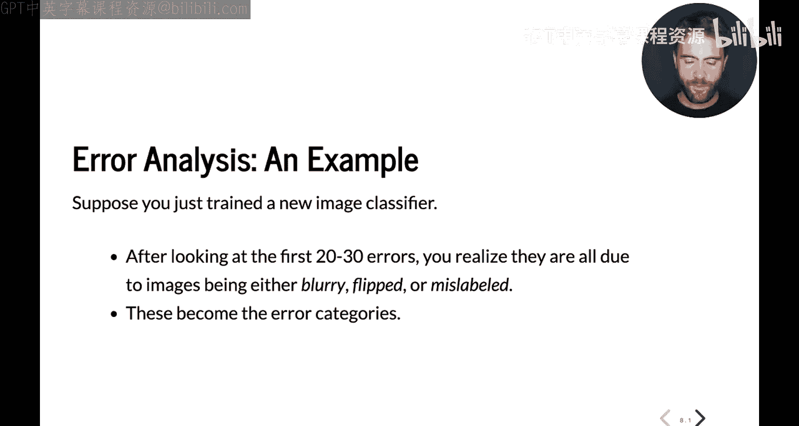

例如，我们可以通过将训练集中的每张图像都创建一份翻转副本，并用相同的标签训练模型，以此来修复翻转错误。同时，注意到有相当大比例（30%）的样本存在标签错误，这也提示我们应该花时间清理数据，修复已发现的标签问题。

## 误差分析的注意事项 ⚠️

误差分析也对开发集的大小提出了一个特定的下限要求。为了使误差分析有用，我们需要看到足够多的模型错误类型。理想情况下，我们希望至少有50到100个错误样本（如果能更多则更好）。为了观察到这么多错误，开发集必须足够大。具体来说，如果模型的错误率为 **ε**（即模型出错的概率为 ε），那么我们希望开发集的大小约为 **100 / ε**。例如，如果模型有5%的错误率，为了看到大约100个错误，我们需要一个大约2000个样本的开发集。

最后，关于开发集的一个重要注意事项是：通过修复开发集上的错误，你很容易**对开发集产生过拟合**。因此，定期更新开发集以最小化这种形式的过拟合非常重要。

## 在训练集还是开发集上进行误差分析？ 📊

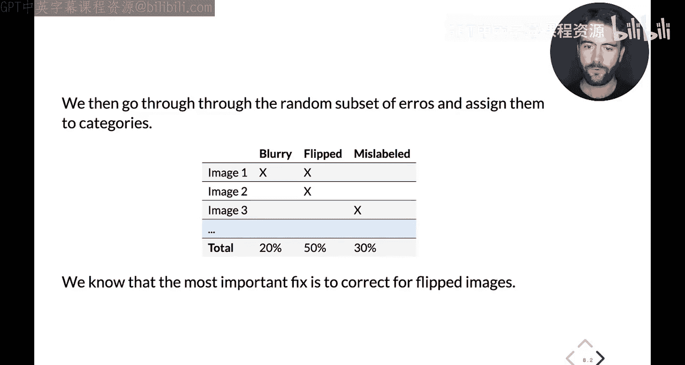

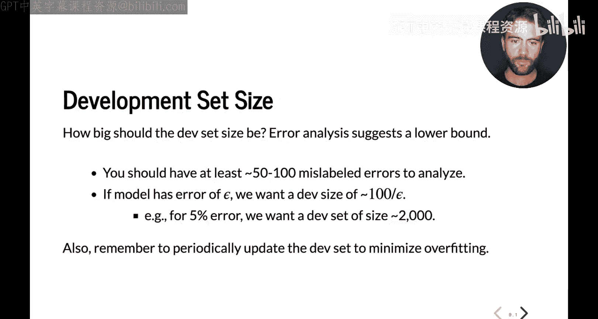

另一个需要考虑的问题是，误差分析应该在开发集上进行，还是在训练集上进行？根据之前的定义，我们应该使用开发集。这是正确的，因为我们最终希望了解系统部署到生产环境后可能出现的错误。如果我们正确构建了开发集，它将与生产环境中的数据来自同一分布，并且是对部署系统将看到的错误的最佳估计。

然而，如果模型在训练集上犯错，这也是一个问题。因为如果它在训练集上犯错，那么它在开发集或生产环境中也很可能犯错。因此，为了修复我们的模型，我们也需要修复训练集上的错误。在大多数情况下，如果不修复训练集上的错误，我们同样无法修复生产环境中的错误。

因此，正确的方法是**两种类型的误差分析都进行**，具体取决于我们更关注修复开发集还是训练集上的问题。两者都很重要，各有其用途。

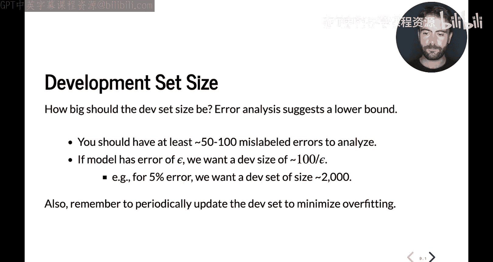

## 实战示例：手写数字识别 🔢

现在，让我们看一个在真实数据集上进行误差分析的最后示例。我们将使用Scikit-learn中的`digits`数据集（MNIST数字数据集的缩小版）。

首先，加载数据并将其可视化。我们可以看到每个数字的一个样本。

接着，将数据随机分成两个大小相等的子集：训练集和开发集。

给定训练集，我们面临一个多分类问题。我们将训练一个softmax分类器（在Scikit-learn中通过`LogisticRegression`类实现）。实例化该类，在训练集上拟合模型，并在开发集上生成预测。

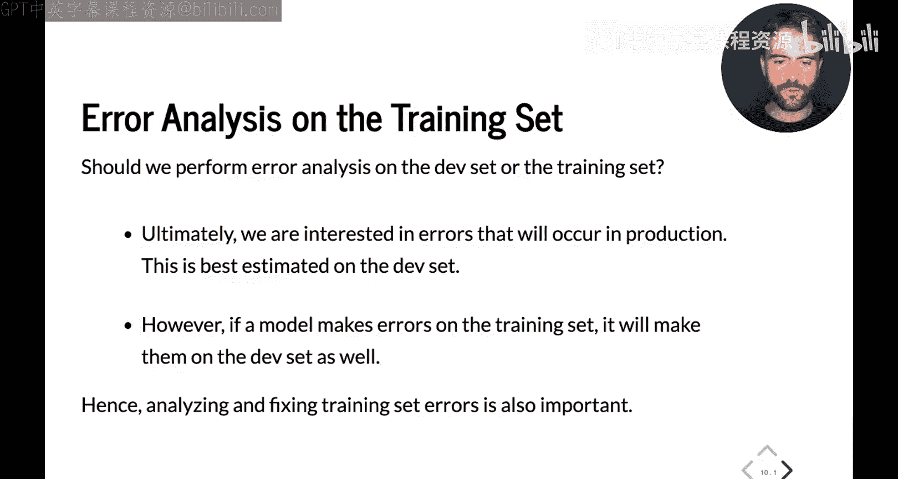

检查准确率后，我们发现模型在开发集上的准确率约为93%。这个结果不错，但并不完美。那么，为什么我们没有达到完美的准确率？我们该如何改进？

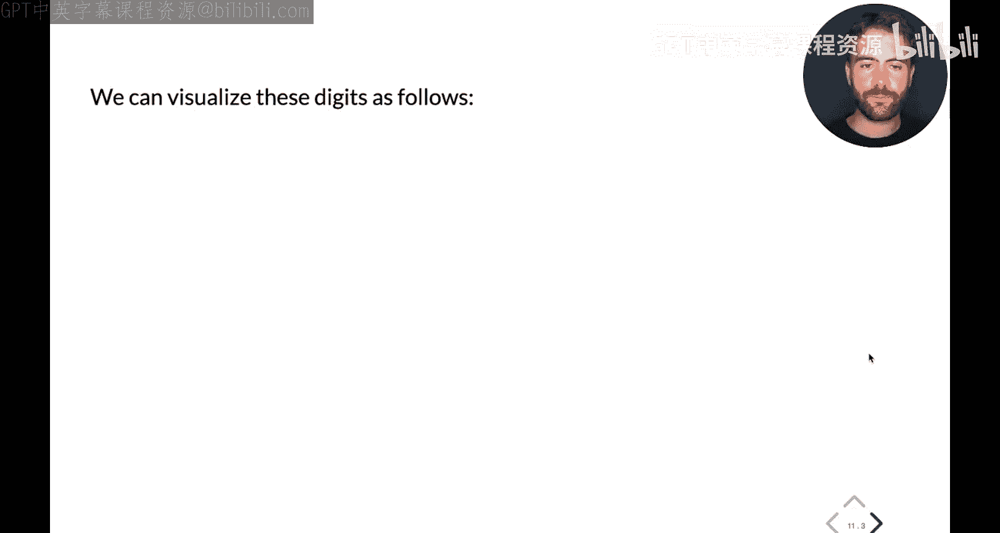

首先，我假设某些数字比其他数字更容易被误分类。这是一种利用先验知识来定义错误类别的方法。

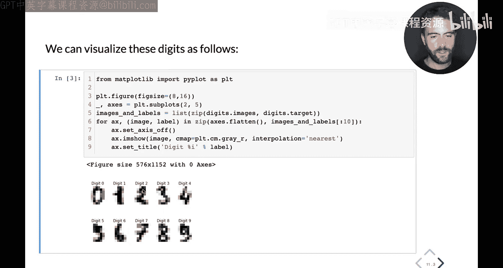

我们可以定量地检查数据。这里，我们查看模型出错的点及其标签，并绘制这些标签的直方图。我发现直方图非常不均匀。正如预期的那样，有些标签被正确分类的频率更高，而有些则更容易被误分类。特别是，错误最多的数字是3和7。

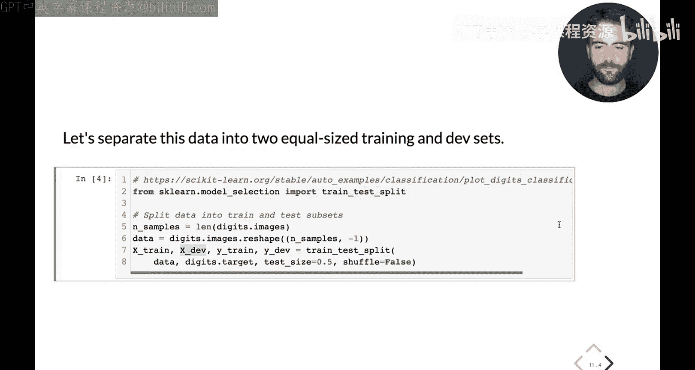

这已经是很有用的信息，并且开始看起来像一组错误类别。事实上，你甚至可以将这些视为一种自动生成的错误类别，而无需手动检查数据。

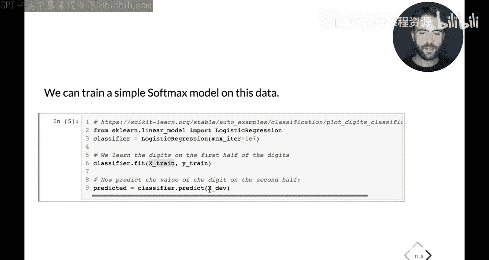

让我们看看这里最常见的错误类型：误分类数字3的情况。

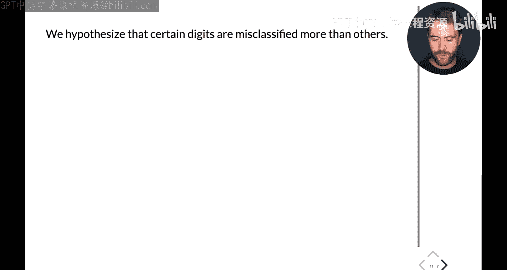

我们可以通过显示被误分类的“3”的子集，并将其与正确分类的“3”进行比较，来进一步调查这个问题。

执行此操作的代码会生成两行图像：顶部一行是被误分类的“3”，底部一行是被正确分类的“3”。

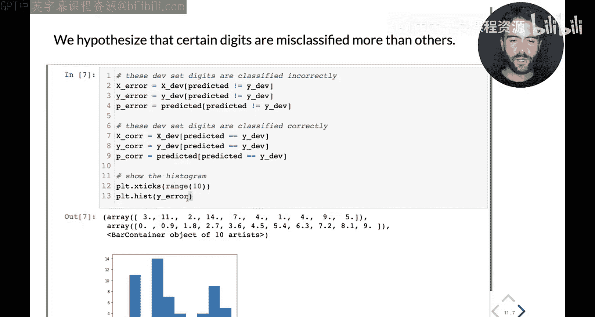

你可以立即在这些结果中看到一个模式：底部的“3”更平滑，看起来像是书写工整的“3”；而顶部的“3”看起来更像是涂鸦。直观上，模型在分类那些看起来“更差”的“3”时遇到了更多困难。例如，其中一个看起来非常接近“7”，实际上模型在这个案例中预测它就是“7”。

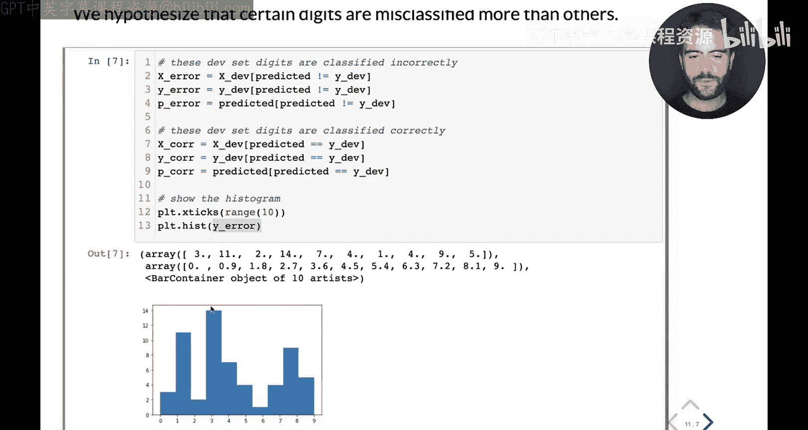

通过检查这些错误，我们识别出了一种特定的错误类型：存在某种书写“3”的风格会导致模型出错。如果我们想进一步调查，可以更深入地探究为什么模型会对这些特定的“3”犯错误，并提出修复方案，或者为模型提供更多此类“3”的示例。虽然有很多不同的解决方案，但我们已经确定这个错误对于当前模型和数据来说尤为重要。

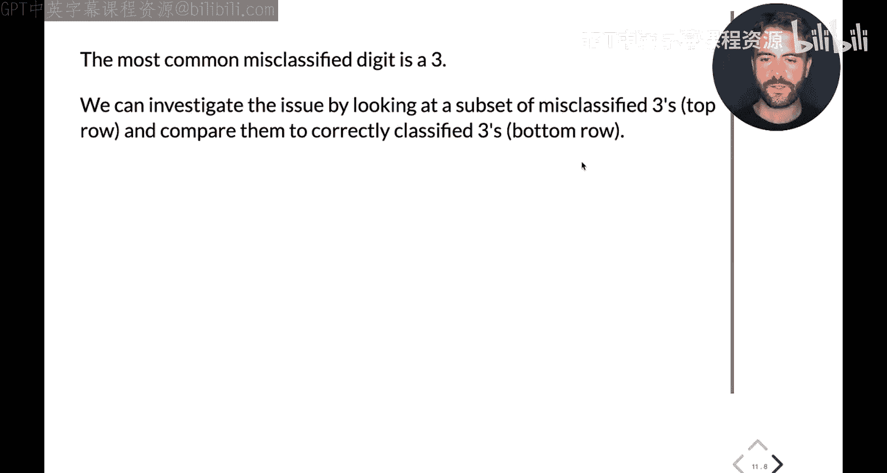

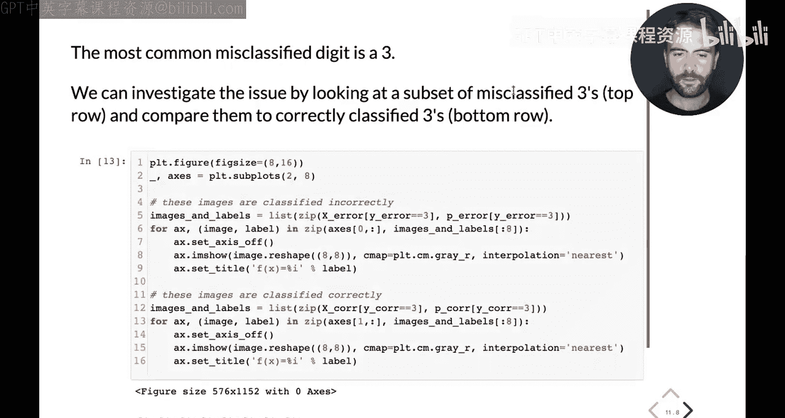

## 误差分析的局限性与总结 📝

以上就是误差分析的最后一个示例。在结束之前，我也想指出误差分析的一些局限性。

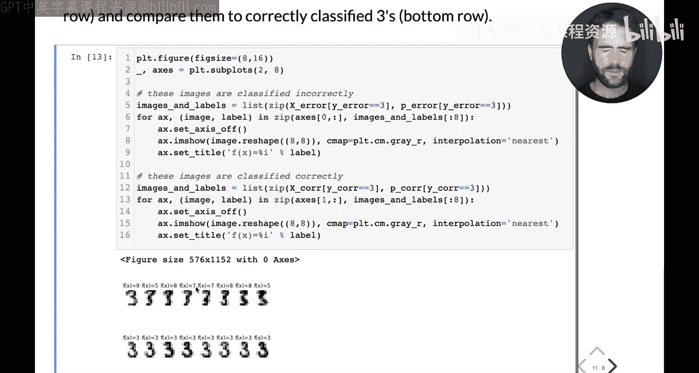

正如前面提到的，在进行误差分析时，很容易对开发集产生过拟合。因为每一步，每当你尝试一个新模型时，你都在详细检查，并花费大量精力，根据开发集上的具体错误来指导所有更改。结果，你很快就会得到一个在开发集上表现非常好的模型，但你只会意识到该数据集上的错误，因此容易对其过拟合。

此外，误差分析是一个需要投入工作的过程，它很繁琐，但尽管如此，它仍然非常重要。

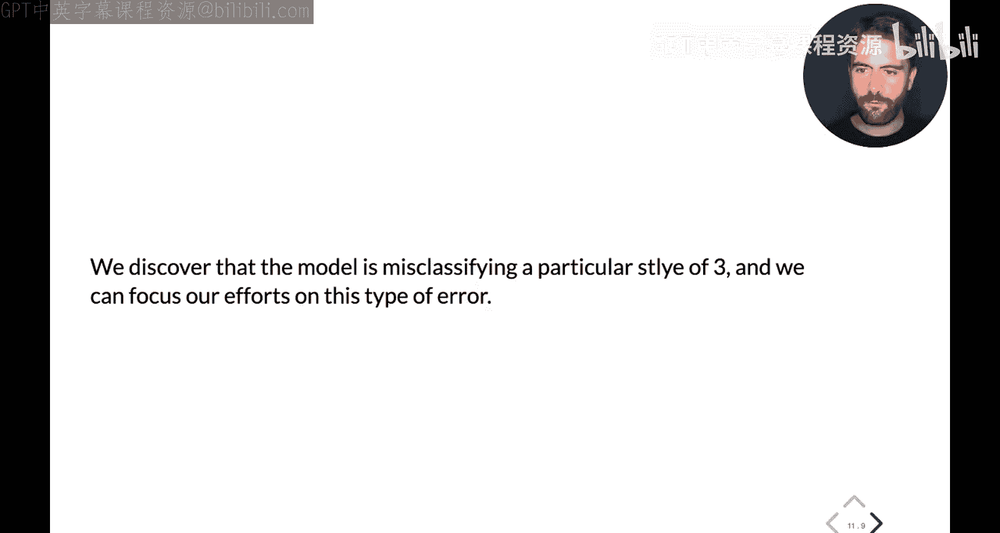

最后，对误差分析的一个更高层次的批评是，它**关注非常具体、细微的错误**（例如那些被误分类的“3”），但有时可能会**忽略全局**。例如，我们可能正在以一种非常糟糕的方式对数据过拟合，而仅仅查看非常微小的细节可能并不明显。

因此，某些更大的趋势可能会被遗漏。这也将促使我们讨论本讲其余部分将介绍的其他类型的分析。

## 总结

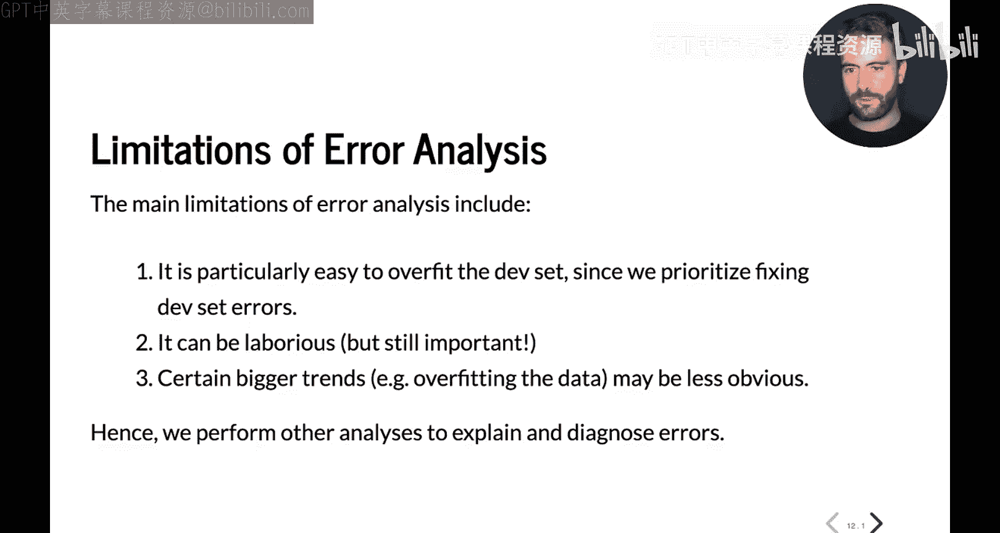

在本节课中，我们一起学习了**误差分析**这一核心工具。我们了解到，通过系统地收集、检查和分类模型在开发集或训练集上产生的错误，可以数据驱动地识别出最常见和最重要的问题。这帮助我们优先分配开发资源，高效地迭代和改进模型。我们通过图像分类和手写数字识别的实例，演示了误差分析的实际应用步骤。同时，我们也认识到误差分析存在过拟合开发集、过程繁琐以及可能忽略宏观趋势等局限性，这为后续学习其他分析方法奠定了基础。记住，从快速构建一个端到端的初始原型开始，然后通过快速观察和修复实际错误，是高效开发优秀机器学习系统的关键。