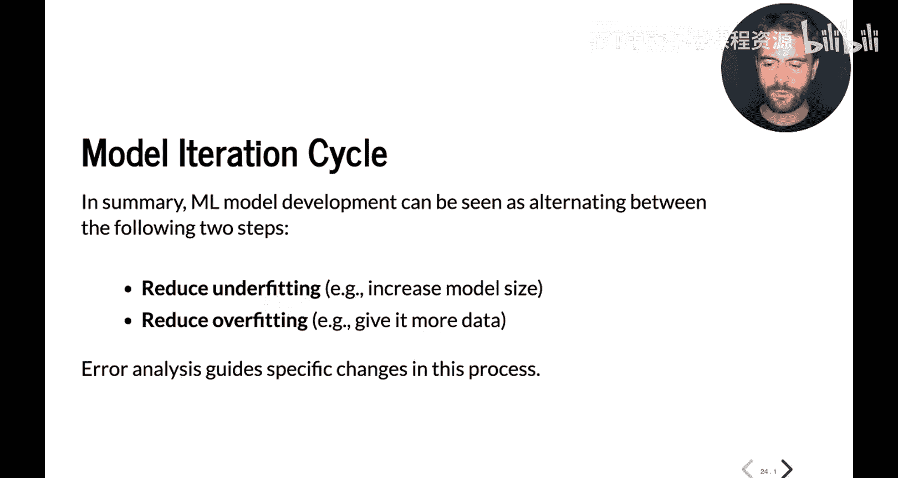

# 康奈尔大学《应用机器学习 CS 5787_ Applied Machine Learning 2020》中英字幕（deepseek p75 -75-Lecture 21. Part 2_ Bias _ Variance Analysis.zh_en -BV12udzYvEFM_p75-

Hi， we are now at part two of Lec 21 of Apped machine learning and in this video。

 I would like to talk about a different kind of analysis that we can do to understand and diagnose the performance of machine learning models。

 which is called biaseverance analysis。

And the key idea of bias variance analysis is to identify two types of problems that our machine learning system can have。

 which are bias and variances。And by looking at the importance of these two errors。

 we can guide the changes that we should be implementing in our model。

Recall from earlier lectures that we identified too important。

Problems that can affect machine learning models， both classification and regression and even in unsupervised learning。

The first problem is overfitting and when we say variance， we mean overfitting。

 the variance problem is a synonym for the overfitting problem。

And it's a very common failure mode that arises when we're using a very expressive model。

On a small data set or at least a data set that is too small for this model。

 and therefore the expressive model can memorize it， and it is very accurate on the training set。

 but its memorized solution doesn't generalize。To give you an example of what。

Overpitting or variance is I am going to use this toy dataset set that I have been using in some of the earlier lectures where I have a true curve that is here given in blue and I'm sampling a number of points I'm sampling 40 points around this curve and this serves as a training set for a regression problem in which I'm going to try to recover the blue curve from the blue dots which are the samples。

🤧嗯。And so here I'm going to do an experiment where I will take 30 points out of this sample of 40 points。

And on each random subset of 30 points， I will fit a high degree polynomial。

 so I will fit a function which has a polynomial of degree 10。

And the results of this look as follows。Here I have three random subsets of 30 points drawn from my data。

And the orange curve is the result of fitting a polynomial of degree 10。

The first observation is that all of these solutions fit the training data really well。

 you can see here the orange curve it passes through this set of points。

 it passes through this point， it passes through so there are two blue points here and it touches both of them so the orange curve comes very close to all the training set points。

 but in regions which are outside the training set。

 it has these very big jumps and so clearly those predictions are wrong。So clearly。

 our model is overfitting in each of these three examples。And also， the other observation is that。

The shape of the orange line is very different in each of these three samples。

And this is why we refer to this overfitting problem as variance。When we perturb our data slightly。

 when we choose a different number of 30 points from our total of 40 points。

 we have a very different orange curve， we have a very different solution。

 so the model that we learn it varies significantly as we perturb the data set。

So here I have a number of points that from have a different sample of 30 points which comes from the same distribution。

 but this different subset completely changes the output of the model， the shape of the curve。

 and therefore we say that here we have a problem of high variance because the solution varies a lot when we slightly perturb our data。

So again， an algorithm that has a tendency to overfit is called high variance。

The other problem that we have seen is called it's called underfitting， which is also known as bias。

And here the problem is the opposite， our function。

 our model is not sufficiently expressive to learn the true structure of the data。

 and in this case we say that it is high bias。Here is an example of both overfitting and underfitting。

 so both variance and bias on the polynomial data set that I just showed earlier。

Here the in the middle， I have an example of overfitting where again we highly we fit a high degree polynomial。

 which is a highly expressive function and it fits the data well。

 but outside the data its predictions are。Very strange。 and incorrect。

The opposite problem underfitting or bias is when trying to approximate the data set with a straight line。

  clearly it is too simple and it's missing the structure of the data。

 and a good fit is a polynomial of degree5， where here over most of the for most of this function it is fitting the true blue curve really well。

So bias and variance or overfitting and underfitting are really important problems in machine learning。

And in fact， I am going to say something even stronger。

 and I'll say that every error in machine learning is either bias or variance。

Overfitting and underfitting are the only two problems we could be having in machine learning。

When a machine learning system doesn't work well， either it has a bias problem because it is not able to extract the true signal from the data that it should be extracting。

 or it has extracted something， but this something does not generalize to new data。

 or this is a variance problem。And if we don't have any any bias and we don't have any variance。

 then we have successfully extracted the true signal and it generalizes。

 And therefore we have a perfect model。 So the only two types of errors or maybe to put it differently。

 every type of error that we could have in machine learning。

 it is either a type of bias or a type of variance。 Therefore。

 it is really important to understand these two sources of error。

The first step towards understanding bias invari is to quantify them。

And we can easily quantify them as follows here I have a simple equation where I'm taking the development set error and I'm subtracting and adding the training error。

And grouping these terms， we can take these two terms。

 the first grouping to be an estimate of variance， and this term is an estimate of bias。

So the training set here， the bias is simply our training error。

 or a quantitative estimate of bias is our training error， can we even fit the training data。

 is our model sufficiently expressive for fitting the training data？

And then a quantitative estimate of variance is the second term。

 which is the difference between development and training error。

Does the model generalize to new data， Does the model generalize to the development set。

 And if on the development set， it has a much higher error， Well。

 whatever it has learned on the training error doesn't generalize。 And therefore。

 this is a sensible estimate of。Of variance。So using these two estimates we can diagnose whether our model is currently having high variance or high bias。

 if the training error is high， then we have high bias。

 if the development error is much higher than the training error， then we have high variance。

Let's look at a few examples。Consider the following example。

 we have an instance where our training error is 15%， our development error is 16%。

 but if we ask a human to solve this problem， then they very easily get 2 percent。

So it seems here that our system still has quite a bit of a gap with respect to human performance。

 and if this is a task such as image classification。

 then this would be a strong indicator that our system is still far from optimal and that our training error is high and therefore we have high bias。

 so we're underfitting the data。Another example is if human error is 2 percent。

And our training error is 4%。 But then our development set error is 12%。

 which is much higher than 4%。So on the training set。

 we're able to match human performance or to get close to it。 But on the development set。

 our performance is much worse， which suggests that we're getting this high performance on the training set simply by overfitting it by memorizing it in a way。

 So this is an example of high variance or overfitting。😊，And finally。

 suppose that you see a training error of 2。5% and a development set error of 3%。

 then both a training and the development set are both close to each other and close to the optimal human error。

 and this looks to me like a model that works well。 So this is an example of good performance。

So the idea of bias variance analysis is to look at our performance on the training set。

 look at the performance on the development set and。

Quantify whether we are in a regime of high variance or high bias。

And then based on the kind of error that we have， we can address the the problem we can either improve variance or we can try to improve bias。

 and there are principled ways of doing this。Let's first start with addressing variance。

So how how do we reduce the variance， How do we reduce overfiing in a model。

The best way to do this is to give the model more data。 That is the most， the。

 the safest way of doing this， and。It is by far the best approach if you can do it。

The reason why we have overfitting in the first place is because we don't have enough data to fit an expressive model。

 Our model is too large for the size of the data that we have。If we increased our data set size， now。

 the expressivity of the model and the size of the data will become。Will be both on the right level。

 and this will solve our overfitting problem。Or to put it differently， if we add more data。

 then the earlier memorized solution will no longer be good on the new data that we have added。

 and the model will have to learn or the algorithm will have to learn a better solution。

This is the ideal way of addressing variants， but it is not always feasible because it may take a lot of time or effort to acquire this extra data and even if we have this data。

 perhaps training our model on it will be too expensive。

So there are several other solutions of doing this， which are more easily applicable。

And here are three examples。The first one is to regularize the model。

 This is something that we have seen in several previous lectures。

 and it's something that we can do for essentially every model。 Ex include L regularization， dropout。

 which is a method for neural networks。 Early stopping could be one approach that is especially useful for。

Algorithms like gradient boosted trees。The disadvantage of regularization is that it is decreasing the expresslusivity of the model。

So it forces us to use a simpler model， and this may increase bias。

 and it will it is likely to increase bias relative to the optimal performance if we had infinite data and even on the smaller data set that we have it could still increase bias and even though the overall error will be will be。

Improved， we will be reducing variances at the cost of increasing bias。

 and ideally we would keep bias the same and only reduce the variance。

 which would be strictly better。Another possible approach is to drop or change the features that we're using。

Imagine in an extreme case that we have 20 data points in our training set and we have 10。

000 features。Well， it is likely that some of these features will correlate with with those with the signal over those0 with the labels of those 20 examples just by pure chance。

And the features are actually irrelevant， and the model will overfit the data by incorrectly assuming that those features are indeed correlated with the labels。

This is an example of overfitting and by having fewer features and especially fewer irrelevant features。

 it will be more difficult to overfit the data。This is also a different way of reducing the excsivity of the model。

 depending on whether you consider the feturization as being part of the model or part of data set preparation。

But the disadvantage of this approach is that you have to manually understand which features are important。

 which features are not important， it may require significant manual effort and this is a problem with this approach。

And finally the last thing you could do is to try to reduce the model size directly， for example。

 you could decrease the size of the neural network layers that you're using or you could use a simpler kernel instead of using a high degree polynomial kernel。

 you could use a low degree polynomial kernel or even a linear kernel。This is an approach that works。

 but in practice regularization is often preferred because it provides in general with a smoother way of controlling regularization and in practice。

 it is better， although it is more computationally intensive in practice it provides a better。

 a more accurate and a more smoother tradeoff between between bias invariance and between the expresssivity between an expressive and a less expressive model。

So these were some examples of fixing variance problems here are now some examples of fixing bias problems。

There is also one ideal approach for reducing bias。

 which is to increase the expresssivity of the model。 So if our model is too simple。

 then it will not fit the data well， and we need to make this model more complex。

 We need to make it bigger。This can involve adding more layers to our neural network or decreasing the bandwidth of an RBF kernel or increasing the degree of the polynomial that we're working with。

 And in general， a bigger and more expressive model will fit the data better。And this will be。

 this is a change that will reduce the bias。 and if we're in a bias problem， then it will not have。

That much of an effect on variance。However， this also may not be often feasible because it can be expensive to train a very large model。

And therefore， there are these other things that we can do。

Similarly to our earlier discussion of variants， we could try to investigate the features and we could try to add more useful features to the data that will make it easier to classify this data for example。

 if we're doing a type of medical classification and we think that there's a particular group so maybe a teenage boys are or a particular group that's at risk for a disease that we're trying to predict well then maybe having a feature called is this a teenage boy or not will be useful for performing this particular。

Mical prediction task。 this is one approach， but again it is laborious and it requires manual thinking。

 it requires manual work and it requires critical human thinking to create these additional features which will make the problem more tractable for a simpler classifier and in principle this approach can be very effective。

 if you have excellent features， then even a linear a simple linear model will work really well。

 but it's designing these features that is really hard。

Another solution could be to reduce the regularization that is the opposite of what we discussed earlier。

 and finally， the most interesting， perhaps the most difficult。

 but also a very promising approach is to adjust the structure of the model。For example。

 the architecture of a neural network。An example of this is if you're using image classification using dense neural networks。

 then switching to a convolutional neural network will almost certainly give you better performance with fewer parameters。

 because the convolutional architecture is just a better fit for analyzing images and it uses its parameters more efficiently for this problem and so a smaller model in terms of number of parameters can work better than a large model with more parameters if the architecture for this model is better and more appropriate for the given task。

And one way to understand what this means in terms of the concepts that we have seen in class is that by adjusting the model architecture。

 we're adjusting the model class or we're adjusting the hypothesis class for our in which we're searching for the optimal model。

 And if we can choose our model class such that it is smaller。

 but is closer to the true mapping between the inputs and the targets。

Then we are going to be able to find this true function in a smaller and better model class。

More easily with less data。 And this is what the adjusting model architecture idea means。And finally。

 I want to point out that for both bias invari reduction。

 we can use our earlier error analysis to guide the changes that we need to do， for example。

 we can use it to determine which features to add or remove or which additional data we need to collect。

 so these two approaches are complementary。So let's now look at a particular example of bias variance analysis using the psychic learn digits data set that we started using earlier in this lecture and in the previous video。

So recall that we start working with this data set， which is data set of digits。

 and those are small eight by eight。Images。And here is an example of every digit。

We can train here a small fully connected network from psyit Learnn， this is a very。

 very simple neural network model that comes with p PsyicLn。

 and I'm fitting it here on the training set and I'm computing predictions on both my development set and on my training set。

And now if I compute the accuracy of this model， I have the following， I have 93。

7% accuracy on the development set and I have 100% accuracy on the training set。

So this immediately suggests that we're overfitting the data or that we are at least airing on the side of overfitting relative to underfitting。

And one way to address this is to add regularization to the model， as I said earlier。

 in psy learnarn， there is a way of adding regularization to this model psy learnarn supports adding L2 regularization and this is what I'm going to do here。

 Alpha is the L2 regularization strength parameter。

 I'm going to turn it on instead it to one and now I fit a second model。

And a computer's predictions on both the development and the training set。

And now visualizing its performance， I see that we have increased our performance on the development set by 1% just by adding regularization here。

So this is a very simple example and we have not solved the entirety of this problem。

 for example we still have 1% we still have 100% accuracy on the training set。

 so we haven't fully we still have some overfitting that goes on here。

 but just by adding a little bit of regularization。

 we easily increased our performance by 1% so going from something like 6。5% error to 5。5% error。

 that's a very significant drop in error rate just by adding a few characters to the code that I had earlier。

So this was an example of how bias andvari analysis can improve the performance of models。

I also want to contrast bias variance analysis with error analysis。

 which I described in the earlier video。First， I want to mention that these two analyses look at different types of problems。

In error analysis， we tend to look at particular systematic errors。 So for instance。

Our our model can be making errors on all the dog images and that happens if we investigate。

 we can see that this happens because we are actually missing dog images in our training set and so。

With error analysis， we can solve the particular problem of misclassifying dogs。

 which is something that's important and it's something that。

That is that that needs to be observed and needs to be fixed。

And then biased variance analysis it reveals a different type of error。

 it reveals high level general error general errors， for example， we are。

 I mean the main thing that it reveals is are we overfiing or are we underfitting and it suggests general solutions to this problem which don't involve fixing a particular subset of the data。

 it improves the performance of the model overall。Without focusing on a particular error class。

 it can potentially affect all the error classes simultaneously。

And so if you're wondering when should you be using either of these two methods。

 the answer is that you should be using both of them and they are complementary in many ways。

For example， by performing bias variance analysis， we can identify the main error categories and which data sets are useful for error analysis。

So for example， if we have high bias， then it means that it will be useful to perform error analysis on the training set and if we have great performance on our training set。

 then maybe this is not useful so we can determine whether we need to perform error analysis on the training or on the development set using bias variants and we also look at it can also provide examples of the kinds categories that are useful to look at。

 so for example， dogs where we're missing the training label it can provide additional intuition for the kinds of categories that we might expect when we perform error analysis。

And conversely， error analysis is useful for fixing bias and variance。 For example。

 if we want to determine which features we want to add or which。Additional data we need to collect。

 do we collect images of dogs or do we collect images of cats or both。

 we can determine this using error analysis， So both methods are highly complementary。

And the other type of model tuning that we have discussed earlier is hyperparameter search and hyperparameter search is also related to bias variance analysis in the sense that。

Bs invari can help guide our hyperparameter search。In general。

 hyperparameters are chosen either by grid search or random search。

 And through a bias variance analysis， we can determine whether we can determine which。

Which subsets of the of the hyperparameter space are worth exploring。For example。

 if we're overfitting， then we need to increase irregularization。

 so it makes sense to search for a better dropout parameter in the particular range。

 which is higher than the value that we're currently using。

So this analysis provides intuition for how to perform hyperparameter search。And finally。

 I want to conclude this discussion of bias variance by again， again。

 reemphasizing that in machine learning， most errors that we're making are。Well。

 every error that we're making is either an instance of overfitting or underfitting。

And if we have a model at any instance at any point in time as we're iterating on it。

 it is either erring on the side of overfitting or or on the side of underfitting。

 and so working on a machine learning model means going continuously through a cycle that involves alternating between two steps。

Either we're working on reducing underfitting or're're working on reducing overfitting。Essentially。

improvingmp on a machine learning model is a long loop where we alternate between these two steps until we have gotten rid of overfitting and underfitting and we have a model that matches our ideal performance。

So bias andvari analysis is important because at any given time。

 our model is either overfitting and underfitting and in order to improve the model。

 our algorithm is to determine are we currently in the state of overfitting or are we in the state of underfitting if we're in the state of underfitting。

 we need to make our model more expressive and then if we're overfitting we need to give it more data or we can do some of the other changes that we have proposed and at any point in time we should be either doing one change or the other change and error analysis that we have seen earlier can help us guide in this process and can help us determine which of the two changes should we be making。

