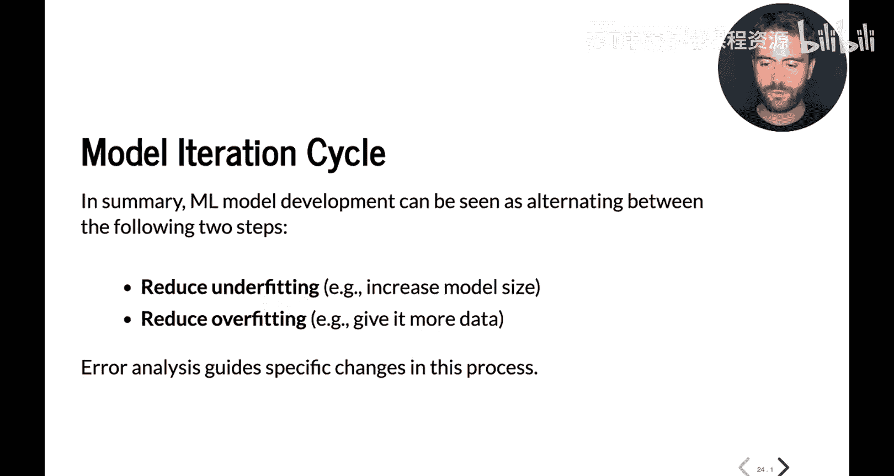

# 应用机器学习：第21讲：第2部分：偏差与方差分析 📊

在本节课中，我们将学习一种用于理解和诊断机器学习模型性能的重要分析方法——偏差与方差分析。我们将探讨这两种误差的来源、如何量化它们，以及如何根据分析结果来改进模型。

## 概述

偏差与方差分析的核心思想是识别机器学习系统可能存在的两类问题：**偏差**和**方差**。通过理解这两种误差的重要性，我们可以指导对模型进行有针对性的改进。

## 偏差与方差：两种核心问题

在之前的课程中，我们识别了影响机器学习模型（包括分类、回归甚至无监督学习）的两个重要问题。

第一个问题是**过拟合**。当我们提到“方差”时，我们指的是过拟合问题。方差问题是过拟合问题的同义词。这是一个非常常见的故障模式，通常发生在我们使用一个表达能力非常强的模型，但数据集太小（或至少对于该模型来说太小）的情况下。因此，表达能力强的模型会“记住”数据，在训练集上非常准确，但这种记忆化的解决方案无法泛化。

为了举例说明什么是过拟合或高方差，我将使用之前课程中使用过的一个玩具数据集。这里有一条真实的蓝色曲线，我在这条曲线周围采样了40个点，这些点将作为回归问题的训练集，我将尝试从这些蓝色点（即样本）中恢复出蓝色曲线。

接下来，我将进行一个实验：从这40个点中随机抽取30个点。在每个由30个点组成的随机子集上，我将拟合一个高阶多项式，即一个10次多项式函数。

结果如下所示。这里有三个从数据中随机抽取的30个点子集。橙色曲线是拟合10次多项式的结果。

第一个观察结果是，所有这些解决方案都能很好地拟合训练数据。你可以看到橙色曲线穿过了这组点，穿过了这个点，这里有两个蓝点，它都接触到了。因此，橙色曲线非常接近所有的训练集点。但在训练集之外的区域，它出现了非常大的跳跃，显然这些预测是错误的。所以，我们的模型在每一个例子中都过拟合了。

另一个观察结果是，橙色曲线的形状在这三个样本中差异很大。这就是为什么我们将这种过拟合问题称为“方差”。当我们稍微扰动数据时，当我们从总共40个点中选择不同的30个点时，我们会得到非常不同的橙色曲线，即非常不同的解决方案。因此，我们学习的模型会随着数据集的扰动而发生显著变化。

这里我有几个点，它们来自同一个分布但不同的30个点子集，这个不同的子集完全改变了模型的输出（曲线的形状）。因此，我们说这里存在一个高方差问题，因为当我们稍微扰动数据时，解决方案变化很大。

再次强调，倾向于过拟合的算法被称为**高方差**。

我们看到的另一个问题被称为**欠拟合**，也称为**偏差**。这里的问题是相反的：我们的函数或模型表达能力不足，无法学习数据的真实结构。在这种情况下，我们称其为**高偏差**。

以下是在刚才展示的多项式数据集上同时展示过拟合和欠拟合（即方差和偏差）的例子。

在中间，我有一个过拟合的例子，我们再次拟合了一个高阶多项式（一个表达能力很强的函数），它很好地拟合了数据，但在数据之外，它的预测非常奇怪且不正确。

相反的问题——欠拟合或偏差——是当我们试图用一条直线来近似数据集时。显然，直线过于简单，遗漏了数据的结构。而一个5次多项式则拟合得很好，在函数的大部分区域，它都能很好地拟合真实的蓝色曲线。

因此，偏差和方差（或过拟合和欠拟合）是机器学习中非常重要的问题。

事实上，我要说一些更强有力的观点：**机器学习中的每一个错误，要么是偏差，要么是方差**。过拟合和欠拟合是我们在机器学习中可能遇到的仅有的两类问题。

当一个机器学习系统表现不佳时，要么是因为它有偏差问题（无法从数据中提取出应该提取的真实信号），要么是因为它提取了某些东西，但这些东西无法泛化到新数据（即方差问题）。如果我们没有任何偏差和任何方差，那么我们就成功地提取了真实信号并且它能泛化，因此我们得到了一个完美的模型。

所以，仅有的两种错误类型，或者换句话说，我们在机器学习中可能遇到的每一种错误，要么是偏差类型，要么是方差类型。因此，理解这两种误差来源至关重要。

## 量化偏差与方差

理解偏差和方差的第一步是量化它们。

我们可以通过以下简单公式轻松量化它们：

`开发集误差 = (开发集误差 - 训练误差) + 训练误差`

通过分组这些项，我们可以将前两项（开发集误差 - 训练误差）作为**方差**的估计，而训练误差项作为**偏差**的估计。

因此，偏差的定量估计就是我们的训练误差：我们的模型是否足够强大以拟合训练数据？方差的定量估计是第二项，即开发集误差与训练误差之间的差异：模型是否能泛化到新数据（开发集）？如果在开发集上误差高得多，那么它在训练集上学到的东西就无法泛化。因此，这是一个合理的方差估计。

使用这两个估计，我们可以诊断模型当前是否存在高方差或高偏差：
*   如果训练误差高，那么我们就有**高偏差**。
*   如果开发集误差远高于训练误差，那么我们就有**高方差**。

让我们看几个例子。

考虑以下情况：我们的训练误差是15%，开发集误差是16%，但如果让人类来解决这个问题，他们可以轻松达到2%的误差。这表明我们的系统与人类性能相比仍有很大差距。如果这是一个如图像分类的任务，那么这将强烈表明我们的系统仍然远离最优，并且我们的训练误差很高，因此我们存在**高偏差**，即我们欠拟合了数据。

另一个例子是：如果人类误差是2%，我们的训练误差是4%，但我们的开发集误差是12%，远高于4%。在训练集上，我们能够匹配或接近人类性能。但在开发集上，我们的性能要差得多，这表明我们在训练集上获得的高性能仅仅是通过过拟合（以某种方式记忆）实现的。所以这是一个**高方差**或过拟合的例子。

最后，假设你看到训练误差为2.5%，开发集误差为3%。那么训练集和开发集的误差彼此接近，并且都接近最优的人类误差。这在我看来是一个表现良好的模型。所以这是一个良好性能的例子。

偏差方差分析的思想就是观察我们在训练集上的表现，观察在开发集上的表现，并量化我们是否处于高方差或高偏差的状态。

## 解决方差问题（减少过拟合）

基于我们所犯的错误类型，我们可以有针对性地解决问题：要么改进方差，要么尝试改进偏差。有原则性的方法可以做到这一点。

让我们首先从解决方差问题开始。我们如何减少方差？如何减少模型中的过拟合？

最好的方法是给模型**提供更多数据**。这是最安全的方法，如果你能做到，这无疑是**最佳方法**。我们之所以首先出现过拟合，是因为我们没有足够的数据来拟合一个表达能力强的模型。我们的模型相对于我们拥有的数据量来说太大了。如果我们增加数据集的大小，模型的表达能力和数据量将达到合适的水平，这将解决我们的过拟合问题。或者换句话说，如果我们添加更多数据，那么之前记忆化的解决方案将不再适用于我们添加的新数据，算法将不得不学习一个更好的解决方案。

这是解决方差问题的理想方式，但并不总是可行的，因为获取这些额外数据可能需要大量时间或精力，即使我们拥有这些数据，在其上训练我们的模型也可能过于昂贵。

因此，还有其他几种更易于应用的解决方案。

以下是三个例子：

**1. 正则化模型**
这是我们之前在几节课中看到的方法，几乎适用于所有模型。例如包括L2正则化、用于神经网络的Dropout、提前停止（尤其适用于梯度提升树等算法）。正则化的缺点是它会降低模型的表达能力。因此，它迫使我们使用更简单的模型，这可能会增加偏差。即使总体误差会得到改善，我们也是在以增加偏差为代价来减少方差。理想情况下，我们希望保持偏差不变，只减少方差，这样会严格更好。

**2. 删除或更改特征**
想象一个极端情况：我们的训练集中有20个数据点，但我们有10,000个特征。很可能其中一些特征会纯粹由于偶然性与这20个例子的标签相关，而这些特征实际上是无关的。模型将通过错误地假设这些特征确实与标签相关来过度拟合数据。这是一个过拟合的例子。通过拥有更少的特征，尤其是更少的无关特征，过拟合数据将变得更加困难。这也是减少模型表达能力的一种不同方式（取决于你是否将特征化视为模型的一部分或数据集准备的一部分）。但这种方法的缺点是你必须手动理解哪些特征是重要的，哪些不重要，可能需要大量的人工努力。

**3. 直接减小模型规模**
例如，你可以减少正在使用的神经网络层的大小，或者使用更简单的核函数（例如，使用低次多项式核甚至线性核，而不是使用高阶多项式核）。这种方法有效，但在实践中，正则化通常更受青睐，因为它通常提供了一种更平滑的控制正则化的方式。在实践中，它提供了在偏差与方差之间、在表达能力强的模型与表达能力弱的模型之间更好、更准确、更平滑的权衡。

## 解决偏差问题（减少欠拟合）

同样，减少偏差也有一个理想的方法，那就是**增加模型的表达能力**。如果我们的模型太简单，那么它将无法很好地拟合数据，我们需要使这个模型更复杂、更大。这可能涉及为神经网络添加更多层、减小RBF核的带宽或增加我们正在使用的多项式的次数。一般来说，更大、表达能力更强的模型会更好地拟合数据。这种改变将减少偏差，如果我们处于偏差问题中，那么它对方差的影响不会那么大。然而，这通常也不可行，因为训练一个非常大的模型可能很昂贵。

因此，我们可以做以下其他事情：

**1. 调查并添加更有用的特征**
类似于我们之前对方差的讨论，我们可以尝试调查特征，并尝试向数据中添加更多有用的特征，使分类数据更容易。例如，如果我们正在进行某种医学分类，并且我们认为某个特定群体（例如青少年男孩）是我们试图预测的疾病的高风险群体，那么拥有一个名为“这是青少年男孩吗”的特征对于执行这个特定的医学预测任务将非常有用。这是一种方法，但同样，它是费力的，需要手动思考和人工工作，需要批判性的人类思维来创建这些额外的特征，这些特征将使问题对于更简单的分类器更容易处理。原则上，如果你有优秀的特征，即使是一个简单的线性模型也能工作得很好，但设计这些特征确实很困难。

**2. 减少正则化**
这与我们之前讨论的正则化相反。

**3. 调整模型结构**
例如，调整神经网络的架构。这方面的一个例子是，如果你使用密集神经网络进行图像分类，那么切换到卷积神经网络几乎肯定会以更少的参数获得更好的性能，因为卷积架构更适合分析图像，并且它更有效地利用其参数来解决这个问题。因此，如果模型架构更好、更适合给定任务，那么一个参数数量更少的较小模型可能比一个参数更多的大模型工作得更好。用我们在课堂上学到的概念来理解这意味着什么：通过调整模型架构，我们正在调整模型类别或我们正在其中搜索最优模型的假设类。如果我们能选择我们的模型类别，使其更小但更接近输入和目标之间的真实映射，那么我们将能够在一个更小、更好的模型类别中更容易地找到这个真实函数，并且需要更少的数据。这就是调整模型架构思想的含义。

最后，我想指出，对于减少偏差和方差，我们都可以使用我们之前的**误差分析**来指导我们需要做的更改。例如，我们可以用它来确定要添加或删除哪些特征，或者需要收集哪些额外的数据。因此，这两种方法是互补的。

## 实战示例：在Scikit-learn数字数据集上应用

现在，让我们看一个使用Scikit-learn数字数据集进行偏差方差分析的具体示例，我们在本讲和上一个视频中开始使用这个数据集。

回想一下，我们开始处理这个数据集，它是一个数字数据集，这些是小的8x8图像。以下是每个数字的示例。

我们可以在这里训练一个来自Scikit-learn的小型全连接网络。这是一个非常简单的神经网络模型。我在训练集上拟合它，并在我的开发集和训练集上计算预测。

现在，如果我计算这个模型的准确率，我得到以下结果：在开发集上的准确率为93.7%，在训练集上的准确率为100%。

这立即表明我们正在过拟合数据，或者至少相对于欠拟合而言，我们偏向于过拟合。

解决这个问题的一种方法是向模型添加正则化，正如我之前所说。在Scikit-learn中，有一种向此模型添加正则化的方法。Scikit-learn支持添加L2正则化，这就是我在这里要做的。`alpha`是L2正则化强度参数。我将把它打开并设置为1，然后拟合第二个模型。

现在，在开发集和训练集上计算其预测并可视化其性能，我看到通过添加正则化，我们在开发集上的性能提高了1%。

这是一个非常简单的例子，我们还没有完全解决这个问题。例如，我们在训练集上仍然有100%的准确率，所以我们仍然存在一些过拟合。但仅仅通过添加一点正则化，我们就轻松地将性能提高了1%，从大约6.5%的错误率降到5.5%的错误率，这是一个非常显著的错误率下降，只需在我之前的代码中添加几个字符。

这就是一个偏差方差分析如何提高模型性能的例子。

## 偏差方差分析与误差分析的对比

我还想将偏差方差分析与我在上一个视频中描述的误差分析进行对比。

首先，我想提一下，这两种分析着眼于不同类型的问题。在误差分析中，我们倾向于查看特定的系统性错误。例如，我们的模型可能对所有狗的图像都分类错误，如果我们调查，可能会发现这是因为我们的训练集中实际上缺少狗的图像。因此，通过误差分析，我们可以解决错误分类狗这个特定问题，这是重要的，需要观察和修复。

而偏差方差分析揭示了不同类型的错误，它揭示了高层次的一般性错误。例如，它揭示的主要问题是：我们是过拟合还是欠拟合？它提出了解决这个问题的通用方案，这些方案不涉及修复数据的特定子集，而是整体提高模型的性能，而不专注于特定的错误类别，它可能同时影响所有错误类别。

因此，如果你想知道何时应该使用这两种方法中的哪一种，答案是**你应该同时使用它们**，它们在许多方面是互补的。

例如，通过执行偏差方差分析，我们可以识别主要的错误类别，以及哪些数据集对误差分析有用。例如，如果我们有高偏差，那么意味着在训练集上执行误差分析将是有用的。如果我们在训练集上表现很好，那么这可能没有用。我们可以利用偏差方差来确定我们是否需要在训练集或开发集上执行误差分析。它还可以提供在误差分析中有用的类别示例（例如，缺少训练标签的狗的图像），为我们在执行误差分析时可能期望的类别类型提供额外的直觉。

反过来，误差分析对于修复偏差和方差也很有用。例如，如果我们想确定要添加哪些特征或需要收集哪些额外数据（我们是收集狗的图像还是猫的图像，还是两者都收集），我们可以使用误差分析来确定。因此，这两种方法是高度互补的。

我们之前讨论过的另一种模型调优是**超参数搜索**。超参数搜索也与偏差方差分析相关，因为偏差方差可以帮助指导我们的超参数搜索。通常，超参数通过网格搜索或随机搜索来选择。通过偏差方差分析，我们可以确定超参数空间的哪些子集值得探索。例如，如果我们过拟合，那么我们需要增加正则化，因此搜索比当前使用值更高的、更好的Dropout参数范围是有意义的。因此，这种分析为如何执行超参数搜索提供了直觉。

## 总结

最后，我想通过再次强调来结束关于偏差方差的讨论：在机器学习中，我们犯的大多数错误——事实上，我们犯的每一个错误——要么是过拟合的实例，要么是欠拟合的实例。

在任何时候，当我们迭代模型时，它要么偏向于过拟合，要么偏向于欠拟合。因此，改进一个机器学习模型意味着持续经历一个循环，该循环涉及在这两个步骤之间交替：要么我们致力于减少欠拟合，要么我们致力于减少过拟合。

本质上，改进机器学习模型是一个长循环，我们在这些步骤之间交替，直到我们消除了过拟合和欠拟合，并得到一个符合我们理想性能的模型。

因此，偏差和方差分析很重要，因为在任何给定时间，我们的模型要么过拟合要么欠拟合。为了改进模型，我们的算法是确定我们当前是处于过拟合状态还是欠拟合状态。如果我们处于欠拟合状态，我们需要使模型更具表现力；如果我们处于过拟合状态，我们需要给它更多数据，或者我们可以进行我们提出的其他一些更改。在任何时候，我们应该要么进行一种更改，要么进行另一种更改。我们之前看到的误差分析可以帮助我们指导这个过程，并帮助我们确定应该进行这两种更改中的哪一种。

在本节课中，我们一起学习了偏差与方差分析。我们了解了偏差（欠拟合）和方差（过拟合）是机器学习模型性能不佳的两种核心根源。我们学习了如何通过比较训练误差和开发集误差来量化它们，并探讨了针对高偏差和高方差问题的不同解决策略。最后，我们看到了如何将偏差方差分析与误差分析和超参数搜索结合使用，以系统性地改进模型。记住，模型改进的过程通常是在解决偏差和解决方差之间不断迭代的循环。