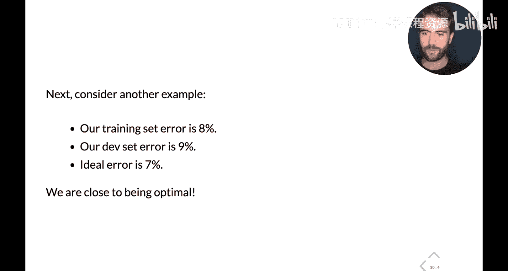

# 康奈尔大学《应用机器学习 CS 5787_ Applied Machine Learning 2020》中英字幕（deepseek p76 -76-Lecture 21. Part 3_ Baselines.zh_en -BV12udzYvEFM_p76-

We are now at part3 of lecture 21 of Apped machine learning。

 and in this video I will talk about another useful tool for diagnosing machine learning model performance called baseline。

Baselines essentially the idea of baseline is that we want to put the results and the performance of our machine learning system in context。

As a motivating example， suppose that you have trained a regression model and you have a mean L1 error of 20。

Is that good or is that bad。Imagine that you now take your training set and you simply compute the average of all the targets。

 so you compute the average Y you compute the average regression target on your training set。

And then， you。Create a machine learning model that just outputs this average。

 regardless of what is the input。 It just always outputs the average prediction in the data。

 the average target in the data。If this gives you an error of 20。

 then our machine learning model has not learned anything It is not doing better than just predicting the average on every single input。

So we haven't learned anything in that example。But in many other cases。An error of 20 can be a very。

 very good error。And in order to understand if 20 is good or bad。

 we need to put this result in context by comparing it to other models。

The idea of baselines is to provide such models against which we can compare。

So a baseline is typically just another model against which we compare and usually baselines are simpler toy models and they provide a basic sanity check on whether we're doing well and they can also help interpret our performance in other ways and they're useful for presenting the results of a machine learning analysis of or when we're measuring a machine learning system。

 it is very useful to add baselines to it because it presents additional context along many dimensions。

There are many kinds of baselines that one could use。

Something simple as random guessing or outputting constant or average predictions。

 something simple like that is very useful because it can provide a simple baseline and often。

Or her I would say surprisingly often。The performance of simple and highly naive models like these ones can reveal weaknesses about the machine learning models that we have trained。

Also it's often useful to compare against simple models such as linear regression or some kind of interpretable tree model。

 so if you're using some kind of very fancy and advanced nonlinear classifier like a neural network。

 it is often very useful and very important to compare to a well tuneed linear model and you may often be surprised that these well tuneed linear models can match the performance of sophisticated。

 highly nonlinear and state of the art machine learning models that you。That you may want to use。

In practice， when you're deploying a machine learning system。

 you may be working with an earlier machine learning system that was there before you。

 and in that case it's useful to compare against that model or if you're running an。

Hiterative process and you're trying your next generation。

 it is always useful to compare against the previous generation。And finally。

 classical approaches that don't involve any machine learning are also very useful baselines In fact。

 machine learning is not the solution to every problem and it's possible that you're working with a problem in which machine learning is not necessary and you can implement you can code by hand a function that involves rules or that involves just standard classical software and programming to solve the problem that you're dealing with just as well as with machine learning but the solution may be significantly simpler and easier to maintain and more stable and in that case it can be maybe machine learning is not great solution so comparing to an nonml baseline is also very good。

Baselines can be thought of providing a lower bound on performance that we want to exceed。

And it is also useful to provide an upper bound on our performance by having some kind of estimate of optimal performance。

This is often nontrivial， often the optimal performance is nonzero， even on tasks。

 such as image recognition or speech recognition， humans are not able to perfectly detect speech。

 for example， if it's noisy or if there's an accent。

 and it would be often unreasonable to expect a machine learning model to exceed that performance。

So if we have a target for the optimal performance or for if we have some kind of notion of optimal performance。

 then this can also help guide our efforts， it can determine whether a model needs to be improved or it can tell us if we're very far from optimal performance then it means that we still need to do a lot of work and so we should reserve more time or engineering resources for this problem so having an upper bound is very useful。

There are different ways in which we can estimate this upper bound。 if we're doing。

 if we're solving some kind of classification problem， then we can。Often annotate the data ourselves。

 we can spend some time to estimate human performance on a small random subset of the data or on our development set ideally。

And if that is too expensive， there are many ways of doing this using crowdsourcing。

 so using a service like Amazon Mechanical Turk can be useful here。

And also when we're building a machine learning system， we often have a goal in mind。

 perhaps there's some kind of downstream application that we want to use or into which we want to integrate and that downstream application may have certain level expected levels of performance that constitute a goal for us or an upper bound that we are trying to reach。

And also by having an notion of optimal error， we can better quantify bias and variance。

And in particular， we can break up the bias into avoidable and unavoidable components。

Here in this example， I have taken the formula that I had in an earlier slide。

 and now I also added and subtracted the optimal error， which is our estimate of optimal error。

And grouping these terms， I can now group these two in order to define what is called avoidable bias and which contrasts with unavoidable bias。

 so the optimal error is the best error that we can achieve and we cannot expect our training error to be better than the optimal error here and if our training error is very far from the optimal error。

 then we still have a lot of bias that is avoidable。

And then the variance definition is the same and having this breakdown can be useful to it can make our bias variance analysis more precise。

For example， if we have performance which looks like this， our ideal optimal error is 14%。

 our training set error is 15% and development is 20%， well we have our bias here is almost ideal。

 so we should not spend too much effort trying to fix bias， we need to address our variance。

 which is higher。We may also have an interesting scenario like this one。

 suppose that we have a training set error of 5% and a development set error of 10% and our ideal error is 7%。

 so here we're doing better than the optimal performance on our training set。

 so we're doing better than human performance on our training set and our development set error higher。

So this is also actually an instance of a variance problem because the reason why our performance on the training set is better than optimal is because we are overfitting it it because the model is simply memorizing the training set and therefore this is again an instance of a variance problem。

And finally， if we have something like this， ideal is 7。 Training is 8。 Development is 9。

 even though 8，7 or 9， that is still。Far from zero。

We know here that we are close to optimal because these numbers are close to our optimal error rate。

