# 康奈尔大学《应用机器学习 CS 5787_ Applied Machine Learning 2020》中英字幕（deepseek p77 -77-Lecture 22. Part 1_ Learning Curves.zh_en -BV12udzYvEFM_p77-

Hi and welcome to Lecture 22 of Applied machinech learninging。

 in which we are going to continue our previous topic of how to apply machine learning in practice and what are some principled approaches and techniques for getting machine learning systems to give us good reliable performance in real worldor applications。

And the particular topic of this lecture is going to be on various tools and techniques that help us diagnose model performance and that provide a more in depth view into model performance than what we have seen so far。

Recall again that the overall motivation for this set of lectures can be summarized in the following example。

 suppose we have trained a machine learning classifier that is giving us a respectable level of accuracy。

 maybe 80% is good for a particular application and then as the person developing the system。

 we want to know what to do next， do we add more data， do we try a bigger model。

 do we add more features。We would like to find principled ways for prioritizing these decisions and quickly achieving good levels of accuracy and doing so with minimum amount of effort。

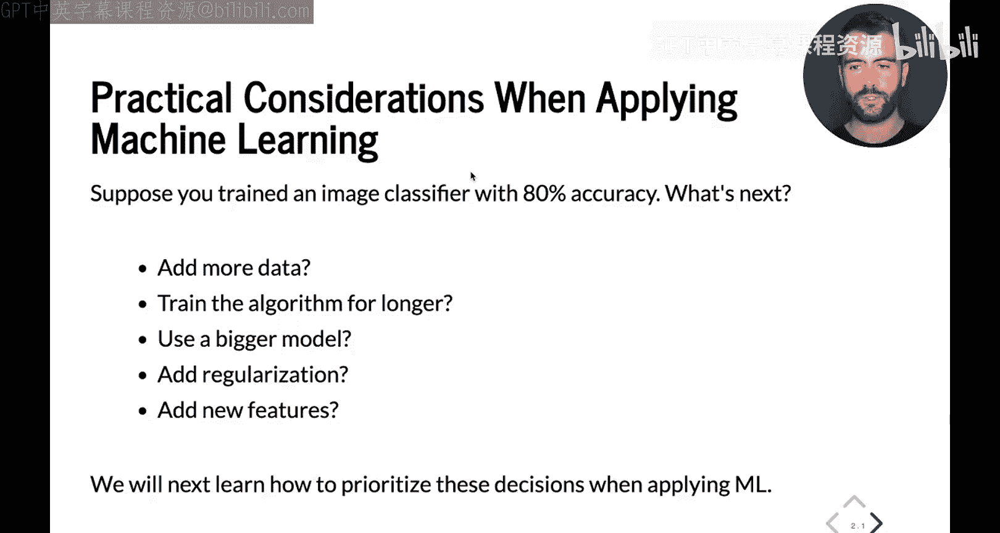

In this video I'm going to introduce a new tool that will help us understand how to interpret our existing level of performance and how to what kind of changes to make to a machine learning model and the name of this tool is going to be learning curves and this section is going to be using a lot of figures and materials from an ebook by and。

 which I also encourage you to look at in your own time if you want more detail on these techniques。

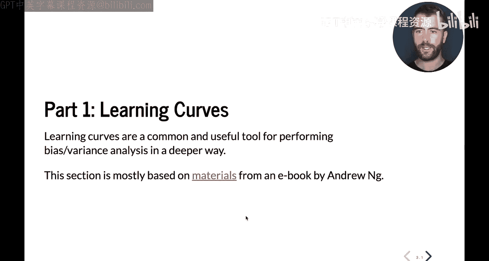

Recall that in previous lectures， we have seen that machine learning models typically have two types of problems that affect them。

 one of them is called overfitting and overfitting happens when we try to apply a very expressive model。

 for example， a high degree polynomial to data that is too small for the capacity of this model。

And as a result， the model will memorize its training set。

 but the solution it will learn it will be good on the training set only and not on new data。

And models that overfit are also said to be high variances and they have this name because if we slightly pertuurrb the training set。

 we will often have a very different set of predictions outside the training set and because the output of an algorithm that overfits is sensitive to small changes in the training set。

 we call this high variance。

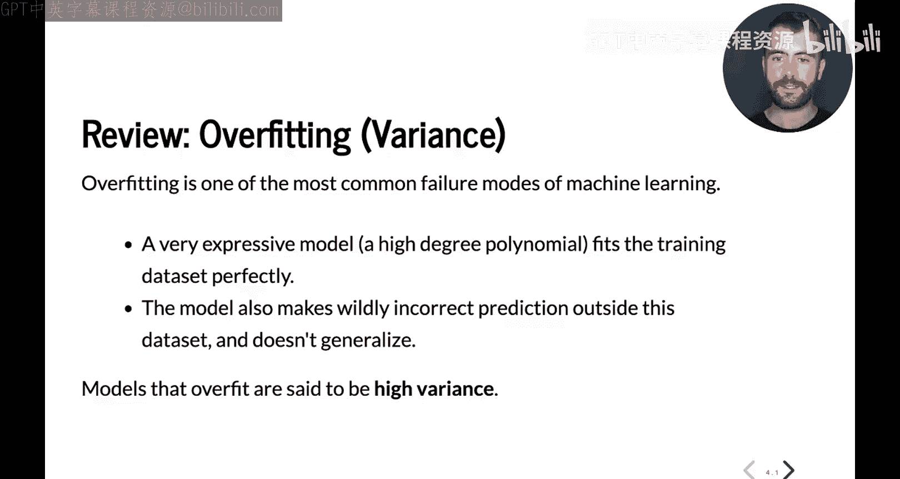

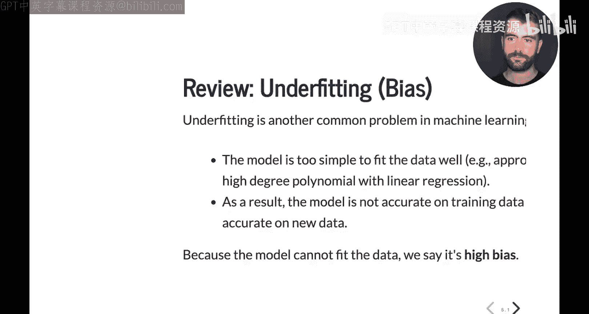

Now the opposite of the high variance problem is underfitting， also known as bias。

And this just means that we're trying to use a model that is too simple for the dataset that we have for example。

 we might be trying to fit a very complex high degree polynomial with only a linear function and we will at best be able to capture the general trend。

 but we will not be able to accurately learn the entirety of the signal。

And when a model cannot fit the data， we say that it has high bias。And these two problems。

They are almost by definition， the only two kinds of problems that we could have within machine learning werere either not fitting our training data correctly or we are fitting our training data。

 but our solution doesn't generalize and if we fit our training data well and the solution generalizes then we have solved this problem so almost by definition any issue that is preventing our machine learning algorithm to achieve maximum performance is either an instance of bias or an instance of variance and this is why it is important to understand these two problems。

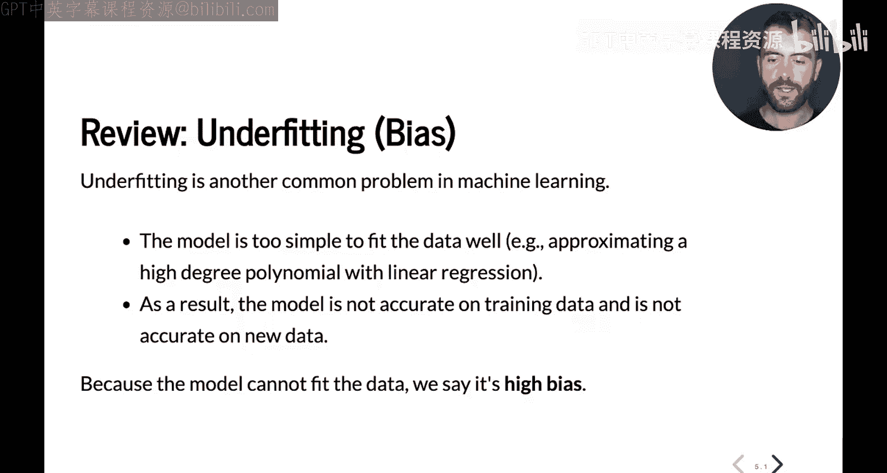

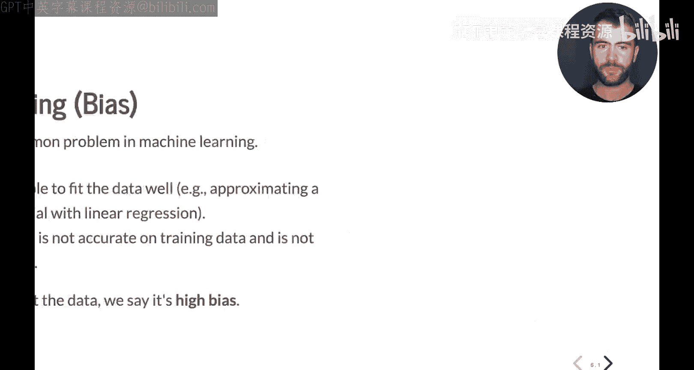

Learning curves are a way of getting a deeper understanding of。

Overfitting and underfitting by via the following plot here we have an example of a learning curve and this learning curve。

Displays model performance as a function of training set size。So on the X axis here。

 I have the number of data points that were used for training and we start with something small and then we increase it as we move rightwards on the X axis。

 and then on the Y axis I have the error that this model is making。

 but in principle this can be any measure of performance。And here in red。

 I have the learning curve which displays the performance of a machine learning model on the development set as a function of the training set size。

 and you can see that as we give the model more data。

 it performs better and therefore our development that error in red here decreases。

And it is also important to note that。This curve is defined for a model that uses a specific set of hyperparameters。

 and this set of hyperparameters is fixed。So given each M in order to obtain given each training set size。

 in order to obtain this level of performance， we retrain the model。

 but crucially throughout this curve， we reuse the same set of hyperparameters So for example。

 we use the same neural network with the same number of layers and the same layer size。

 or if we use rigid regression， then we keep the same regularization parameter。

Throughout the process of generating this curve so that the different points on the curve are comparable。

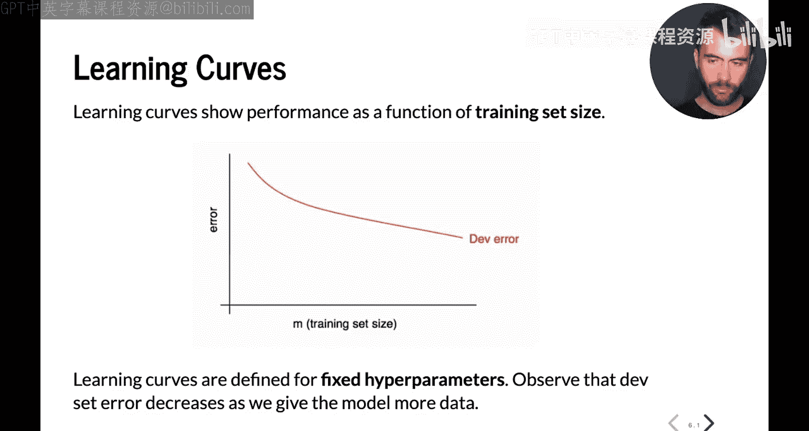

Now there are other kinds of elements that could be plotted that could be displayed on this plot。

 one of them is our upper bound on performance or our ideal or desired performance。

 which I have shown here in green。In general， when building machine learning system。

 it is very useful to have a target upper bound on the performance that we want to reach。

 This allows us to estimate how much work is left， it allows us to more systematically prioritize our the changes to the model it can provide us with intuition for。

What is causing inefficiencies？And it can also help us diagnose the type of error that the model is making。

 and here I have here I'm showing on the same plot the desired performance in green。

 and in the context of a learning curve， this immediately provides us another useful set of information。

Which is the amount of additional data that our algorithm currently needs in order to achieve a certain desired level of performance。

In this particular example， you can see that the development error。

 development set error is on a downward trajectory。

 so it seems to be continuing to decrease linearly even as we give it the largest amount of data that we have。

And therefore by looking at this plot， we can extrapolate where the development error will go。

 and it seems that if we give it perhaps twice the data that we have given it before possibly even less。

 then at this rate it's going to soon reach our desired level of performance and this tells us this tells us that well data will be very beneficial together data and there is a simple solution for getting the desired level of performance that we need。

So visualizing optimal or ideal or desired performance is something that often is very useful when we look at learning curves。

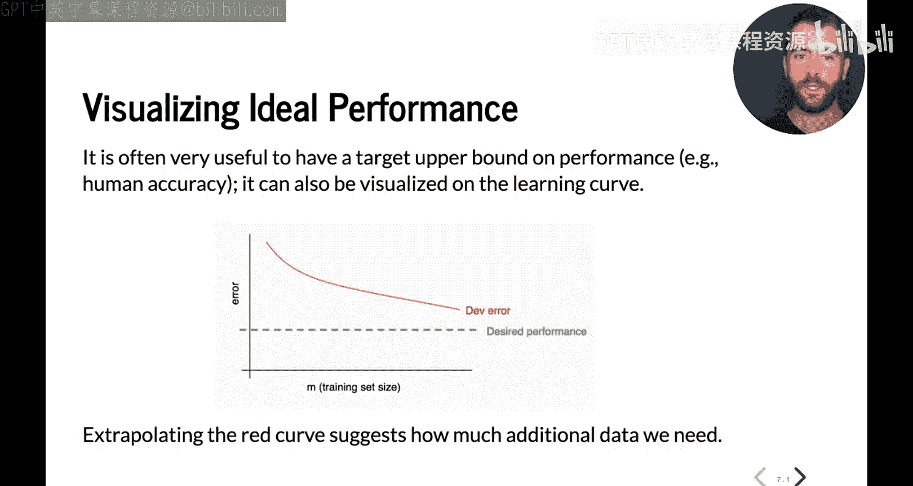

No。Looking at a learning curve relative to the desired level of performance also can tell us that we have other kinds of problems and we can also identify issues that are more problematic than the example that I just showed you in this example you see that the developments that error has plateaued and even as we give it more data。

 it still displays the same level of performance so this is an example where by looking at this curve we see that collecting more data and giving more data to the model is not going to solve our problem and this is again a very useful it's a very useful piece of information to have when building these models and it's important for guiding our work。

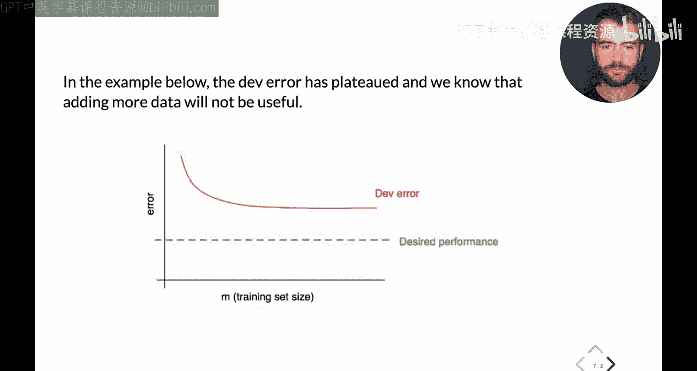

Now， learning curves are not only something that would be measured over the development set。

 we can also measure them on the training set and here I have the training error which is shown in blue。

嗯。There are a few important observations to be made here。First of all。

 our training error is almost always， it should be always lower than the development error。And again。

 that is simply because。The training error is something that we can optimize directly。

 we can fit a model that directly minimizes the training set。

 and then the development error has the development set in in addition to any error that's due to the error on the training set。

 we also have to generalize to the development set， so to go from training to development。

 we not only have to fit the training set accurately。

 but we also have to generalize to the development set and that is a harder problem and therefore the development error is always higher than the training error。

And also the training error， unlike the development error， increases as we give the model more data。

And the intuition for this is as follows， if we have say one training point or two training points。

 it is very easy for the model to memorize these two training points again we are using the same set of hyperparameters and therefore the same model expresssivity throughout this for every point on this curve。

But then as we give the model more and more data， it is no longer able to fit this data perfectly and therefore its training error increases and a model with a fixed capacity。

 given a very large data set that will have a lot of edge cases that need to be modeled。

 it will given a fixed representational power， a fixed level of excsivity。

 a model will not be able to fit a huge training set perfectly and therefore our training error will be higher for larger training sets and it will be almost perfect with tiny dataset sets that can be memorized。

So these are two observations about the shape of this training error。

 and when you build your own learning curves， you should have。The observations that I made。

 you should also see them on the learning curves that you generate。

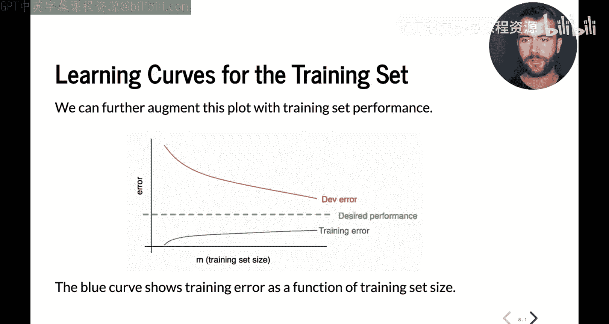

And this here summarizes the two observations that I just described。

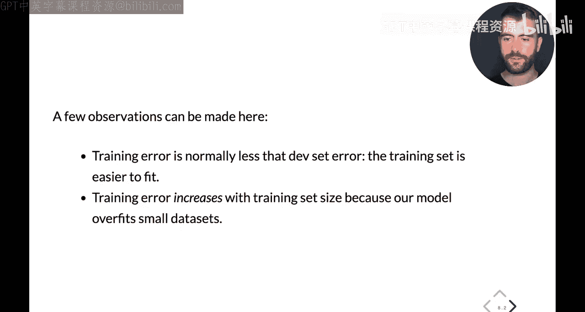

Now， using learning curves， both on the development set and the training set。

 we can diagnose a lot of the errors that we have seen in earlier lectures and in particular we can diagnose the bias andvari problem more precisely。

This particular curve is representative of a data set that is high bias or of a model that is。

Whose bias is too high for the data that we have。As we give the model more data。

 it is no longer able to fit it and it stabilizes at a high error rate that is still very far from the desired level of performance。

 So here the model is not able to fit the data well and so we we can。

This suggests that we have a form of bias problem。

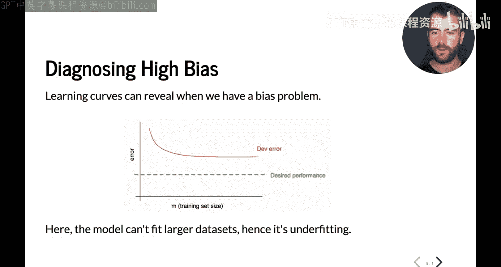

Now， in practice， it is significantly easier to diagnose this problem by also looking at the training error。

One reason is that it may not be easy to visually detect when the development error has a plateau and just from a more practical perspective。

 it's always great to have additional piece of information an additional data source。

 which is our training curve， so the learning curve on the training error。

On the training set here we see that the training error also increases and it plateaus and stabilizes at a level that's really high。

 and this really gives us strong evidence that giving the model more data will no longer help and the model is simply not fitting well the data that we have。

And this provides us with additional evidence because we know that the training error has to be always lower than the development error。

 and now this training error has stabilized at a level that is too high and the development error will not be able to decrease further because it cannot cross the blue curve and therefore our red air is truly at a plateau and it will never reach our green desired level of performance。

So this type of learning curve is characteristic of a bias problem and it allows us to diagnose a bias problem more reliably and it provides us with more information and a regular bias variance analysis would only look at the values of the development error。

 the training error and the desired performance。At the very end of it will look at them for only one value of M。

 but by looking at all the values the jointly by looking at the entire curve。

 we can more reliably determine whether we have truly an overfitting problem or whether we have really a bias problem。

 we can make these diagnosis more reliably and with more confidence by looking at the entirety of the learning curve as opposed to just at one point。

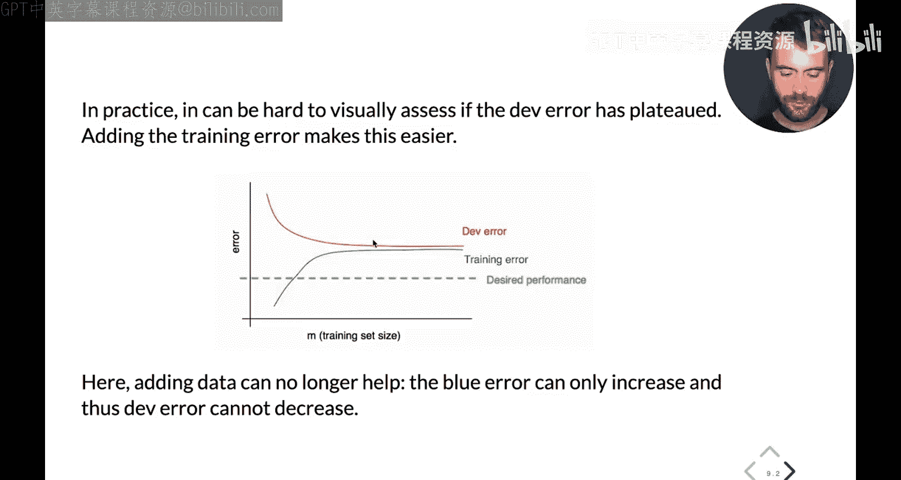

Now， similarly， learning curves can also help us diagnose hi variance problems。Here in this example。

 our training error is it is good， it is close to optimal。

 but our development error is significantly higher。

 and this suggests that we are in the regime wherere where。

We're not generalizing well to the development set because of this gap。

 and therefore we could give more data to this model and if and we can also see that these curves are still quickly changing as we give more data。

 So if we extrapolate these curves， we would anticipate to have a lower development error just by extrapolating the shape of this curve and the fact that there's still a big gap that can be filled between the red curve and the blue curve。

 So this matches our intuition that the model is both overfitting and giving it more data will help giving more data is。

The best way of preventing overfitting， and we see here that according to this curve。

 we anticipate that the solution will work。

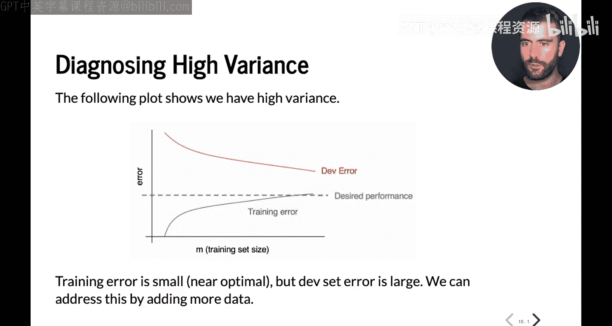

And finally， in this example， we have both high variance and high bias。

 The blue curve has is reaching a plateau that's sufficiently above that's quite significantly above the green level of performance and the red curve is still even higher than the blue curve that we have both an instance of。

Bs and variance。

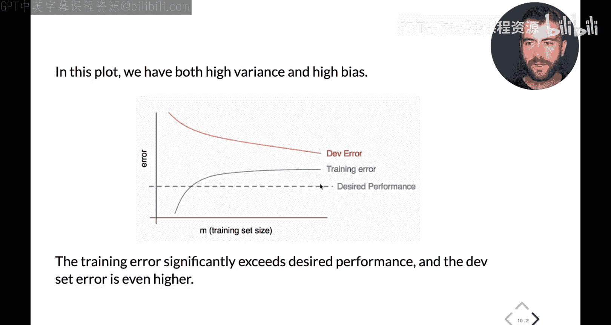

Now to illustrate learning curves even more， let's look at another example in the context of a few algorithms that we have seen earlier in this course。

For this example， we're going to use the Ps learns digit dataset set。

 which I have introduced in the earlier lecture and this is a downscaled version of the MIS data set which contains handwritten digits that have been reduced in dimension to an8 by8 grid and here I have a sample of each digit so you can see how they look like。

So here I'm going to define some boilerplate code that we're going to use to visualize learning curves this simply generates and plots the learning curve you do not need to understand this code for to understand this example。

 the core example is going to be here where I will now use the above。

 I will use the previous function to generate learning curves for two algorithms on the digits data set。

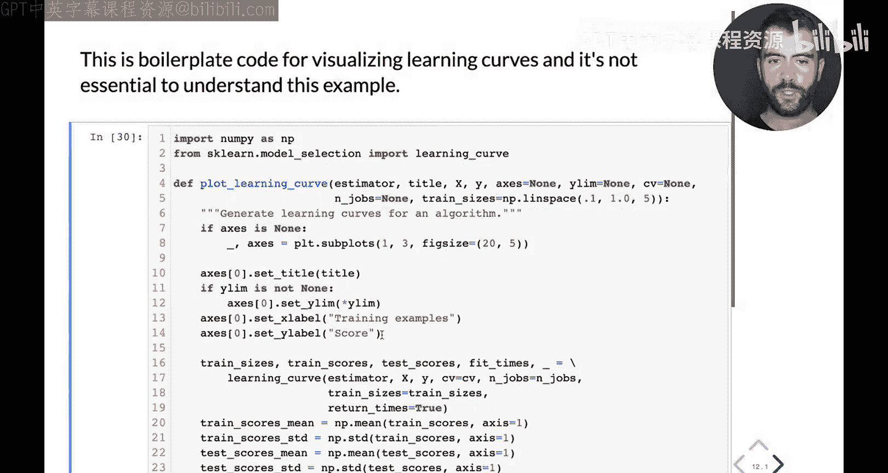

The first one will be a Gaussian naive basease model。

 which is an extension of the navebased algorithm to inputs that have to inputs X which are continuous recall that the most common standard form of nave basease assumes discrete values for x。

 but we can also define a version that is best for continuous inputs and it's a slightly variant。

 and we will also compare it to a support vector machine that uses the RBf radial basis function kernel。

 something that might also be called the Gaussian kernel because it uses the Gaussian distribution uses the bell curve to represent to weigh that。

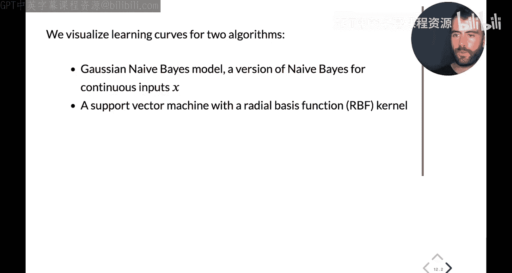

The distance between two inputs。

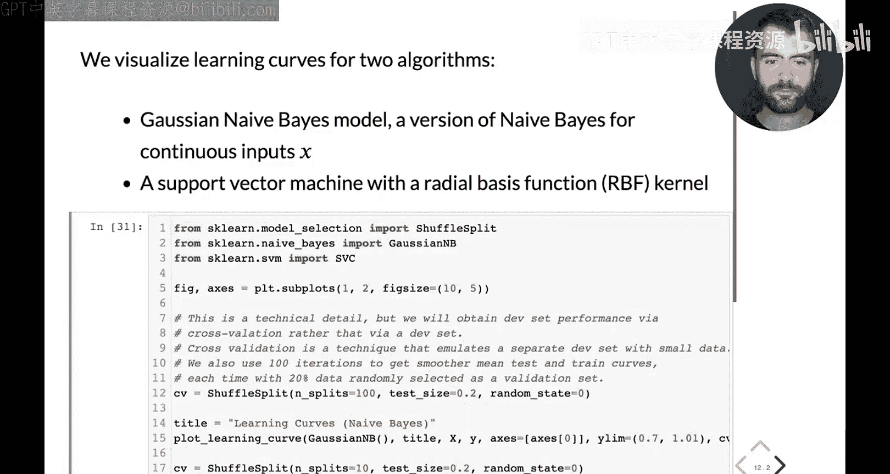

And so now here in this code we are generating learning curves for the two algorithms。

 we have the Gausian Neve Bes model on the left and we have the SVM on the right and here on the Y axis I have the accuracy on a development set。

And you can see here that the shape matches our intuition that we had earlier as we give the model more data。

 our training accuracy decreases， but then our development set accuracy increases and then these two curves stabilize at a level of around 85% accuracy and we see that once we have reached about 1400 points。

 the Gaussian nabased algorithm doesn't really benefit from having more data。

 and we have essentially we have reached the optimal amount of data that this algorithm can currently handle。

And this here is a fairly low value， which is consistent with the fact that Nebase is a fairly simple linear algorithm。

 therefore it tends to reach a lower level of performance for a data set that is more complex like the digits that we're trying to classify。

And here we have we show the performance of the SVM under the RBF kernel。And an SVM。

 especially with an RBF kernel， is a much more expressive and it's a nonlinear algorithm。

And therefore， its performance is significantly higher。When we start。

 we have a big gap between the red training curve and the development set and as we give it more data。

 the development set performance increases and what's interesting here is that training accuracy barely decreases。

 which means that again this is a very expressive model and it's able to fit even large data sets well。

 but we see here that we are in a regime where。If we had given the algorithm around 600 or 800 examples。

 we would be in this area of the curve that is steep decreasing。

 and then our learning curve analysis would have told us that we need to give it more data and still here we could give the model even more data if we had it and it would probably still continue improving。

So here we have and perhaps here there's still a slight gap between the green and the red curve。

 which indicates that there might be a little bit of overfitting that is going on。

 and so we may want to adjust our hyperparameter gamma here to account for this。So in summary。

 these plots， they have been generated on real algorithms and they're consistent with the theory that we outlined earlier。

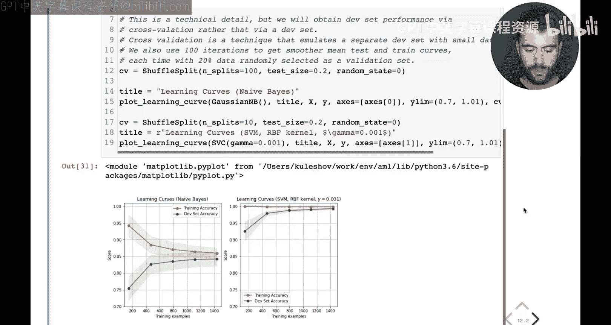

And finally， in terms of the limitations that learning curves might have。

 they require a certain amount of time to compute， it takes some time to compute these curves because we have to retrain the algorithm for each subset of the data and then the shape of these curves can sometimes be noisy if we have small amounts of data。

 for example， if we only have 20 examples depending on which 20 examples we choose we might have different levels of performance。

 which is what I mean when I say here， that the learning curve can be noisy and then in order to correct for this。

 we want to average multiple subsets of 20 points and that again can be more computationally intensive and finally learning curves require human intuition to read and it requires some experience to become more familiar with these curves。

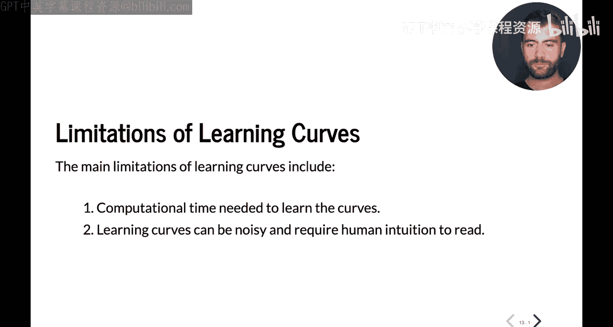