# 康奈尔大学《应用机器学习 CS 5787_ Applied Machine Learning 2020》中英字幕（deepseek p78 -78-Lecture 22. Part 2_ Loss Curves.zh_en -BV12udzYvEFM_p78-

This is now part two of lecture 22 of applied machine learning and in this part of the lecture。

 I will describe a second tool that is very useful for。

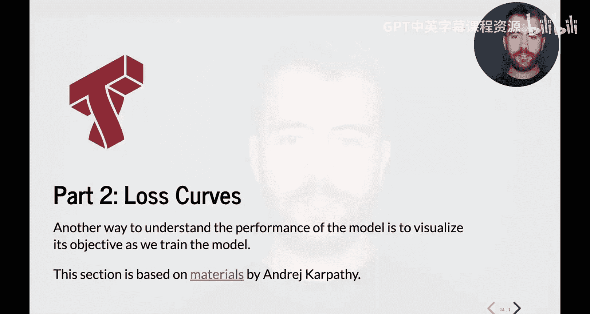

diaiagnosing and explaining the performance of machine learning algorithm and this is going to be the name of this tool is going to be the lost curve and a lot of the materials and screenshots in this video are based on materials by Andre KRPy。

 which I encourage you to look at in your own time if you want more details about this。

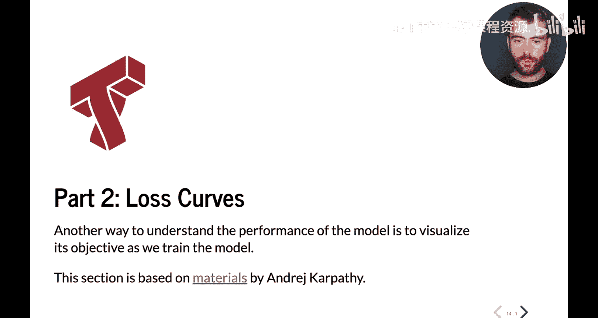

So recall that in our earlier lectures we defined a particular workflow for developing and quickly iterating on machine learning models。

 First we fit a model on a training set， then we observe its performance on a separate development set using a well definedfined set of metrics。

 based on these results， we try to understand what changes are need to be made to the model。

 we make these changes， we retrain it， then we evaluate the second model and we move between these two steps until we're satisfied with our performance。

 and then we evaluate our model on a separate test set in order to get one final estimate of how it will perform in the real world。

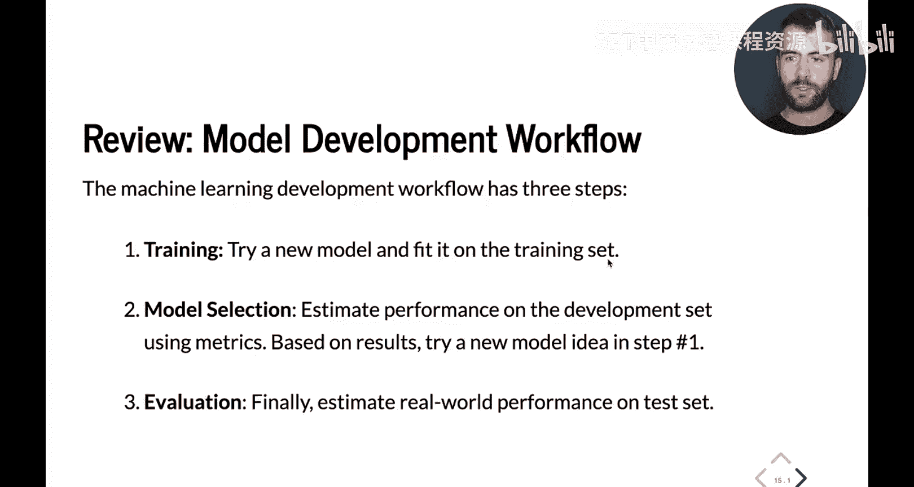

Now， in the， in the training stage， most。Well， most or at least a large number of machinery models。

They optimize an objective function， which is also known as a loss function using an iterative optimization procedure such as gradientding descent。

 which updates the parameters of the model over many steps using based on an iterative optimization procedure。

And the value that this loss function takes as it is being optimized is useful for a lot of model diagnosis tasks。

 and this is what the loss curve shows us the loss curve plots or training objective or the training loss as a function of the number of training steps of the optimization procedure that we have made and shows the objective on either the training or the development dataset sets。

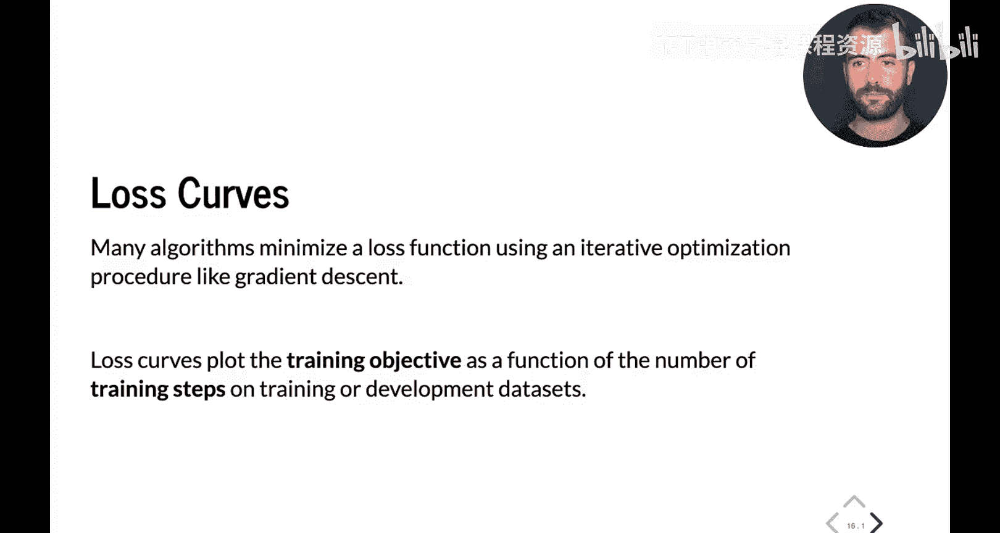

This here is an example of the shape that occur。ALo curve can take。

 and it also illustrates the way loss curves can be used to diagnose。

Bed invari in the same way that learning curves can help us。So here。

 this shows three different loss curves。 The first one shows training accuracy as as a function of。

How many times we have trained how many training steps we have taken here this is called an epoC。

 which is when training a neural network this corresponds to the amount of time to the number of steps that one epoch corresponds to the number of steps that it takes to go over the entire training set once。

And as we train the model more， the training accuracy increases， which is good。

And here in green and blue， we have two different types of。

Loss functions or loss curves that we can have for for over the validation set。

 the green one is an example of a validation loss curve that is well behaved and that does not exhibit significant overfitting here we have in green a very low level of overfitting because the green curve tracks the training curve closely and our training and validation set acuracies are similar the blue curve shows an example of when things go bad and here our validation curve is significantly per validation error is significantly worse than our training error and in fact towards the end it even starts to becoming worse and this is an example of a model that is overfitting。

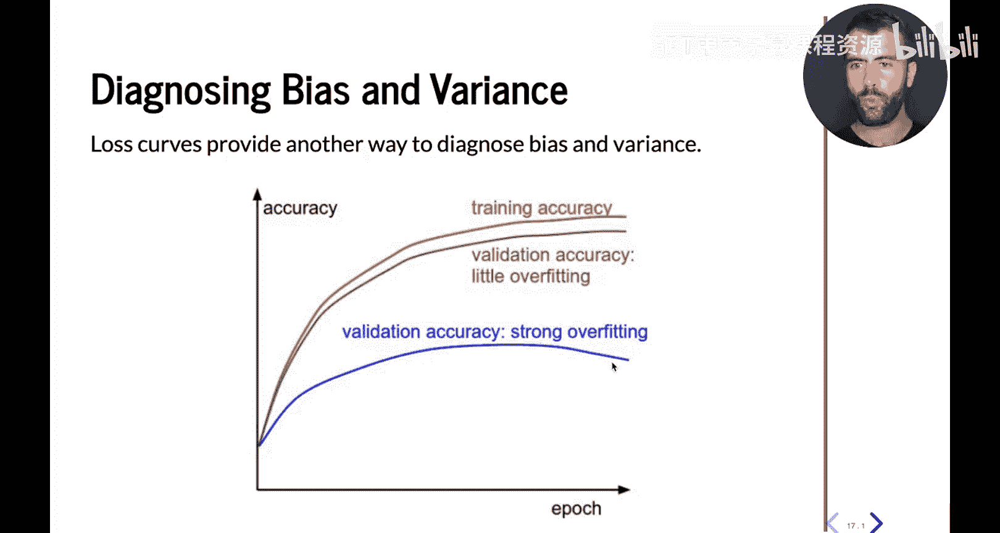

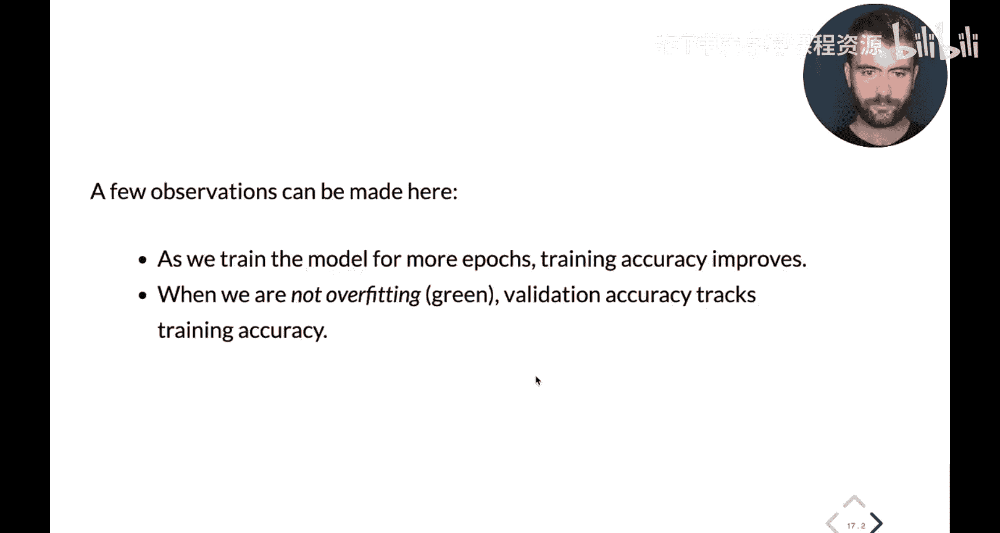

Here， these are the observations that I just described。And in particular。

 learning curves can identify one specific failure mode that applies to several machine learning algorithms in particular neural networks and gradientding boosted trees。

 which is called overtraining。Overtrain happens when we train the model for a long time。

 the training error improves， but the test error becomes worse and or the test or the validation or the deficit error becomes worse and our error there is increasing。

The solution in this case is to train the model is to either train the model for less steps。

 or ideally it would be to regularize the model because it shows that the model is overfitting in general and often there are more effective ways than early stopping to prevent overfitting and I would try here adding if this was a neural network I would try dropout or if this was a green boosted tree。

 I would try using smaller trees as its components。But。

Los function loss curves can identify errors like overtraining。

 and they can do this by revealing the entirety of the learning trajectory as opposed to just the final set of points。

 so for example， if if we only had the final performance here we would not know that actually there exists a set of hyperparameters which at least should be able to give us a better level of performance which is closer to the best point of the red curve and again this is something that we find only by looking at the entire trajectory of the development and training losses。

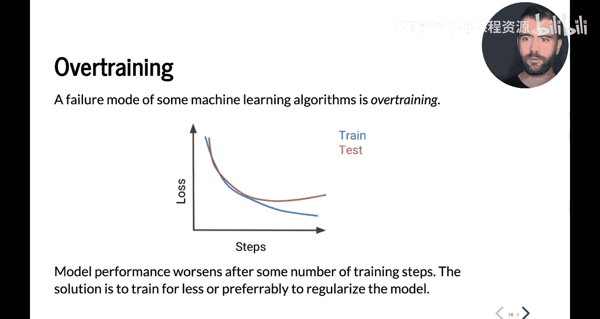

Over the course of training。

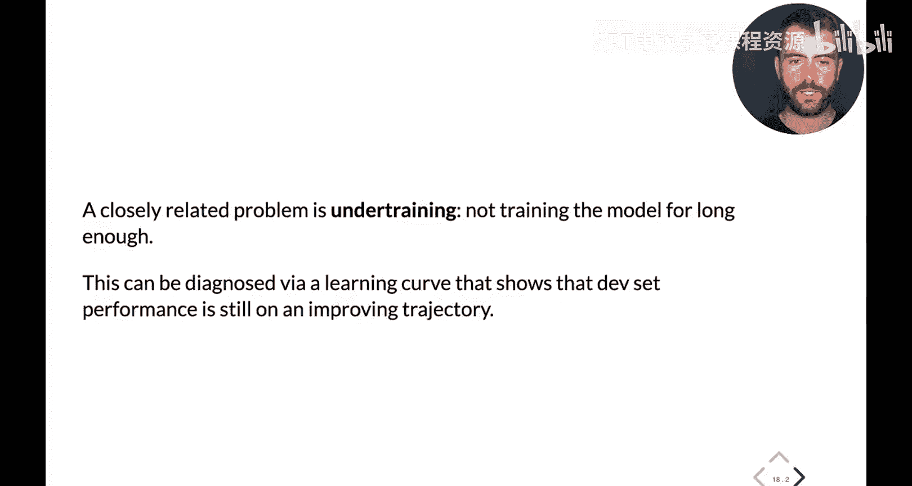

And of course， a closely related problem is undertrain， if we don't train the model for long enough。

 we can identify this problem by observing that the error of a particular model has not converged yet。

 so here in the previous example if you look at the blue curve the blue curve keeps decreasing so we could。

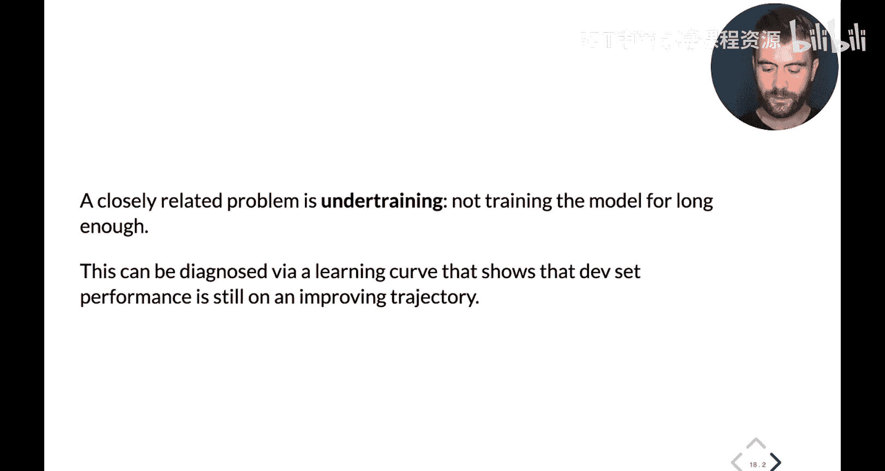

Moify， we could decrease the training error further if we wanted to do this。

 but of course here we're also overfitting， but if the red curve tracked the blue curve。

 we could decrease both of them by training the model more and this is something that again。

 the loss curve can indicate to us。

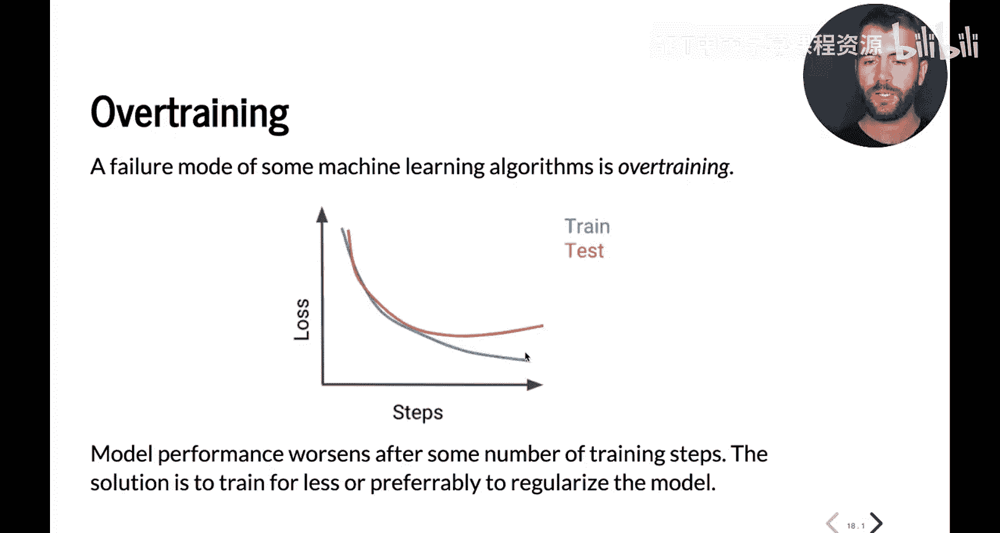

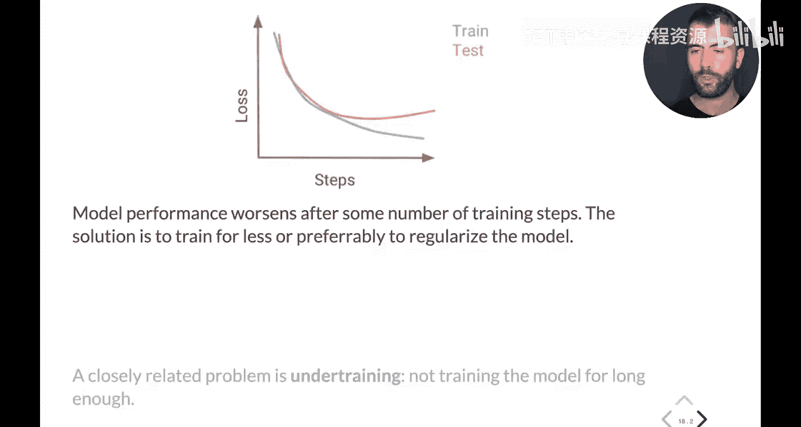

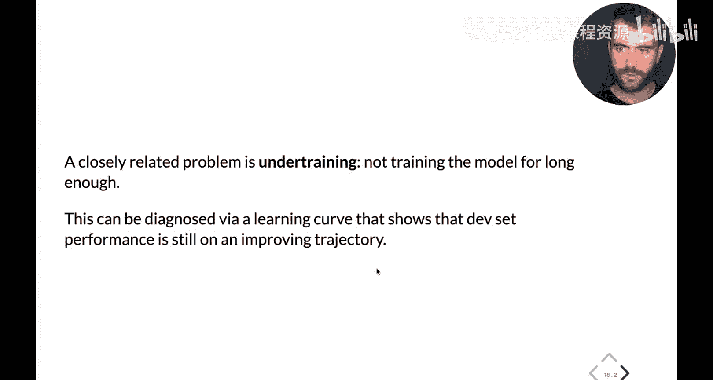

Another set of issues that can be diagnosed using a loss curve are optimization issues。

Here is an example of how we can diagnose a problem of having the wrong learning rate。

🤧This plot here shows a number of learning curves of loss curves for which we are using a different learning rate。

 so we are optimizing a model that involves gradient descent。

 this could be a neural network or it could also be a different algorithm like a gradient boosted decision tree。

And here we observe the performance for different kinds of learning rates。

The blue example is a function whose learning rate is too small。

We can see that it is too small because it takes time to reach it takes a long time to reach a low level of performance。

 to reach a low error and even at the end it looks like it's still decreasing so the steps that we're making are too small。

 we need to increase our learning rate。Now the green curve is an example of a lowering rate that is too high。

 the function decreases very， very quickly， and then it stabilizes at a high level at a relatively high plateau。

 and it stabilizes at this plateau because the steps that it's taking are too large and it's just moving in circles around the optimal solution。

 but it cannot make a step that's small enough in order to find a very precise good set of points and therefore its it's making big steps。

In the area around the minimum without actually reaching it because it would have to take smaller steps to reach it。

 and therefore it looks like a plateau that is the green curve and the extreme version of that is the yellow curve where immediately we start taking steps that are much too high and it goes into a region where the function just takes really where the loss takes very high values and the steps that are taking are。

So large that it never even closely approaches the。The， the ideal minimum。 And so this is bad。

 And a good learning rate would correspond to the。Red loss curve， which decreases smoothly。

 but not too slow， not too fast， and it stabilizes at a low rate。

 and the blue curve would have probably reached this rate， but it would taken much。

 much longer and the red curve achieves this in a good amount of time。

 and this corresponds to a good learning rate。

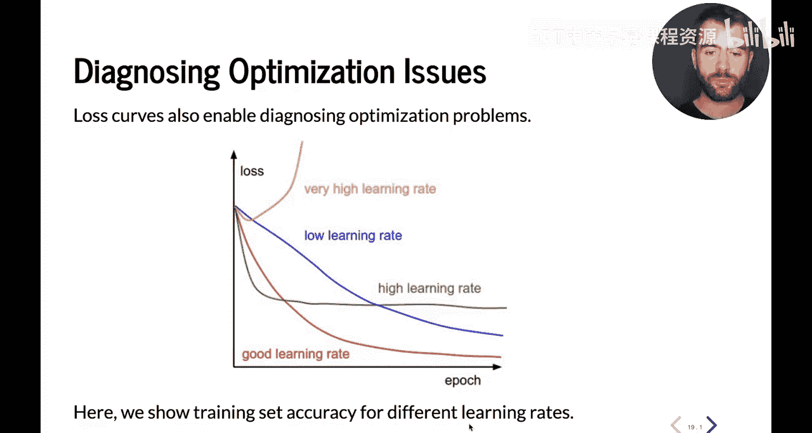

嗯。Lost curves have a lot of advantages， including compared to learning curves。

 which we have seen in the previous video。 One obvious advantage is that they don't require extra computation since we're training the model。

 we can just record its performance at different steps in training and we have these curves for free so。

We should just always be looking at them to diagnose what is happening to our model。

And also they can detect certain problems like overtraining or undertraining or certain types of optimization problems that other curves cannot reveal。

But they may not necessarily provide the best estimate into whether we're overfaeding or underfiing or it doesn't tell us how our performance would scale if if we gave it more data and therefore when we are trying to diagnose bias invaris and our current diagnosis is ambiguous we still probably want to use learning curves in addition to these loss curves together very reliable diagnosis on what's going on so both learning curves and loss curves are complementary and can be used together and they can each reveal different types of issues that our model may be having。

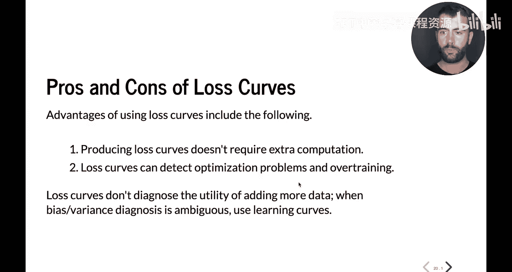