# 应用机器学习：第22讲：第二部分：损失曲线 📉

在本节课中，我们将学习一种用于诊断和解释机器学习算法性能的重要工具——损失曲线。我们将探讨损失曲线的定义、如何绘制以及如何利用它来识别模型训练中的常见问题，如过拟合、欠拟合和优化问题。

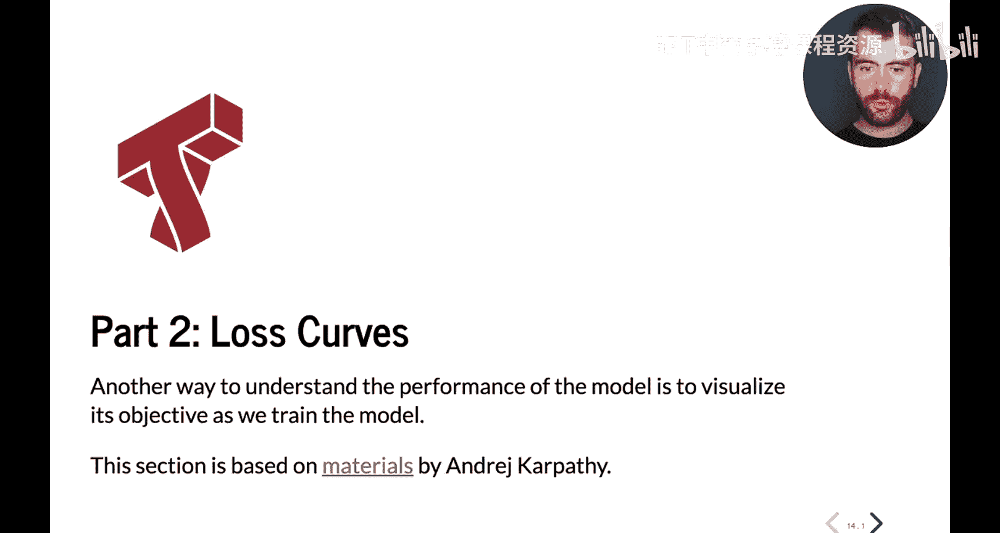

---

## 损失曲线的定义与绘制

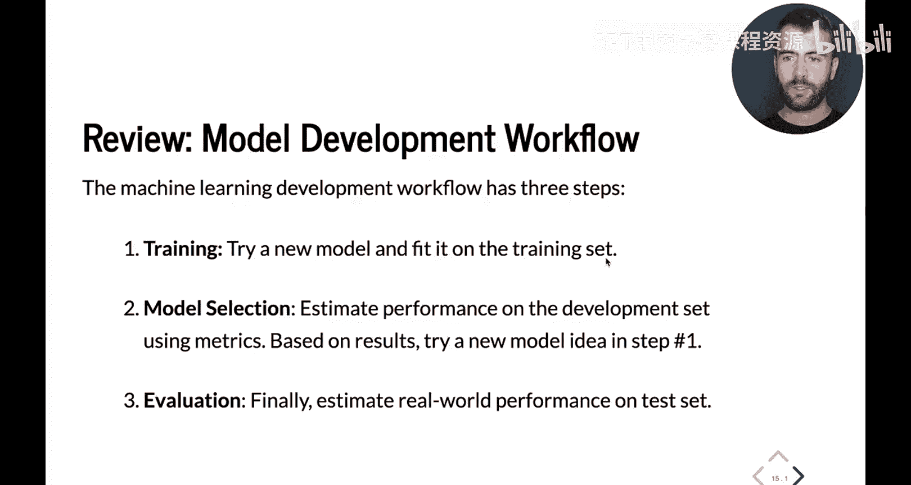

上一节我们介绍了学习曲线，本节中我们来看看损失曲线。损失曲线绘制的是训练目标函数（即损失函数）的值随训练步数（或迭代次数）的变化情况。它可以在训练集或开发集（验证集）上计算。

大多数机器学习模型通过迭代优化过程（如梯度下降）来最小化一个目标函数，该函数也称为损失函数。损失函数在优化过程中的取值对于模型诊断非常有用。

损失曲线的公式可以表示为：
\[
L(\theta_t) \quad \text{vs.} \quad t
\]
其中，\( L \) 是损失函数，\( \theta_t \) 是第 \( t \) 步训练后的模型参数。

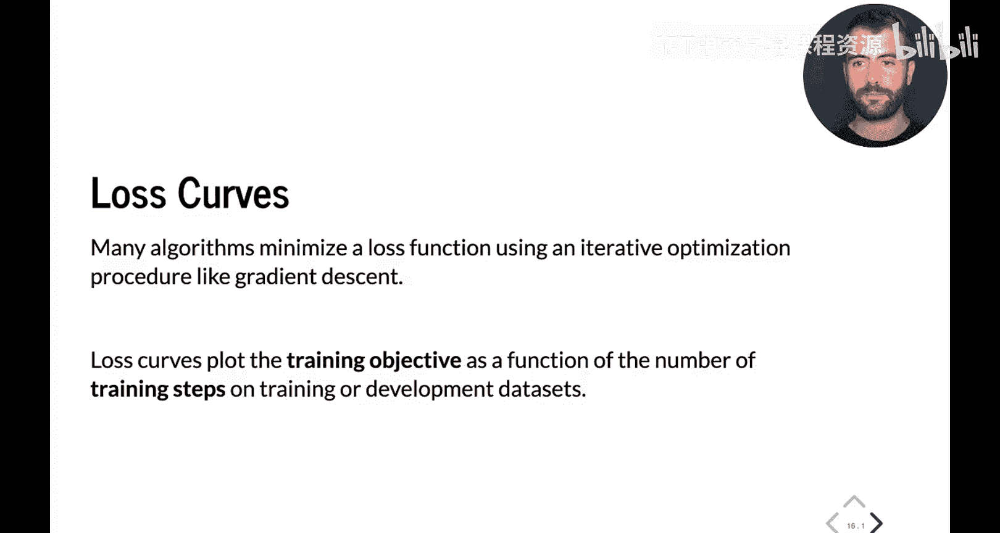

---

## 解读损失曲线：一个示例

以下是损失曲线可能呈现的形状示例，它也说明了损失曲线如何像学习曲线一样帮助我们诊断模型行为。

上图展示了三条不同的损失曲线：
*   第一条曲线（红色）显示了训练准确率随训练周期（Epoch）增加而提升，这是正常现象。
*   第二条曲线（绿色）是开发集（验证集）损失曲线的一个表现良好的例子。它与训练曲线紧密贴合，表明过拟合程度很低。
*   第三条曲线（蓝色）则是一个出现问题的例子。开发集误差显著高于训练误差，并且在后期甚至开始恶化，这是模型过拟合的典型表现。

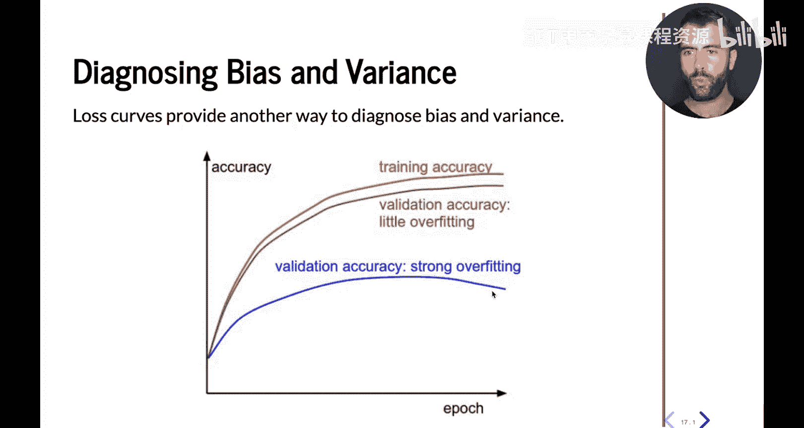

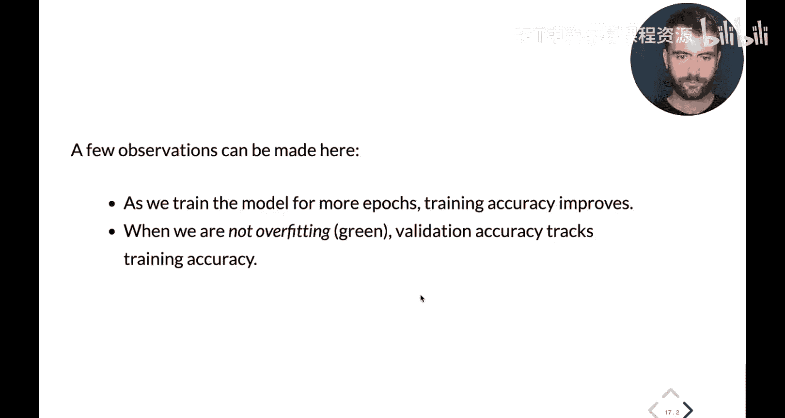

---

## 损失曲线诊断的常见问题

通过观察损失曲线的形态，我们可以识别出模型训练中的几种关键问题。

### 过度训练（过拟合）

过度训练发生在模型训练时间过长时。此时，训练误差持续改善，但验证误差却开始变差甚至上升。

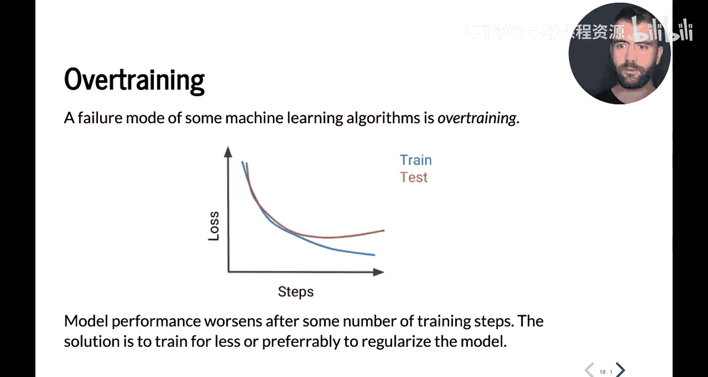

解决方案通常是：
1.  减少训练步数（早停）。
2.  更理想的方法是正则化模型。例如，对于神经网络可以尝试添加Dropout，对于梯度提升树可以尝试使用更小的树作为基学习器。

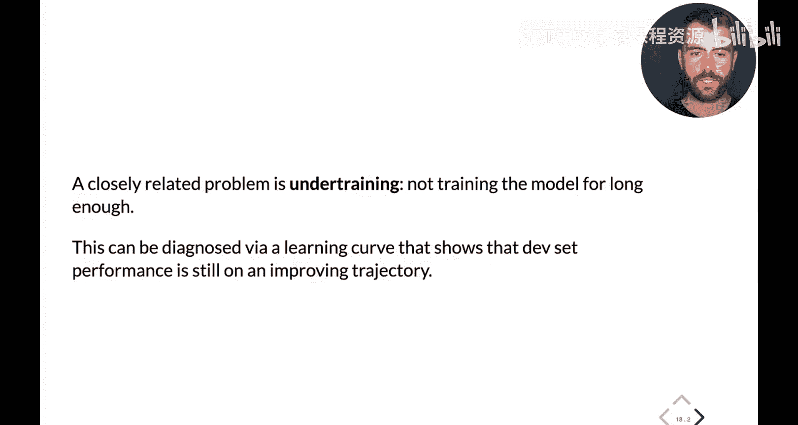

损失曲线通过展示完整的学习轨迹（而非仅最终结果），帮助我们识别此类问题。如果只看最终性能点，我们可能无法发现存在一组能提供更好性能的中间参数。

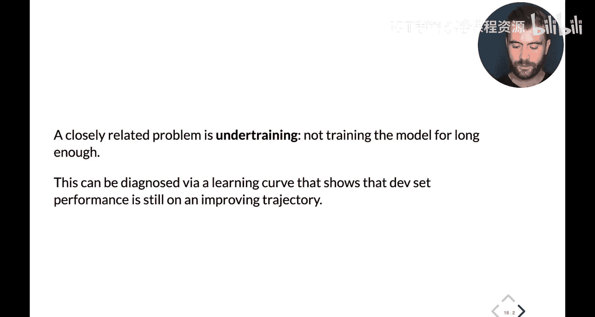

### 训练不足（欠拟合）

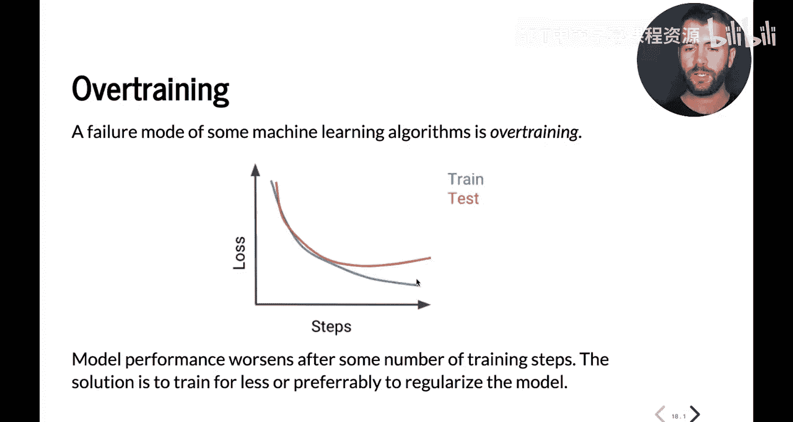

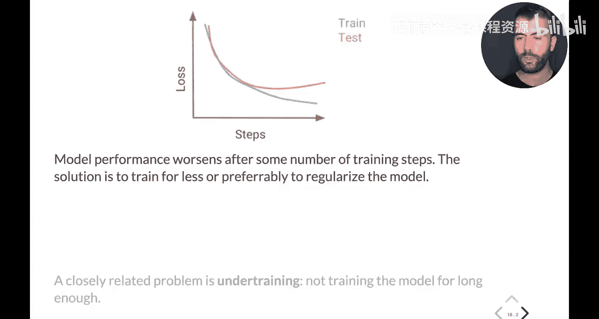

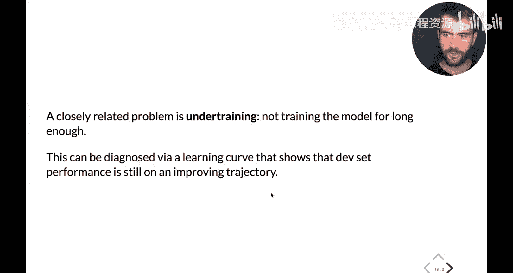

与过度训练相反，如果模型没有训练足够长的时间，其误差可能尚未收敛。

在之前的示例中，如果蓝色曲线（训练损失）仍在持续下降，则表明通过延长训练时间，可以进一步降低训练误差（当然，需同时关注验证误差以防过拟合）。损失曲线可以为我们提供这种延长训练的指示。

### 优化问题：学习率设置不当

损失曲线还能帮助诊断优化算法本身的问题，例如学习率设置不当。

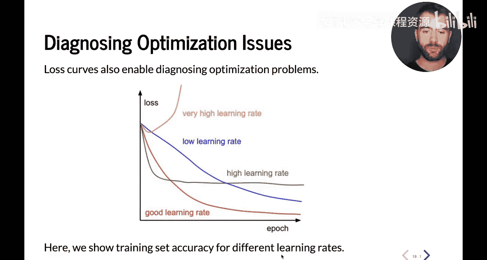

上图展示了不同学习率下的损失曲线：
*   **蓝色曲线（学习率过小）**：损失下降非常缓慢，需要很长时间才能达到较低误差。
*   **绿色与黄色曲线（学习率过大）**：损失初期快速下降，但随后稳定在一个较高的平台（绿色），甚至因步长过大而发散到损失很高的区域（黄色），无法接近最优解。
*   **红色曲线（学习率合适）**：损失平滑、稳定地下降至较低水平，收敛速度适中。

---

## 损失曲线的优势与局限性

损失曲线与上一节学习曲线相比，具有一些明显优势：
*   **无需额外计算**：在模型训练过程中即可记录，几乎是“免费”获得的诊断工具。
*   **能揭示特定问题**：如过度训练、训练不足以及某些优化问题，这些可能是其他曲线不易直接发现的。

然而，损失曲线也有其局限性：
*   它可能无法最有效地估计模型是处于高偏差还是高方差状态。
*   它不能直接预测如果提供更多数据，模型性能将如何变化。

因此，当诊断存在歧义时，我们仍需要结合使用**学习曲线**和**损失曲线**。两者是互补的工具，共同使用可以提供更可靠、全面的模型诊断。

---

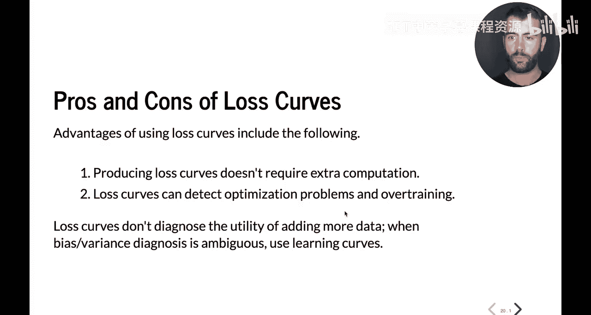

本节课中我们一起学习了损失曲线这一重要工具。我们了解了如何绘制和解读损失曲线，并利用它来诊断过度训练、训练不足以及学习率设置不当等常见问题。记住，损失曲线与学习曲线是相辅相成的，在实际工作中结合使用它们，能更有效地指导和优化机器学习模型的开发流程。