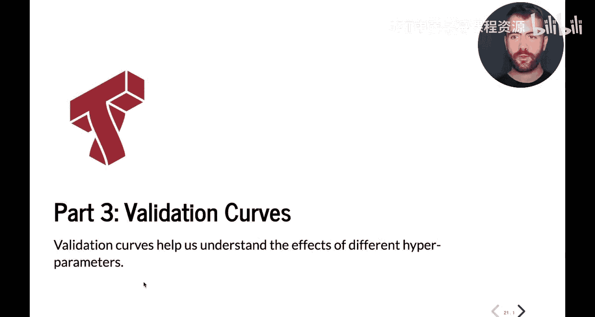
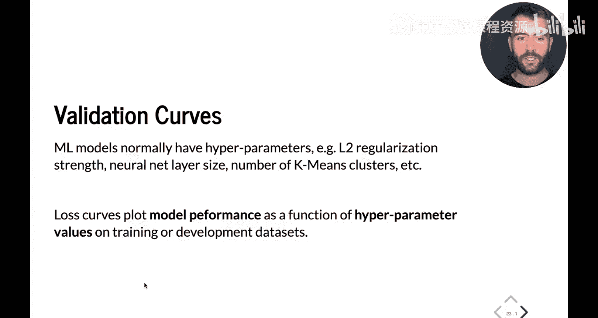
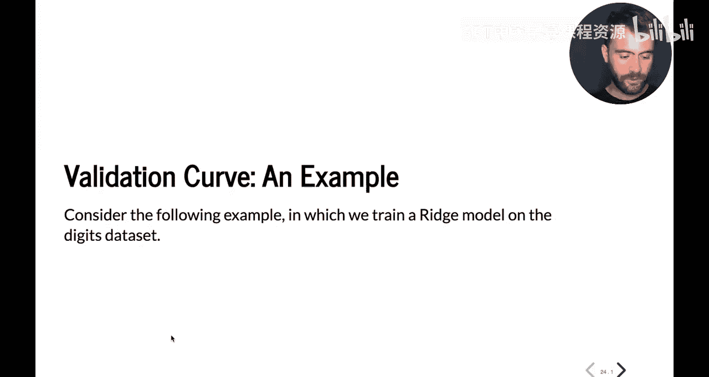
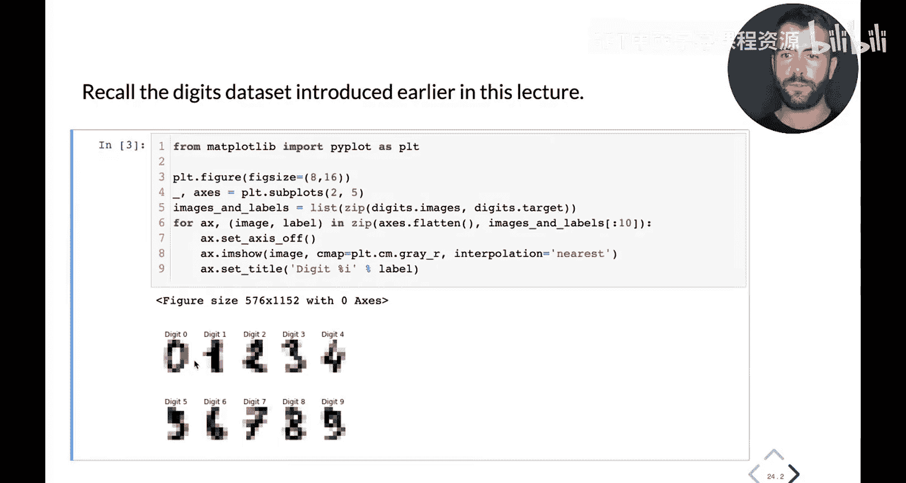
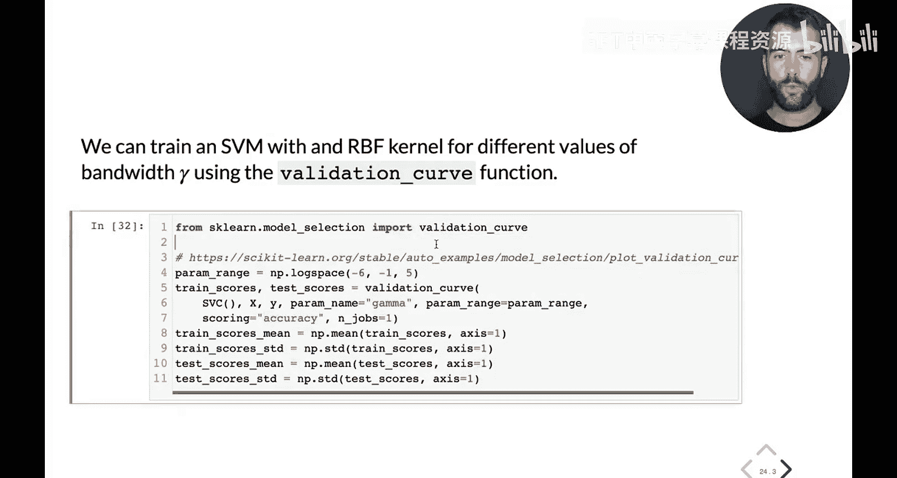
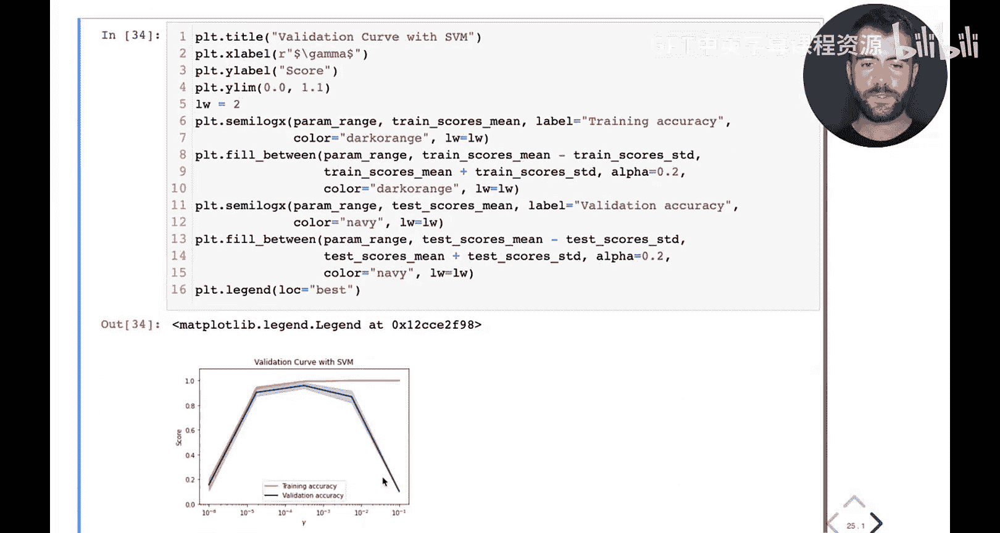
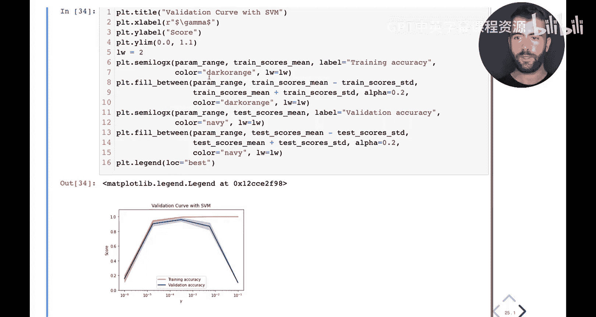

# 康奈尔大学《应用机器学习 CS 5787_ Applied Machine Learning 2020》中英字幕（deepseek p79 -79-Lecture 22. Part 3_ Validation Curves.zh_en -BV12udzYvEFM_p79-

We are now at part 3 of lecture 22， and in part 3， I am going to introduce yet another useful tool for diagnosing and explaining the performance of machine learning models。

This tool is going to be called the validation curve。 and again。

 it will be part of our workflow of our model development workflow in which we itertativeively train new models。

 Then we observe their performance on the。

On a development set， we changed parameters of these models， we retrain them。

 and when we're satisfied， we evaluate our performance on a held out test set。

A validation curve is useful for all the machine learning models that have important hyperparameters。

 and that is essentially most machine learning models。

So a hyperparameter would be something like the strength of the L2 regularizer or the number of layers in the neural network or the size of the neural networks。

 or the learning rate would be hyperparameter for an algorithm like a neural net or gradient boosted tree or the bandwidth of the RBF kernel or the number of clusters in K means。

 these are all called hyperparameters because they affect our performance。

 but we don't optimize them we don't optimize over them directly over the course of training。

A validation curve explains the effects of the hyperparameters by showing model performance as a function of specific hyperparameter values。

 and it does that both on the training and the development sets。

As an example of a validation curve considered the following example。

 we're going to train a ridge model on the digits data set that we have introduced earlier in this lecture。

 and these are some examples of digits in our digits data set。

We're going to train an SVM with an RBF kernel using different values for the bandwidth hyperparameter of this kernel。

 So recall that the bandwidth when the bandwidth of the RBF is。Depending on whether a demand with a。

 small or large， this controls whether we look at a large number of points or a small number of points when determining the prediction for a new point。

And here in Ps learnarn， there is a convenient function called the validation curve。

 which can be used to compute these and with a little bit of code。

 we obtain the curve which we can then visualize here。

And so this here is an example of a validation curve。

On the， on the X axis， I have different values for the hyperparameter of gamma。 and on the y axis。

 I have。I have the performance of the model， which is gear the accuracy。

And for smaller values of gamma， both the training error。

 which is here in in orange and the validation or the validation accuracy and the training accuracy。

 both curves are。Similar and they're also small data in small values as we increase gamma。

 they given the same data set they improve， and then they stabilize at a value around here。

 and then the orange curve stays high our training error stays high， but our blue curve worsens。

 which means that for values of gamma that are in this range that are around from between 10 to the -3 to 10 to the -1 now the model starts to overfit the data and it's able to basically by having a gamma that is high that is on the order 10 to the -3 and or 10 to the 2 or 10 to the -1。

 we have。Hi。We increase the expresssivity of this model it high values for which gives it high performance on the training set。

 but bad performance on the validation set which is a sign of overfitting and by plotting this entire curve we can see what is going on and this is a tool called the validation curve。

 and it may be useful to visually understand the effects of using various kinds of hyperparameter。

