# 康奈尔大学《应用机器学习 CS 5787_ Applied Machine Learning 2020》中英字幕（deepseek p80 -80-Lecture 22. Part 4_ Distribution Mismatch.zh_en -BV12udzYvEFM_p80-

We have now reached part 4 of Lec 22 of machine learning， and in this part of the lecture。

 I will talk about a particular problem that affects machine learning models called distribution mismatch。

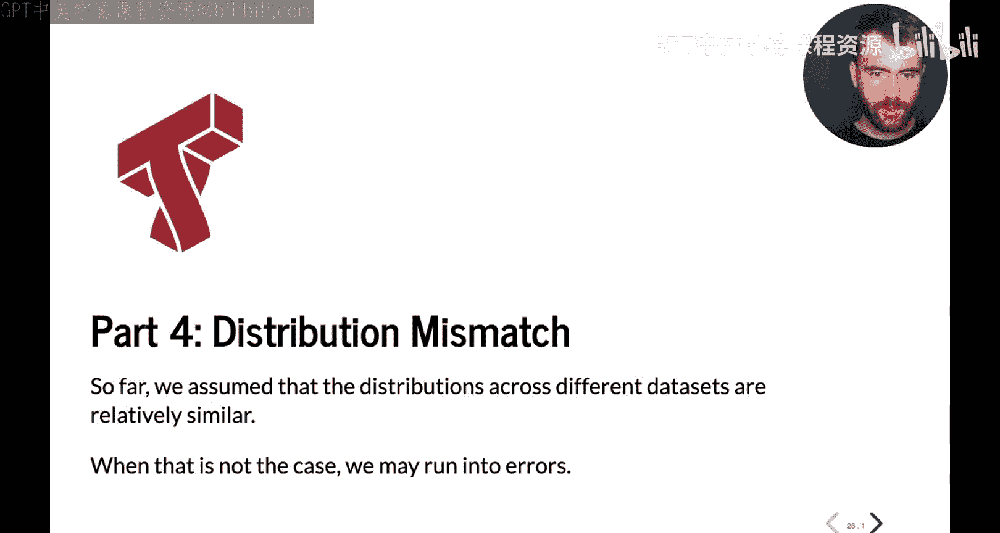

嗯。Recall that when we develop machine learning models。

 we work with essentially three different data sets。 the training set on which we。

Train or fit our models development set that we use to check whether particular modeling choices that we have made work well or don't work well。

 And we use it to develop and improve our models。 And then a final test set that evaluates the final performance of the model。

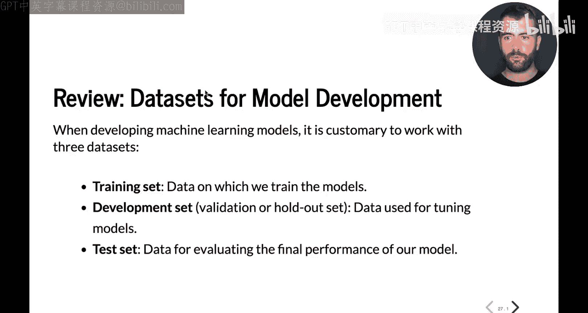

In order for machine learning to work well， these data sets have to be representative of the final performance that we expect from this model。

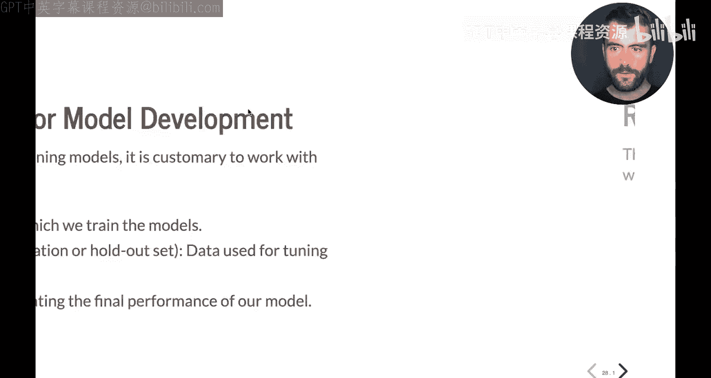

In particular， the development and the test sets should come from the data distribution that we expect to see in production。

Once we have deployed our system， we will see a certain pattern of inputs and these inputs。

 this pattern of inputs should be similar to what we see in the development and test sets。

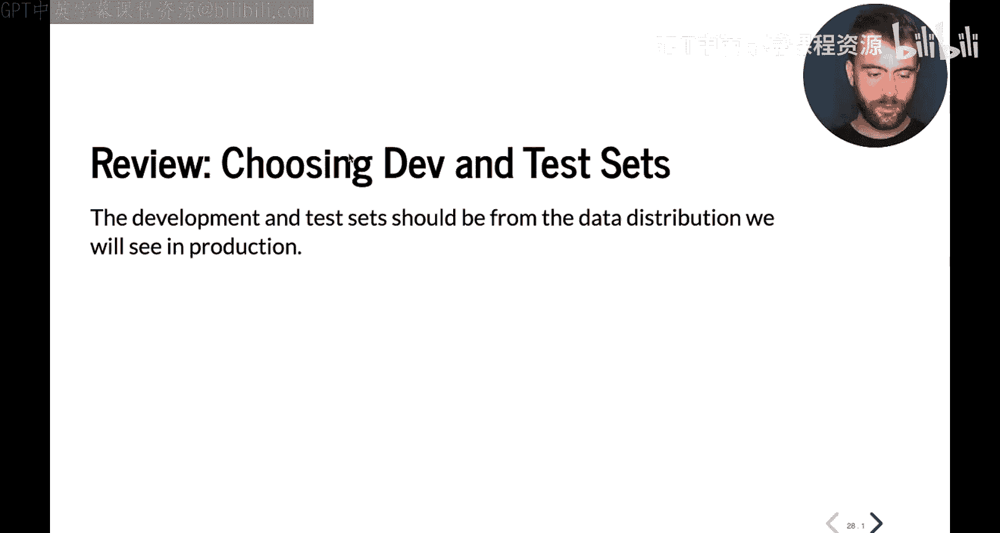

Unlike the development and test sets， the training set may or may not be from the same distribution。

For example， if we are building a classifier for detecting whether there is a cat or not in an image。

Then。It could be useful to also have a data set with many kinds of animal images， or for example。

 if we're detecting cats versus dogs， and we have a cat versus dog classifier。

 it may be useful to also have images of other animals。

And also try to classify them with the same model with the hope that the model will learn something which also which generalizes across many different types of animals and will improve the performance on the cat class as well。

So。

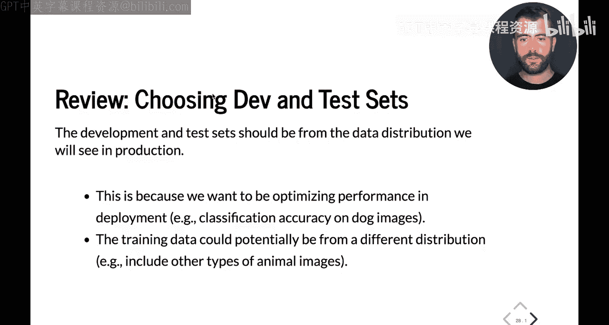

When when these distributions are not met， for example。

 when the development set or the test set is no longer representative of our true data distribution or when the training set that we have chosen is too different from the development set and we have added。

Images which are no longer useful for our ultimate task of detecting of classifying dogs versus cats。

 and we have added， say cars or PDF documents and something which is completely unrelated and this may be hurting our performance。

 this is a different type of error that can arise because of distribution mismatch。And in fact。

 in practice， the data that we see in the real world will eventually become different from the data that we have in that we're working with and it will be important to understand and detect these kinds of issues because they can cause a they can cause very significant performance problems all the analysis that we have seen so far assumes that these different distributions are related in the ways that I have described earlier。

 but if it doesn't hold a lot of the analysis that we have seen break down and it's important to identify and diagnose and understand this problem and attribute errors to this particular problem as opposed to the mismatch problem as opposed to other problems that we might be tempted to identify。

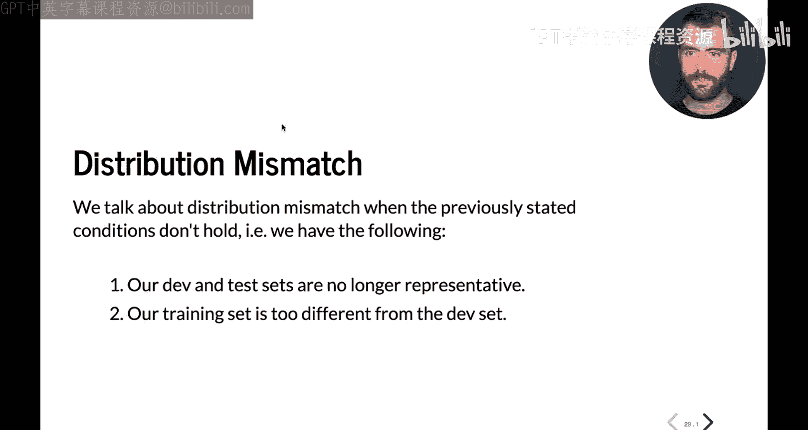

Now， in order to diagnose mismatch problems between the training and the development set。

We can create a special new data set and understand whether this problem is something that occurs or not by looking at the performance on this new dataset set。

 and we're going to call this new dataset， the training dev set。

 so it will be a mix of the training and the development set， it will be something in between。

In order to form this data， we take a random subset of the training set and we use it as a second validation or a second development set。

So if we have 200，000 images in our training set， we may take 5，000 or 10。

000 of them and choose them at random and keep them as a separate validation set and now we're going to measure our performance after the model has been trained both on our standard development set and on our training development set。

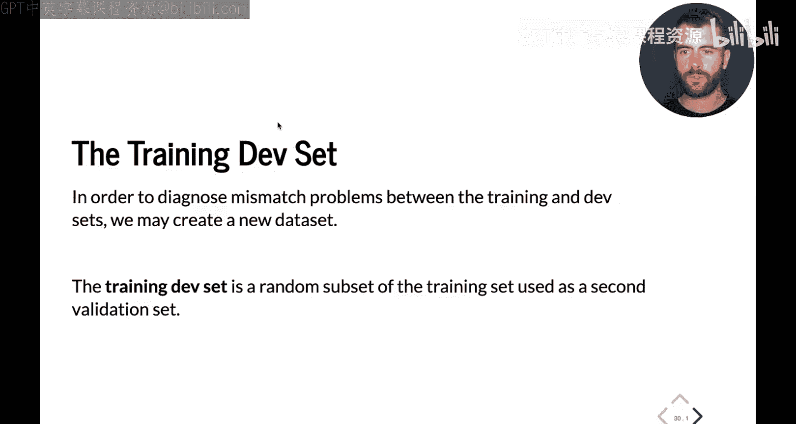

This。This dataset set allows us to diagnose bias variants and crucially distribution mismatch。

The way that we do this is as follows， S we have already identified that the development error is high。

 so we could have a variance problem。 We could have a bias problem。

 or we could also have a distribution mismatch problem。

 which means that our training set we have added too many irrelevant examples。

 and now it's just distracting the model。If the training error is low。

 but both the training development and the standard development errors are high。

 then it means that we are overfaading， we don't generalize to the training development and to the standard development sets。

 and this is a classical example of variances or overfaing。

But if both the training and the training development errors are low。

 but the development error is high， then we generalize to the training development set。

 but we don't generalize to the standard development set。

 which means that our standard development set is too different from the training set。

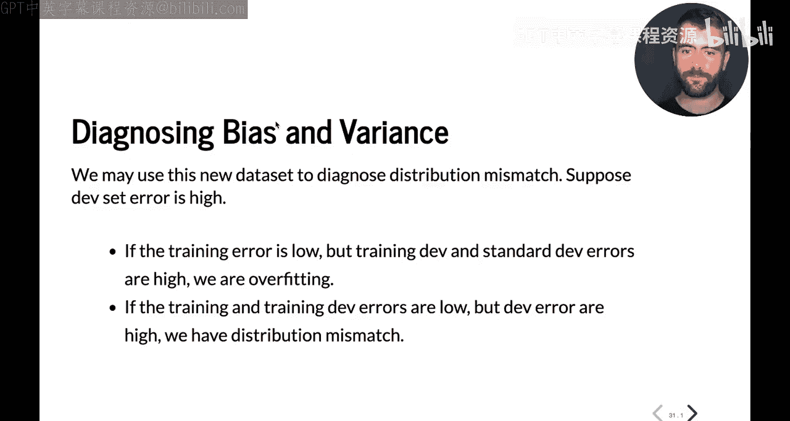

Let's make this concretely with a few examples and let's say again that we're building a cat image classifier and our training set consists of both cats as well as other animals。

 and we hope that if we show examples of other animals it will detect better things like fur or eyes or ears。

 there are different elements that are useful for classifying both cats and other animals and if we show the algorithm。

A diverse and large data set it will be able to use this data to improve its performance on cats specifically。

 and then our training development set is sampled from the training set and therefore it also contains cats and other animals and the dev and test sets。

 they only contain cats because ultimately we are grade。

 we are graded on our performance on cats only。

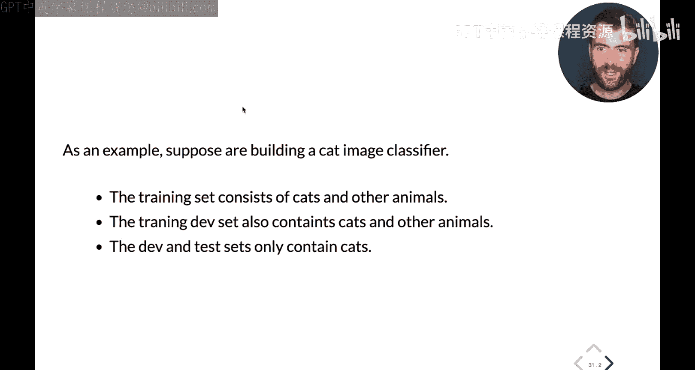

And now if we see the following error pattern where we have a training set error of two。

 then a training development and a standard development set error of six。

 then again this is a problem of high variance， because our model is able to fit the training set perfectly but even the training depth set which we know for sure comes from the same distribution because it's just a random subset of the training set。

 there our errors worse， and so it doesn't generalize the training depth set。

 which means that it has worse performance and it overfits the training set。

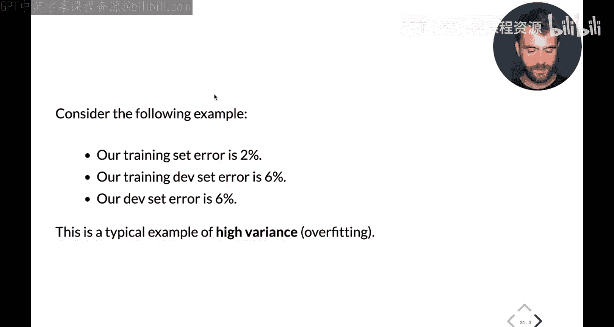

If we have an error which looks as follows， we have a training set error of 10%。

 a training dev error of 11， de set of 12， but a human error is only 1%。

 then this is clearly an example of highavable bias or even our training error doesn't approach the human error at all。

 so this is an example of overfaading and high avoidable bias bias and finally if we see the following if we have a training error of 4% a training development error of 5% but now our depth set error is 13。

 it's significantly higher， we have a model which generalizes to the training depth set but not to the standard depth set。

 and therefore its the reason can only be because the death set is very different from the training depth set and this is an instance of a distribution mismatch problem。

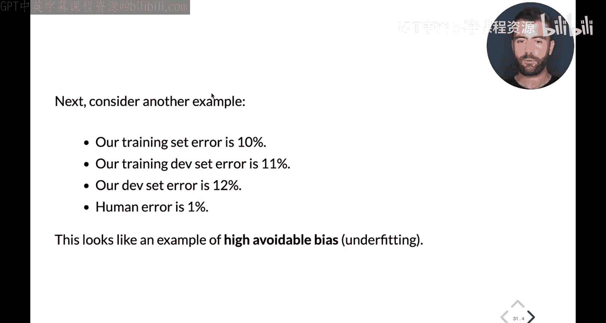

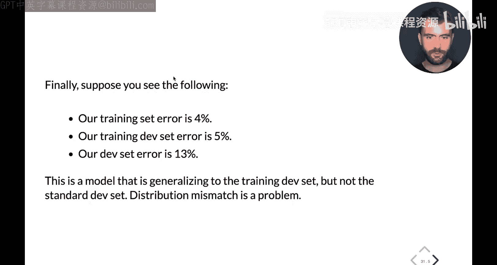

We can even quantify this a little bit more precisely。

 we saw in earlier lectures different ways of decomposing the development error into components。

 and now we can take our most sophisticated decomposition and we can add an additional element。

 which is the element of distribution mismatch。So here I'm just adding and subtracting the development train error and the difference between。

Difference between the development train and the train error is precisely the distribution mismatch。

 and then the extra error from the de train to the dev， that is generalization， error or variance。

 and then avoidable and unavoidable bias that remains the same as in the previous lecture。

So this is a more quantitative way of formulating what I just described。

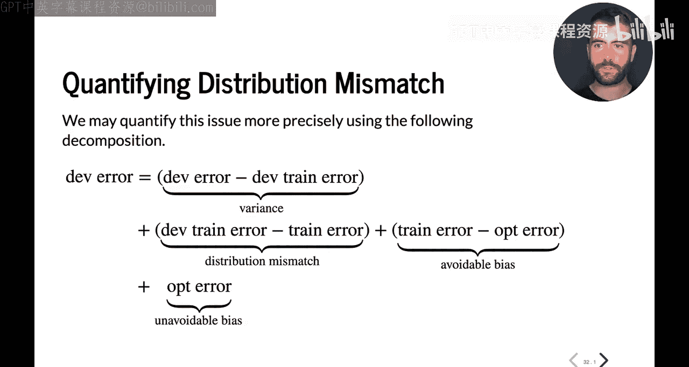

And finally， even though this idea， I have described it in the context of the training set and development sets。

 even though I'm trying to see if the model generalizes if there's a mismatch between training and development。

 we can also use it in other contexts， we can for example。

 use the same idea to detect whether the development and test sets are stale in the sense that they are no longer representative of the production data distribution。

In order to determine whether they're stale， we would collect additional real world data。

And then we would take this real world data as another。Development or test set。

 we can call it the real worldorl data set， and if our model generalizes very well to the old development set。

 but not to the new data set， then it means that our old data has become stale and it is time to update our dataset sets and in practice when a machine learning is deployed a machine learning system is deployed into production。

 data eventually does become stale， and therefore it's important to monitor this kind of behavior。

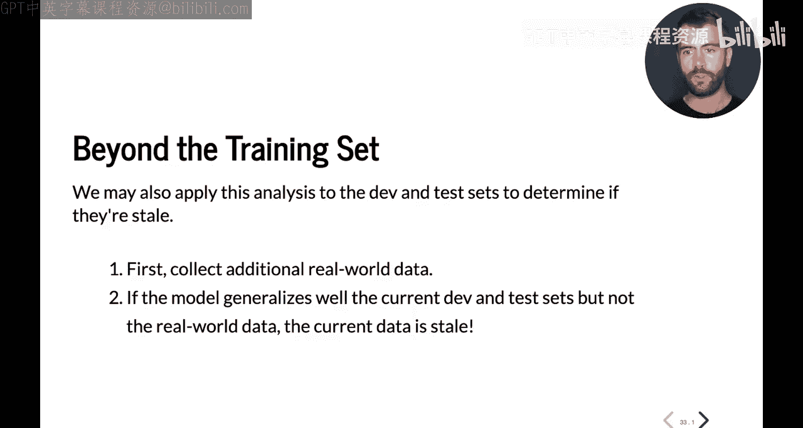

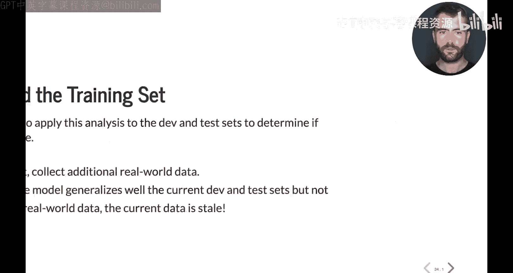

Now， finally， how does one address data mismatch？Effectively。

 it requires understanding the properties of the data that are causing the mismatch We need to understand is the mismatch because we are collecting certain data in a different environment。

 perhaps perhaps we have data on users from different countries and are different data sets have a different distribution of countries or perhaps we're collecting sounds and certain sounds are measured in a car and other ones are measured in in a quiet room and this is what's preventing us to generalize or maybe we have voice recordings and there are different accents。

 so understanding the specific properties that are different is really important and then once we have understood these properties we want to minimize their influence so we either want to remove the data the parts of the data set that are different or we want to add significantly more data that matches better and that will compensate for any deficiencies。

And the best way to understand which data。The best way to understand which properties of the data are causing the mismatch and which data remove。

 which data to add is by inspecting it， and that can be done using error analysis。

 which we have seen earlier， error analysis is an effective and very general process for understanding how to fix the machine learning models what are the main errors that it's making and the same process can be applied here in order to explain the errors of the machine learning system and explain the role that data or distribution mismatch has in this process。

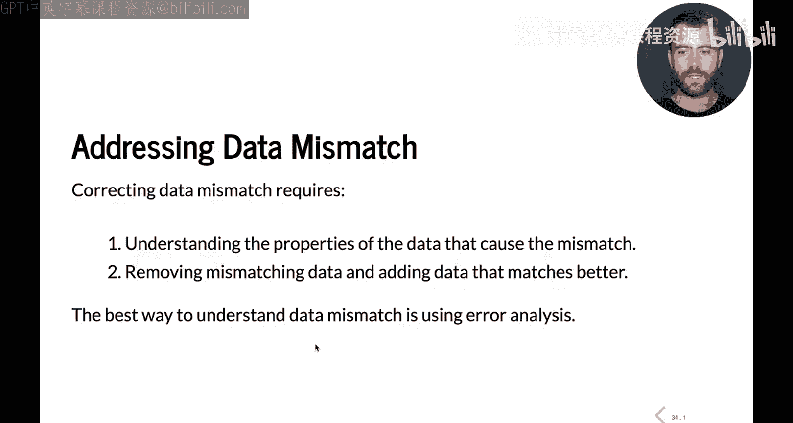