# 3：自回归模型 🧠

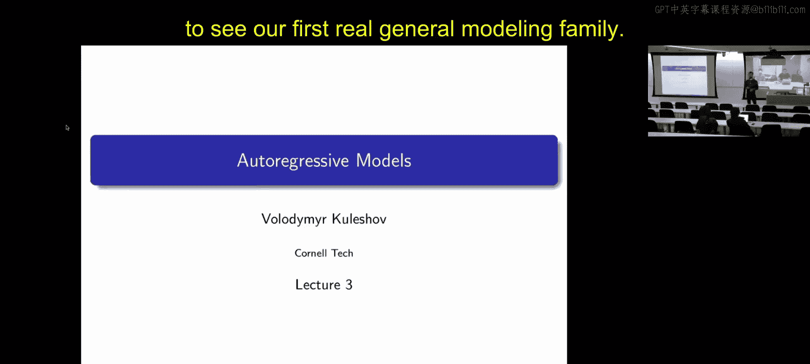

在本节课中，我们将要学习第一类生成模型家族——自回归模型。我们将从概率分布的基本表示方法开始，逐步深入到如何使用神经网络来参数化这些模型，并探讨其在图像和序列数据上的应用。

---

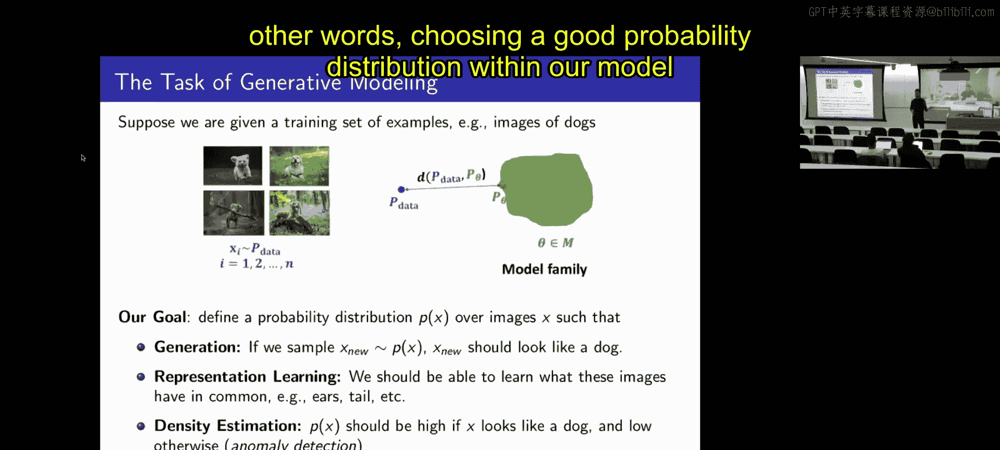

## 概述 📋

生成建模的目标是学习一个能够描述高维数据（如图像、音频、文本）的概率分布。在前两讲中，我们定义了生成建模的任务，并介绍了所需的背景知识。现在，我们将正式开始学习第一个具体的生成模型家族：自回归模型。

自回归模型的核心思想是利用概率的链式法则，将联合概率分布分解为一系列条件概率的乘积，并使用神经网络来参数化每个条件概率。

---

## 背景回顾：概率分布的表示 🔄

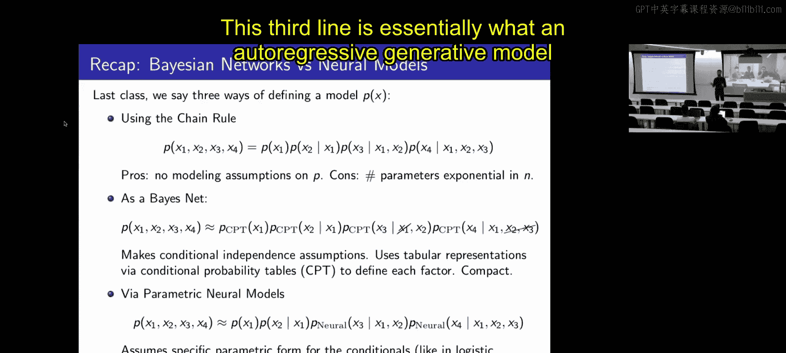

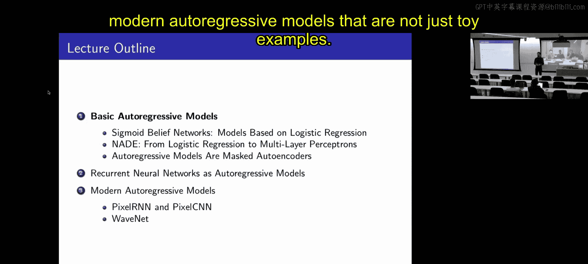

在上一讲中，我们回顾了几种表示概率分布的经典方法。对于一个包含多个变量（例如 `x1, x2, x3, x4`）的联合分布 `P(x1, x2, x3, x4)`，我们可以应用链式法则进行分解：

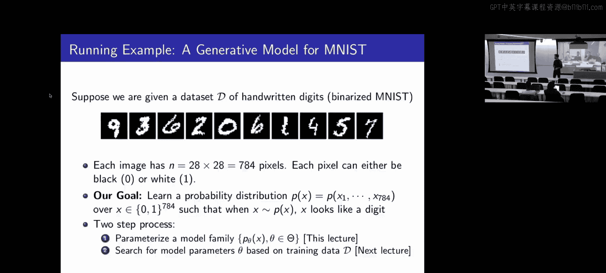

**公式：**
```
P(x1, x2, x3, x4) = P(x1) * P(x2 | x1) * P(x3 | x1, x2) * P(x4 | x1, x2, x3)
```

这种分解的优点是它没有对分布 `P` 做任何假设，可以表示任何分布。然而，如果每个变量 `Xi` 只有两种可能的结果，那么所需的参数数量会随着变量数量的增加而指数级增长，这就是所谓的“维度灾难”。

为了应对维度灾难，我们可以采取两种策略：
1.  **简化模型**：做出条件独立性假设，减少每个条件概率所依赖的变量数量。
2.  **参数化模型**：使用参数化模型（如逻辑回归或神经网络）来近似每个条件概率，而不是使用庞大的概率表。

自回归生成模型主要采用第二种策略。

---

## 任务定义：手写数字建模 ✍️

为了具体说明，本讲的大部分示例将围绕一个任务展开：对手写数字图像进行建模。我们将使用二值化的 MNIST 数据集，其中每张图像是 28x28 像素，每个像素值为 0（白）或 1（黑）。因此，我们的目标是定义一个包含 784 个二值变量的概率分布。

---

## 自回归模型的核心思想 💡

自回归模型严格遵循链式法则分解。对于由 `n` 个变量 `x1, ..., xn` 组成的数据点，其联合概率为：

**公式：**
```
P(x1, ..., xn) = ∏_{i=1}^{n} P(xi | x1, ..., x_{i-1})
```

模型的关键在于，我们使用一个神经网络 `P_neural` 来参数化每个条件概率 `P(xi | x1, ..., x_{i-1})`。这个神经网络的任务是：给定所有先前的变量（像素），预测下一个变量（像素）的值或概率。

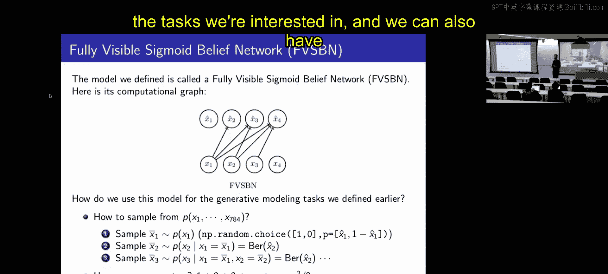

我们通常用 `x_i_hat` 来表示这个预测值，它既是神经网络对第 `i` 个像素的预测，也是该像素条件伯努利分布的参数。

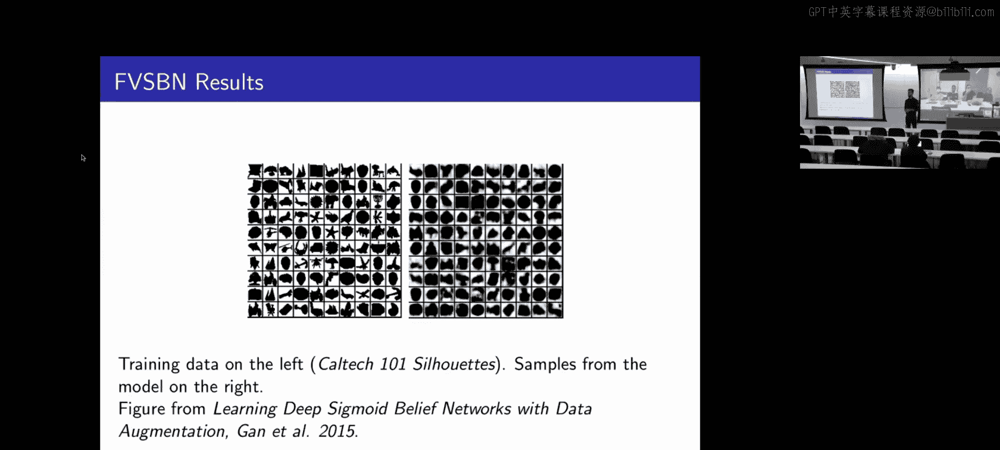

---

## 基础示例：全可见Sigmoid信念网络 🧮

首先，我们来看一个最简单的自回归模型：全可见Sigmoid信念网络。在这个模型中，我们使用简单的逻辑回归来参数化每个条件概率。

**模型定义：**
*   对于第一个像素 `x1`，我们直接用一个概率表表示 `P(x1)`。
*   对于后续的像素 `xi`，我们使用一个逻辑回归模型来预测 `P(xi = 1 | x1, ..., x_{i-1})`。

**公式：**
```
x_i_hat = σ(α_i · [x1, ..., x_{i-1}] + b_i)
```
其中 `σ` 是 sigmoid 函数，`α_i` 是权重向量，`b_i` 是偏置项。`x_i_hat` 就是像素 `xi` 为 1 的预测概率。

**模型能力：**
*   **密度估计**：给定一张完整图像，我们可以通过计算每个像素在其对应条件分布下的概率，并将它们相乘，得到整张图像的概率。
*   **采样生成**：我们可以进行“祖先采样”。首先从 `P(x1)` 采样得到 `x1`，然后根据 `P(x2 | x1)` 采样得到 `x2`，依此类推，直至生成整张图像。

**参数数量**：该模型大约有 `O(n^2)` 个参数（`n` 为像素数），这虽然比指数级好，但对于大图像仍然较多。

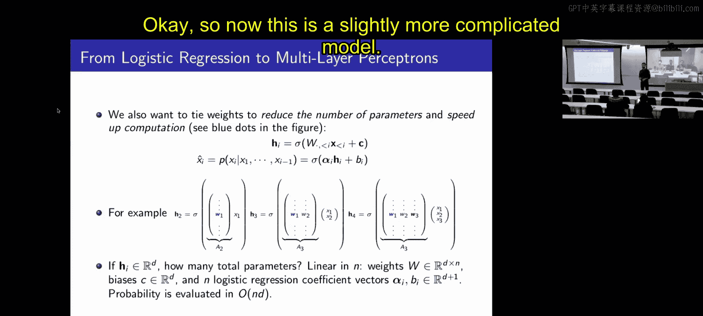

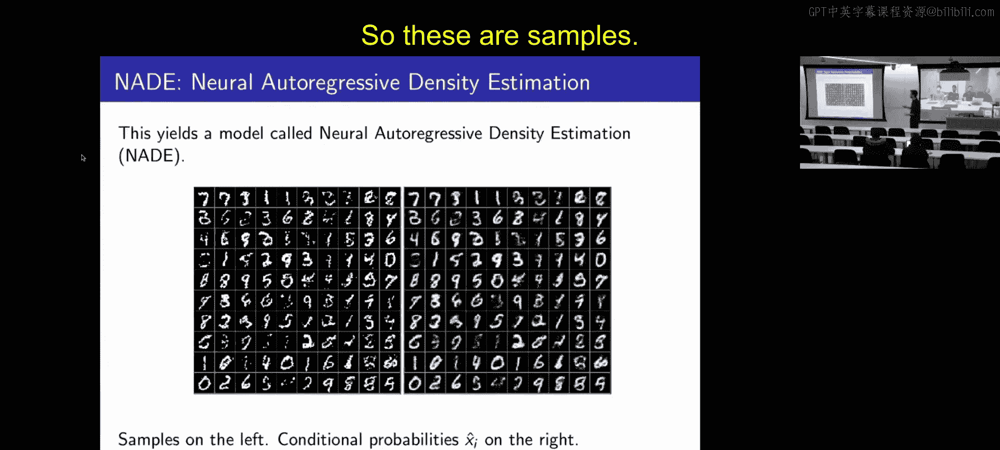

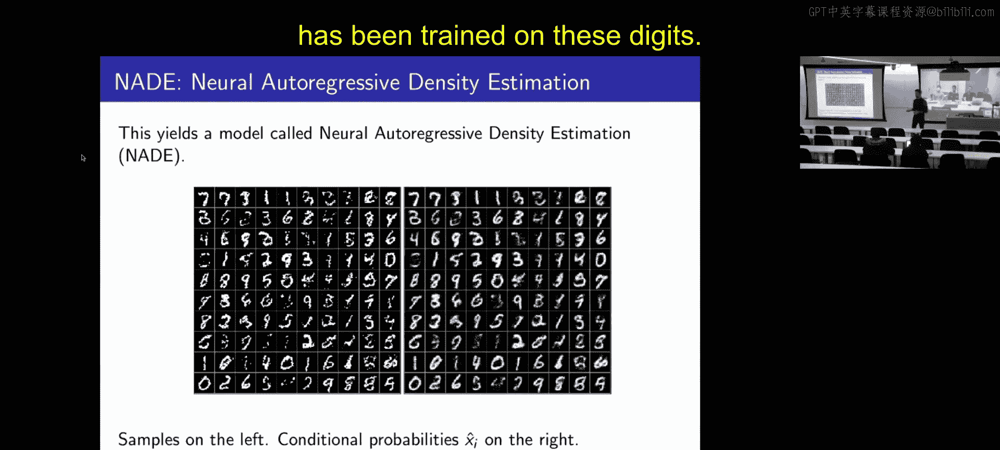

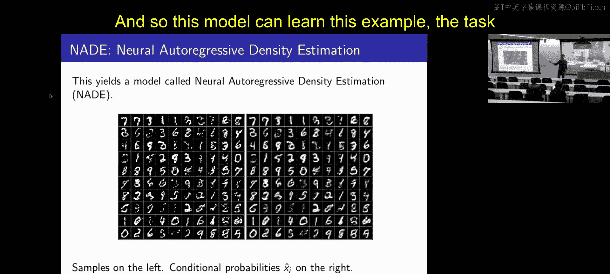

---


## 进阶模型：神经自回归密度估计器 (NADE) 🧠➡️🧠

为了提升模型的表达能力，我们可以用更强大的多层感知机来代替简单的逻辑回归。

**模型定义：**
现在，每个条件概率 `P(xi | x1, ..., x_{i-1})` 由一个 MLP 来参数化。

**公式：**
```
h_i = g(A_i · [x1, ..., x_{i-1}] + c)
x_i_hat = σ(α_i · h_i + b_i)
```
其中 `g` 是非线性激活函数（如 ReLU），`h_i` 是隐藏层表示。

为了减少参数量并提高效率，我们引入了**权重共享**。我们不再为每个条件概率分配独立的矩阵 `A_i`，而是使用一个大的共享权重矩阵 `W`，`A_i` 只是 `W` 的前 `i-1` 列。

**参数数量**：通过权重共享，参数量减少到大约 `O(n * D)`，其中 `D` 是隐藏层大小。

---

## 与自编码器的关联 🔗

自回归模型在结构上类似于**掩码自编码器**。一个标准的自编码器试图重建整个输入，其输出层的每个单元都依赖于所有输入单元。为了将其转化为自回归模型，我们需要“掩码”掉那些从未来时间步到当前预测的连接，确保预测 `xi` 时只使用 `x1, ..., x_{i-1}` 的信息。这通常通过将权重矩阵中相应的项设置为零来实现。

---

## 基于循环神经网络的自回归模型 🔄

当处理序列数据（如文本、时间序列、长音频）时，输入长度可能很大或可变。直接应用前述方法会导致历史信息向量过长。循环神经网络提供了一种解决方案。

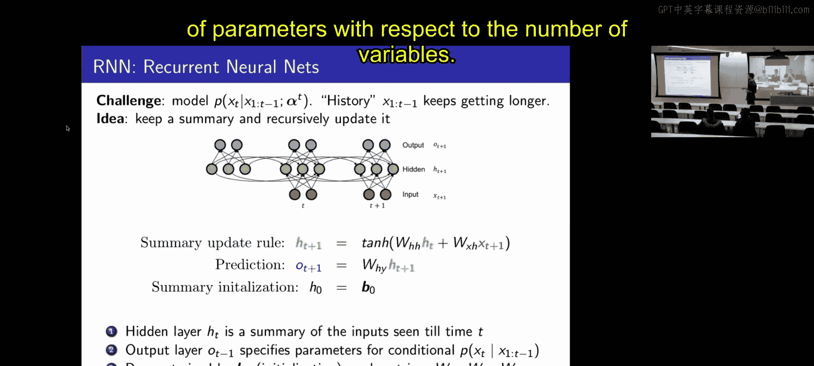

**核心思想**：RNN 维护一个隐藏状态 `h_t`，该状态总结了到时间 `t` 为止的历史信息。预测下一个变量 `x_{t+1}` 不再直接依赖于所有过去的原始变量，而是依赖于这个隐藏状态 `h_t`。

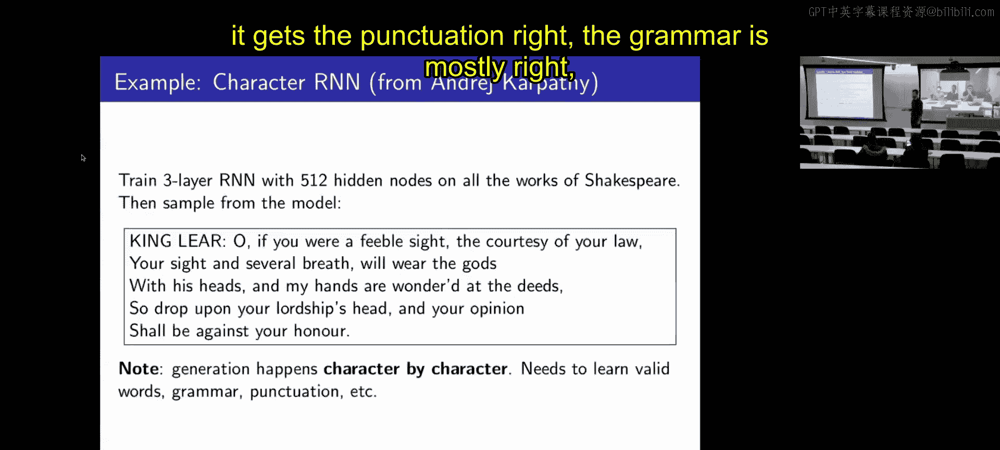

**更新与预测：**
```
h_{t+1} = f(h_t, x_{t+1}) // 更新隐藏状态
x_{t+1}_hat = softmax(V * h_{t+1} + d) // 预测下一个符号（如字符）的概率分布
```

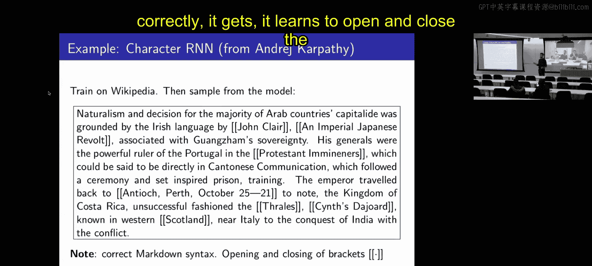

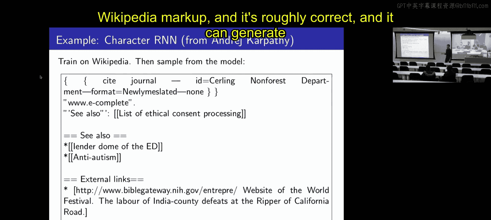

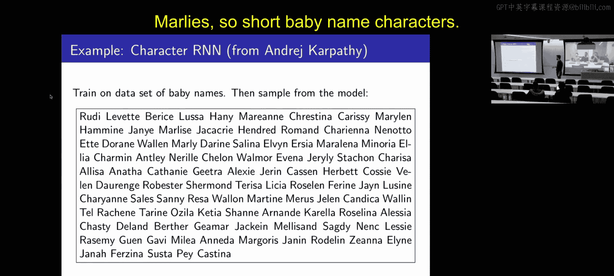

**优点**：
*   可处理任意长度的序列。
*   参数量恒定，不随序列长度增长。

**缺点**：
*   训练中存在梯度消失/爆炸问题，通常需要 LSTM 或 GRU 等变体。
*   序列生成过程是串行的，速度较慢。

---

## 现代架构：WaveNet 与 PixelCNN 🎵🖼️

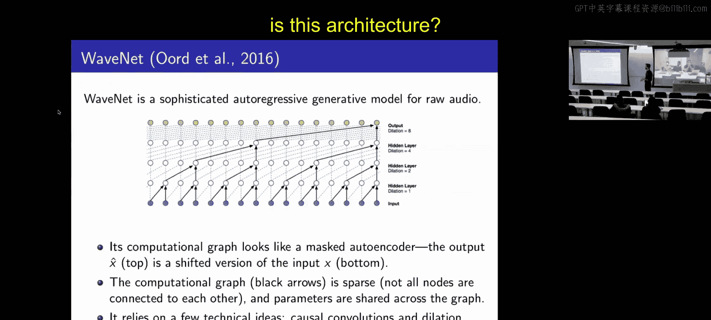

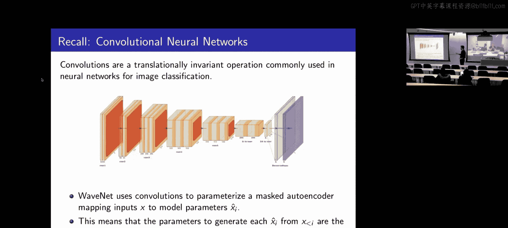

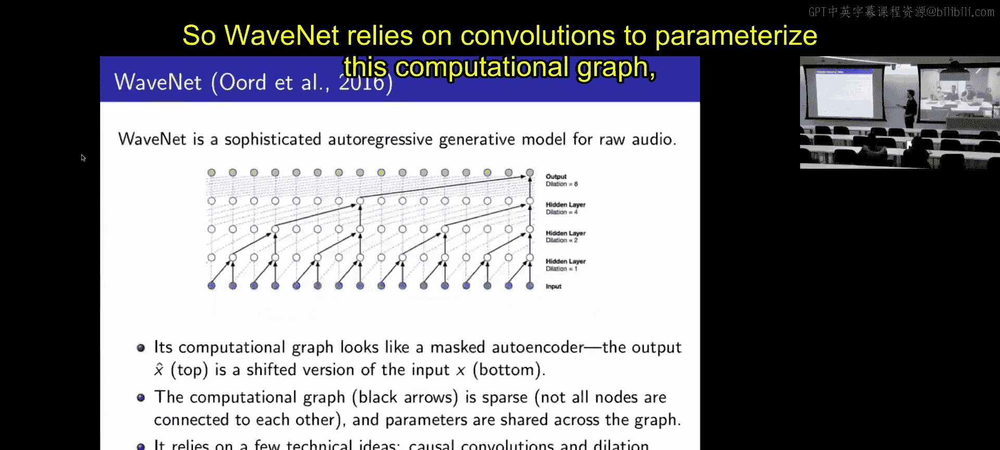

这些是应用于特定领域（音频、图像）的高性能自回归模型，它们都基于**掩码卷积**。

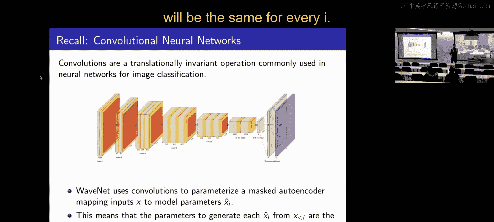

**WaveNet（用于音频）**：
*   **因果卷积**：确保卷积核只关注当前及过去的时间步，不“窥见”未来。
*   **膨胀卷积**：通过间隔采样扩大感受野，让模型能够捕获长距离的依赖关系，而无需显著增加参数量。
*   结构上是一个深度卷积网络，每一层都使用因果膨胀卷积，最终输出下一个音频样本的概率分布。

**PixelCNN（用于图像）**：
*   将因果卷积的概念扩展到二维图像。使用**掩码卷积核**，确保在预测某个像素时，卷积操作只涉及该像素左上方的像素（取决于定义的扫描顺序，如从左到右、从上到下）。
*   通过堆叠多层掩码卷积，模型可以捕获图像中复杂的空间依赖关系。

---

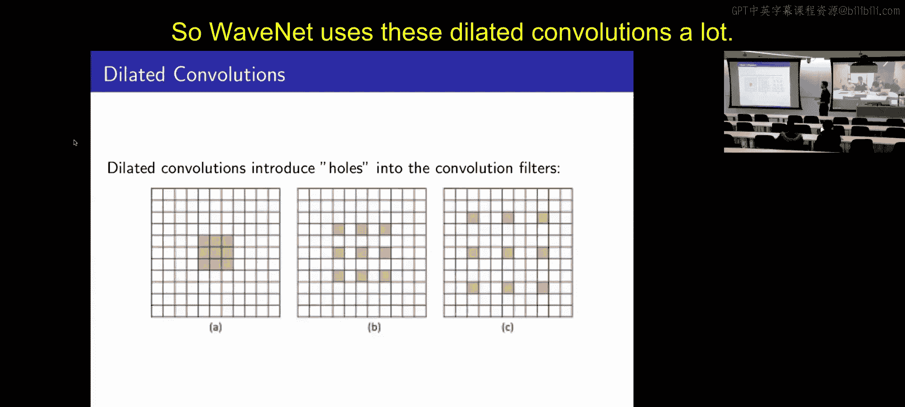

## 自回归模型总结 📊

以下是自回归模型主要特性的总结：

**优点：**
*   **原理直观**：基于概率的链式法则，概念清晰。
*   **似然计算易处理**：可以精确计算数据点的概率密度，便于密度估计和异常检测。
*   **采样过程简单**：通过祖先采样，可以顺序生成数据。
*   **可扩展至连续变量**：只需将伯努利分布替换为其他分布（如高斯分布）。

**局限：**
*   **顺序生成**：采样速度慢，无法并行。
*   **顺序依赖**：模型性能受变量顺序影响。
*   **表征学习能力有限**：没有显式的、压缩的潜变量来表示数据的高级特征。

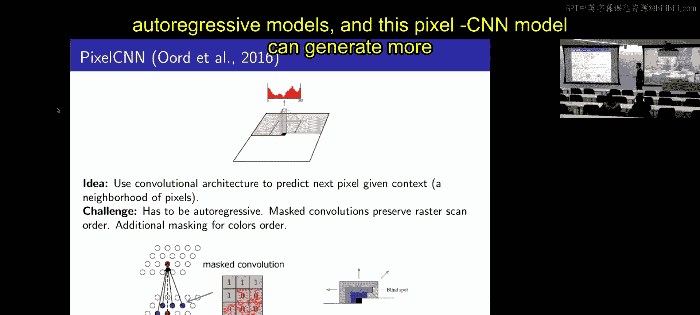

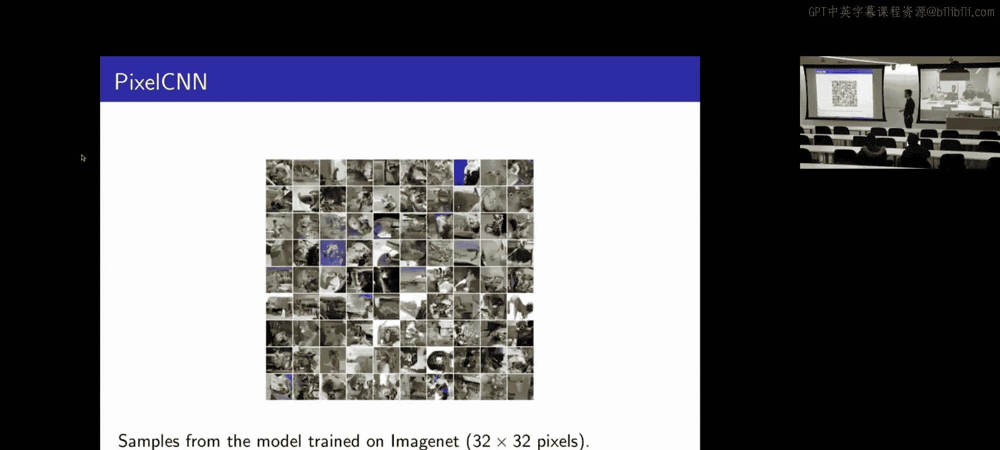

---

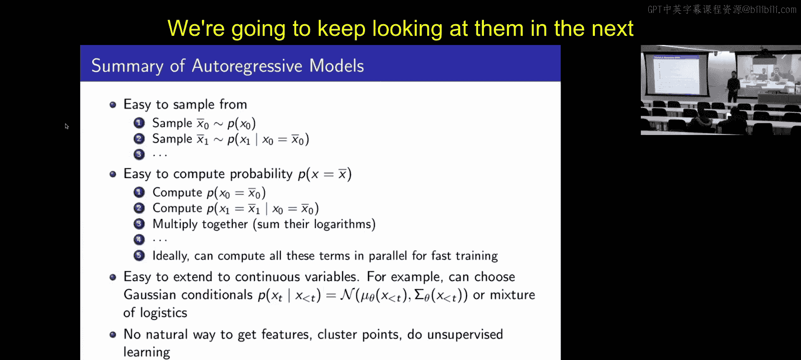

本节课中，我们一起学习了自回归生成模型的基本框架、从简单的逻辑回归参数化到复杂的基于 RNN 和掩码卷积的现代架构。我们了解了它们如何通过链式法则和神经网络来定义概率分布，并用于密度估计和序列生成。在下一讲中，我们将探讨如何通过最大似然估计来训练这些模型。