# 10：GANs高级主题 🧠

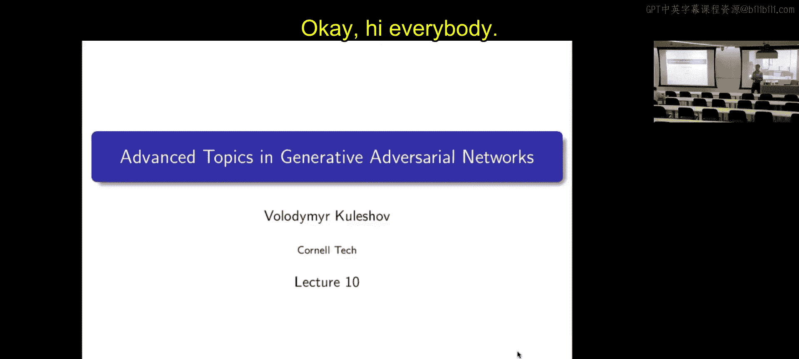

在本节课中，我们将深入学习生成对抗网络（GANs）的高级主题。我们将回顾GANs的核心概念，探讨其训练中的挑战，并介绍一些改进方法，包括使用不同的散度（Divergence）进行优化、在GANs中进行隐变量推断，以及一个有趣的应用——无配对图像翻译（CycleGAN）。

## GANs核心概念回顾

上一节我们介绍了生成对抗网络（GANs）的基本框架。本节中，我们来看看其核心机制和面临的挑战。

GANs可以看作是两个神经网络之间的博弈：一个生成器（Generator）和一个判别器（Discriminator）。生成器定义了一个概率模型，它将来自简单输入空间（如高斯分布）的样本 `z` 映射到我们试图建模的输出空间（如图像）。其映射关系为：
`x = G_θ(z)`
这里的 `G_θ` 是一个采样器或模拟器，它直接输出样本 `x`，而不是输出一个分布参数。这种“隐式”定义分布的方式提供了极大的灵活性，因为我们无需指定概率密度 `p(x)` 的具体公式。

然而，由于没有 `log p(x)` 的显式公式，我们无法使用标准的最大似然估计进行优化。因此，GANs采用了一种基于“双样本检验”的学习过程。判别器 `D` 充当一个可学习的统计量，用于区分来自真实数据分布 `p_data` 的样本和来自生成器分布 `p_G` 的样本。生成器的目标是生成足以“欺骗”判别器的样本，使得判别器无法区分真假。

训练过程是一个极小极大博弈（Minimax Game），目标函数如下：
`min_G max_D V(D, G) = E_{x~p_data}[log D(x)] + E_{z~p(z)}[log(1 - D(G(z)))]`

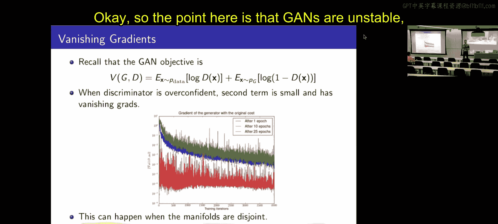

以下是训练步骤：
1.  从训练集中采样一个真实数据的小批量 `x`。
2.  从先验分布 `p(z)` 中采样一个噪声向量小批量 `z`。
3.  将 `z` 输入生成器，得到假数据 `G(z)`。
4.  更新判别器参数，以最大化其区分真假数据的能力（即最大化 `V(D, G)` 中的 `D` 部分）。
5.  更新生成器参数，以最小化判别器对其的识别能力（即最小化 `log(1 - D(G(z)))`）。

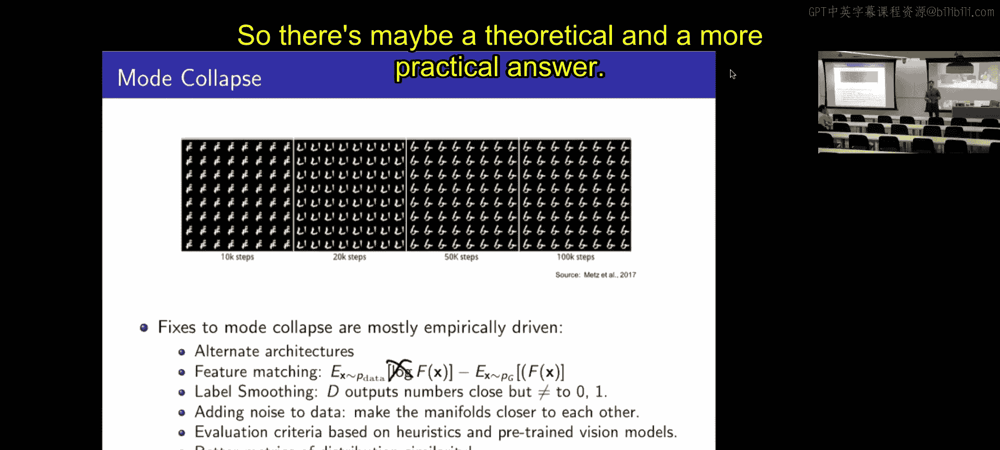

## GANs的训练挑战与失败模式

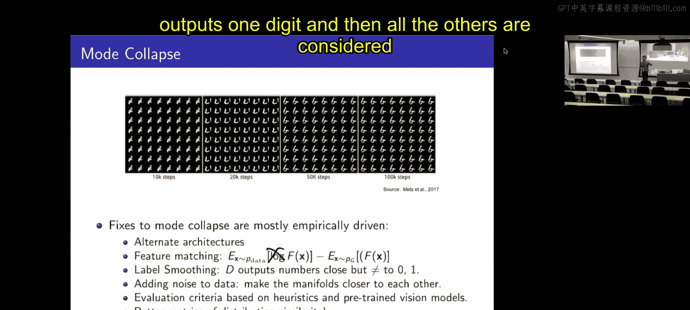

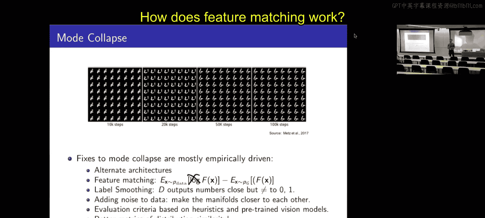

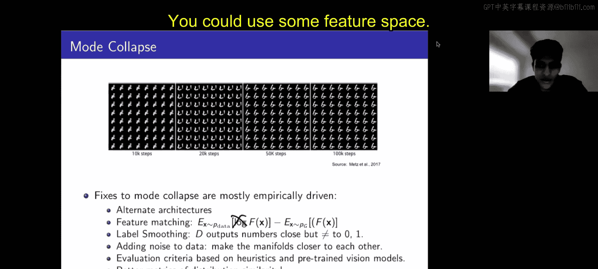

尽管GANs非常强大，但其训练过程复杂且不稳定。一个常见问题是**梯度消失**（Vanishing Gradient）。当判别器过于自信（例如，在训练初期，生成器还很差时），对于假数据 `D(G(z))` 的输出会接近0。这使得损失函数 `log(1 - D(G(z)))` 的梯度变得非常小，导致生成器几乎无法更新。

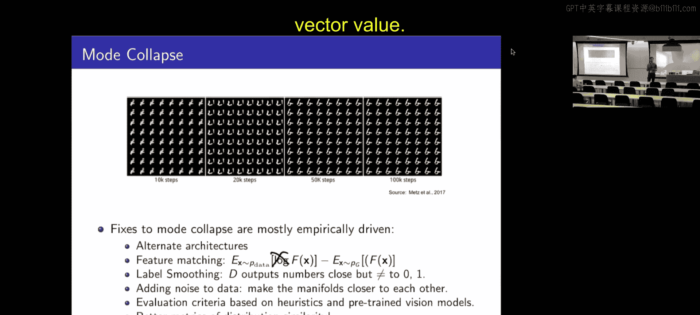

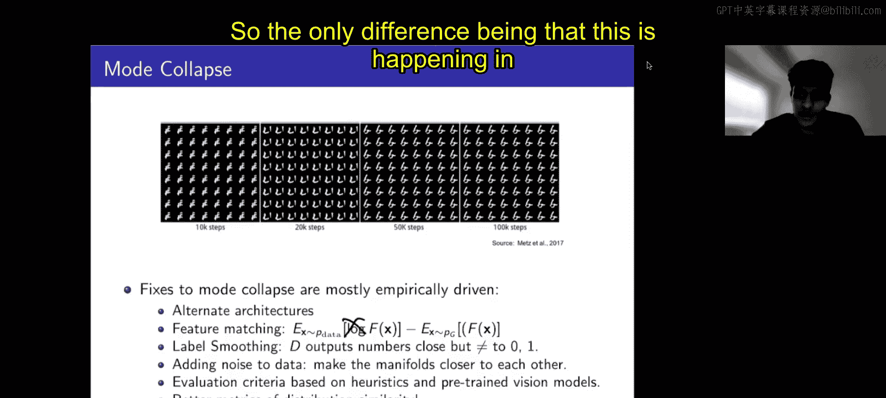

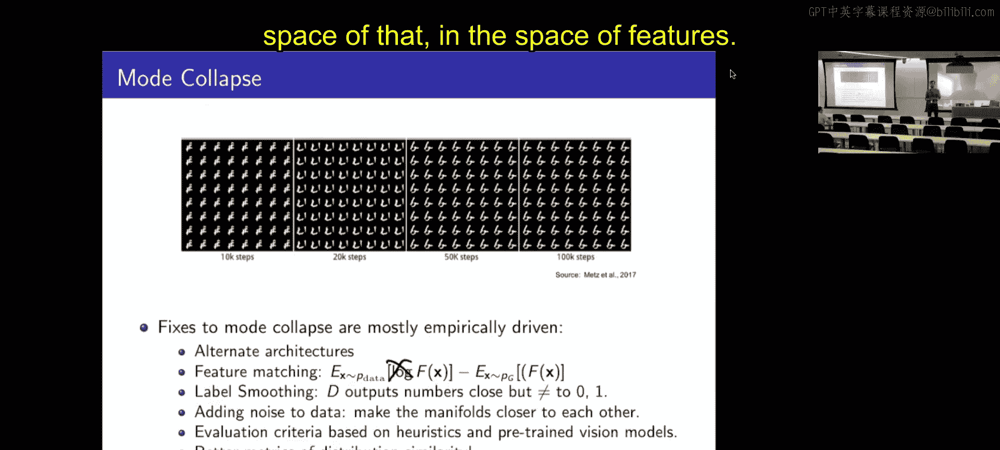

另一个常见问题是**模式崩溃**（Mode Collapse）。生成器可能只学会生成数据分布中的一小部分模式（例如，只生成数字“1”），而忽略了其他模式。这通常是因为优化过程陷入了不良的局部最优，生成器发现只专注于欺骗当前判别器的最简单方式就是反复生成同一样本。

为了解决这些问题，研究者提出了许多启发式技巧：
*   **标签平滑**（Label Smoothing）： 不将真实/假标签严格设为1/0，而是设为0.9/0.1等。
*   **添加噪声**： 向输入数据或判别器的输入添加噪声。
*   **特征匹配**（Feature Matching）： 不直接优化判别器的最终输出分数，而是尝试让生成数据在判别器中间层激活的统计特征上与真实数据匹配。

此外，还有更原则性的改进方法，例如**Wasserstein GAN**，它通过使用Wasserstein距离（或Earth Mover‘s Distance）作为目标函数，从根本上缓解了梯度消失和模式崩溃问题。

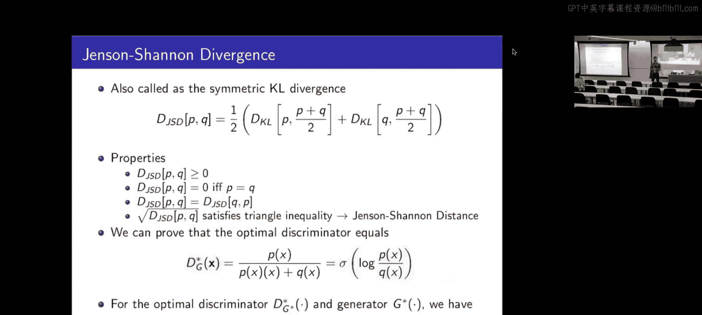

## 超越Jensen-Shannon散度：f-散度家族

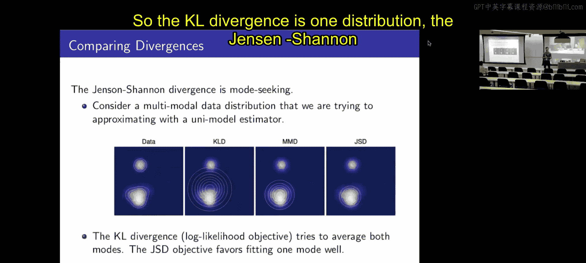

之前我们了解到，GANs在理论上优化的是Jensen-Shannon散度。但这是唯一的选择吗？本节中，我们来看看更广泛的散度家族——f-散度（f-divergence），并了解如何在GAN框架中优化它们。

f-散度是一类通用的分布差异度量，定义为：
`D_f(P || Q) = E_{x~Q}[ f( P(x)/Q(x) ) ]`
其中 `f` 是一个凸函数且满足 `f(1)=0`。许多常见的散度都是f-散度的特例：
*   **KL散度**： 当 `f(t) = t log t` 时。
*   **反向KL散度**： 当 `f(t) = -log t` 时。
*   **Jensen-Shannon散度**： 当 `f(t) = -(t+1)log((1+t)/2) + t log t` 时。
*   **总变差距离**： 当 `f(t) = 0.5|t-1|` 时。

为了在GAN中优化任意的f-散度，我们需要引入一个数学工具：**凸共轭**（Convex Conjugate， 或Fenchel共轭）。对于一个凸函数 `f`，其凸共轭 `f*` 定义为：
`f*(t) = sup_{u∈dom_f} { ut - f(u) }`
直观上，`f*(t)` 给出了斜率为 `t` 且与函数 `f` 相切的直线在y轴上的截距。凸共轭具有对偶性：`(f*)* = f`。

利用凸共轭，我们可以将f-散度重写为一个与GAN目标类似的形式：
`D_f(P || Q) = sup_T { E_{x~P}[T(x)] - E_{x~Q}[f*(T(x))] }`
这里，`T(x)` 是一个函数。如果我们用神经网络 `D(x)` 来参数化 `T(x)`，并像在标准GAN中一样，将 `P` 视为真实数据分布，`Q` 视为生成器分布 `G(z)`，那么我们就得到了一个通用的**f-GAN**框架。

其训练目标同样是极小极大博弈：
`min_G max_D { E_{x~p_data}[D(x)] - E_{z~p(z)}[f*(D(G(z)))] }`
通过为 `f` 选择不同的凸函数，我们可以让GAN优化KL散度、JS散度等多种目标，这为模型设计提供了更大的灵活性。

## GANs中的隐变量推断

GANs本质上是隐变量模型，它定义了从隐变量 `z` 到数据 `x` 的映射。那么，我们能否像变分自编码器（VAE）那样，使用GAN进行表示学习，即根据数据 `x` 推断其对应的隐变量 `z` 呢？本节中，我们探讨两种方法。

由于生成器 `G` 的映射通常不是可逆的，我们无法直接计算 `z = G^{-1}(x)`。一种启发式方法是利用判别器。判别器是一个在区分任务上训练的神经网络，其中间层的激活通常能学习到数据的有用表示。因此，我们可以截断判别器的最后一层，使用其倒数第二层的激活作为输入 `x` 的特征表示。

更原则性的方法是**双向GAN**（BiGAN）。BiGAN在标准GAN的基础上增加了一个编码器网络 `E`，它将数据 `x` 映射回隐空间 `z`。模型的目标是让联合分布 `(z, G(z))`（来自生成过程）和 `(E(x), x)`（来自编码过程）变得不可区分。

具体来说，我们引入一个判别器 `D`，它接收数据对 `(z, x)` 作为输入，并尝试区分它们来自哪个分布：
*   真实对：从先验采样 `z`，然后生成 `x = G(z)`。
*   编码对：从数据分布采样 `x`，然后编码 `z = E(x)`。

判别器 `D` 的目标是正确区分这两类对，而生成器 `G` 和编码器 `E` 的共同目标是“欺骗”判别器，使得它无法区分。当训练收敛时，编码器 `E` 学到的分布 `E(x)` 应该接近真实的先验分布 `p(z)`，从而为数据 `x` 提供了有意义的隐表示。尽管BiGAN训练更具挑战性，但它从原理上证明了在GAN框架内进行隐变量推断是可行的。

## 应用：无配对图像翻译（CycleGAN）

最后，我们来看一个GAN的精彩应用：**无配对图像翻译**。假设我们有两个图像域 `X`（如照片）和 `Y`（如油画），我们想学习一个模型将 `X` 中的图像翻译到 `Y`，反之亦然。但我们的训练数据中并没有成对的 `(x, y)` 样本。

**CycleGAN** 通过引入“循环一致性”损失巧妙地解决了这个问题。模型包含两个生成器：
*   `G: X -> Y` （将照片转为油画）
*   `F: Y -> X` （将油画转为照片）

以及两个分别对应域 `X` 和 `Y` 的判别器 `D_X` 和 `D_Y`。损失函数包含三部分：
1.  **对抗损失**： 确保 `G(x)` 看起来像 `Y` 域的图像，`F(y)` 看起来像 `X` 域的图像。
2.  **循环一致性损失**： 这是关键。它要求翻译后再翻译回来应该能恢复原图，即 `F(G(x)) ≈ x` 且 `G(F(y)) ≈ y`。这迫使生成器在改变域特定风格（如纹理、颜色）的同时，保留输入图像的原始内容（如结构、形状）。

循环一致性损失通常使用L1范数：
`L_cyc(G, F) = E_{x~p_data(x)}[||F(G(x)) - x||_1] + E_{y~p_data(y)}[||G(F(y)) - y||_1]`

通过结合对抗损失和循环一致性损失进行训练，CycleGAN能够实现令人惊叹的跨域翻译，例如将马变成斑马、将照片变成莫奈风格的画作，而无需任何成对的训练数据。

## 总结

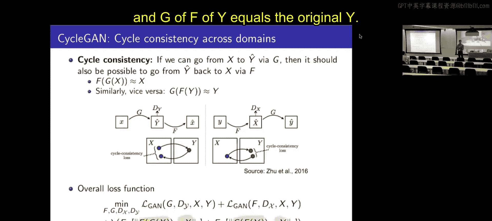

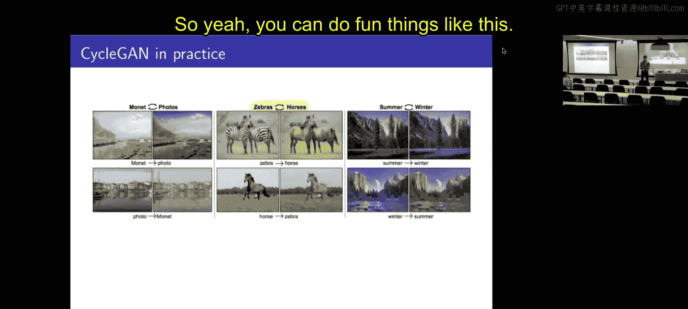

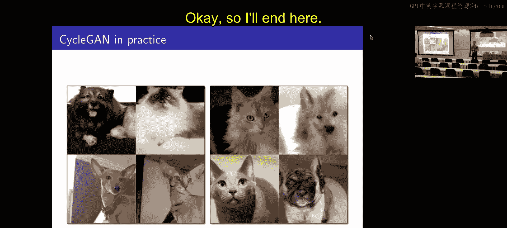

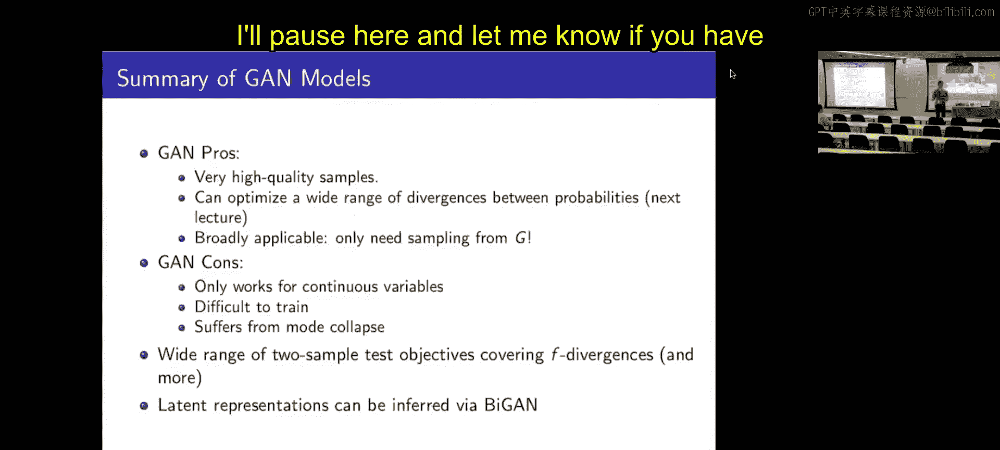

本节课中，我们一起深入探讨了生成对抗网络（GANs）的高级主题。我们回顾了GANs通过隐式建模和对抗训练提供的灵活性，同时也分析了其训练不稳定、梯度消失和模式崩溃等挑战。我们介绍了更广泛的f-散度家族，并了解了如何通过f-GAN框架优化任意f-散度。我们还探讨了在GANs中进行隐变量推断的两种方法：启发式的判别器特征提取和原则性的双向GAN（BiGAN）。最后，我们学习了一个精彩的应用——CycleGAN，它利用循环一致性损失实现了无需配对数据的跨域图像翻译。尽管GANs训练困难，但其强大的生成能力和广泛的应用前景使其成为深度生成模型中不可或缺的一部分。