# 15：组合生成模型家族 🧩

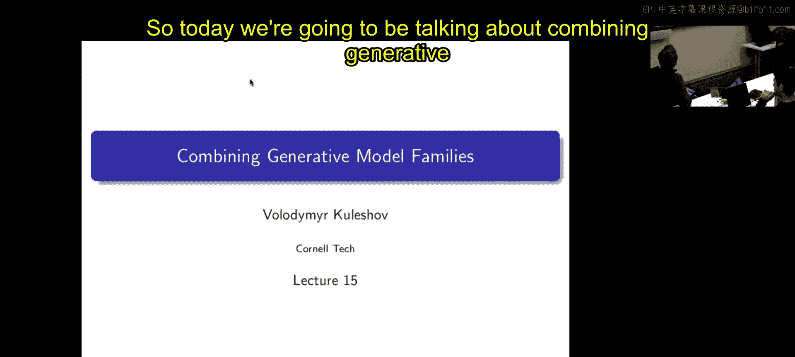

在本节课中，我们将学习如何将本学期介绍过的不同生成模型家族组合起来，创造出兼具多种优势的新模型。我们将探讨自回归模型、变分自编码器、流模型、生成对抗网络和扩散模型之间的多种组合方式，并了解这些组合如何解决单一模型难以处理的问题。

---

## 模型家族与任务回顾

上一节我们介绍了多种生成模型。首先，让我们回顾一下本学期探讨过的不同生成建模任务和模型家族。

我们主要关注三类任务：
1.  **生成**：给定一个数据集（如图像），生成与训练集相似的新样本。
2.  **密度估计**：通过最小化某种目标（通常是KL散度，等价于最大化对数似然），尝试用模型分布恢复数据分布。
3.  **表示学习**：学习数据的有意义、紧凑的潜在表示。

不同的模型家族在这些任务上各有优劣。例如，自回归模型、流模型、GAN、基于分数和扩散模型都擅长生成；自回归模型和流模型特别适合密度估计；而变分自编码器等潜变量模型则专为表示学习设计。

本课程的核心问题是：**我们能否组合这些不同的模型家族，创造出兼具各方优点的新模型？** 本节课将概述过去六七年中尝试组合不同模型思想的几篇论文，为你提供构建更复杂模型的灵感。

---

## 组合自回归模型与潜变量模型

自回归模型在密度估计和生成上非常有效，但它们通常没有潜变量，因此在表示学习上可能不足。变分自编码器擅长表示学习。我们可以尝试结合两者，获得双重优势。

### 变分自编码器快速回顾

在潜变量模型中，我们有两组变量：潜变量 **Z** 和观测变量 **X**。我们使用神经网络参数化从 **Z** 到 **X** 的映射。在变分自编码器中，我们设定先验 **P(Z)**，并使用神经网络定义似然 **P(X|Z)**。由于边缘似然难以计算，我们使用变分推断，引入近似后验 **Q(Z|X)**，并优化证据下界。

### PixelVAE：将解码器变为自回归模型

一种结合方式是 **PixelVAE**。它本质上是一个变分自编码器，但其解码器 **P(X|Z)** 是一个 **PixelCNN**（一种针对图像的自回归模型）。这意味着，给定潜变量 **Z**，图像 **X** 的生成是以自回归的方式，逐个像素进行的，并且每个像素的条件分布都依赖于 **Z**。

以下是其架构关键点：
*   **解码器**：将上采样后的潜变量张量 **Z** 与图像通道拼接，然后输入标准的 PixelCNN 网络。
*   **编码器**：使用标准卷积网络将图像下采样为潜变量表示 **Z**。

这种组合的优势在于，它既能像变分自编码器一样学习有意义的潜表示，又能像自回归模型一样获得很高的对数似然。此外，由于 **P(X|Z)** 是许多 PixelCNN 的混合，每个单独的 PixelCNN 可以更小，从而可能提高效率。

然而，PixelVAE 面临一个挑战：如果解码器（PixelCNN）过于强大，模型可能会学会完全忽略潜变量 **Z**，仅用自回归部分就能很好地建模数据。这是一种实际的失败模式，需要在工程上额外注意。我们将在本节末尾讨论应对方法。

### 变分RNN：为序列数据引入潜变量

对于序列数据（如时间序列），我们可以用不同的方式组合自回归和潜变量模型。**变分RNN** 为每个时间步 **t** 引入一个潜变量 **Z_t**，而不是像 PixelVAE 那样使用一个全局潜变量。

其概率分布分解如下：
*   每个时间步的观测 **X_t** 依赖于当前及过去的潜变量。
*   潜变量 **Z_t** 本身也遵循一个自回归过程。

我们可以使用循环神经网络来参数化这个模型：
1.  RNN的隐藏状态 **H** 在每个时间步演化。
2.  由 **H** 通过一个全连接层输出当前潜变量 **Z_t** 的分布参数（均值和方差）。
3.  从该分布采样得到 **Z_t**（训练时使用重参数化技巧）。
4.  将 **Z_t** 和 **H** 输入另一个网络，生成观测 **X_t** 的分布。
5.  将 **X_t** 和 **Z_t** 反馈给RNN，更新隐藏状态 **H**。

训练时，我们同样使用变分推断，编码器 **Q(Z_t | H, X_t)** 也是一个基于RNN的网络。这种方法非常适合建模视频帧或时间序列等数据。

---

## 组合流模型与变分自编码器

流模型是另一种潜变量模型，它通过一个可逆的双射函数 **F** 将潜变量 **Z** 映射到观测变量 **X**。由于其可逆性，我们可以精确计算数据的对数似然。

### 流模型作为更强大的编码器

在标准变分自编码器中，近似后验 **Q(Z|X)** 通常是一个简单的（对角）高斯分布。这限制了其表达能力，导致证据下界不够紧致。我们可以使用 **流模型** 来构建一个更强大的 **Q(Z|X)**。

具体做法是：让编码器输出一个高斯分布的参数，然后从这个高斯分布采样得到一个初始潜变量 **Z'**，再将 **Z'** 通过一个可逆的流模型 **F**，得到最终的潜变量 **Z**。这样，**Q(Z|X)** 就不再是简单的高斯，而可以是多模态或形状复杂的分布，从而能更好地逼近真实后验 **P(Z|X)**。

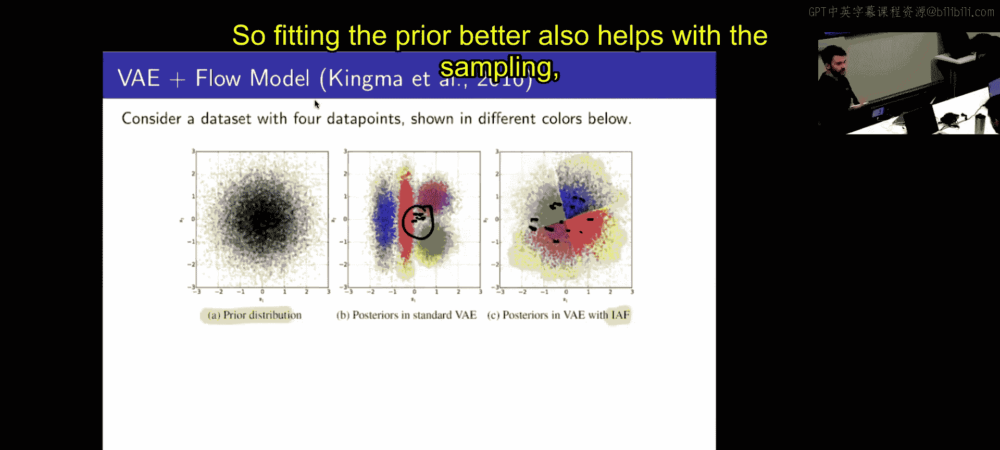

特别是，使用 **逆自回归流** 非常适合这个场景，因为我们需要在模型采样下评估KL散度。通过这种方式，我们可以让近似后验的样本更紧密地匹配先验分布，从而得到更紧致的下界和更好的生成样本。

### 多模态变分自编码器

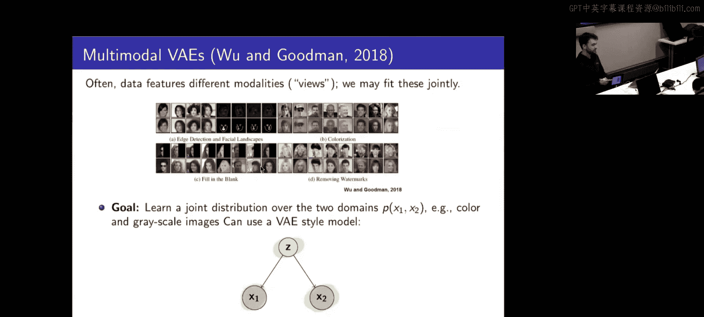

变分自编码器还可以扩展到处理多模态数据（如图像和对应文本、彩色图与灰度图）。其核心思想是让一个共享的潜变量 **Z** 捕捉所有模态的语义信息，而每个模态 **X_i** 在给定 **Z** 的条件下独立生成。这被称为 **多模态VAE**。

在训练时，即使某些模态的数据缺失，也可以通过巧妙的参数化（如基于专家乘积的方法）来高效计算近似后验 **Q(Z|{X_i})**，从而进行原则性的推断。

---

## 组合流模型与生成对抗网络

生成对抗网络通过一个判别器来训练生成器，优化的是Jensen-Shannon散度等目标，而不是直接的最大似然。

### FlowGAN：用GAN目标训练流模型

流模型因其可逆性，无论用什么目标训练，我们总能精确计算其对数似然。**FlowGAN** 实验尝试用标准的GAN损失来训练一个流模型（将其视为生成器）。

这样做的有趣之处在于，训练后我们既可以评估生成样本的质量（如使用初始分数），又可以计算模型的对数似然。实验结果表明：
*   当使用纯对抗损失训练时，模型能获得最好的样本质量（高初始分数），但其对数似然可能变得非常差，甚至发散到极大值。
*   当使用纯最大似然训练时，模型获得最好的对数似然，但样本质量较低。
*   通过混合两种目标（`λ * 对抗损失 + (1-λ) * 似然损失`），可以在两者之间取得权衡。

这再次实证了**样本质量与似然值之间可能完全无关**。

---

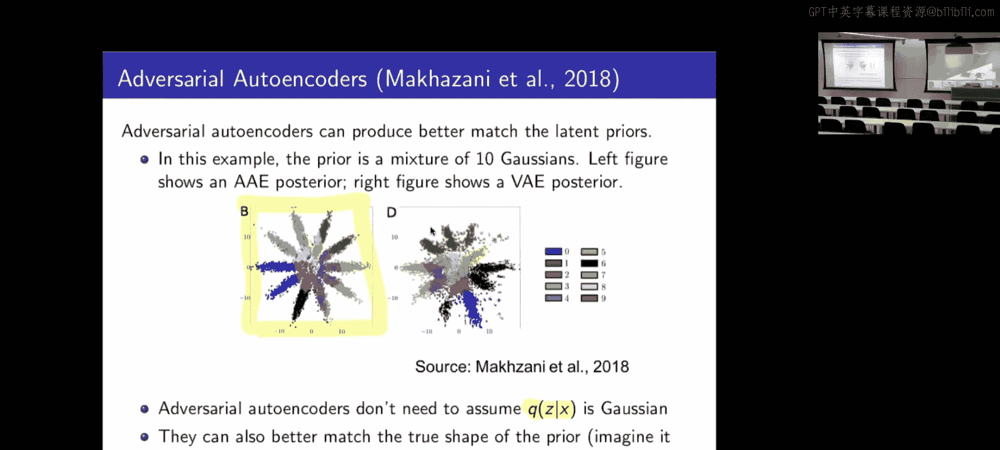

## 组合变分自编码器与生成对抗网络

### 在潜空间使用对抗损失：对抗自编码器

标准VAE在潜空间使用KL散度作为正则项，迫使近似后验 **Q(Z)** 匹配先验 **P(Z)**。我们可以将这里的KL散度替换为Jensen-Shannon散度（通过对抗训练实现），这就得到了 **对抗自编码器**。

**为什么这样做？**
就像在像素空间使用GAN损失能产生更清晰的图像一样，在潜空间使用对抗损失能让 **Q(Z)** 的样本更精确地匹配我们设定的先验形状（即使先验是复杂的，如星形或螺旋形）。同时，这相当于使用了一个隐式定义的、更灵活的 **Q(Z|X)**，因为它不再被限制为高斯形式。

### 解决“忽略潜变量”问题：互信息正则化

回顾PixelVAE中提到的失败模式：当解码器过于强大时，模型可能学会忽略潜变量。从数学上推导，VAE的证据下界可以重写为两个联合分布之间的KL散度。存在一种退化解：让解码器 **P(X|Z)** 不依赖 **Z**（完美建模数据），同时让编码器 **Q(Z|X)** 总是输出先验（完全忽略 **X**）。这同样能使证据下界最优，但没有进行任何有意义的潜变量推断。

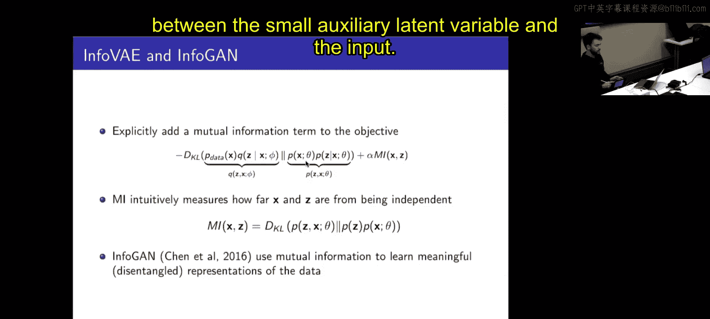

为了防止这种情况，我们可以添加一个 **互信息** 正则项。互信息衡量 **Z** 和 **X** 之间的依赖程度。我们希望最大化 **I(Z; X)**，从而鼓励模型使用潜变量 **Z** 来生成 **X**。

这项技术不仅用于VAE，也用于GAN。例如，**InfoGAN** 在GAN的生成器中引入了一个额外的低维潜变量 **C**，并最大化 **C** 与生成图像之间的互信息。这促使GAN学习用 **C** 来控制生成图像中有意义的、解耦的语义特征（如物体的姿态、光照、形状等）。

在VAE中，**β-VAE** 通过给KL正则项添加一个权重系数 **β**，也被证明可以隐式地增加互信息，从而有助于学习解耦的表示。

---

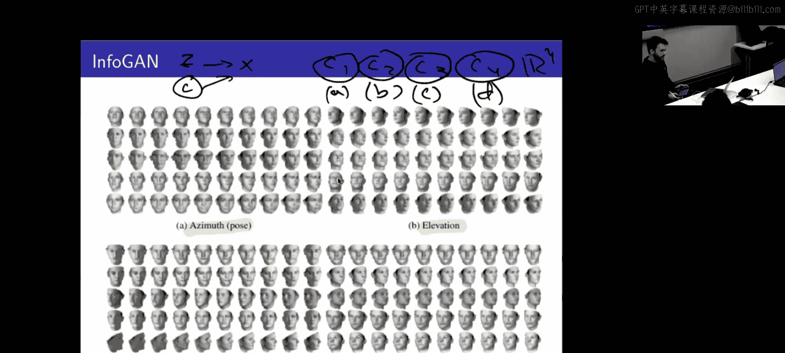

## 组合扩散模型与其他家族

### 潜在扩散模型

扩散模型直接在像素空间操作高维数据（如图像）计算量很大。**潜在扩散模型** 提出在变分自编码器的**潜空间**中进行扩散过程。

工作流程如下：
1.  使用一个预训练的VAE编码器将图像 **X** 压缩到低维潜变量 **Z**。
2.  在潜空间 **Z** 中进行前向扩散（加噪）和反向去噪过程。
3.  去噪完成后，使用VAE解码器将潜变量 **Z** 重建回像素空间图像 **X**。

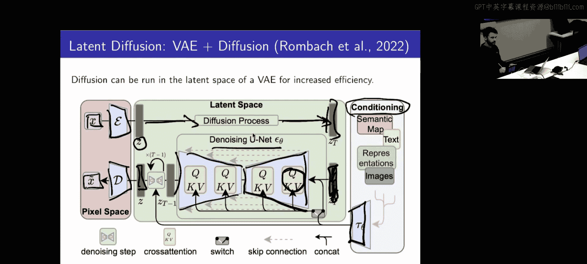

这样做大大降低了计算成本，因为去噪U-Net现在处理的是低维潜变量。**Stable Diffusion** 就是基于潜在扩散模型，并额外使用CLIP文本编码器进行条件化生成，从而实现了强大的文生图功能。

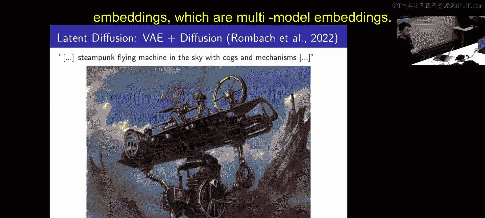

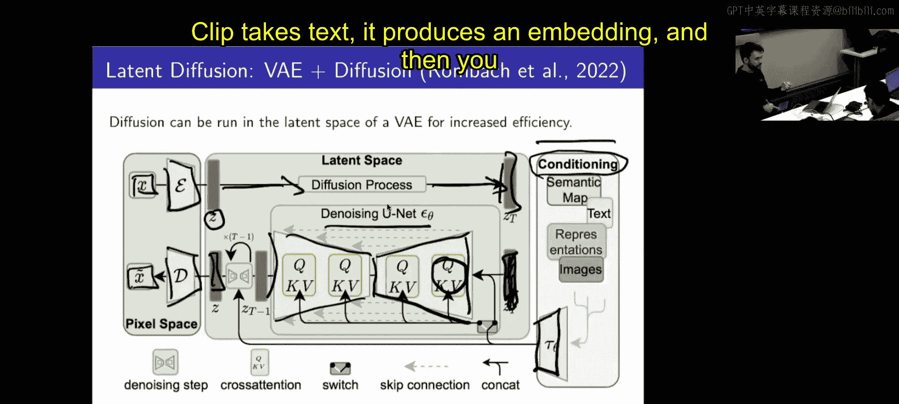

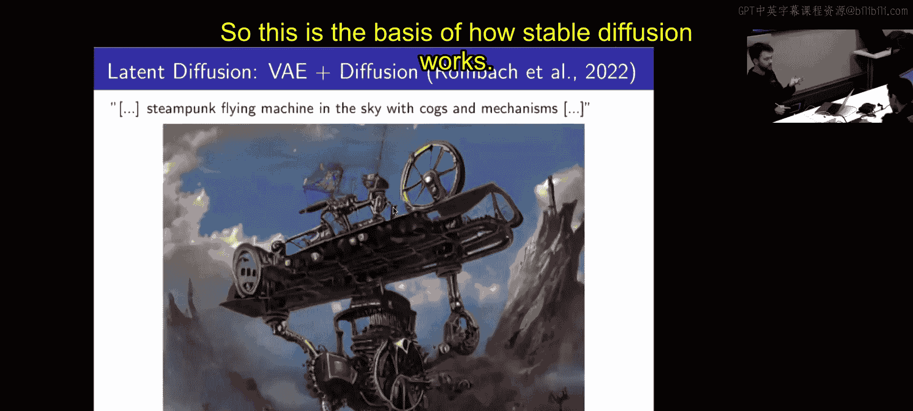

### 扩散模型与GAN及自回归模型的联系

*   **对抗分数匹配**：扩散模型的目标可以重新参数化，变成最小化去噪图像与干净图像之间的L2损失。我们可以将此L2损失替换为对抗损失，从而结合扩散模型和GAN的优点。
*   **自回归扩散模型**：自回归生成过程（如逐词生成句子）可以看作一种特殊的扩散过程：前向过程是逐步删除词，反向过程是逐步生成词。将删除顺序从固定的（从左到右）推广到任意的随机顺序，就得到了**自回归扩散模型**。这种模型可以按照任意指定的顺序生成序列的各个部分。

---

## 总结

本节课我们一起探索了如何将不同的生成模型家族组合起来。我们看到了：
*   如何将**自回归模型**与**变分自编码器**结合（如PixelVAE， 变分RNN），以同时获得强大的密度估计和表示学习能力。
*   如何用**流模型**增强变分自编码器的编码器，从而得到更紧致的证据下界和更好的潜空间匹配。
*   如何将**流模型**与**GAN**的目标结合（FlowGAN），实证研究了似然与样本质量的关系。
*   如何在**变分自编码器**的潜空间使用**对抗训练**（对抗自编码器）来获得更灵活的后验和更精确的先验匹配。
*   如何使用**互信息正则化**（如InfoGAN， β-VAE）来防止模型忽略潜变量，并鼓励学习解耦的表示。
*   如何将**扩散模型**与**变分自编码器**结合（潜在扩散模型），实现高效的高质量生成，并介绍了其与GAN、自回归模型的进一步联系。

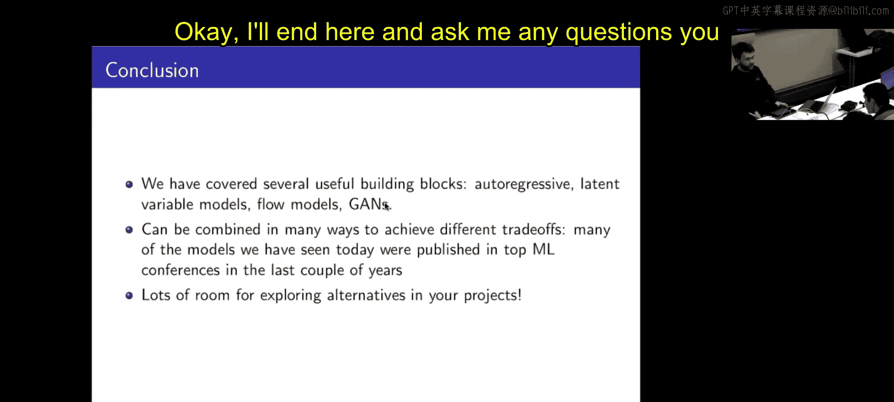

这些组合展示了生成建模领域的丰富性和创造性。我们所学的各种基础模型（自回归、VAE、流、GAN、扩散）是强大的构建模块，通过以新颖的方式组合它们，研究人员不断推动着生成模型性能的边界，并解决着更具挑战性的问题。希望这些例子能为你的项目或未来的探索提供灵感。