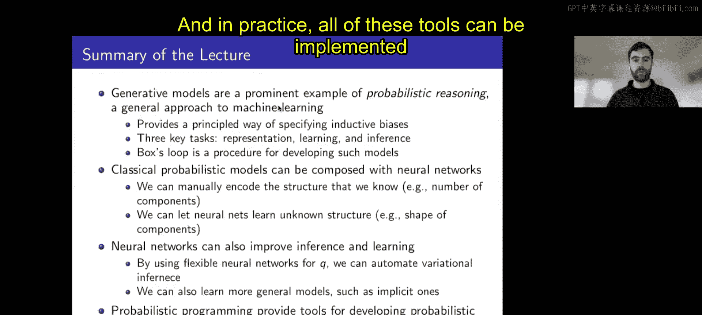

# 17：概率推理 🧠


在本节课中，我们将学习概率推理这一主题。我们将探讨如何将课程中学到的深度生成模型概念，应用于解决更广泛的机器学习建模问题。这是一种思考机器学习问题的新方式。


---


## 概述：什么是概率推理？


在课程的第一部分，我们看到了各种生成模型家族，它们各自可以解决**生成**、**密度估计**和**无监督表示学习**这三项任务中的不同子集。这些模型是解决特定任务和用例的工具。


在本讲中，我们将退一步，展示如何利用课程中学到的工具来解决机器学习中更广泛的建模问题。我们将探讨这些工具如何成为**概率推理**的实例。概率推理是一种思考机器学习、解决机器学习问题的方法论。


因此，本讲将从一个更高的、更哲学性的层面进行探讨，但也会包含许多有趣的具体例子和重要的经典算法作为贯穿始终的示例。


---


## 概率推理的核心思想 🤔


概率推理，或称概率建模，是机器学习中一种基于原则的方法。它通过构建结构化的概率模型来解决问题，而不是简单地拟合一个黑盒判别模型。


### 一个动机示例：课程难度建模


假设我们有一个问题：给定一个包含学生成绩的数据集，我们想要判断哪些课程是难的，哪些课程是容易的。


解决这个机器学习问题有两种不同的方法：

1.  **判别式方法**：我们尝试构建一个模型，直接根据各种数据（如成绩）来预测课程的难度。这可以是一个逻辑回归或前馈神经网络。我们使用监督学习来训练这个模型，将其视为一个黑盒。
2.  **生成式/概率方法**：我们尝试构建一个结构化的生成模型，该模型包含了我们关于所建模领域的先验知识，然后利用这个模型进行预测。


第二种方法正是本讲要深入探讨的。


### 结构化生成模型的例子：贝叶斯网络


我们可以将我们的先验知识编码为一个贝叶斯网络。例如，我们知道：
*   课程有某个**难度**。
*   学生的**智力**水平会影响其**SAT成绩**和**课程成绩**。
*   **课程成绩**会影响**推荐信**的质量。

我们可以将这些结构信息编码为一个贝叶斯网络图。这个模型不仅定义了数据的生成过程（一个“故事”），还定义了一个根据网络结构进行因子分解的概率分布。利用贝叶斯网络的理论和正确的概率公式，我们可以根据其他变量（如成绩、SAT、推荐信）来预测课程的难度。


这种方法比单纯拟合一个黑盒模型更复杂，但优势在于它允许我们指定先验知识。如果这些先验知识（如依赖关系）是正确的，那么我们可能能够用更少的数据获得更好的结果，因为我们将正确的归纳偏置融入了模型。


这体现了概率方法的核心：基于先验知识，通过指定各种归纳偏置来解决机器学习问题。


---


## 更广泛的框架：Box’s Loop 🔄


更一般地说，上述方法是解决机器学习问题的一种更广泛方法——**概率建模**或**概率推理**——的一个特例。


统计学家George Box提出了一个描述这种推理框架的流程图，称为**Box’s Loop**。其核心思想是，在解决任何感兴趣的机器学习问题时，都应尝试遵循以下多步骤方法：


1.  **构建模型**：根据对问题结构的了解，构建一个概率模型。
2.  **选择算法**：根据定义的模型族，选择相应的**推断**和**学习**算法（如变分推断、马尔可夫链蒙特卡洛）。
3.  **应用与评估**：应用这些方法，检查学习和推断的结果（如模型参数的后验分布、潜在变量的分布）。在保留数据集上评估模型性能。
4.  **迭代优化**：如果对结果满意，则停止；如果不满意，则返回第一步，更新模型（例如，添加变量、调整先验、修改结构），然后再次运行训练和评估，形成一个循环迭代过程，直到得到满意的模型。


---

## 经典案例：潜在狄利克雷分配 (LDA) 📚


让我们通过一个经典算法——**潜在狄利克雷分配**——来具体说明Box’s Loop的应用。


**任务：主题建模**
给定一个文档语料库，我们想自动了解每个文档的主题。例如，一篇关于计算基因组学的文档可能包含“生物学”、“遗传学”和“计算机”三个主题的词汇混合。主题建模的目标是：
*   自动从数据中学习这些**主题**（即每个主题下的词汇分布）。
*   学习每个文档的**主题比例**（即文档中各个主题的占比）。
*   学习每个词汇到特定主题的**分配**。

我们只有原始文本文档，上述所有信息都是未观察到的。问题看似定义不足，如何解决？


**应用Box’s Loop：定义LDA模型**
我们可以通过指定一个结构化的概率模型来解决。LDA就是一个这样的概率潜在变量模型。它使用**板表示法**来描述生成过程：


**LDA的生成故事（伪代码）：**


```
对于每个主题 k in [1, K]:
    从狄利克雷分布中抽取一个主题-词汇分布 β_k
对于每个文档 d in [1, D]:
    从狄利克雷分布中抽取一个文档-主题分布 θ_d
    对于文档 d 中的每个词汇位置 n in [1, N_d]:
        从主题分布 θ_d 中抽取一个主题索引 z_{d,n}
        从词汇分布 β_{z_{d,n}} 中抽取一个词汇 w_{d,n}
```

**模型推断与学习**
现在，我们有了一个定义了所有潜在变量（主题分布β、文档主题比例θ、词汇主题分配z）和观测变量（词汇w）之间关系的概率模型。接下来就是应用课程中学到的工具进行推断和学习：
*   **变分推断**：我们可以将主题分配等潜在变量视为Z，观测词汇视为X，然后学习一个近似后验分布 Q(Z|X)，通过优化证据下界来拟合模型。
*   **MCMC**：我们也可以将LDA视为一个基于能量的模型，对潜在变量运行MCMC链，从真实后验中采样。


LDA是概率推理的一个绝佳实例：我们将感兴趣的量定义为模型中的潜在变量，通过指定它们之间的约束关系使问题变得可解，然后利用推断工具从数据中揭示这些量。


---


## 概率推理的三要素 🎯


总结来说，使用概率推理框架解决任何任务，通常需要解决三个核心问题：


1.  **表示**：如何将我们处理的数据表示为来自某个概率模型？如何定义这个模型？
2.  **推断**：给定定义好的模型，如何进行推断？如何向模型询问关于缺失量的问题？
3.  **学习**：如何从数据中学习模型？如果我们不是完全的贝叶斯派，可能需要进行参数学习。


---

## 深度生成模型与概率推理的联系 🔗


现在，我们来看看深度生成模型与上述概率建模方法之间的联系。


### 联系一：深度生成模型是概率方法的实例


当我们定义变分自编码器、正则化流等潜在变量模型时，我们遵循的步骤本身就是Box’s Loop的实例：首先定义数据的概率分布，然后引入学习算法，应用这些算法并观察模型样本，使用各种技术（如对数似然、样本质量）评估结果。如果不满意，则返回修改模型。因此，深度生成模型是这种更通用的概率机器学习方法的一个特例。


### 联系二：深度生成模型可以改进概率建模


深度生成模型可以作为构建块，与经典的贝叶斯网络或LDA等概率模型结合，使这些模型更强大。


**示例一：深度高斯混合模型**
假设我们想对“星形”数据集建模。该数据明显由五个分支组成，但每个分支不是高斯形状，而是弯曲的月牙形。
*   单纯使用**高斯混合模型**效果不佳，需要用多个高斯来拟合一个分支。
*   单纯使用**变分自编码器**，虽然灵活，但生成的分布可能过于扩散，不能完美贴合星形。
*   **最佳方案是结合两者**：使用一个**深度高斯混合模型**。该模型仍然有一个表示聚类归属的离散潜在变量Z（如GMM），但对于每个聚类，我们不使用高斯分布，而是使用一个**变分自编码器**来生成复杂形状。可以将其视为一个**具有高斯混合先验的VAE**。


**如何训练？**
我们可以使用课程中学到的工具进行变分推断。模型有两组潜在变量：z（离散聚类分配）和 u（VAE的连续潜在变量）。训练可以采用类似EM的迭代过程：
*   固定z，则每个聚类内的数据拟合就是一个独立的VAE问题。
*   固定u（通过VAE推断得到），则对u的分布进行聚类就是一个GMM问题，可以用EM求解。
来回迭代优化。


**示例二：结合VAE与状态空间模型分析小鼠行为视频**
任务：给定小鼠在笼中活动的视频帧，我们想了解其行为（如睡觉、奔跑、进食）。如果有离散状态标签，就可以用概率模型（如隐马尔可夫模型）研究状态转移。但我们只有原始视频帧。
*   **步骤1（深度生成模型）**：对每一帧图像，使用**变分自编码器**学习一个低维潜在表示 `u_t`。期望相似行为（如所有奔跑帧）在潜在空间中聚集在一起。
*   **步骤2（经典概率模型）**：由于视频帧是连续的，我们在潜在状态 `u_t` 上施加时间结构。例如，假设一个**线性动态系统**（卡尔曼滤波器），表示潜在状态平滑演化。
*   **步骤3（结合离散状态）**：在潜在表示 `u_t` 上再学习一个**高斯混合模型**，以发现离散的行为状态。最终，我们得到了可解释的离散状态，可用于聚类小鼠行为。


这个例子展示了如何将深度生成模型（处理非结构化图像数据）与经典概率模型（处理结构化时间序列和离散状态）相结合，从而将概率推理方法应用于传统上难以处理的新型数据。


---


## 深度生成模型改进概率推断 🚀


除了改进模型表示，深度生成模型和神经网络还可以改进我们学习和拟合概率模型的能力。


### 示例一：黑盒变分推断


对于经典的潜在变量模型（如高斯混合模型），传统的学习方法是**期望最大化**或**平均场变分推断**。这些方法需要根据模型 `P` 的结构，手动推导出近似后验 `Q(z|x)` 的特定形式及其更新公式。这个过程数学推导复杂，且只适用于特定类型的模型。


**深度学习的解决方案**：**黑盒变分推断**。
我们可以将 `Q(z|x)` **参数化为一个黑盒神经网络**。然后，直接使用我们在课程中学到的**REINFORCE**等梯度估计器，来优化这个 `Q` 以拟合真实后验。我们无需手动推导数学公式，只需将 `Q` 设为灵活的神经网络，并使用现成的优化器进行拟合。


优势：
*   **通用性**：适用于任何可以计算联合概率 `P(x, z)` 的模型。
*   **灵活性**：如果真实后验 `P(z|x)` 难以处理，但神经网络足够灵活，我们可能得到更好的近似。
*   **易用性**：可以直接在TensorFlow、PyTorch等框架中实现，并利用GPU进行大规模优化。


### 示例二：隐式模型与GAN式学习


回忆一下，生成对抗网络是**隐式模型**，因为它们只通过采样过程定义分布，而没有显式的概率密度函数。我们可以将这种思想推广到任何类型的数据。


**示例：生态学中的Lotka-Volterra方程**
该微分方程描述了捕食者（如狼）和猎物（如兔子）种群数量的演化。它是一个**隐式模型**：给定初始条件和参数，我们可以运行方程来生成种群数量的样本轨迹，但无法写出显式的概率分布。


**问题**：我们想学习模型的参数（如增长率、相互作用系数），但无法使用基于概率密度的变分推断。


**解决方案**：借鉴GAN的思想。
假设我们想学习模型参数 `θ` 的后验分布 `P(θ|data)`。我们可以设定一个变分分布 `Q(θ)` 来近似它。证据下界ELBO涉及一个难以处理的密度比 `log[P(x,θ)/Q(θ)]`。


**关键思路**：我们可以训练一个**判别器** `R` 来估计这个对数密度比。具体做法是：
1.  从联合分布 `P(x,θ)` 和变分分布 `Q(θ)` 中采集样本。
2.  训练判别器 `R` 来区分这两组样本。最优的 `R*` 正好等于这个对数密度比（正如我们在GAN中推导过的）。
3.  将学习到的 `R*` 代入ELBO的表达式中，得到一个可计算的ELBO估计。
4.  固定 `R*`，优化 `Q(θ)` 以最大化这个估计的ELBO。
5.  迭代更新判别器和变分分布。


这个例子表明，GAN的思想可以用来优化任意的概率模型，特别是那些隐式定义的模型。课程中学到的REINFORCE、变分推断和GAN等技术，其用途远不止生成图像，它们可以用于改进整个机器学习和统计学中的统计推断。


---


## 概率编程：实现概率推理的框架 💻


概率推理的最终实现离不开软件工具。**概率编程**这一领域旨在开发能够实现Box’s Loop所有步骤的软件框架。


### 什么是概率编程？


概率编程语言允许用户使用**通用的计算机程序**来定义概率模型。这比传统的概率符号更强大：你可以使用循环、条件语句、递归等任意代码逻辑，只要这些代码操作的是随机变量，并最终产生样本或定义分布。


### 概率编程语言的例子


*   **Stan**：一个非常著名的概率编程语言。
*   **Edward**：基于TensorFlow的早期深度概率编程语言。
*   **Pyro**：基于PyTorch的现代概率编程语言。


这些语言提供了有用的原语（如概率分布类）和自动化推理工具（如变分推断、MCMC）。用户只需用高级语言指定模型（“故事”），编程语言就会接管推理和学习过程，输出结果，并帮助评估模型。

### 与深度学习的结合


概率编程语言可以利用深度学习来增强自身：
*   **模型定义**：允许使用神经网络作为定义分布的基本原语。
*   **加速推断**：集成黑盒变分推断等基于神经网络的推断方法。
*   **硬件加速**：通常构建在TensorFlow/PyTorch之上，便于利用GPU进行大规模计算。


### 示例：在Edward中实现LDA


以下是在Edward中定义LDA模型的简化代码示例，它几乎就是生成故事的直译：


```python
# 假设有 K 个主题， V 个词汇， D 个文档， N_d 是文档d的词汇数
phi = Dirichlet(concentration=tf.ones([K, V]) / K)  # 主题-词汇分布
theta = Dirichlet(concentration=tf.ones([D, K]) / K) # 文档-主题分布
z = Categorical(probs=tf.gather(theta, doc_indices)) # 每个词汇的主题分配
w = Categorical(probs=tf.gather(phi, z))             # 观测到的词汇
```


定义好这个计算图后，可以将其送入Edward引擎，引擎会自动进行变分推断等操作，最终输出学习到的主题和聚类结果。


---


## 总结 📝


本节课我们一起学习了概率推理这一主题。


1.  **概率推理是一种方法论**：它通过构建结构化的概率模型，结合先验知识，以原则性的方式解决机器学习问题。其核心流程是Box’s Loop：构建模型、选择算法、评估结果、迭代优化。
2.  **深度生成模型是其实例**：我们在本课程中学习的各种生成模型（VAE, GAN, 流模型等），其开发和应用过程本身就是概率推理的体现。
3.  **深度生成模型能增强概率推理**：
    *   **改进模型**：通过将神经网络与经典概率模型（如GMM、状态空间模型）组合，我们可以为半结构化数据（如图像+离散标签）创建更强大、更灵活的模型。
    *   **改进推断**：利用黑盒变分推断、隐式模型学习（如GAN式方法）等技术，我们可以更通用、更高效地学习和拟合复杂的概率模型，摆脱繁琐的数学推导。
4.  **概率编程是实现工具**：概率编程语言（如Pyro, Edward）提供了高级框架，让用户能够轻松指定概率模型并自动化推理过程，使得概率推理方法更易于被广大研究者和分析人员使用。




总而言之，本课程虽然聚焦于生成模型，但生成模型是更广阔的**概率机器学习**领域的一个特例。概率方法为我们提供了一种融合先验知识、系统化解决问题的强大范式。而深度学习和深度生成模型不仅自身是这一范式的优秀实践，更是推动整个概率推理领域向前发展的重要引擎。