# 深度生成模型：12：基于分数的生成模型

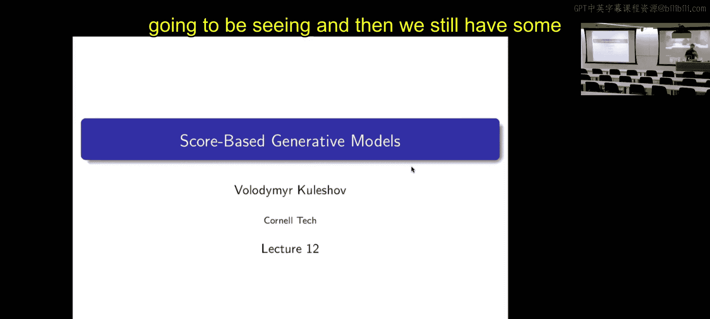

在本节课中，我们将要学习一种新的生成模型——基于分数的生成模型。我们将从回顾之前学过的模型家族开始，引出为什么需要这种新方法，然后详细介绍分数函数的概念、如何学习它（分数匹配），以及如何利用它进行采样。最后，我们会看到如何通过多尺度噪声技术解决实际应用中的难题。

---

## 回顾：生成模型家族与挑战

上一节我们介绍了基于能量的模型，它提供了极大的建模灵活性。本节中，我们来看看如何克服其训练和采样上的主要挑战。

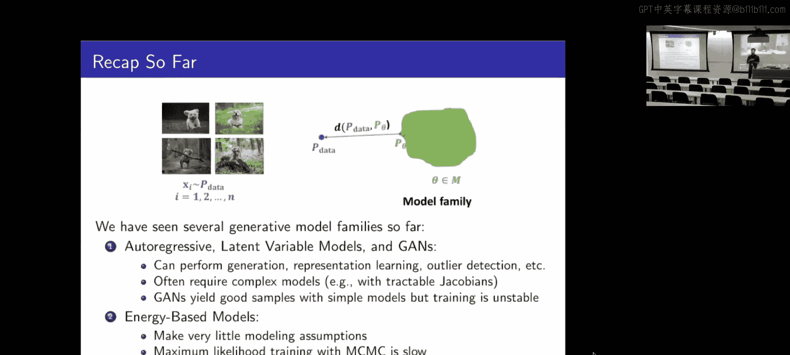

在之前的课程中，我们学习了几种经典的深度生成模型：
*   **自回归模型**
*   **隐变量模型**（包括变分自编码器和标准化流）
*   **生成对抗网络**

这些模型可以完成多种任务，例如**生成**、**表示学习**和用于异常检测的**密度估计**。

大多数早期模型使用**最大似然估计**作为训练目标。但这带来了复杂性：
*   对于包含隐变量的模型，似然计算通常是**难解的**。
*   对于标准化流模型，必须精心设计网络结构以保证**可逆性**和**雅可比行列式易计算**。

GANs 避开了似然计算，可以使用任意生成器，但训练过程因涉及判别器和生成器的博弈而**不稳定**。

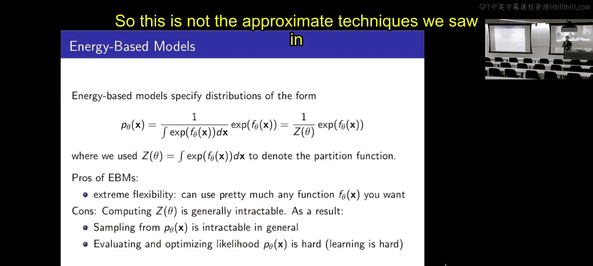

在上一讲中，我们学习了**基于能量的模型**。其概率密度定义为：
`p_θ(x) = exp(f_θ(x)) / Z(θ)`
其中 `Z(θ) = ∫ exp(f_θ(x)) dx` 是配分函数。这种模型允许使用非常灵活的神经网络来参数化未归一化的密度 `f_θ(x)`。然而，代价是配分函数 `Z(θ)` 通常难解，导致：
1.  计算精确密度 `p_θ(x)` 难解。
2.  基于最大似然的训练难解。
3.  采样困难，通常需要依赖缓慢的 **MCMC** 方法。

因此，我们面临一个核心问题：**能否拥有基于能量模型的建模灵活性，同时避免 MCMC 带来的缓慢训练和采样？** 基于分数的生成模型正是为了回答这个问题。

---

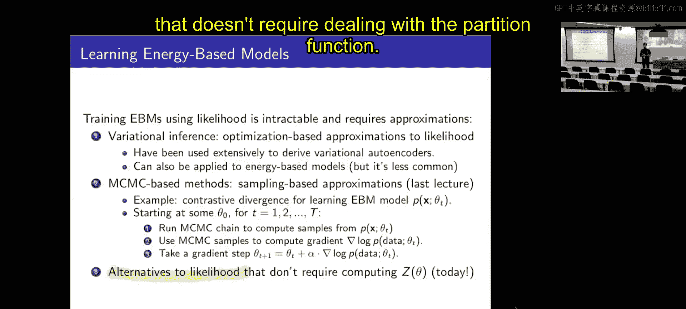

## 分数函数：一种新的表示方式

上一节我们指出了基于能量模型的核心难点在于配分函数。本节中我们来看看如何通过绕过配分函数来解决问题。

**分数函数** 被定义为数据对数概率密度相对于数据本身的梯度：
`s(x) = ∇_x log p(x)`
请注意，这里的梯度是针对输入数据 `x`，而不是模型参数 `θ`。

**直观理解**：分数函数 `s(x)` 是一个向量场。在数据空间的每一点 `x` 上，它指向概率密度 `p(x)` 增长最快的方向。它指引着如何移动 `x` 才能到达更高概率的区域。

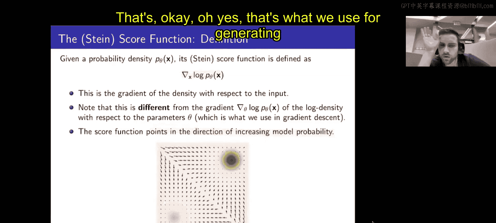

**关键优势**：对于基于能量的模型 `p_θ(x) = exp(f_θ(x)) / Z(θ)`，其分数函数为：
`∇_x log p_θ(x) = ∇_x f_θ(x) - ∇_x log Z(θ) = ∇_x f_θ(x)`
因为配分函数 `Z(θ)` 与 `x` 无关。**分数函数完全避开了难解的配分函数**！这启发我们：与其直接建模概率密度 `p(x)`，不如直接建模其分数函数 `s(x)`。

---

## 分数估计任务定义

基于上述思想，我们定义核心任务：**分数函数估计**。

我们的目标是学习一个模型 `s_θ(x)`，用以近似真实数据分布 `p_data(x)` 的分数函数 `∇_x log p_data(x)`。模型 `s_θ(x)` 是一个从 `R^D` 到 `R^D` 的向量值函数（例如，D 是图像的像素维度）。

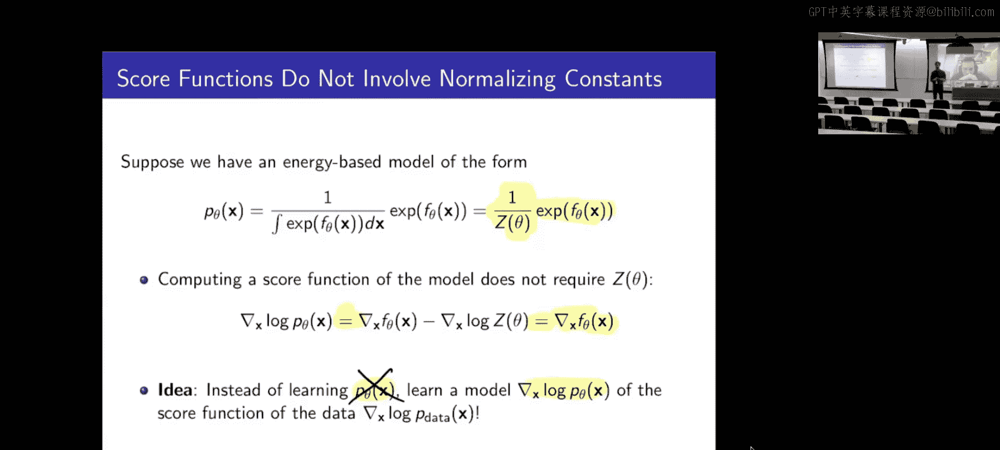

我们拥有从 `p_data(x)` 中独立同分布采样的数据集。目标是通过优化，使模型分数 `s_θ(x)` 尽可能接近真实分数 `∇_x log p_data(x)`。

为了实现这个目标，我们需要一个可计算的学习目标。

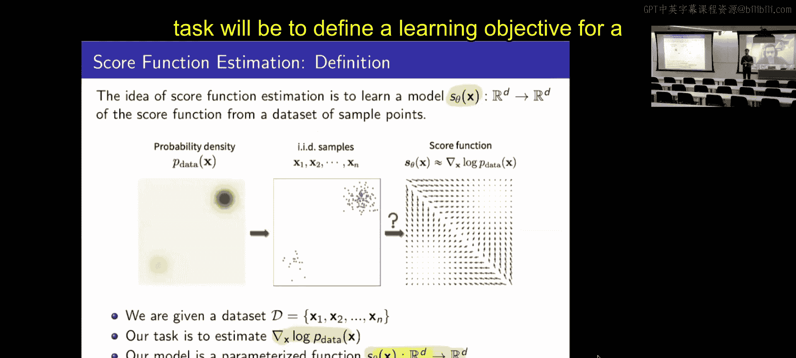

---

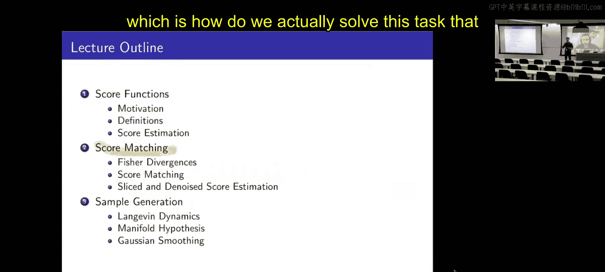

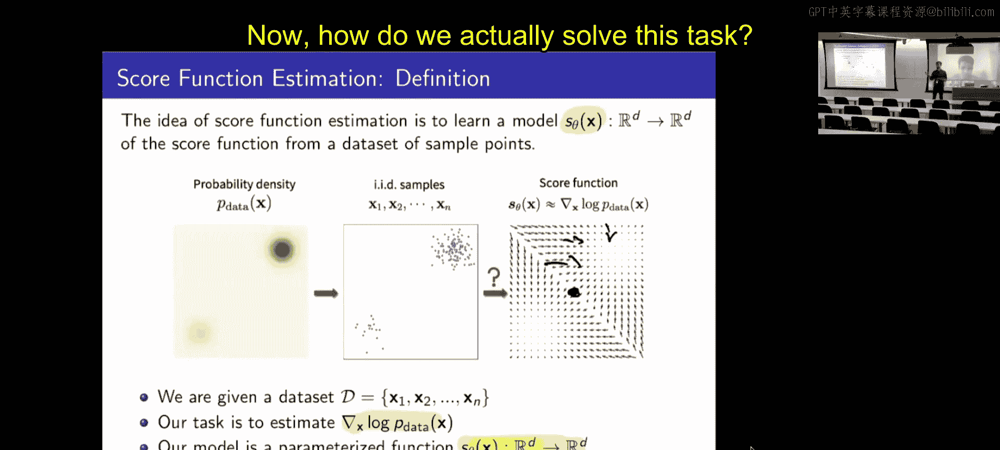

## 分数匹配：学习分数函数

上一节我们定义了学习分数函数的任务。本节中我们来看看如何通过“分数匹配”来构建一个可行的学习目标。

一个自然的想法是最小化模型分数与真实分数之间的 Fisher 散度：
`J(θ) = 1/2 * E_{p_data(x)} [ || s_θ(x) - ∇_x log p_data(x) ||^2 ]`
这相当于在数据分布的每个点上，最小化两个向量之间的平均 L2 距离。然而，这个目标不可行，因为它依赖于未知的真实分数 `∇_x log p_data(x)`。

**分数匹配** 通过积分技巧，将上述目标转化为一个等价但可行的形式（以一维情况为例，通过分部积分）：
`J_SM(θ) = E_{p_data(x)} [ tr(∇_x s_θ(x)) + 1/2 || s_θ(x) ||^2 ]`
这个新目标不再包含真实分数，只涉及模型 `s_θ(x)` 及其雅可比矩阵的迹 `tr(∇_x s_θ(x))`。我们可以通过从数据集中采样来近似期望值。

**挑战**：计算 `tr(∇_x s_θ(x))` 需要对一个 D 维输出函数的雅可比矩阵求迹，计算成本是 `O(D)`，在高维数据（如图像）上非常昂贵。

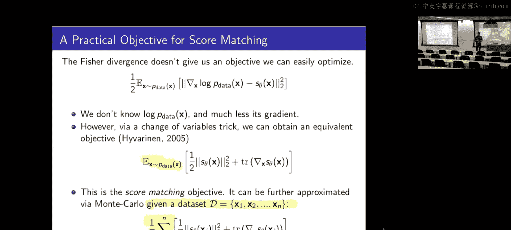

为了解决这个计算瓶颈，我们引入**切片分数匹配**。

---

### 切片分数匹配

切片分数匹配的核心思想是：通过随机投影将高维向量比较降低为一维标量比较。

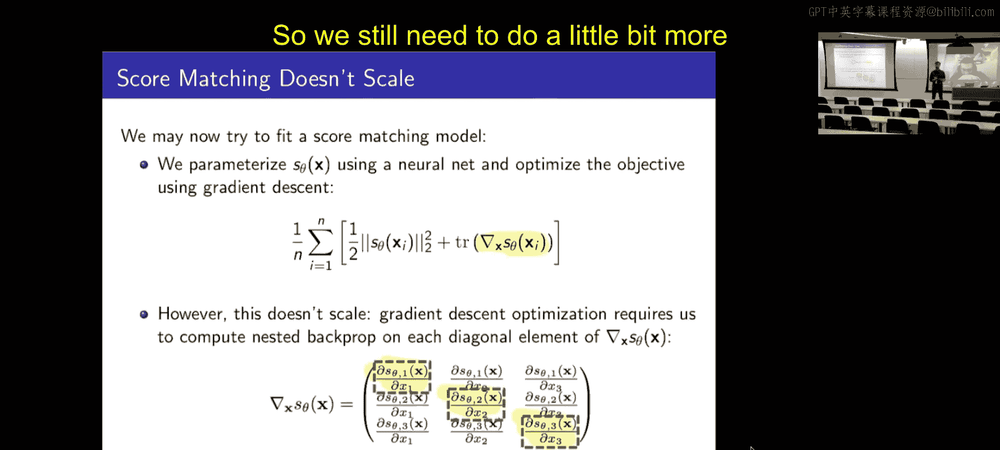

我们引入一个随机投影向量 `v`（通常从标准正态分布中采样）。切片 Fisher 散度定义为：
`J_SSM(θ) = 1/2 E_{p_data(x)} E_{q(v)} [ (v^T s_θ(x) - v^T ∇_x log p_data(x))^2 ]`
这衡量的是分数在随机方向 `v` 上投影的差异。

同样地，我们可以应用积分技巧，得到可计算的切片分数匹配目标：
`J_SSM(θ) = E_{p_data(x)} E_{q(v)} [ v^T ∇_x s_θ(x) v + 1/2 (v^T s_θ(x))^2 ]`
现在，`v^T ∇_x s_θ(x) v` 是一个标量，计算成本大大降低。通过从 `p_data(x)` 和 `q(v)` 中采样，我们可以高效地估计并优化这个目标。

---

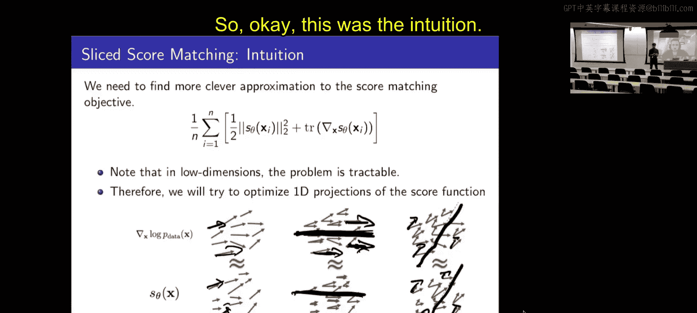

### 去噪分数匹配

另一种流行的分数匹配方法是**去噪分数匹配**。其思路是：学习一个**噪声化数据分布**的分数函数，而不是原始干净分布的。

假设我们通过添加高斯噪声来扰动数据：`x̃ = x + σ * ε`，其中 `ε ~ N(0, I)`。这定义了一个噪声分布 `q_σ(x̃)`。

去噪分数匹配的目标是学习噪声分布 `q_σ(x̃)` 的分数函数。可以证明，最小化以下目标等价于最小化模型分数与 `q_σ(x̃)` 真实分数之间的 Fisher 散度：
`J_DSM(θ) = E_{p_data(x)} E_{x̃~q_σ(x̃|x)} [ || s_θ(x̃) - ∇_{x̃} log q_σ(x̃|x) ||^2 ]`
其中 `q_σ(x̃|x)` 是给定干净数据 `x` 时噪声数据 `x̃` 的条件分布。对于高斯噪声，`∇_{x̃} log q_σ(x̃|x) = -(x̃ - x) / σ^2`，这是一个简单的闭式解。

**优点**：目标函数简单，计算高效。
**缺点**：直接学习的是噪声分布的分数。为了逼近干净分布，需要将噪声水平 `σ` 设置得足够小，但这会导致梯度估计的方差增大。

---

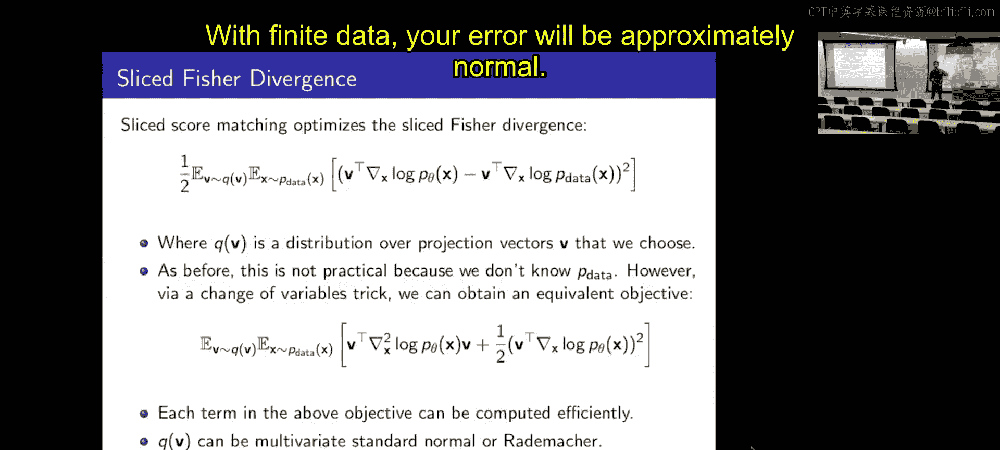

### 分数匹配算法总结

综上所述，我们可以使用以下算法框架来学习基于分数的生成模型：

1.  初始化分数模型 `s_θ(x)` 的参数 `θ`（例如，一个神经网络）。
2.  循环直到收敛：
    *   从数据集中采样一个批次 `{x_i}`。
    *   选择并计算目标函数：
        *   **切片分数匹配**：采样随机投影向量 `{v_i}`，计算 `J_SSM(θ)` 的梯度。
        *   **去噪分数匹配**：为每个 `x_i` 采样噪声版本 `x̃_i`，计算 `J_DSM(θ)` 的梯度。
    *   使用梯度下降更新参数 `θ`。

分数模型 `s_θ(x)` 可以是任何神经网络，没有像流模型那样的可逆性限制，提供了极大的灵活性。

---

## 采样：朗之万动力学

学习了分数函数模型后，我们如何从中采样生成新数据呢？本节介绍**朗之万动力学**方法。

**核心直觉**：分数函数 `s_θ(x) ≈ ∇_x log p_data(x)` 指向概率更高的区域。因此，我们可以从随机噪声开始，沿着分数指引的方向迭代移动，同时注入一些噪声，最终到达高概率数据区域。

**朗之万动力学**采样过程如下：
1.  从先验分布（如均匀分布或高斯分布）初始化 `x_0`。
2.  对于 `t = 0` 到 `T-1`：
    `x_{t+1} = x_t + α * s_θ(x_t) + √(2α) * z_t`
    其中 `z_t ~ N(0, I)`，`α` 是步长。
3.  输出 `x_T` 作为生成的样本。

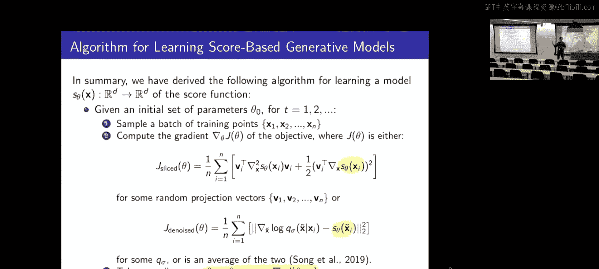

这个过程可以看作是**带有噪声的梯度上升**，旨在最大化 `log p(x)`。理论上，当步长 `α` 以适当速率衰减到 0，且迭代步数 `T → ∞` 时，`x_T` 的分布会收敛到 `p_data(x)`。

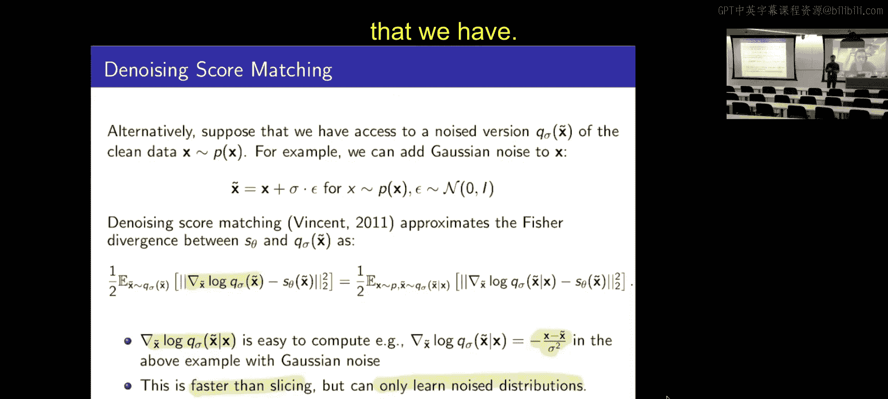

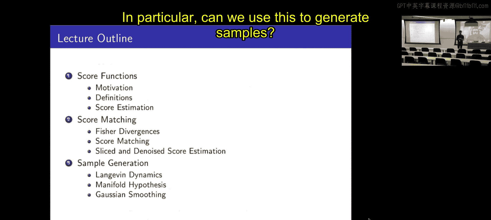

---

## 实践挑战与解决方案：流形假设与多尺度噪声

上一节描述的朗之万动力学在理论上成立，但在实践中会遇到一个根本性问题：**流形假设**。

高维数据（如图像）通常集中在一个低维流形上，而不是充满整个数据空间。这意味着在大部分数据空间区域，真实数据概率 `p_data(x)` 实际为零或接近零。因此，在这些区域，真实的分数函数 `∇_x log p_data(x)` 是未定义或数值不稳定的。我们的分数模型在这些区域也会学到错误或无意义的值。如果朗之万动力学从这些区域开始，将无法有效收敛到真实数据流形。

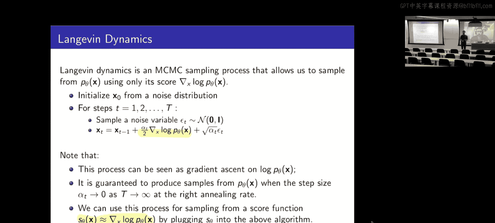

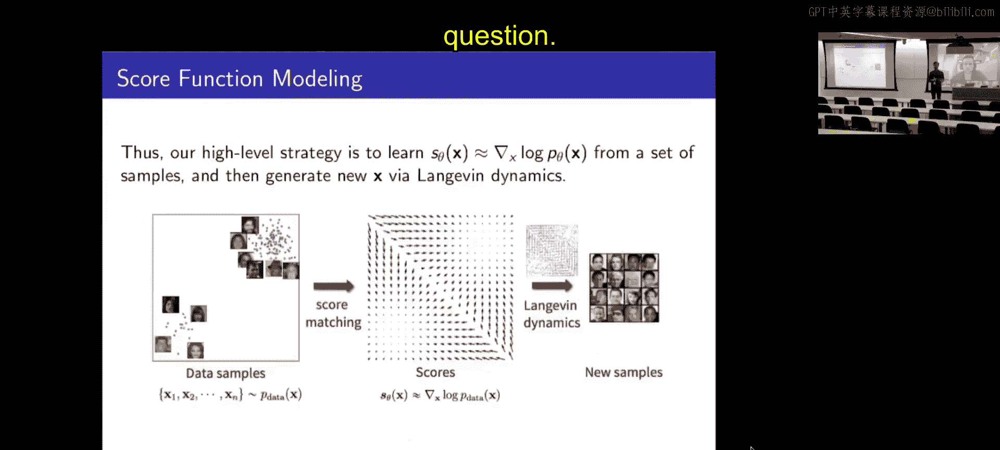

**解决方案**：使用**多尺度噪声（或噪声条件分数网络）**。

我们不只学习一个分数函数，而是学习一系列不同噪声水平 `{σ_i}` 下的分数函数，其中 `σ_1 > σ_2 > ... > σ_L ≈ 0`。较大的噪声会使数据分布“扩散”开，覆盖更多空间，使得分数函数在更广的区域都有良好定义。

我们训练一个**噪声条件分数网络** `s_θ(x, σ)`，将噪声水平 `σ` 作为额外输入。训练目标（例如基于去噪分数匹配）变为对所有噪声水平求平均：
`L(θ) = (1/L) Σ_{i=1}^L λ(σ_i) * E_{p_data(x)} E_{x̃~q_{σ_i}(x̃|x)} [ || s_θ(x̃, σ_i) - ∇_{x̃} log q_{σ_i}(x̃|x) ||^2 ]`
其中 `λ(σ_i)` 是权重系数。

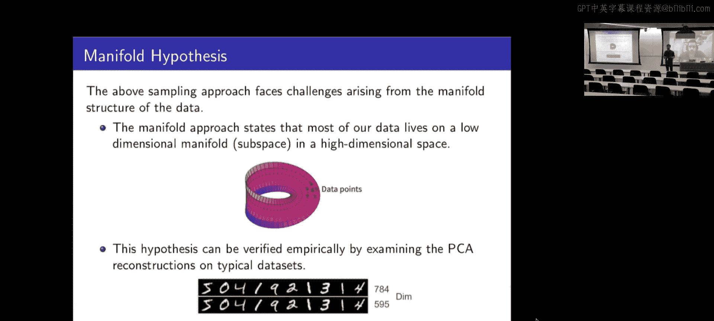

---

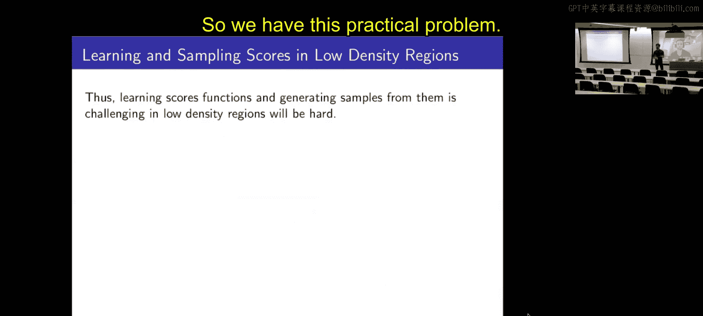

### 退火朗之万动力学采样

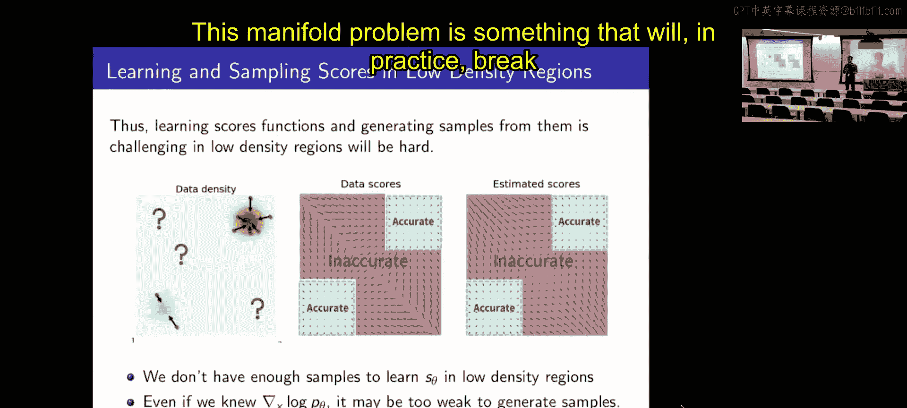

在采样时，我们采用**退火朗之万动力学**：
1.  从最大的噪声水平 `σ_L` 开始，初始化 `x_L` 为随机噪声。
2.  **对于噪声水平 `σ_i` （从大到小）**：
    *   运行若干步朗之万动力学，使用当前噪声水平对应的分数模型 `s_θ(x, σ_i)` 进行更新：`x ← x + α_i * s_θ(x, σ_i) + √(2α_i) * z`。
    *   进入下一个更小的噪声水平 `σ_{i-1}`。
3.  当到达最小的噪声水平 `σ_1` 并完成迭代后，输出 `x` 作为最终样本。

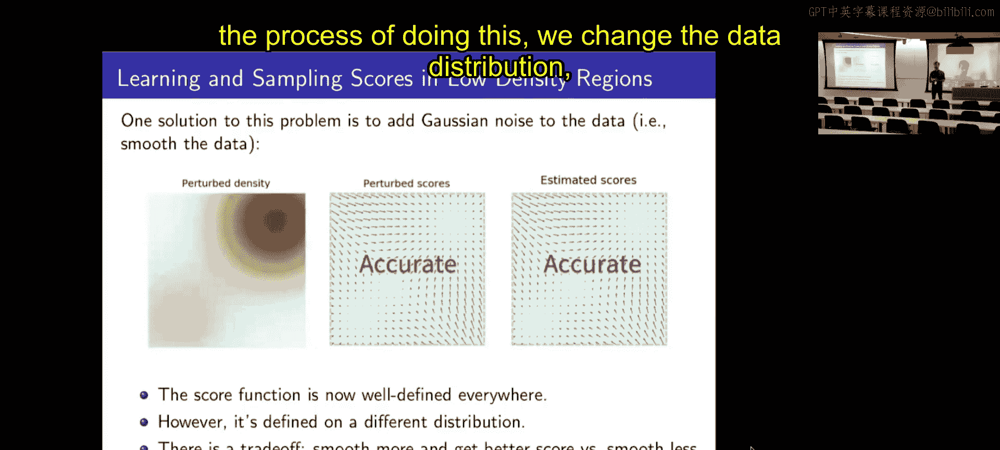

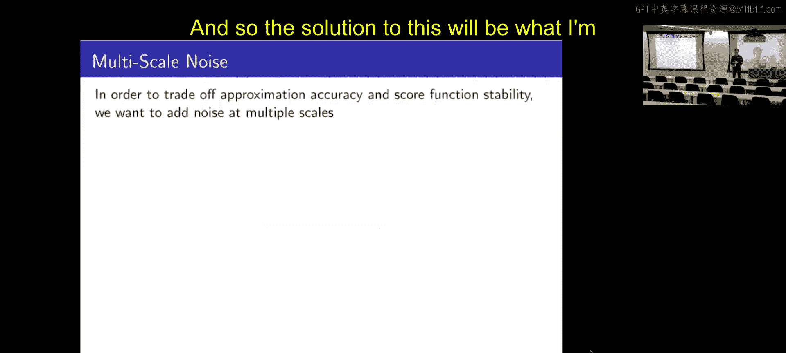

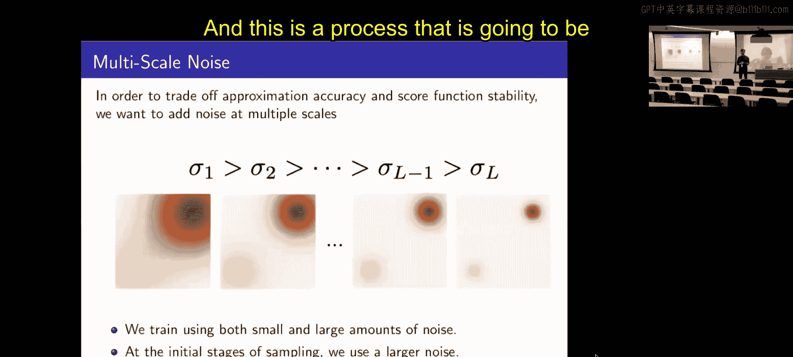

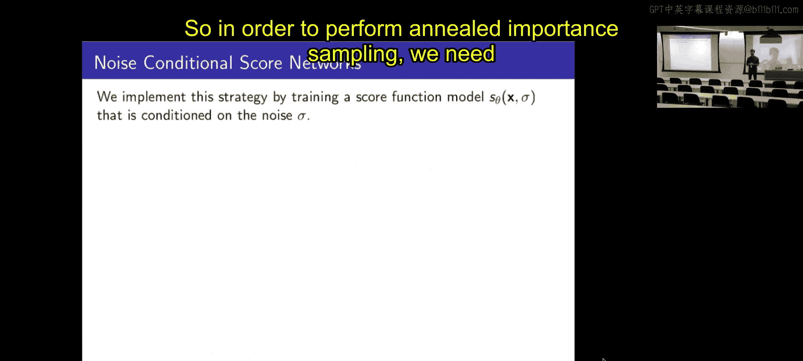

这个过程就像先在一个模糊的、定义良好的分布中定位大致结构，然后逐步去噪和细化，最终得到清晰、高质量的样本。这有效解决了从低概率区域启动的问题。

---

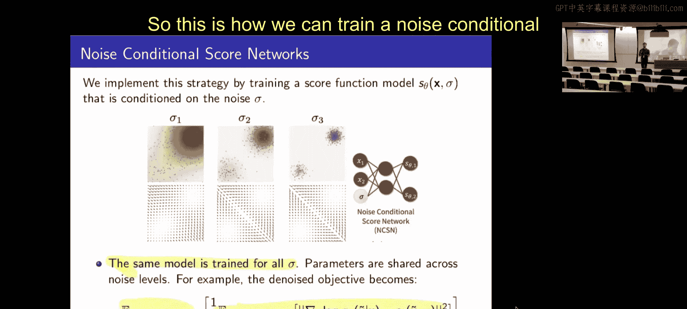

## 总结与展望

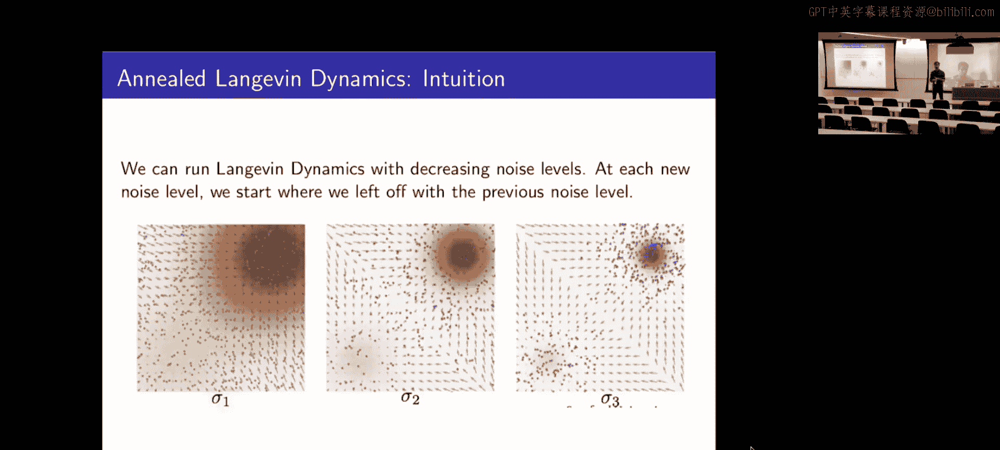

本节课中我们一起学习了**基于分数的生成模型**。

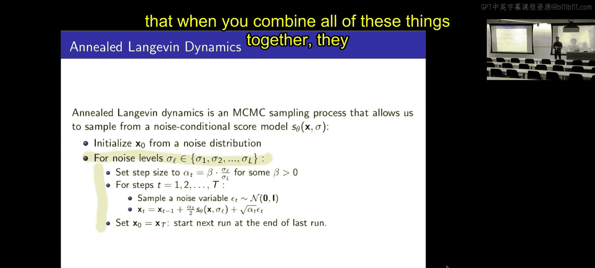

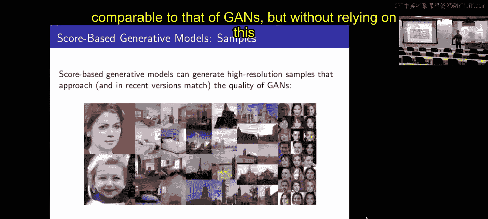

*   **动机**：在保持基于能量模型建模灵活性的同时，避免处理难解的配分函数。
*   **核心概念**：直接建模概率分布的**分数函数** `∇_x log p(x)`，它避开了配分函数。
*   **学习**：通过**分数匹配**技术（切片分数匹配或去噪分数匹配）来训练分数模型。
*   **采样**：使用**朗之万动力学**，沿着分数指引的方向进行迭代生成。
*   **关键改进**：引入**多尺度噪声**和**噪声条件分数网络**，结合**退火朗之万动力学**，解决了数据流形导致的实践难题，能够生成高质量的样本。

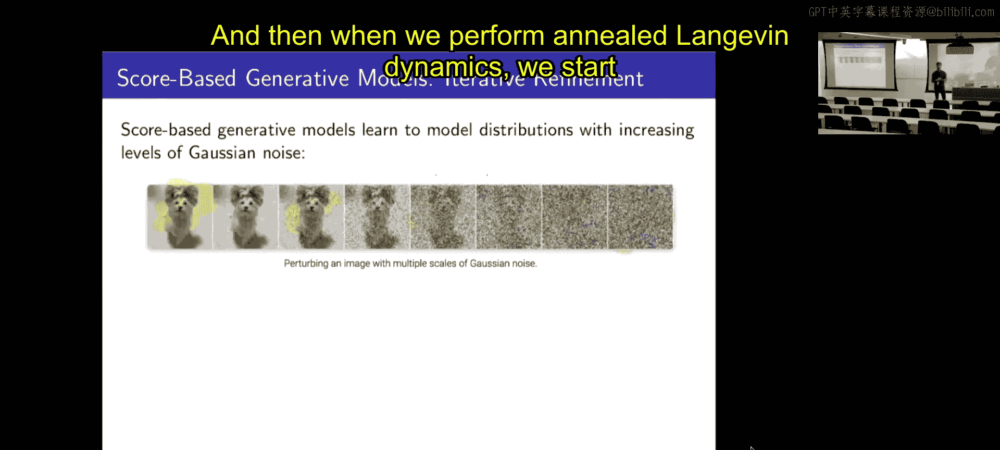

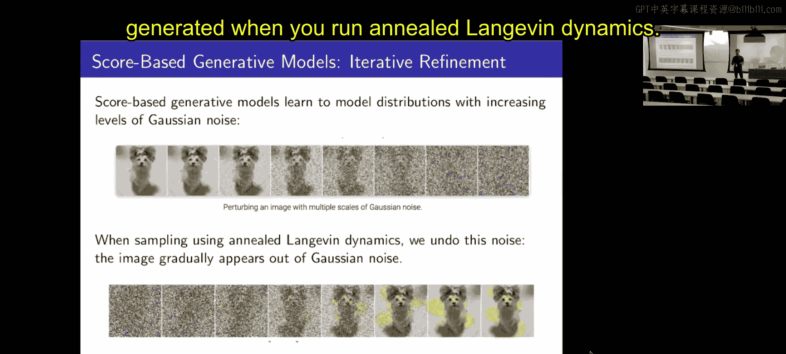

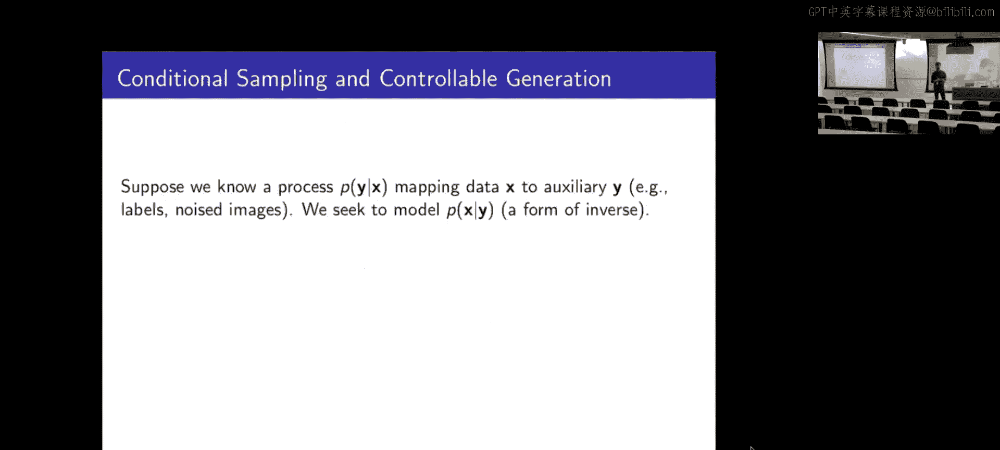

基于分数的模型提供了稳定训练和高样本质量的优点，但采样速度相对较慢（需要多次迭代），并且在密度估计等任务上不直接提供似然值。

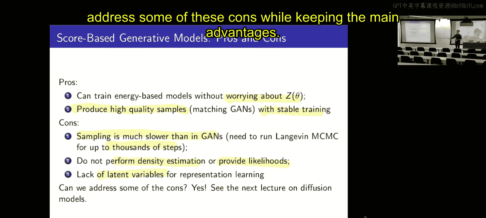

在下一讲中，我们将探讨与基于分数模型紧密相关的**扩散模型**，它将进一步形式化噪声添加和去除的过程，并解决当前模型的一些局限性。