# 深度生成模型：13：扩散模型 🌀

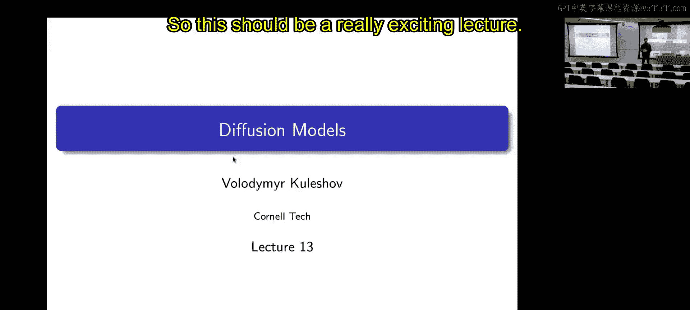

在本节课中，我们将要学习扩散模型。扩散模型是近年来出现的一个令人兴奋的新型生成模型家族，在图像生成等领域取得了非常令人印象深刻的成果。我们将从基于分数的生成模型出发，建立扩散模型与变分自编码器等经典生成模型之间的联系，并理解其工作原理、训练方法和应用。

---

## 概述

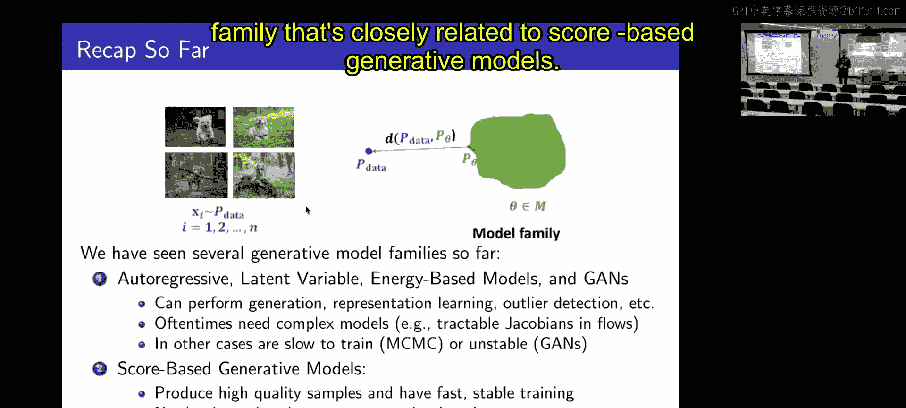

上一节我们介绍了基于分数的生成模型，它通过建模对数概率密度的梯度（即分数函数）来生成数据。本节中，我们将从一个不同的视角来看待基于分数的模型，并将其与我们已经学过的其他模型家族（如隐变量模型和流模型）联系起来。通过这种联系，我们将获得对基于分数模型的更深层次理解，并能够利用一个与之紧密相关的模型家族——扩散模型，来解决表示学习和密度估计等额外任务。

扩散模型通过定义一个从干净数据逐步添加噪声的“前向过程”，并学习一个从噪声数据逐步去噪的“反向过程”来生成数据。这种迭代细化的生成方式是其强大能力的关键。

---

## 回顾：基于分数的生成模型

首先，让我们快速回顾一下基于分数的生成模型是什么。

基于分数的模型旨在解决一个与似然最大化不同的学习目标，即**分数函数估计**。分数函数是数据对数似然相对于输入 **x** 的梯度：

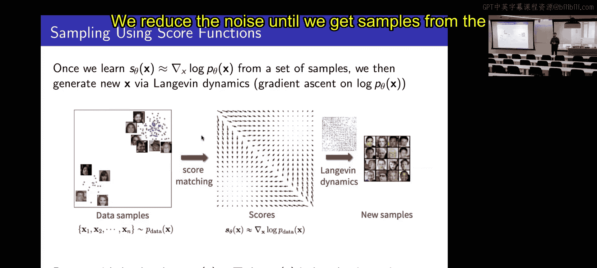

**公式：** `score(x) = ∇_x log p_data(x)`

这个向量场指向数据分布的高概率区域。给定一个数据集，我们的目标是学习一个参数化模型 **s_θ(x)** 来近似这个真实的分数函数。模型可以是任何从 **R^D** 映射到 **R^D** 的神经网络。

以下是基于分数的生成建模流程：
1.  从数据集中获取样本。
2.  通过分数匹配等目标函数，训练模型 **s_θ(x)** 来估计真实分数函数。
3.  一旦获得分数模型，就可以通过**朗之万动力学**进行生成：从一个随机点开始，沿着分数函数指示的方向（即梯度上升）移动，最终到达高概率区域，从而生成样本。

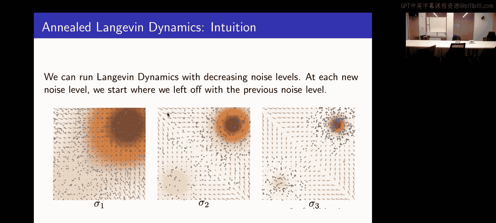

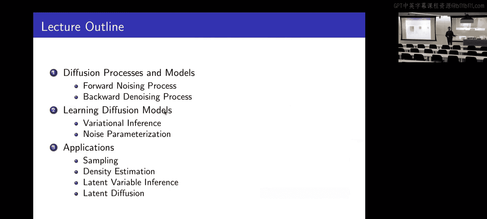

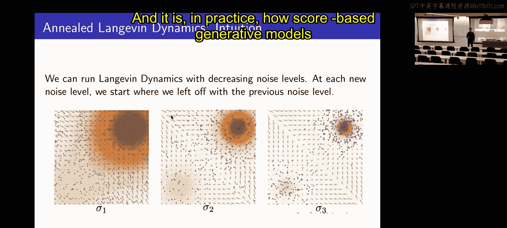

然而，一个重要的细节是：在数据概率较低的区域，分数函数难以准确估计，这会导致朗之万动力学采样失败。为了解决这个问题，实践中采用了**退火朗之万动力学**。

---

## 退火朗之万动力学

退火朗之万动力学通过使用一系列逐渐增强的噪声扰动数据分布来克服上述问题。

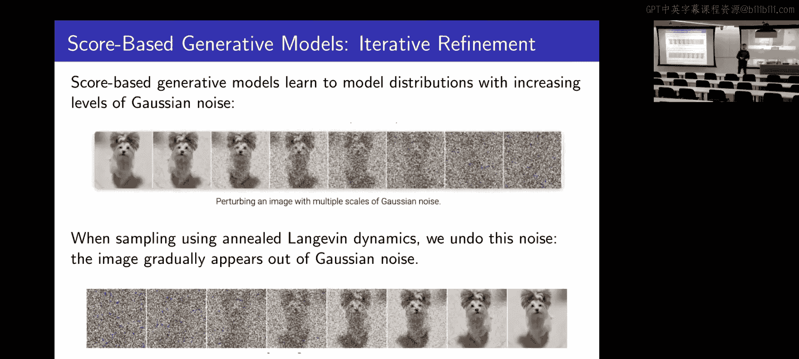

其核心思想如下：
*   我们不仅学习原始数据分布的分数函数，还学习一系列被不同强度高斯噪声扰动后的数据分布的分数函数。
*   噪声最强的分布（如 **σ_1**）其支撑集覆盖了整个空间，因此其分数函数处处可定义且易于准确估计，采样也稳定。
*   生成时，我们首先从噪声最强的分布（**σ_1**）开始进行朗之万动力学采样。
*   然后，我们降低噪声水平至 **σ_2**，并以 **σ_1** 阶段结束时的样本作为起点，继续进行朗之万动力学采样。
*   重复此过程，逐步降低噪声水平，直到从接近原始数据分布的噪声水平下采样，最终得到高质量样本。

这种方法将生成过程分解为多个更易处理的步骤。

---

## 扩散模型：一个新的视角

现在，我们希望将基于分数的生成模型这套看似不同的机制，与我们之前学过的隐变量模型和变分推断 machinery 联系起来。这将为我们提供关于基于分数模型的新见解，并允许我们解决密度估计和表示学习等新任务。

为了建立这种联系，我们需要引入**扩散过程**的概念，这是描述退火朗之万动力学中逐步添加噪声过程的另一种数学方式。

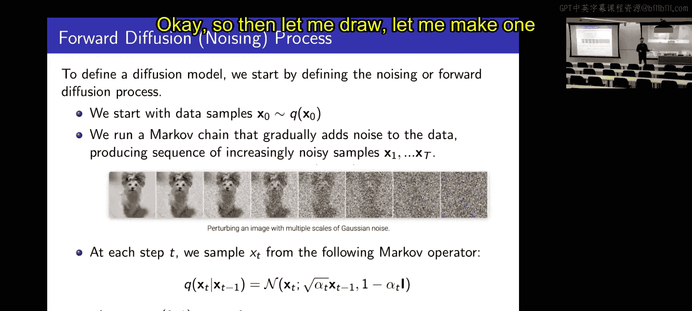

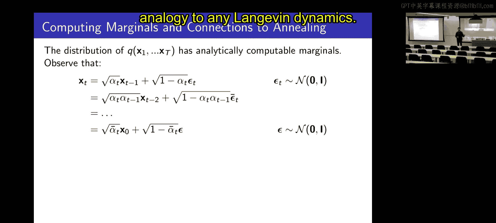

---

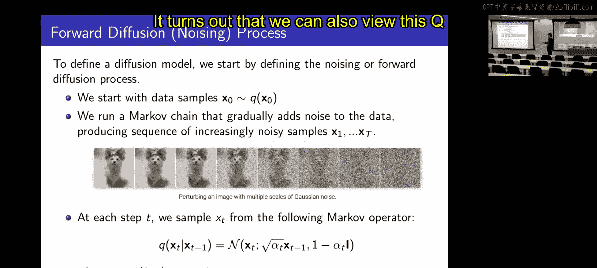

### 什么是扩散过程？

扩散模型从数学上描述了从干净数据到噪声数据（前向过程），以及从噪声数据重建干净数据（反向过程）的过程。

**前向过程（加噪）**： 这是一个马尔可夫链，从干净数据 **x_0** 开始，逐步添加高斯噪声，生成一系列噪声逐渐增强的版本 **x_1, x_2, ..., x_T**。这个过程由分布 **q** 定义。在每一步，给定前一步的数据 **x_{t-1}**，下一步数据 **x_t** 的分布是一个高斯分布：

**公式：** `q(x_t | x_{t-1}) = N(x_t; √(α_t) * x_{t-1}, (1 - α_t) * I)`

其中 **α_t** 是噪声调度表中的一个标量，随着 **t** 增大从接近1衰减到接近0。当 **α_t** 很小时，分布接近纯高斯噪声。

一个重要的数学结果是，我们可以直接写出任意时刻 **t** 的噪声数据 **x_t** 关于原始干净数据 **x_0** 的分布：

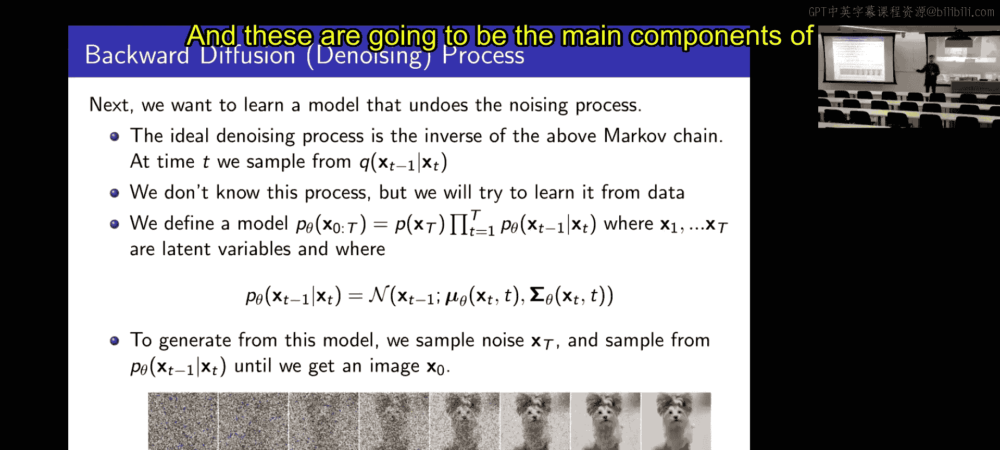

**公式：** `q(x_t | x_0) = N(x_t; √(ᾱ_t) * x_0, (1 - ᾱ_t) * I)`

其中 **ᾱ_t = Π_{s=1}^{t} α_s**。这表明 **x_t** 是 **x_0** 的缩放版本加上高斯噪声。这与退火朗之万动力学中对数据添加高斯噪声的思想是一致的。

**反向过程（去噪）**： 我们的目标是学习另一个马尔可夫链，即**反向扩散过程**，它从纯噪声 **x_T ~ N(0, I)** 开始，并逐步去噪，最终生成干净数据 **x_0**。这个过程由我们想要学习的生成模型 **p** 定义：

**公式：** `p_θ(x_0, x_1, ..., x_T) = p(x_T) Π_{t=1}^{T} p_θ(x_{t-1} | x_t)`

其中，**p(x_T) = N(0, I)**，并且我们通常将每个条件分布 **p_θ(x_{t-1} | x_t)** 参数化为高斯分布，其均值和方差由神经网络预测。

这样，生成数据就变成了从 **p_θ** 中进行祖先采样：先采样 **x_T**，然后依次采样 **x_{T-1}, ..., x_0**。这实现了迭代式生成。

---

### 如何训练扩散模型？

我们的目标是让生成模型 **p_θ** 的反向过程尽可能匹配前向过程 **q** 的反转。我们可以使用变分推断的框架，通过最大化证据下界来训练模型。

将 **x_1, ..., x_T** 视为隐变量，**x_0** 是观测数据。我们可以推导出 ELBO（证据下界），它由以下几项损失之和构成：
*   **L_T**： 先验匹配损失，衡量 **q(x_T)** 和 **p(x_T)** 之间的 KL 散度。由于两者都设计为简单高斯，此项通常很小。
*   **L_{t} (1 ≤ t ≤ T-1)**： 扩散匹配损失，衡量 **q(x_{t-1} | x_t, x_0)** 和 **p_θ(x_{t-1} | x_t)** 之间的 KL 散度。这是训练的核心，迫使反向过程的每一步学习去匹配前向过程在给定干净数据条件下的反转。
*   **L_0**： 重构损失，衡量生成数据 **x_0** 的似然。

通过优化这个 ELBO，我们同时最小化了 **p** 和 **q** 之间的 KL 散度，并最大化了数据 **x_0** 在模型下的对数似然。

---

### 关键参数化：预测噪声

直接参数化 **p_θ(x_{t-1} | x_t)** 的均值 **μ_θ** 并非最优。一个更巧妙的参数化利用了 **q(x_{t-1} | x_t, x_0)** 的解析形式。可以证明，其均值 **μ̃_t** 可以表示为：

**公式：** `μ̃_t = (1 / √(α_t)) * ( x_t - ((1 - α_t) / √(1 - ᾱ_t)) * ε_t )`

其中 **ε_t** 是在前向过程中，从 **x_0** 生成 **x_t** 时所添加的噪声。

因此，我们可以不直接预测均值，而是让神经网络 **ε_θ(x_t, t)** 去预测这个噪声 **ε_t**。然后通过上述公式计算出 **μ_θ**。这样，扩散匹配损失 **L_t**（在方差固定等假设下）简化为一个简单的均方误差：

**公式：** `L_t = E[|| ε_t - ε_θ(x_t, t) ||^2]`

这意味着，扩散模型的核心是训练一个**去噪模型**，其任务是预测添加到一张图像中的噪声。这与基于分数的模型中**去噪分数匹配**的目标紧密相关。

---

### 训练算法

基于上述推导，训练扩散模型的算法变得非常简洁：
1.  从数据集中随机采样一个干净样本 **x_0**。
2.  随机选择一个时间步 **t** ~ Uniform({1, ..., T})。
3.  从标准高斯分布采样噪声 **ε** ~ N(0, I)。
4.  根据前向过程公式计算加噪后的样本 **x_t = √(ᾱ_t) * x_0 + √(1 - ᾱ_t) * ε**。
5.  将 **x_t** 和 **t** 输入神经网络 **ε_θ**，得到预测的噪声 **ε_θ(x_t, t)**。
6.  计算损失 **|| ε - ε_θ(x_t, t) ||^2** 并执行梯度下降。

---

### 采样算法

训练好噪声预测模型 **ε_θ** 后，生成样本的祖先采样过程如下：
1.  从纯噪声 **x_T** ~ N(0, I) 开始。
2.  对于 **t = T, T-1, ..., 1**：
    *   根据当前 **x_t** 和时间步 **t**，用模型预测噪声 **ε_θ(x_t, t)**。
    *   使用公式计算 **x_{t-1}** 的均值（利用预测的噪声）。
    *   采样 **x_{t-1} ~ N(μ_θ(x_t, t), σ_t^2 I)**，其中 **σ_t^2** 是预设或学习的方差。
3.  最终得到生成样本 **x_0**。

可以证明，这个采样过程在数学上等价于执行退火朗之万动力学，其中每一步的“分数”由 **ε_θ(x_t, t) / √(1 - ᾱ_t)** 给出。这清晰地建立了扩散模型与基于分数的生成模型之间的等价性。

---

## 扩散模型的能力与应用

扩散模型凭借其迭代细化生成和稳定训练的特性，展现出强大的能力：

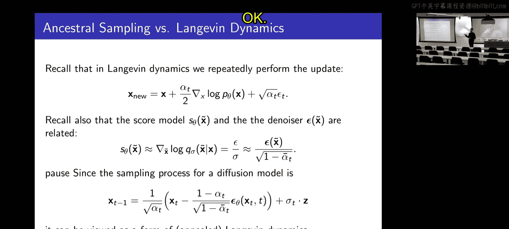

*   **高质量图像生成**： 扩散模型能够生成与GAN相媲美甚至更优的高分辨率、高保真度图像。
*   **条件生成**： 通过在对噪声预测模型 **ε_θ** 的输入中加入条件信息（如文本描述、类别标签），可以实现可控的图像生成。这正是DALL·E 2、Stable Diffusion等著名文生图系统的核心技术之一。
*   **最先进的密度估计**： 由于扩散模型优化的是对数似然的下界，通过改进模型结构（如引入傅里叶特征、学习噪声调度表等），它们可以在CIFAR-10、ImageNet等标准数据集上取得最先进的负对数似然值，超越了长期占据主导地位的自回归模型。
*   **表示学习**： 可以在扩散框架中引入低维、可解释的隐变量 **z**。通过联合训练一个编码器将 **x_0** 映射到 **z**，并在去噪过程中条件于 **z**，模型可以学习有意义的语义表示，从而实现图像插值、属性编辑等操作。

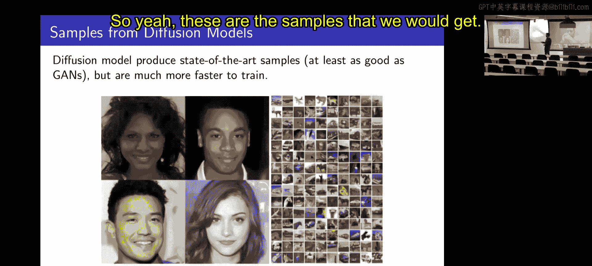

---

## 总结与优缺点

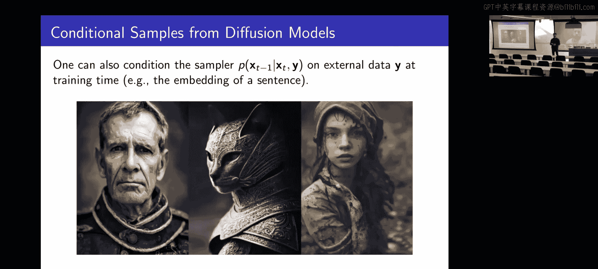

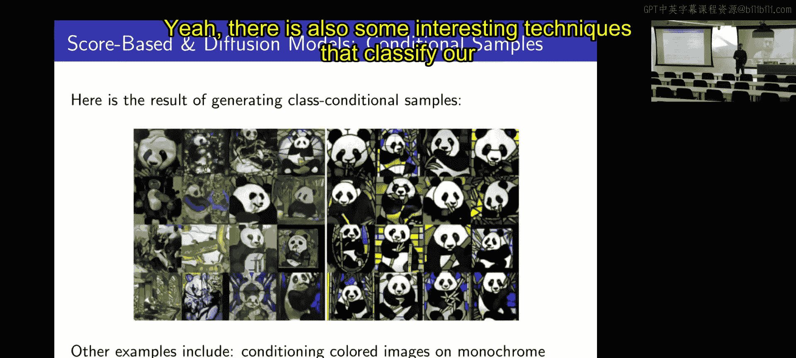

本节课中，我们一起学习了扩散模型。我们从基于分数的生成模型出发，通过引入前向和反向扩散过程，建立了扩散模型与变分下界优化之间的桥梁。我们看到，扩散模型本质上是基于分数模型的一种特例或另一种视角，它通过预测噪声来进行训练，并通过迭代去噪过程进行生成。

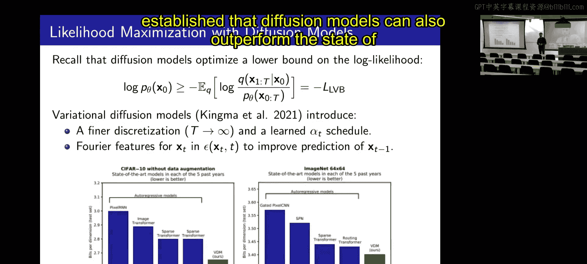

**优点**：
*   生成样本质量极高，与GAN相当或更优。
*   训练目标稳定，避免了GAN中的模式崩溃和训练不稳定问题。
*   天然适合迭代式、可控的生成过程。
*   在密度估计任务上也能达到最先进水平。
*   与基于分数的模型理论相通，提供了丰富的数学解释。

**缺点**：
*   采样速度较慢，因为需要多次（通常数百或数千次）神经网络前向传播来生成一个样本。
*   主要针对连续数据（如图像、音频）设计，将其有效推广到离散数据（如文本）仍是一个活跃的研究领域。

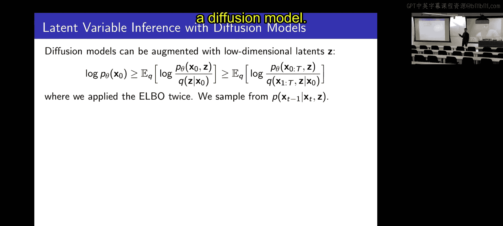

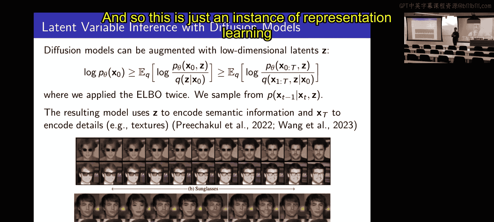

---

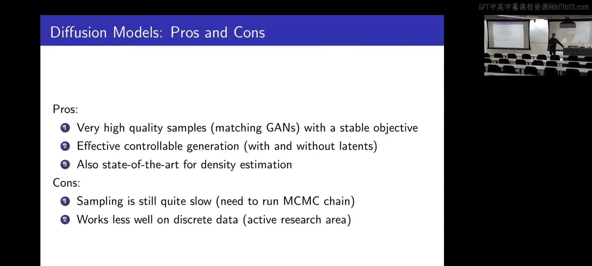

通过本课程，你现在应该对扩散模型的基本原理、其与基于分数模型及经典生成模型的联系、以及其强大的应用潜力有了深入的理解。