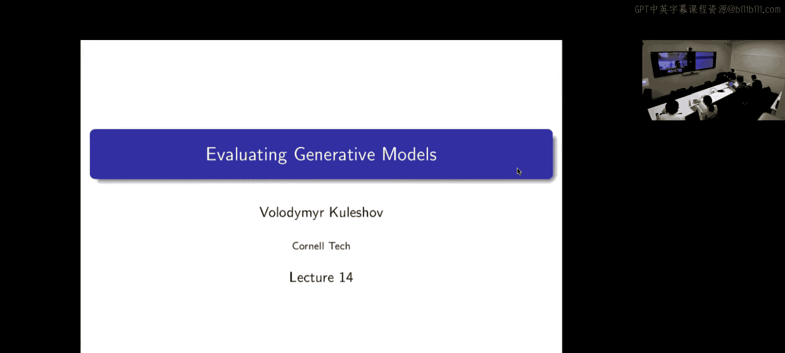
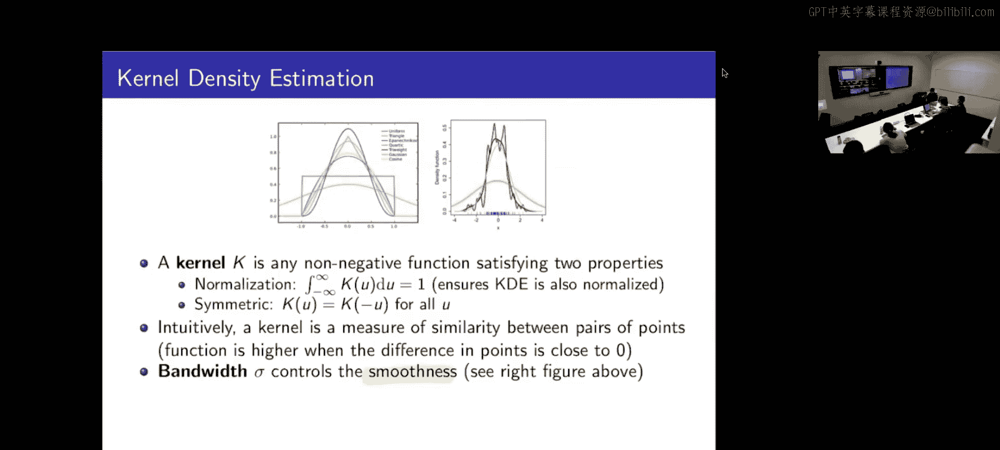
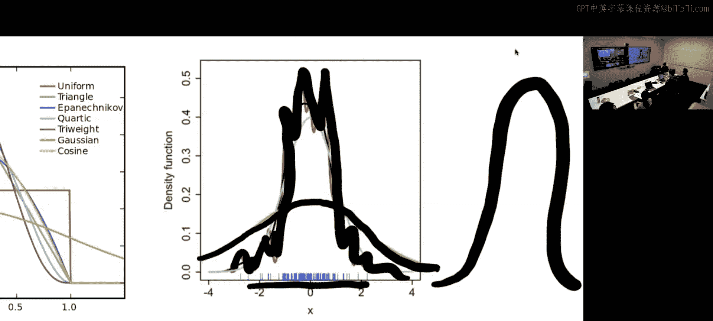
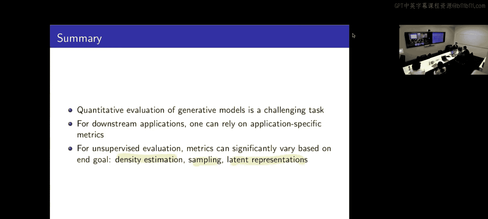

# 深度生成模型：第14讲：生成模型评估 🧪

在本节课中，我们将要学习如何评估生成模型。评估生成模型比评估判别模型更具挑战性，因为生成模型可以执行多种任务，如密度估计、高质量样本生成和表示学习。不同的模型可能在不同任务上表现各异，因此我们需要针对特定任务选择合适的评估方法。本节课将重点介绍针对密度估计、样本质量和潜在变量质量这三个核心任务的评估指标与技术。

## 密度估计 📊

上一节我们介绍了生成模型的不同任务。本节中，我们来看看如何评估模型的密度估计能力。密度估计的目标是学习一个模型分布 P_θ，使其尽可能接近真实的数据分布。一种严谨的定义方式是使用KL散度作为度量，最小化模型分布与数据分布之间的KL散度。由于最小化KL散度等价于最大化对数似然，因此我们可以将对数似然作为评估密度估计性能的核心指标。

对于能够直接计算对数似然的模型（如自回归模型、标准化流），评估过程相对直接。

以下是评估步骤：
1.  将数据集划分为训练集、验证集和测试集。
2.  在训练集上拟合模型。
3.  使用验证集的对数似然来调整超参数。
4.  最终在测试集上计算对数似然，作为模型性能的评估。

然而，对于无法直接计算精确对数似然的模型（如变分自编码器、能量模型），我们需要其他技术来近似评估。

以下是两种常用的近似方法：
*   **重要性采样**：这是一种蒙特卡洛采样技术，通过从一个提议分布 Q 中采样来估计目标概率。其核心公式为：
    `P(x) = E_{z~Q(z)} [ P(x, z) / Q(z) ]`
    对于变分自编码器，可以使用其编码器 `q_φ(z|x)` 作为提议分布 Q，以获得更低的方差估计。
*   **退火重要性采样**：这是重要性采样的扩展，特别适用于能量模型等复杂分布。它通过逐渐“退火”一个从简单分布（如均匀分布）到目标分布的路径来生成样本，从而提高估计的准确性。

对于仅能生成样本的隐式模型（如生成对抗网络），我们可以尝试使用核密度估计来从样本中近似数据分布。

## 样本质量评估 🖼️

上一节我们讨论了密度估计的评估。本节中，我们来看看如何直接评估生成样本的质量。虽然理论上完美的密度估计会带来完美的样本，但在实践中，对数似然的提升并不总是与视觉样本质量的提升完全一致。因此，我们需要专门针对样本质量的评估指标。

人类评估虽然直观，但成本高、可扩展性差，且难以评估泛化性等问题。因此，研究者开发了多种自动化定量指标。

以下是三种主流的自动化样本质量评估指标：
*   **初始分数**：该指标使用一个预训练的分类器（如Inception网络）来评估生成样本。它结合了“清晰度”（分类器对单个样本的预测应确信）和“多样性”（所有生成样本的类别分布应均匀）两个准则。其公式为：
    `IS = exp( E_x [ KL( p(y|x) || p(y) ) ] )`
    其中，`p(y|x)` 是分类器对样本 x 的预测分布，`p(y)` 是所有生成样本的边际类别分布。
*   **弗雷歇初始距离**：这是目前最常用的图像生成质量评估指标。它不在像素空间比较图像，而是在一个预训练分类器（如Inception网络）的中间层激活空间进行比较。具体做法是，分别计算真实图像和生成图像在特征空间中的分布，然后拟合两个高斯分布，并计算它们之间的弗雷歇距离（两个高斯分布之间的Wasserstein-2距离）。FID值越低，表示生成分布与真实分布越接近。
*   **核初始距离**：KID与FID类似，也是在特征空间中比较分布，但它使用的是最大均值差异作为度量。MMD是一种基于核的两样本检验统计量。与FID相比，KID的估计是无偏的，并且允许使用更灵活的核函数，但计算复杂度更高（O(n²)）。

## 潜在变量质量评估 🔍

上一节我们介绍了样本质量的评估。本节中，我们来看看如何评估生成模型学习到的潜在表示的质量。一个好的潜在表示可以有不同的含义，具体取决于下游任务。

如果存在明确的下游任务（如半监督学习），那么直接在该任务上评估性能是最佳方式。例如，可以使用生成模型提取的特征训练一个分类器，并报告其准确率。

当没有明确的下游任务时，我们可以从以下几个角度评估潜在表示的质量：

以下是潜在变量质量的几个评估维度：
*   **聚类发现**：模型是否能在无监督的情况下发现数据中有意义的簇结构（例如，将手写数字的不同类别自动分开）。如果数据本身带有标签（仅用于评估），可以使用聚类评估指标，如**同质性**（一个簇中是否只包含单一类别）、**完整性**（同一类别的样本是否被分配到同一个簇）以及两者的调和平均**V度量**。
*   **压缩效率**：生成模型（尤其是变分自编码器）可以看作是一种压缩算法。我们可以通过衡量模型在给定压缩率下的重构质量，或将模型的对数似然与比特率联系起来，来评估其压缩性能。
*   **解纠缠**：这是指学习到的潜在变量维度是否对应数据中人类可理解的、独立的语义因子（例如，人脸数据中的姿态、光照、发型等）。评估解纠缠程度有专门的指标，如**β-VAE度量**和**因子VAE度量**，它们通过测量潜在变量变化对生成样本特定属性的可控性来进行量化。

## 总结 📝

本节课中我们一起学习了评估生成模型的各种方法。我们了解到，定量评估生成模型具有挑战性，最佳方式是针对具体的下游任务进行评估。除此之外，我们可以根据关注点的不同（密度估计、样本质量或潜在表示），选择专门的评估指标：对于密度估计，可使用（近似）对数似然；对于样本质量，FID是目前最主流的自动化指标；对于潜在变量，则可根据聚类、压缩或解纠缠等目标选择相应评估方法。理解这些评估技术有助于我们在实践中根据任务需求选择和比较不同的生成模型。