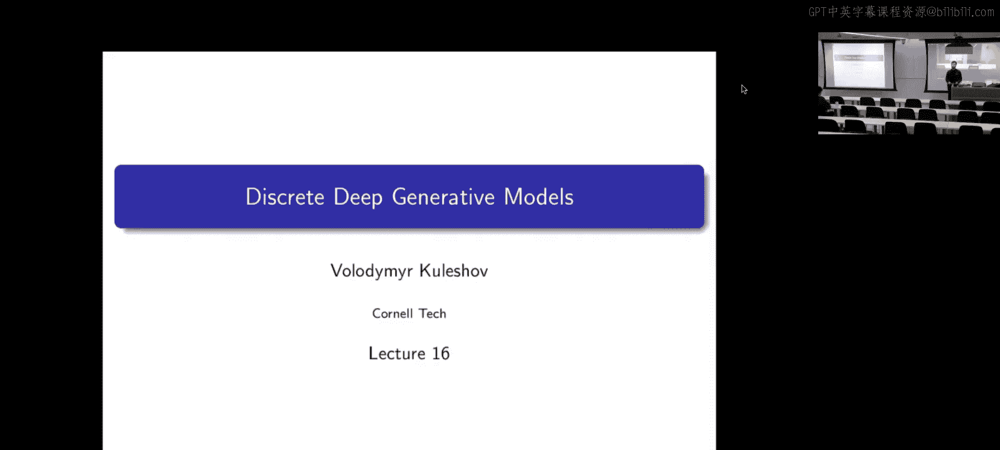
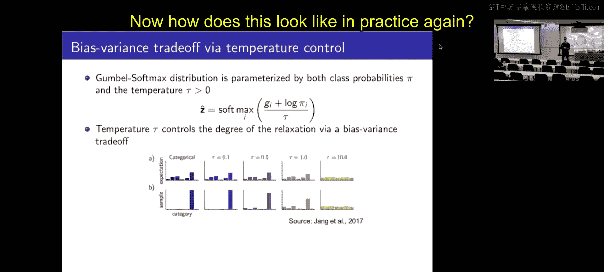
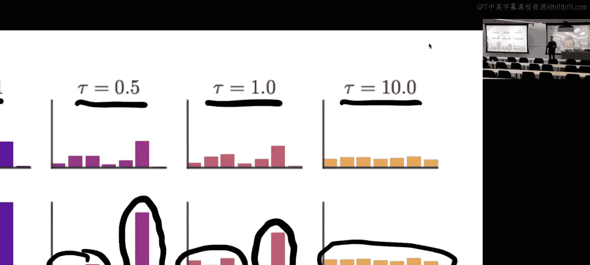
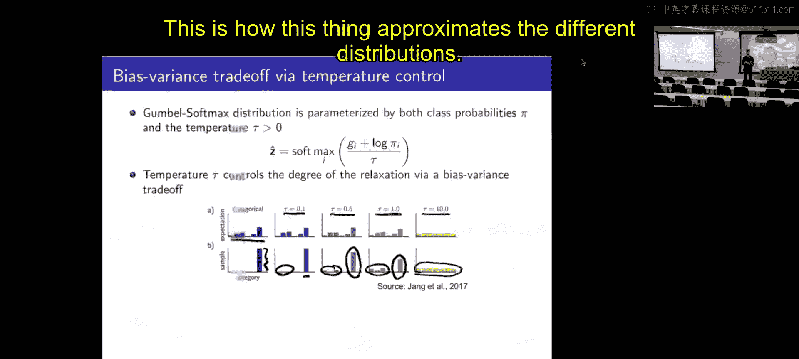
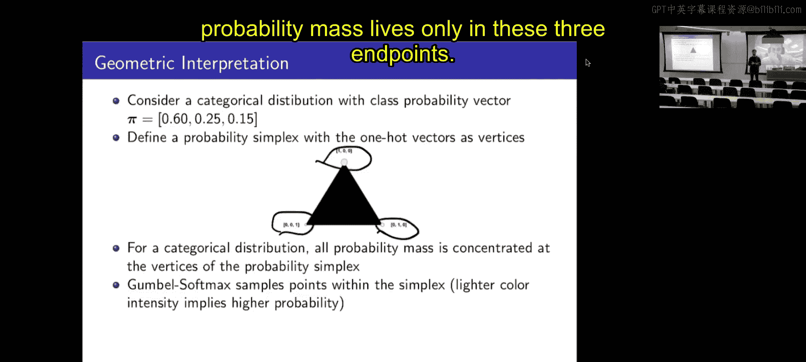
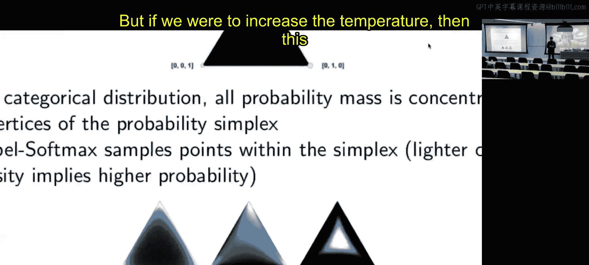
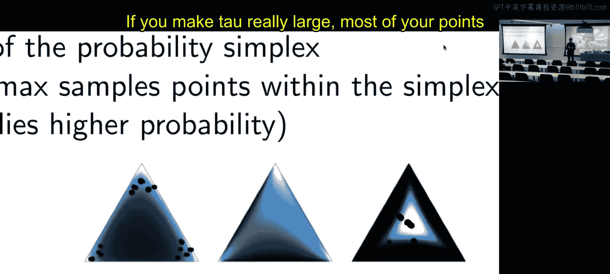
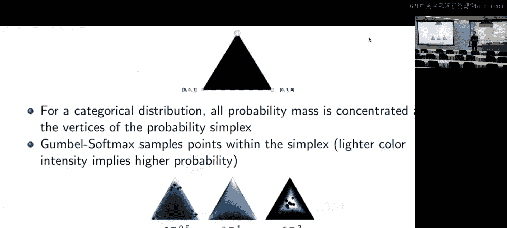
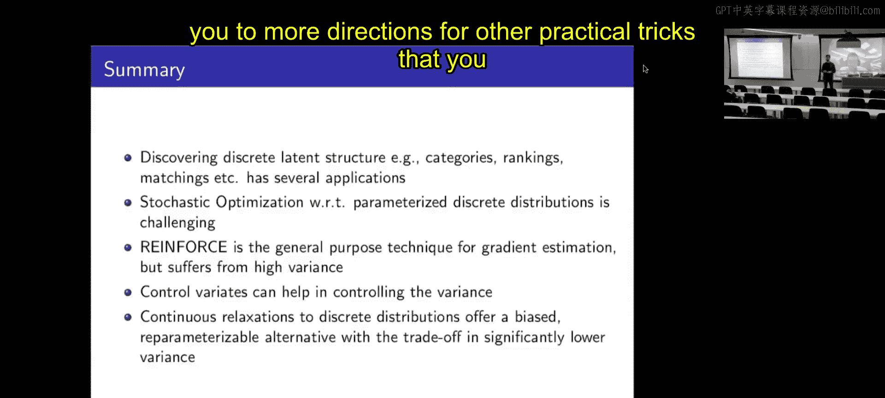

# 深度生成模型：16：离散深度生成模型 🧠

在本节课中，我们将探讨生成模型中的一个特殊主题：**离散性**。我们将学习为什么离散数据（如文本、图、DNA序列）或离散潜在表示在建模时会带来独特的挑战，并介绍两种用于解决此类离散优化问题的核心技术：**REINFORCE梯度估计器**和**松弛重参数化技巧**。

## 概述：离散优化问题

在生成模型中，我们经常遇到需要对**离散变量**进行优化的问题。这类问题的通用形式可以表示为：

**目标函数**：`L(φ) = E_{z∼q_φ(z)} [f(z)]`

我们的目标是优化参数 `φ`，以最大化这个期望值。这里的 `q_φ(z)` 是一个参数化的概率分布（例如生成器或近似后验），`f(z)` 是一个评分函数（例如ELBO或判别器得分）。

当 `z` 是连续变量时，我们可以使用**重参数化技巧**轻松计算梯度。然而，当 `z` 是离散变量时，或者当 `f(z)` 本身不可微时（例如某些自然语言处理评估指标），重参数化技巧不再适用。这就需要更通用的方法。

接下来，我们将深入探讨两种解决此类问题的方法。

## REINFORCE梯度估计器 🔄

上一节我们定义了离散优化问题。本节中，我们来看看第一种通用解决方案：**REINFORCE梯度估计器**（也称为得分函数估计器）。

其核心思想是通过一个数学恒等式，将梯度算子移入期望内部。具体推导如下：

我们希望计算目标函数 `L(φ)` 关于参数 `φ` 的梯度：
`∇_φ L(φ) = ∇_φ E_{z∼q_φ(z)} [f(z)]`

通过一些代数运算和**对数导数技巧**，我们可以将其重写为：
`∇_φ L(φ) = E_{z∼q_φ(z)} [f(z) ∇_φ log q_φ(z)]`

这个公式就是REINFORCE估计器。现在，梯度以期望值的形式表达，我们可以使用蒙特卡洛采样来近似计算它：

`∇_φ L(φ) ≈ (1/K) Σ_{i=1}^{K} [f(z_i) ∇_φ log q_φ(z_i)]`，其中 `z_i ∼ q_φ(z)`

这个估计器是**无偏的**，但一个主要问题是它的**方差通常很高**，导致训练不稳定。高方差源于 `log q_φ(z)` 项，当概率 `q_φ(z)` 很小时，其对数值会趋向负无穷，波动极大。

### 应用场景

以下是REINFORCE估计器可以应用的几个场景：

*   **离散潜在变量模型**：例如，在变分自编码器（VAE）中，如果潜在变量 `z` 是离散的（如分类分布），则无法使用标准重参数化技巧，REINFORCE成为一种选择。
*   **离散生成对抗网络（GAN）**：当生成器产生离散数据（如文本）时，需要优化生成器参数以欺骗判别器。由于采样步骤不可微，可以使用REINFORCE来估计梯度。
*   **基于不可微奖励的序列生成**：在文本生成中，如果目标是最大化一个不可微的评估指标（如BLEU或ROUGE分数），可以将生成器视为智能体，生成动作（词）以获得奖励，从而应用REINFORCE。

尽管REINFORCE很通用，但其高方差问题限制了其实用性。接下来，我们将介绍一种降低方差的重要技术。

## 控制变量法：降低方差 🎯

REINFORCE估计器虽然无偏，但高方差会影响优化效率。本节中，我们介绍一种常用的方差缩减技术：**控制变量法**。

其核心思想是，我们可以构造一个新的函数 `f̂(z)`，使其期望值与原函数 `f(z)` 相同，但方差更低。一个简单的控制变量形式是：

`f̂(z) = f(z) - β (h(z) - E[h(z)])`

这里，`h(z)` 是一个与我们想要估计的 `f(z)` 相关的函数，`β` 是一个系数。关键在于，减去 `(h(z) - E[h(z)])` 这一项并不改变期望值，因为 `E[h(z) - E[h(z)]] = 0`。然而，如果 `h(z)` 与 `f(z)` 高度相关，那么 `f̂(z)` 的方差就会显著降低。

**最优控制变量** `h*(z)` 实际上是 `f(z)` 本身，但这通常未知。在实践中，我们会选择一个与 `f(z)` 近似且其期望值易于计算（或可学习）的函数作为 `h(z)`。

### 在离散VAE中的应用

一个著名的例子是NVIL（Neural Variational Inference and Learning）论文。在训练具有离散潜在变量的Sigmoid信念网络（一种离散VAE）时，他们使用了输入相关的基线（控制变量）。其梯度估计器变为：

`∇_φ L ≈ (1/K) Σ_i [ (f(z_i) - b(x) - β) ∇_φ log q_φ(z_i | x) ]`

其中 `b(x)` 是一个可学习的、依赖于输入 `x` 的基线网络，用于估计 `f(z)` 的值。`β` 是一个全局基线。通过学习 `b(x)` 使其接近 `f(z)` 的期望，可以有效地降低梯度估计的方差，使得训练离散潜在变量模型成为可能。

控制变量法显著改善了REINFORCE的实用性。然而，还有一种思路截然不同且通常更易于实现的方法，我们将在下一节探讨。

## 松弛重参数化技巧：连续放松 🧪

除了改进REINFORCE，我们还可以换一种思路：如果能把离散变量**连续化**，不就可以直接应用高效的重参数化技巧了吗？这就是**松弛重参数化技巧**的核心思想，其中最具代表性的是 **Gumbel-Softmax技巧**。

首先，我们需要一个工具：**Gumbel分布**。其概率密度函数为：
`p(g) = exp(-(g - μ + exp(-(g - μ))))` （标准Gumbel分布 `μ=0, β=1`）

Gumbel分布有一个神奇的性质，即 **Gumbel-Max技巧**：
要从一个分类分布 `Cat(π)` 中采样，可以这样做：
1.  对每个类别 `i`，从标准Gumbel分布采样噪声 `g_i`。
2.  计算 `z = one_hot(argmax_i [log(π_i) + g_i])`。

这样得到的 `z` 服从 `Cat(π)` 分布。这个过程看起来很像重参数化（参数 `log(π_i)` 加上固定噪声），但 `argmax` 和 `one_hot` 操作是不可微的。

**Gumbel-Softmax技巧**的关键一步是**用可微的softmax替换不可微的argmax**：

`ẑ_i = exp((log(π_i) + g_i) / τ) / Σ_j exp((log(π_j) + g_j) / τ)`

这里，`τ > 0` 是一个**温度参数**。当 `τ → 0` 时，`ẑ` 趋近于一个one-hot向量（即Gumbel-Max的结果）；当 `τ` 较大时，`ẑ` 变得更平滑，更像一个连续的概率向量。

### 应用与训练

在训练时，我们可以：
1.  用 `ẑ` 代替原始的离散采样 `z` 参与前向计算。
2.  由于 `ẑ` 是连续且可微的，我们可以直接通过反向传播计算梯度。
3.  采用**退火策略**：训练初期使用较大的 `τ` 以获得较低方差的梯度；随着训练进行，逐渐减小 `τ`，使 `ẑ` 逼近真实的离散分布。

这种方法非常易于实现，只需在采样步骤中插入Gumbel-Softmax变换即可，深度学习框架可以自动处理梯度计算。

### 扩展到其他离散结构

这种“扰动-松弛”的思想可以推广到许多其他离散结构：

*   **排列（Permutations）**：可以使用 **Plackett-Luce分布** 和类似的松弛技巧（如使用Gumbel噪声和可微的排序操作）。
*   **图结构、语法树等**：也存在相应的松弛重参数化方法。

## 总结 📝

本节课我们一起学习了深度生成模型中处理离散性的核心挑战与方法。

*   **问题定义**：我们首先明确了在优化涉及离散变量或不可微目标的期望时面临的通用问题。
*   **REINFORCE估计器**：我们学习了这种通用但高方差的梯度估计方法，它通过对数导数技巧将梯度表达为期望形式。
*   **控制变量法**：为了克服高方差，我们介绍了控制变量法，通过减去一个与目标相关且期望已知的基线项来有效降低方差，使REINFORCE在实践中可用。
*   **松弛重参数化（Gumbel-Softmax）**：我们探讨了另一种思路，即通过连续松弛（如用Gumbel-Softmax替代离散采样）将离散问题转化为连续可微问题，从而可以直接利用反向传播和重参数化技巧的优势，通常更易于实现和训练。

离散性在数据（文本、图）和潜在表示中无处不在。理解这些技术为你处理相关的生成建模任务（如文本生成、离散推理、结构化预测）提供了重要的工具基础。