# 深度生成模型：P1：课程介绍与概述 🎓

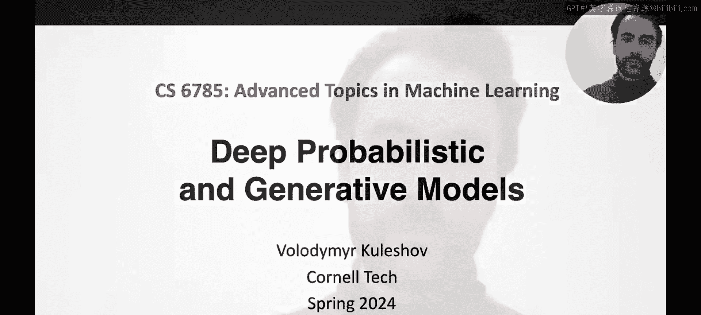

在本节课中，我们将学习康奈尔大学《深度生成模型》课程的第一讲。我们将了解课程的核心主题、深度生成模型的基本概念，并通过一系列令人兴奋的应用实例来展示这一领域的魅力。

大家好，欢迎来到康奈尔大学及康奈尔理工学院的深度生成模型在线课程。我是Vladimir Kuleshov，很荣幸担任本课程的讲师。

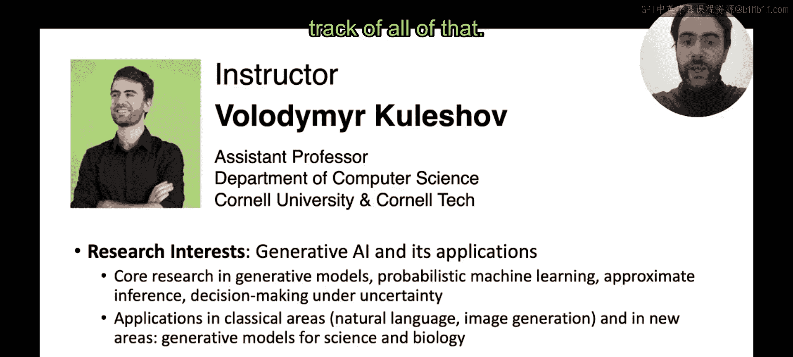

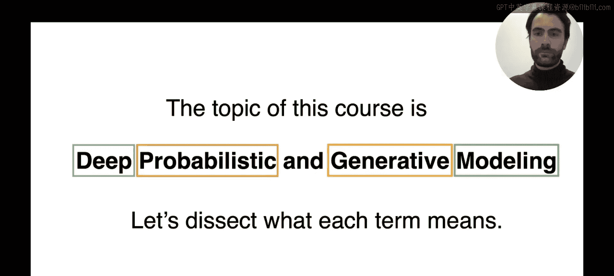

在这第一讲中，我将概述整个课程，并展示一些深度生成模型的最新应用实例。希望这些例子能让你相信这是一个非常激动人心的领域，并让你对后续课程中将学习的算法和方法有一个初步的了解。

在开始主要内容之前，我先简要介绍一下自己。我是康奈尔大学计算机科学系的助理教授，康奈尔理工学院是康奈尔大学在纽约市的分校。我非常关注深度生成模型这一主题，因为它是我个人研究以及我研究小组的主要焦点之一。我的小组致力于开发新的生成建模算法，改进现有的深度生成模型家族，并探索其在各个领域的应用，从自然语言处理、图像生成等经典领域，到生物学等科学新领域。我也投入时间进行教学，例如本课程，并且热衷于向世界分享我的课程材料。

## 课程核心主题解析 🔍

现在，我想用本讲剩余的时间来探讨课程的核心主题。首先，我将用接下来的15到20分钟来详细解释课程的主题究竟是什么，即什么是深度概率生成模型。

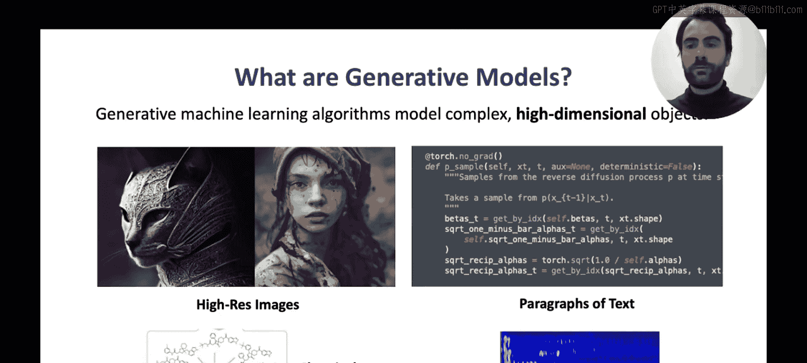

幻灯片上显示的是课程标题。我想通过深入剖析标题中的每个关键词，来帮助你更好地理解我们将在整个课程中涵盖的主题类型。

### 生成模型

本课程将围绕一类特定的算法展开，我们称之为**生成模型**。生成模型的关键定义特征是，它是一种处理**高维数据**的算法。

什么是高维数据？幻灯片上展示了一些例子。左上角是深度生成模型最常处理的数据类型之一：**高分辨率图像**。你可以将图像视为一个非常大的数字数组，而深度生成模型试图建模和理解这种高维数据。因此，生成模型具备诸如生成图像的能力。事实上，屏幕上你看到的两张图片就是由计算机程序使用一种称为**扩散模型**的生成建模算法生成的。我们将在课程中学习扩散模型。近年来，图像生成模型的质量有了巨大提升，如今计算机已经能够生成像截图中那样非常美丽、极具艺术感染力的图像。

另一个高维数据的例子是**文本**。这是幻灯片右侧的例子。这里展示了一段代码片段，它实际上实现了我们将在课程中看到的生成建模算法的一个组件，特别是扩散模型的一部分。代码或广义上的文本代表了另一种高维数据，因为它由非常长的离散标记序列组成。当我们把整个序列看作一个数据点时，它对应着一个包含许多变量、许多自由参数的非常高维的数据点。因此，能够处理文本数据的生成模型通常也可以执行诸如生成文本的任务，它可以生成代码、充当代码助手、生成自然语言，并用于驱动像ChatGPT这样的聊天机器人。所以说，文本是高维数据的另一个例子。

图像和文本并不是唯一的例子。**人类语音**可能是另一个例子。你可以将语音录音视为一个非常长的时间序列，其中每个时间点对应一个音频样本，而我们有很多这样的样本。事实上，典型的音频记录通常每秒有超过44,000个样本，这导致每秒有非常大量的数据点，从而形成一个非常复杂、非常高维的信号。生成模型也可以尝试处理这种信号。

另一个例子是**化学分子**。你可以将化学分子表示为一长串符号，或者也可以将其表示为3D结构，例如3D点云或其他类型的3D表示。这同样对应着一个可以被建模的复杂高维输入。

### 生成模型 vs. 判别模型

理解生成建模算法的另一种方式是将它们与另一种机器学习方法——**判别算法**或**判别模型**——进行比较。事实上，当今使用的大多数机器学习算法实际上都是判别模型。

判别模型也可以处理高维数据，但方式非常不同。通常，判别模型会将高维数据作为固定输入，然后处理该数据点以输出简单的内容，例如一个类别标签，或者一个低维数字（可能只是一个标量，对应回归问题）。但这里的关键点是，在判别模型中，高维数据**仅作为固定输入**。

然而，在生成模型中，复杂数据**反而是输出**。你甚至可以将生成模型视为**反向运行判别模型的计算图**。例如，我们可能从简单的东西开始，比如我们想要生成的对象的名称，或者只是一小段随机数向量。然后，我们将其反向通过计算图，尝试将复杂数据点作为输出。中间完成的工作、进行的计算可以由不同类型的模型参数化。在这种情况下，判别模型的例子是像卷积神经网络这样的东西，我们也可以使用类似的转置卷积类型来生成底部示例中的高维数据点。

但再次强调，这里的关键点是，**复杂的高维数据是模型的输出**。这意味着我们试图解决的任务将更加复杂。生成图像比分类图像要困难得多。然而，这样做的好处也将是显著的。

因此，简要思考一下判别模型与生成模型的优缺点以及它们的能力是有用的。简而言之，生成模型通常可以做判别模型能做的所有事情。事实上，判别模型的主要用例是监督学习问题，我们试图进行分类或某种形式的回归。在生成模型中，我们通常也可以解决分类问题。例如，如果你上过机器学习课程，你可能见过朴素贝叶斯算法，它对应一个简单的生成模型，可以通过应用称为贝叶斯规则的特定数学技巧将其转换为分类算法。

因此，生成模型可以做判别模型能做的所有事情，但它们还能做得更多。生成模型最令人印象深刻的用例或许是能够**生成新数据**。例如，我们可以要求生成模型创建新的图像，即它在训练时未曾见过的图像。或者，我们可以要求它生成图像，但以某种输入为条件，例如描述我们想要生成内容的文本片段。或者，如果我们在分类领域，我们可以执行分类，但针对某些属性缺失的数据。此外，还有许多其他可能的应用程序，例如，我们可以尝试检测某个数据点是否来自我们的数据分布，这将是另一个有趣的用例。

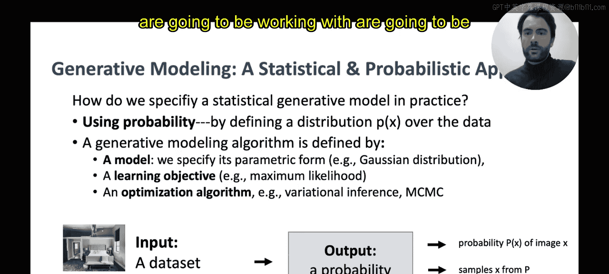

### 基于规则 vs. 基于学习的方法

本课程中我们将学习的生成模型将具有某种特定形式。我们将专注于一种特定类型的生成模型。为了更好地理解这一点，我想将本课程中将看到的生成模型与你可能熟悉的另一种生成系统进行对比，即可能用于你最喜欢的视频游戏的图形引擎，例如虚幻引擎或用于渲染简单2D Atari游戏的Atari引擎。我将这种图形引擎称为**基于规则的方法**的一个实例，这与我们将在本课程中学习的**基于学习的方法**非常不同。

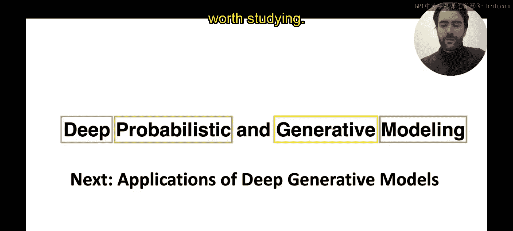

首先，让我们尝试理解基于规则的方法，并将其与课程中将看到的基于学习的方法进行对比。你可以将图形引擎视为接收用户想要渲染的某种规范（通常使用某种编程语言），然后将其传递给一个由程序员设计、工程师手动实现的系统。该系统的输出将是我们想要创建的场景对象的某种渲染。这个过程的关键在于，渲染引擎基于一组由用户创建的规则。换句话说，我们对物理定律有所了解，我们知道光在不同表面上的反射方式，以及它如何被镜子反射或如何穿过水或玻璃。基于这些物理定律，工程师写下了不同纹理和材料应如何渲染和呈现的规则，这就是图形引擎工作的基础。

与图形引擎的基于规则方法相反，本课程中将看到的模型将采用**基于学习的方法**。这是什么意思呢？假设我想生成像卧室这样的物体。那么，与其为衣服或光线应如何渲染指定一个基于规则的系统，我们不如给计算机一个非常大的卧室图像数据集，然后要求它从数据中学习将我们想要生成的场景的抽象表示映射到像素的规则。我们这样做的原因是，这种方法最终将证明比手动指定规则更具可扩展性，特别是它将适用于无法轻松创建这些规则的新领域，例如在生物学中，或者对于代码、语言、音频、人类语音等领域。很难手动编写人类语音的规则，相反，我们应该能够从数据中学习这些东西。当然，某种程度的人类知识始终是必要的，我们仍然必须以某种方式选择学习算法，但在需要多少手动定制工作的光谱上，本课程中的算法将尽可能基于学习，而不是基于手动规则的规范。

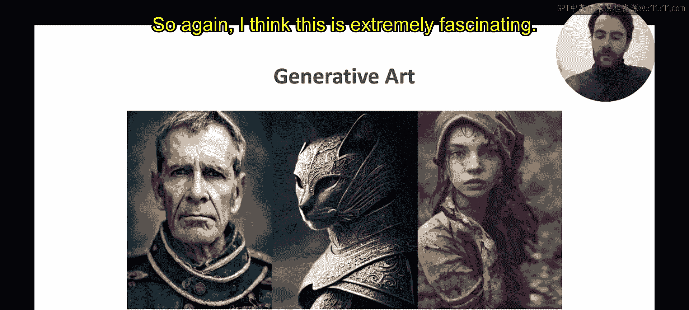

为了更好地理解统计方法与基于规则方法之间的区别，让我给你一个高层次的实际例子，说明概率方法在实践中如何实现。

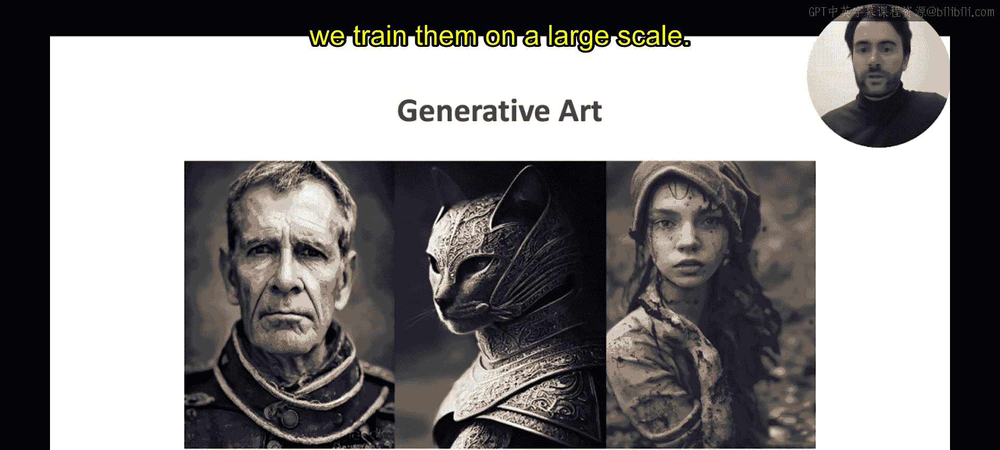

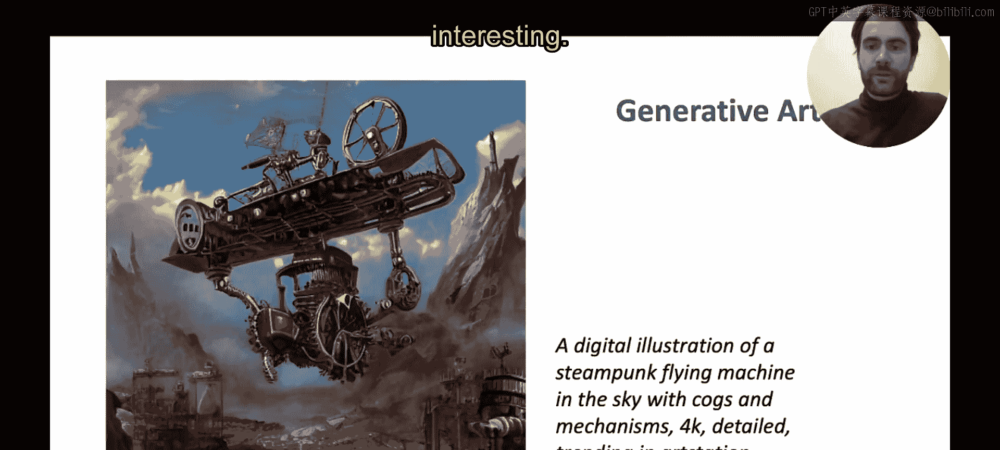

在本课程中，例如生成图像的生成器，不会看起来像一个人工设计的黑盒子。相反，它将由一个**概率分布**定义。我们将为我们想要生成的所有类型的对象（例如所有可能的图像）定义一个概率分布，然后通过从该分布中抽取样本来生成。如果该分布在高维空间的正确部分（即看起来像图像的事物上）放置了概率质量，那么通过抽取样本，我们将生成新的图像。

这就是高层次的概述。现在稍微深入一点细节。你可以想象输出概率生成器的算法，在我们的课程中，它将始终具有某种结构，并且始终由相同的三个组件组成。事实上，这三个组件也是大多数机器学习算法所共有的。

这三个组件首先是**模型族**。我们考虑输出哪种类型的概率分布？我们可能对许多类型的概率分布感兴趣。例如，高斯分布是一种特定类型的简单参数分布。然而，我们在本课程中感兴趣处理的概率将比高斯分布复杂得多。在最大的情况下，它们可能拥有数百万、数亿甚至数千亿个参数，但它们最终仍然是某个概率分布的巧妙参数化。

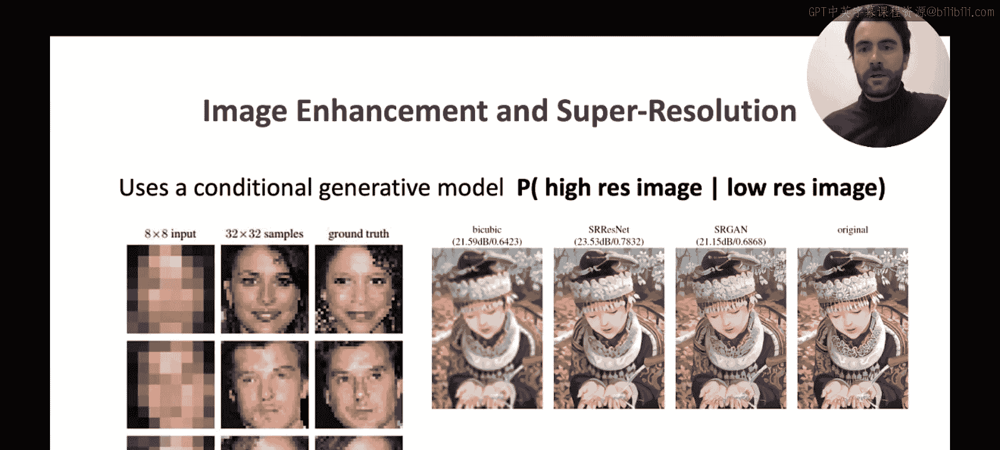

好的，这就是模型或模型族。如果我们有一个模型族，我们还需要选择一组特定的参数。我们需要选择一个代表良好分布、能很好拟合数据的特定模型。为了做到这一点，我们需要指定一个**目标函数**或**学习目标**，它告诉我们任何给定的模型、任何给定的参数集是否恰好能很好地拟合数据。我们将看到许多目标。事实上，如果你熟悉机器学习，那么你熟悉简单的目标，例如回归模型的均方误差或分类任务的交叉熵。在这里，因为我们正在拟合一个生成模型，我们将不得不开发适合我们感兴趣任务的学习目标。本课程将介绍几种不同的目标，它们定义了不同的学习算法。例如，最大似然估计是一个著名的目标，但也有其他方法，例如基于双样本检验或分数匹配的方法，还有其他方法。

最后，如果我们有一个学习目标和一个模型，我们仍然需要一种方法来选择最大化或优化该目标的参数集。这就是**优化算法**的目标。通常，事实上在大多数情况下，精确优化学习目标是难以处理的，因此我们将求助于各种近似技术，范围从随机梯度下降到更复杂的近似概率推理算法，其中最著名的是变分推理和马尔可夫链蒙特卡洛。

但这些是细节。在高层次上，任何学习算法，像我们在本课程中感兴趣使用的那些，都将由三个组件定义：一个模型、一个学习目标和一个优化算法。

一旦我们定义了一个算法，使用该算法的过程将如下所示。我们将从收集一个数据集开始，数据再次描述了我们想要生成的对象，例如，这可以是一个卧室图像的数据集。然后，我们还将指定一个学习算法，这本质上意味着我们指定刚刚描述的这三个组件。一旦我们在数据集上运行该算法，输出将是这个概率模型，也就是我之前提到的概率生成器。一旦我们有了这个概率分布（顺便说一下，它可以被显式或隐式定义，我们将在课程后面讨论这意味着什么），现在我们可以从模型中抽取数据点，这将对应于新对象的生成。

除了从分布中抽取样本外，我们还可以解决其他任务。例如，我们可以询问某个数据点的概率，这可以帮助我们理解一个新数据点是否看起来像是我们数据的一部分，这是一种异常值检测的形式。我们还可以填充数据中的缺失值，我们可以执行各种操作，我们可以尝试以不同的方式重新布置卧室。一旦我们有了数据的概率模型，所有这些都是我们可以解决的有趣任务，因此这也是为什么我们将要使用的模型被称为概率生成模型。

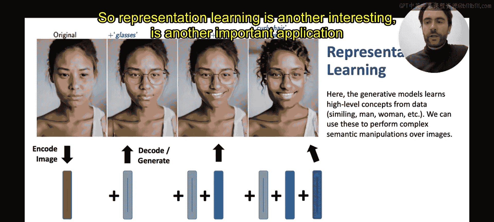

### “深度”的含义

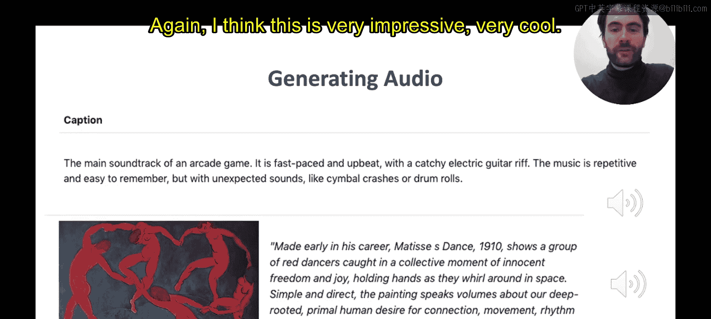

最后，我想深入探讨的课程定义中的最后一个词是“**深度**”。这门课程被称为深度概率生成模型是有原因的。之所以是“深度”，是因为我们将要处理的概率几乎总是由**深度神经网络**定义的，它们将由深度神经网络参数化。因此，分布的参数将是描述该分布的神经网络的参数。

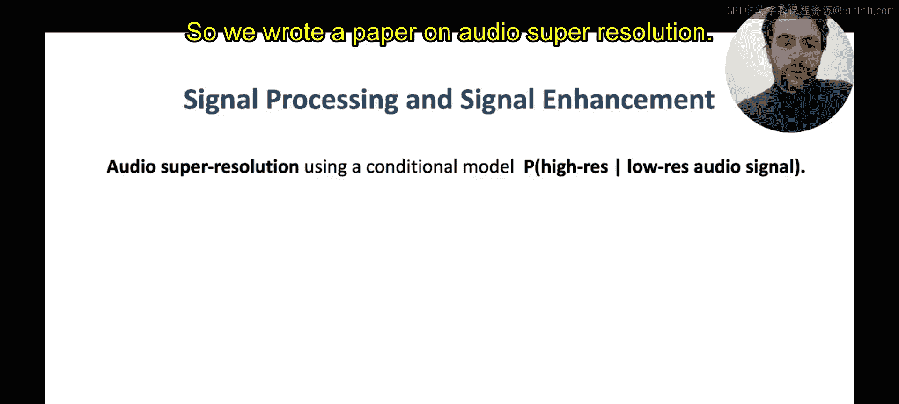

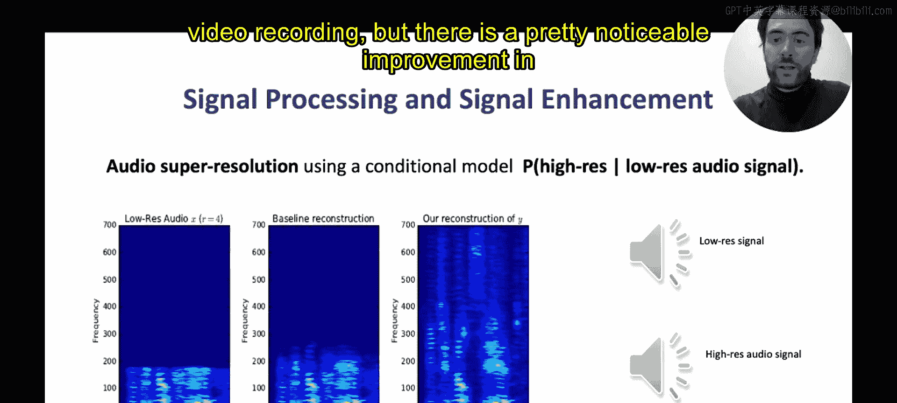

当然，我们将在后面的讲座中更详细地看到许多这样的神经网络，但只是给你一个非常粗略的概念，这张图描述了一个卷积架构，它接收一组随机数作为输入，然后输出一个64x64x3的张量，对应我们想要生成的图像，或者它也可以对应我们想要生成的图像分布的参数。当我们抽取随机数时，我们会在输出端得到图像。这些图像的创建方式是通过遵循由我们架构定义的卷积过程。我们将看到许多这种形式的模型。我们对深度神经网络感兴趣的原因再次是因为我们感兴趣于构建非常复杂、表达能力强的模型，以拟合我们拥有的高维复杂数据。如果我们有简单的标量数据，我们或许可以使用简单的高斯架构、简单的高斯分布。但在这里，我们试图建模非常高维的复杂数据，如图像，因此我们需要一个表达能力非常强的概率分布，能够将概率质量精确地放置在看起来像好图像的位置上。这就是为什么我们需要借助深度神经网络来利用它们的表达能力。

好的，这总结了定义本课程的关键术语：深度概率生成建模。希望现在你开始对本课程后续将探索的主题和算法类型有了一些感觉。

## 深度生成模型的应用实例 🌟

接下来，在剩余的大约20到25分钟里，我想更深入地探讨深度生成模型的应用，并概述各种生成学习算法。坦率地说，我认为这些算法非常令人印象深刻，希望也能帮助你相信深度生成模型确实有趣且值得研究。

### 图像生成

我想给你的第一组例子是图像生成模型的例子。这或许是生成模型所能获得的最引人注目、最令人印象深刻的一组结果。这些图像生成模型在计算机生成艺术等领域有应用。

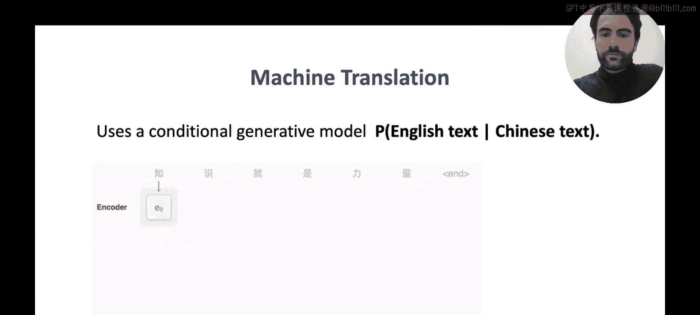

这里你看到一些使用计算机算法完全自动生成的图像示例。这些图像非常美丽、非常引人注目。我认为值得注意的是，这些图像的质量在过去几年里取得了巨大进步。事实上，我不得不定期重做这些幻灯片，因为这个领域变化太快了。仅仅几年前，生成模型能产生的最佳图像可能是一个像素化的人脸、简单的数字或小房子号码。现在，特别是在过去12到18个月里，该领域取得了巨大进步，当前的模型能够产生极其复杂、极具说服力、艺术感染力的图像，就像你在这里看到的那些。这些特定的图像来自一个名为Midjourney的系统。Midjourney的工作方式是，你提供一个文本提示，然后它为你生成图像。因此，中间那张猫的图像是通过向模型输入一个类似于你在屏幕底部看到的提示而获得的。

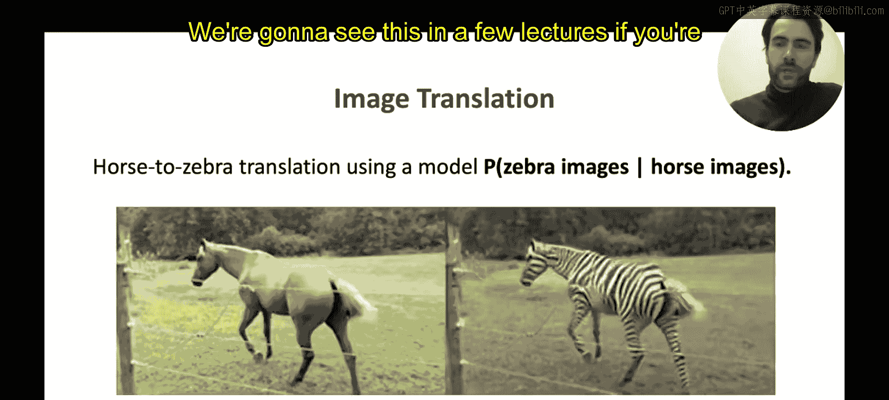

我认为这非常迷人。这是另一个来自不同知名文本到图像模型（称为Stable Diffusion）的图像示例。在这里，我们向Stable Diffusion输入了你在底部看到的提示，它产生了你在屏幕上看到的这件非常有趣的艺术作品。

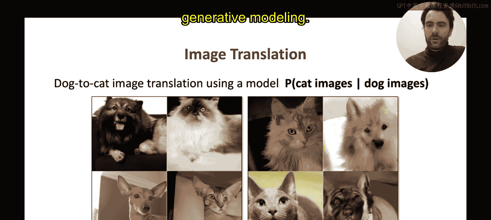

我还要补充一点，这些模型的迷人之处在于，它们能够以训练数据中不存在的新颖方式组合在训练数据中看到的概念。例如，当我们生成穿着盔甲的猫的图像时，模型见过猫的图像，也见过盔甲的图像，但它能够自行以新颖的方式组合它们，创造出这只穿着盔甲的猫。这是文本到图像模型开始出现的一种真正迷人的新兴特性，当我们大规模训练它们时，我们开始看到这一点。我认为这非常迷人、有趣，而且这些模型似乎正在学习一些重要且有用的东西。

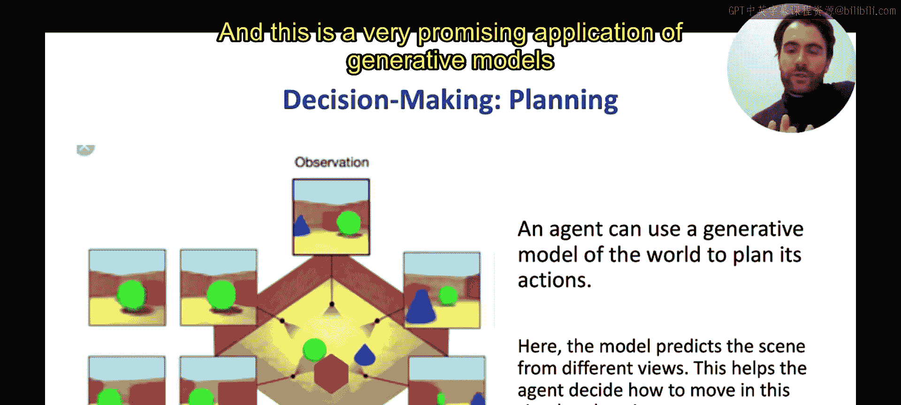

### 信号处理与图像增强

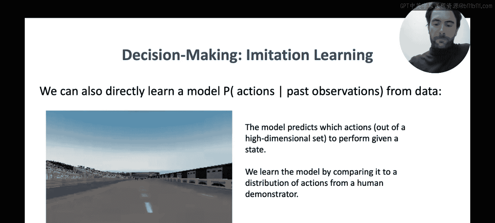

现在，图像生成模型和更广泛的生成模型不仅对艺术等应用有用，它们对于像你在本幻灯片上看到的那些非常实际的、落地的信号处理问题也很有用。顺便说一下，这些图像也可以以同样复杂的数据为条件，例如，它们可以以另一张图像为条件，这也正是本幻灯片中发生的情况。

这张幻灯片展示了一个特定信号处理任务的例子，称为**图像增强**或**超分辨率**。在左侧，你看到我们从一个相对简单的、像素化的人脸图像开始，模型能够从像素化版本中恢复出高质量的人脸，恢复程度相当好。你还在右侧看到了一个例子，我们从一个模糊且分辨率较低的图像开始，但神经网络和生成模型能够填充各种有趣的细节和纹理，恢复出高分辨率图像。

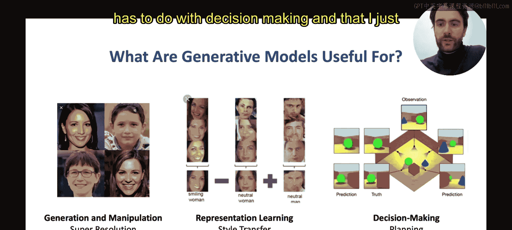

这类模型在压缩等领域有有趣的应用。如果你有一个好的超分辨率模型，你也可以有一个压缩某些类型图像的好算法。这些算法还可以在显微镜等领域找到应用，它们通常也用于增强其他类型的信号，如MRI数据。更广泛地说，我的观点是，存在一大类我称之为信号处理的任务，而生成模型通常可以改进各种信号处理任务。如果它能学习需要产生的信号，那么它通常可以产生更高质量的信号，或者可以对现有信号执行有趣类型的操作，从而增强各种数据处理、信号处理流程。

### 表示学习

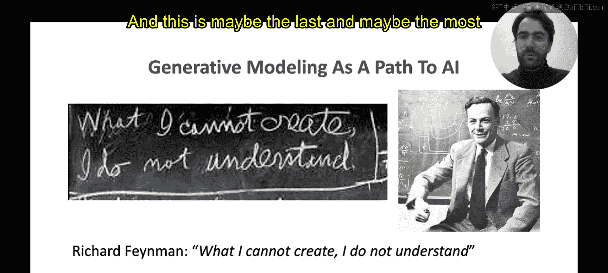

现在，我想强调的另一个重要例子，它来自一个不同的算法家族，我称之为**表示学习**。

表示学习是什么意思？你可以使用生成模型来创建图像，但你也可以使用它们来更好地理解图像，你可以将它们用作非常复杂的无监督学习算法。事实上，通常生成建模算法不仅具有生成图像或将一些小的随机向量解码为图像的能力，而且许多生成模型还具有将图像编码为某种低维向量的能力，该向量通常携带语义上有意义的知识、关于图像的有趣知识。我将这个低维向量称为**表示**、**学习到的表示**，我们也可以说它是图像的分布式表示或基于向量的学习表示。

这些表示之所以有趣，再次是因为它们可以帮助我们学习关于数据的新东西。我们经常会发现，相似的图像往往具有相似的表示，并且表示向量空间的结构也将携带关于图像、关于我们正在处理的任何数据的重要信息。这对于理解数据以及执行对图像的有趣任务（如操作它们或调整它们的属性）都很有用。这就是你在屏幕上看到的例子。

你在这里看到的是一张通过在其高级表示、语义表示空间中操作其表示而被修改的图像。许多生成建模算法的工作方式如下：给定一张图像，可以将其编码或嵌入为某个高维语义向量空间中的一个向量，这就是绿色矩形所代表的，那是它的向量表示，即一行数字。相似的图像或具有某些属性的图像将被放置在该向量空间的某些区域。我们通常可以在该向量空间中找到某些方向，这些方向对应于图像的某些属性。或者，如果我们处于空间的一个区域，我们可以尝试向包含某些属性的另一组图像或另一个图像子空间移动。然后，当我们向那个方向移动时，图像将获得某些属性。例如，通过操作向量空间，我们通常可以找到一个有趣的方向，比如我们可以找到一组包含眼镜的图像。如果我们将图像的绿色表示向有眼镜的图像方向移动（我的意思是，我们添加一个指向有眼镜方向的向量增量），然后我们从新的表示（即这两个向量的和）生成图像，生成的图像通常会有一个戴眼镜的人。类似地，我们可以找到另一个方向，对应于人物有微笑。如果我们加上那个，那么我们也添加了微笑。现在，我们从这三个向量的总和中解码，现在我们得到了一张有微笑的图像。同样，我们可以通过找到修改它的卷发向量来生成一个卷发的人。因此，能够学习表示是有趣的，因为它实现了对图像的某种有趣的语义操作。

更广泛地说，表示学习是无监督学习的一种形式，通过检查语义空间中的数据，我们通常也能发现关于数据的有趣之处。例如，如果我们正在处理描述癌症肿瘤的基因数据，如果我们可以将这些数据嵌入到一个有意义的高维空间中，那么我们就可以检查该数据集中不同的肿瘤簇，我们可能会发现具有相似表示、相似呈现的肿瘤也共享某种生物学机制，因此可能对某种癌症治疗有相似的反应，而其他肿瘤可能没有反应。因此，我们可以利用通过表示学习学到的知识，在这个例子中，我们可以用它来为癌症设计更好的治疗方法，如果我们处理的是癌症肿瘤数据的话。

因此，表示学习是生成模型的另一个重要应用。

### 超越图像的应用

现在，正如我之前提到的，生成模型也适用于图像之外的领域。这里我有一些最近由Google DeepMind发布的音频生成模型的例子。这是一个从文本生成音频的模型，因此它是一个文本到音频模型，类似于之前的模型是文本到图像模型。

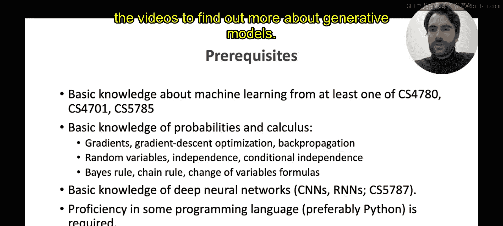

这里的提示要求为街机游戏生成快节奏的配