# 深度生成模型：第6讲：学习隐变量模型 🧠

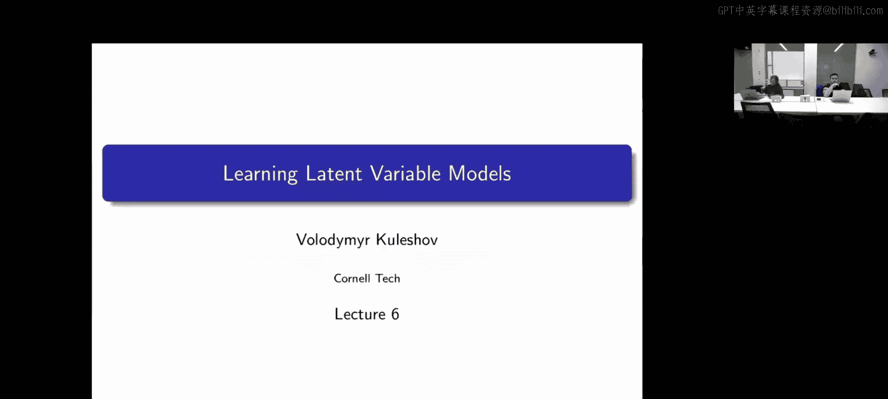

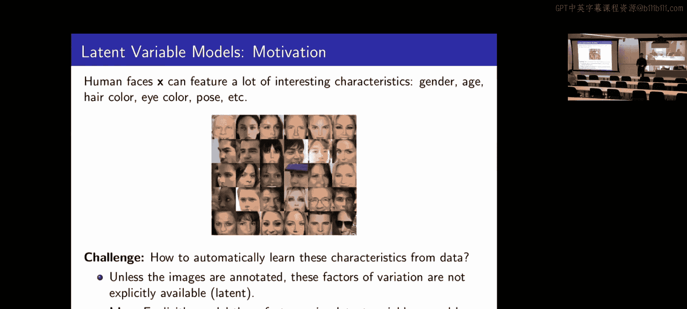

在本节课中，我们将学习如何训练隐变量模型。我们将回顾变分推断的核心思想，并最终推导出变分自编码器这一重要算法。我们将重点介绍如何计算难以处理的边际似然的梯度，并利用这些梯度来学习模型参数。

## 概述与回顾 📚

上一节我们介绍了隐变量模型的基本概念。本节中我们来看看如何学习这些模型。

隐变量模型旨在从数据中发现未标注的有趣模式，例如人脸数据集中的人物性别、肤色、发型等。这些未观测到的变化因素由隐变量 **Z** 表示。模型定义了一个关于数据 **X** 和隐变量 **Z** 的联合概率分布 **P(X, Z)**。由于 **Z** 未被观测，我们需要将其边缘化以获得数据的边际似然 **P(X)**。

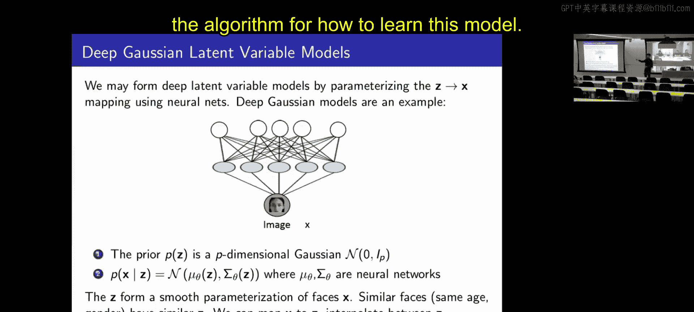

一个重要的例子是深度高斯隐变量模型。其贝叶斯网络结构如下：顶部的连续隐变量 **Z** 服从单位高斯先验 **P(Z) = N(0, I)**；底部的数据 **X** 的条件分布 **P(X|Z)** 是一个高斯分布，其均值和协方差由一个以 **Z** 为输入的神经网络参数化。这可以看作是一个无限维的高斯混合模型。

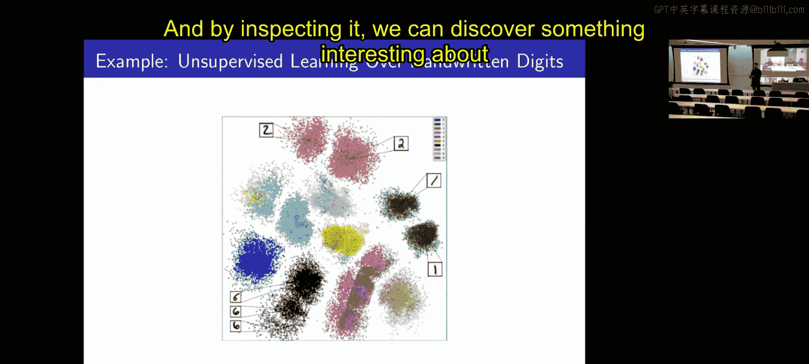

一旦学会这个模型，我们就可以通过先采样 **Z**，再采样 **P(X|Z)** 来生成新的数据 **X**。我们还可以通过编码器网络从 **X** 推断出对应的 **Z**，并在隐空间中进行插值或语义运算。

## 学习挑战与变分推断 🎯

学习隐变量模型的主要挑战在于边际似然 **P(X)** 的计算通常是难以处理的。对于连续隐变量，求和变为积分；即使 **Z** 是离散的，其组合空间也过于庞大。

为了解决这个问题，我们在上一讲引入了变分推断。其核心思想是为难以处理的边际对数似然 **log P(X)** 寻找一个可计算的下界，即证据下界。

ELBO 的公式如下：
`ELBO = E_{Z~Q}[log P(X, Z) - log Q(Z)]`

其中 **Q(Z)** 是任意一个易于处理的概率分布。这个下界与真实对数似然之间相差一个 KL 散度项：`log P(X) = ELBO + KL(Q(Z) || P(Z|X))`。由于 KL 散度非负，ELBO 始终是 `log P(X)` 的下界。当 **Q(Z)** 等于真实后验 **P(Z|X)** 时，下界是紧致的。

变分推断的目标就是在某个参数化分布族 **Q(Z; φ)** 中，寻找参数 **φ** 以最大化 ELBO，从而获得对边际似然的一个紧致下界近似。

## 利用变分推断学习模型参数 🧮

我们的最终目标是学习模型参数 **θ** 以最大化整个数据集的边际似然。利用 ELBO，我们可以为每个数据点 **X_i** 构建一个下界。为了获得整个数据集的下界，我们需要为每个数据点分别优化其变分参数 **φ_i**。

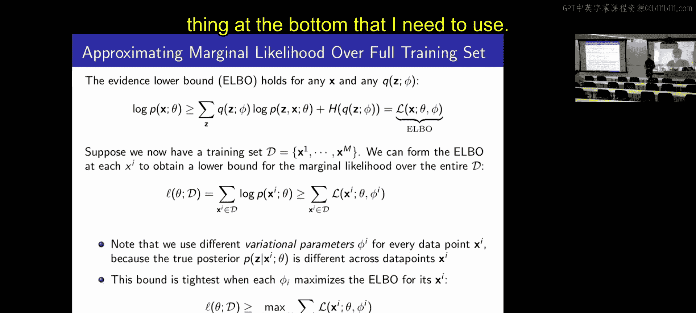

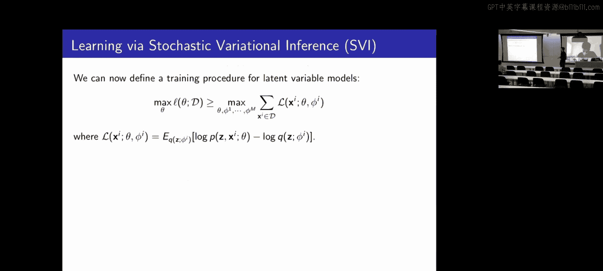

因此，学习目标变为同时优化模型参数 **θ** 和所有变分参数 **{φ_i}**：
`max_{θ} Σ_i [ max_{φ_i} ELBO(X_i; θ, φ_i) ]`

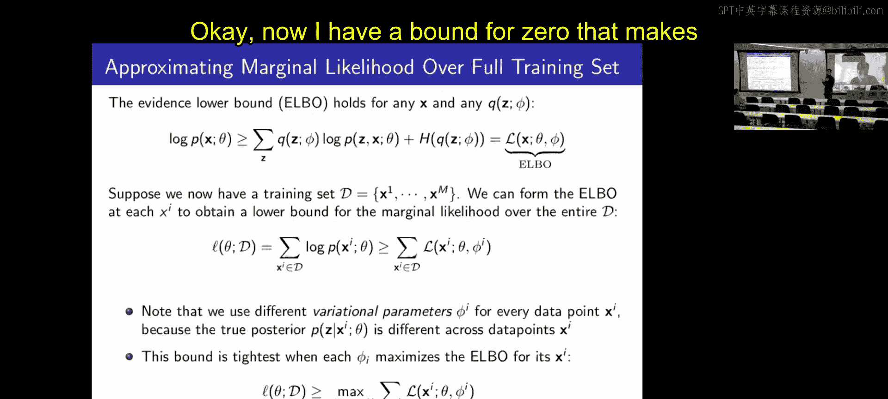

一种直接的优化方法是随机变分推断：
1.  初始化参数 **θ** 和 **{φ_i}**。
2.  从数据集中采样一个数据点 **X_i**。
3.  固定 **θ**，使用梯度下降内循环优化 **φ_i** 以最大化该数据点的 ELBO。
4.  固定优化后的 **φ_i**，计算 ELBO 关于 **θ** 的梯度，并更新 **θ**。
5.  重复步骤 2-4。

这种方法需要为每个数据点运行内层优化循环，计算成本很高。

## 计算梯度：两种策略 ⚙️

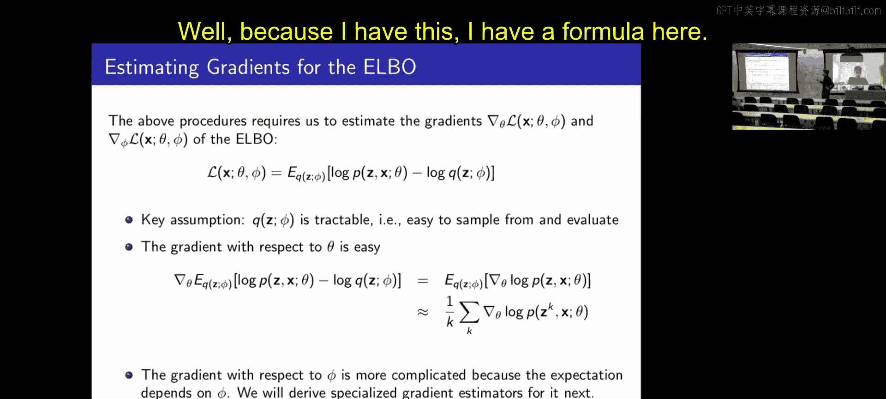

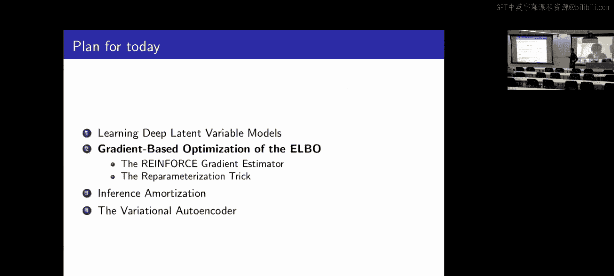

为了实施上述优化，我们需要计算 ELBO 关于参数 **θ** 和 **φ** 的梯度。

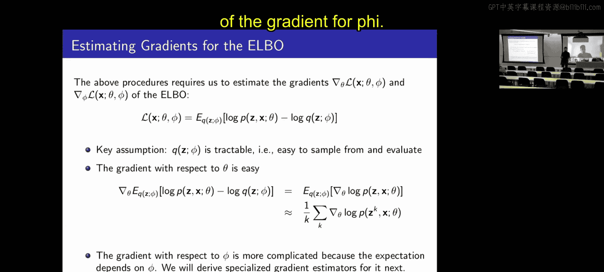

**关于 θ 的梯度**相对容易计算，因为期望内部的函数 `log P(X, Z; θ)` 关于 **θ** 的梯度是良定义的，我们可以使用蒙特卡洛采样来近似期望。

**关于 φ 的梯度**则更具挑战性，因为期望分布 **Q(Z; φ)** 本身依赖于 **φ**。以下是两种计算该梯度的策略：

### 1. 强化梯度估计器 (REINFORCE)

这是一种通用方法，适用于离散和连续隐变量。其核心公式（得分函数估计器）为：
`∇_φ E_{Z~Q_φ}[f(Z)] = E_{Z~Q_φ}[f(Z) ∇_φ log Q_φ(Z)]`

我们可以通过从 **Q** 中采样来蒙特卡洛近似这个期望。然而，这种方法的一个主要问题是估计的**方差很高**，尤其是在隐变量维度较高时，因为 `log Q_φ(Z)` 的尺度可能变化很大，导致学习不稳定。

### 2. 重参数化技巧 (Reparameterization Trick)

这种方法要求隐变量 **Z** 是**连续**的，并且可以从一个与 **φ** 无关的基分布中采样得到。例如，若 `Z ~ N(μ, σ^2)`，我们可以将其重写为 `Z = μ + σ * ε`，其中 `ε ~ N(0, 1)`。

利用重参数化，梯度计算变为：
`∇_φ E_{Z~Q_φ}[f(Z)] = E_{ε~p(ε)}[∇_φ f(μ + σ * ε)]`

现在，期望与参数 **φ** 无关，我们可以将梯度算子移入期望内部。这通常能得到**方差更低、更稳定**的梯度估计，是训练变分自编码器的首选方法。

## 摊销推断：加速学习过程 🚀

在随机变分推断中，我们需要为每个数据点 **X_i** 单独存储并优化变分参数 **φ_i**，这非常低效。

摊销推断通过引入一个**推断网络（或编码器）**来解决这个问题。该网络 `f_λ` 参数化为 **λ**，它接收数据点 **X** 作为输入，直接输出该数据点对应的变分分布参数 **φ**。即：`φ = f_λ(X)`。

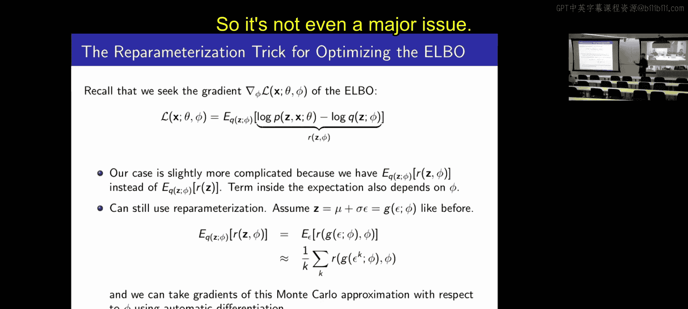

这样，我们不再为每个数据点单独优化 **φ_i**，而是**共同学习**模型参数 **θ** 和推断网络参数 **λ**。优化目标变为：
`max_{θ, λ} Σ_i ELBO(X_i; θ, f_λ(X_i))`

在实践中，我们通常用 **φ** 直接表示推断网络的参数，并记变分分布为 `Q_φ(Z|X)`。这大大提高了学习效率。

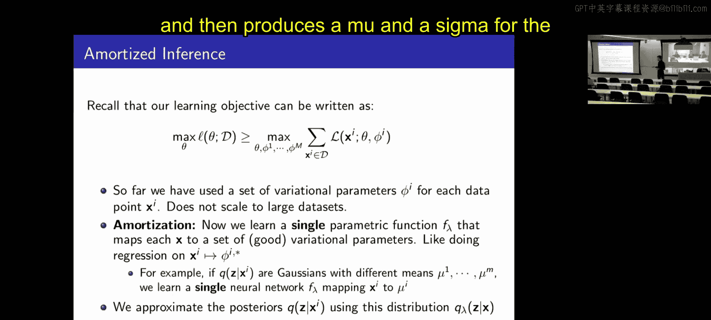

## 变分自编码器：最终算法 🏗️

现在，我们将所有组件组合起来，就得到了**变分自编码器**。

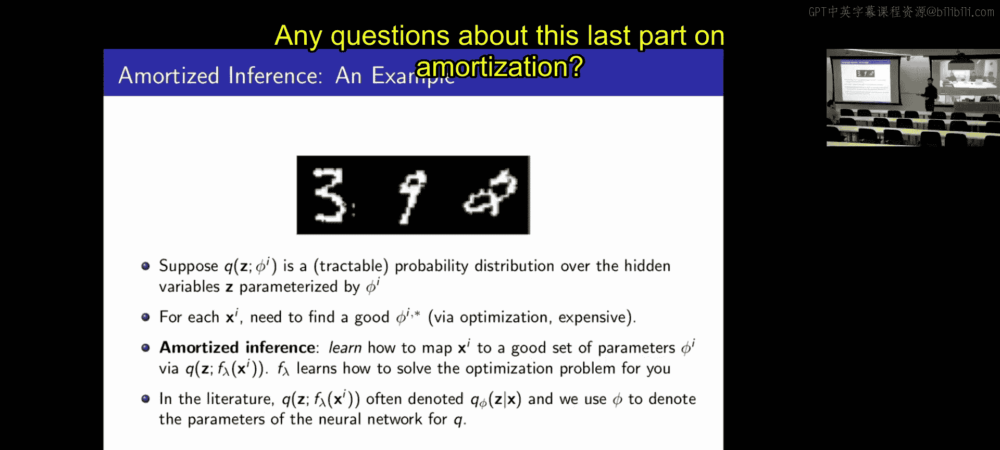

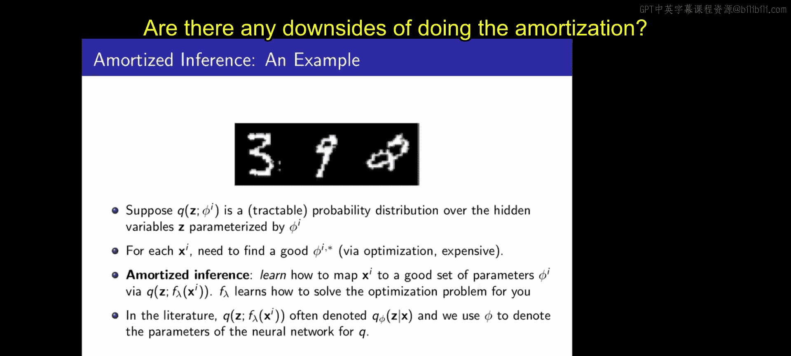

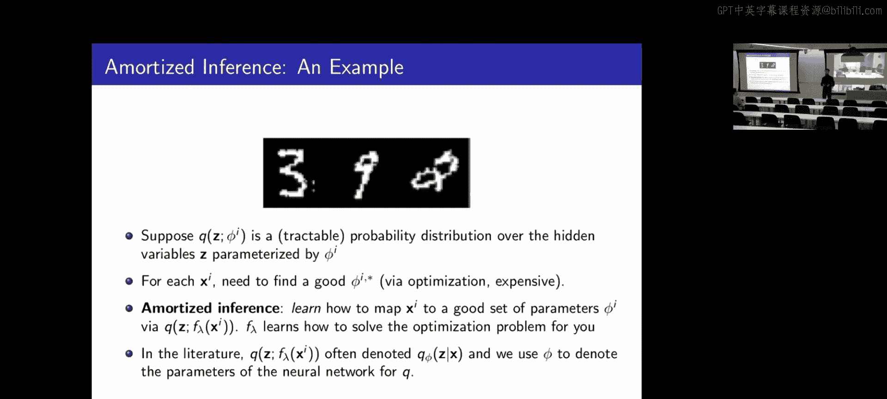

*   **模型 (Model)**: 深度高斯隐变量模型。先验 `P(Z) = N(0, I)`，生成分布 `P_θ(X|Z)` 是一个高斯分布，其均值和方差由解码器神经网络（参数为 **θ**）给出。
*   **推断网络 (Inference Network)**: 编码器 `Q_φ(Z|X)` 也是一个高斯分布，其均值和方差由编码器神经网络（参数为 **φ**）给出。
*   **目标 (Objective)**: 最大化所有数据点的 ELBO 之和：`Σ_i ELBO(X_i; θ, φ)`。
*   **优化 (Optimization)**: 使用小批量随机梯度下降同时优化 **θ** 和 **φ**。关于 **φ** 的梯度通过重参数化技巧计算。

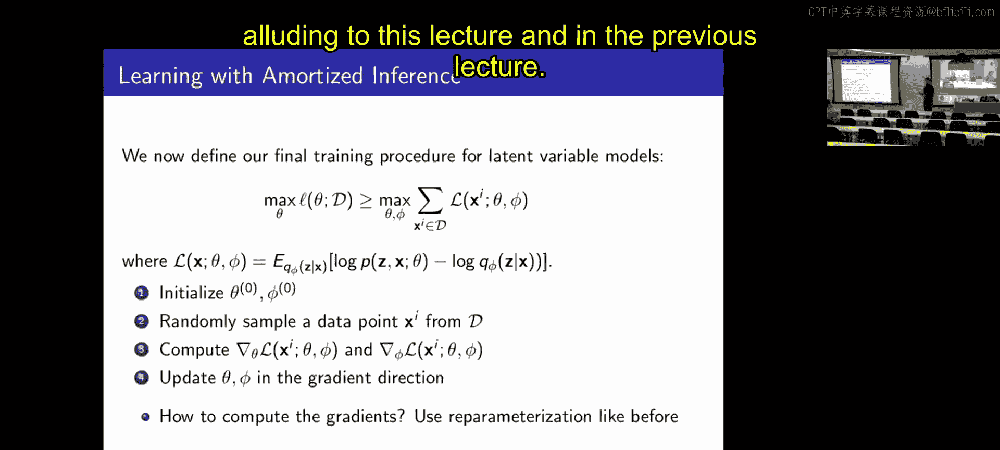

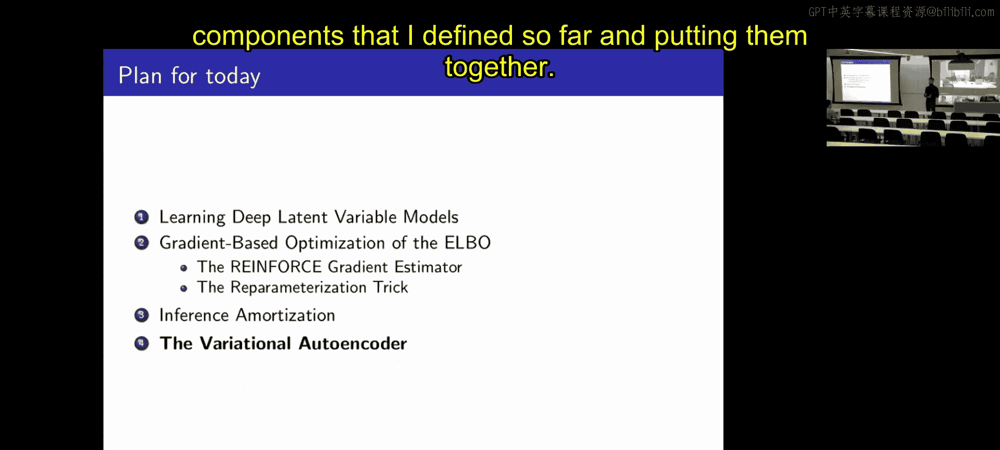

### 为何称为“自编码器”？

ELBO 可以重写为两项：
`ELBO = E_{Z~Q_φ(Z|X)}[log P_θ(X|Z)] - KL(Q_φ(Z|X) || P(Z))`

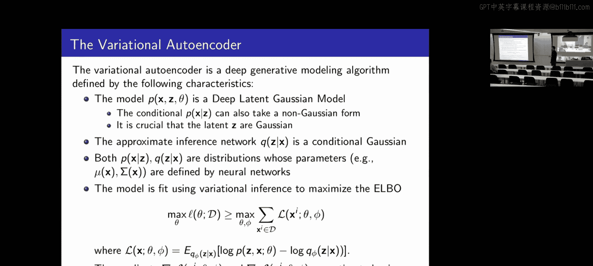

*   **第一项（重构项）**: 期望 `log P_θ(X|Z)` 衡量了通过编码器得到 **Z** 后，解码器重构原始数据 **X** 的能力。对于高斯分布，这类似于最小化重构图像与原始图像之间的 L2 损失。
*   **第二项（正则项）**: KL 散度项迫使编码器产生的隐变量分布 `Q_φ(Z|X)` 接近先验分布 `P(Z) = N(0, I)`。这起到了正则化的作用，防止编码器为不同输入分配完全不同的隐码，并确保了隐空间的规整性。

因此，训练过程类似于一个被正则化的自编码器：编码器将 **X** 压缩为隐码 **Z**，解码器从 **Z** 重构 **X**，同时 KL 项约束 **Z** 的分布。

## 总结与展望 📈

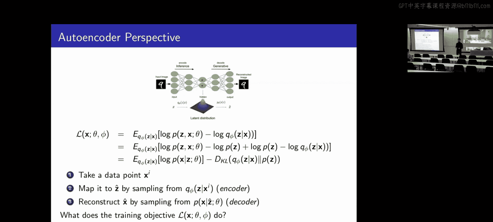

本节课中我们一起学习了如何训练隐变量模型，并完整推导了变分自编码器算法。

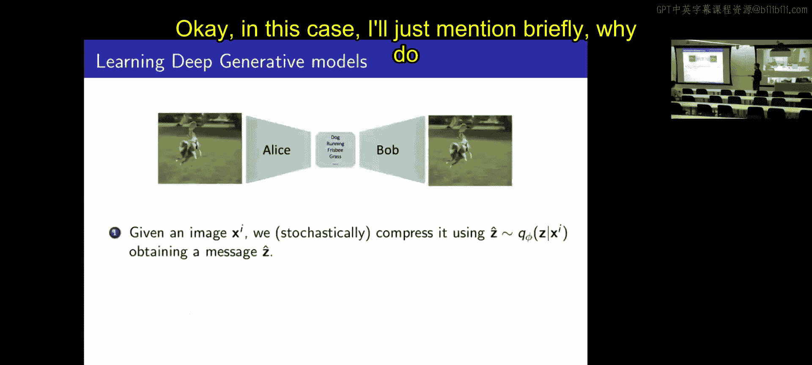

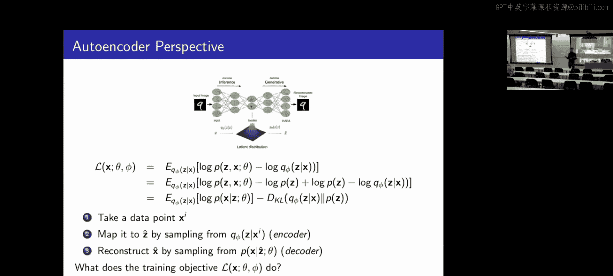

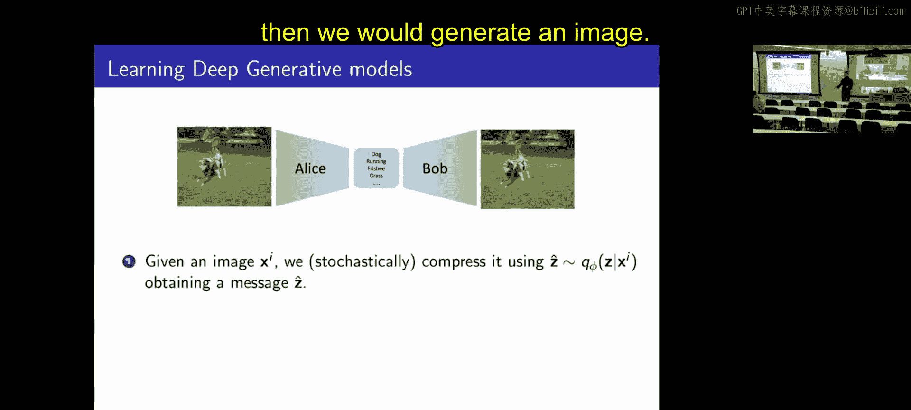

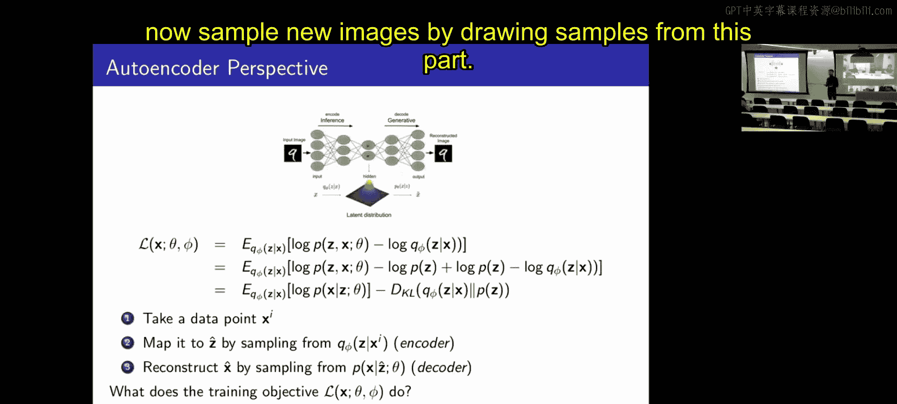

**隐变量模型的优势**在于其强大的表示学习能力和生成能力。它们能对图像等复杂数据建模，采样高效，并能通过编码器网络获得有意义的隐表示。

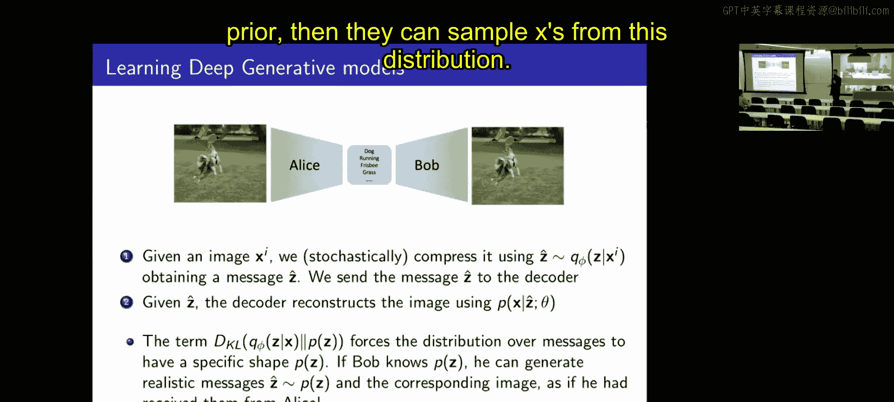

**其挑战**在于边际似然难以处理，使得训练目标（ELBO）相对复杂，且难以精确计算数据的对数似然值。

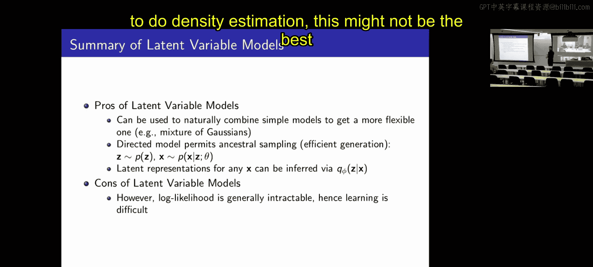

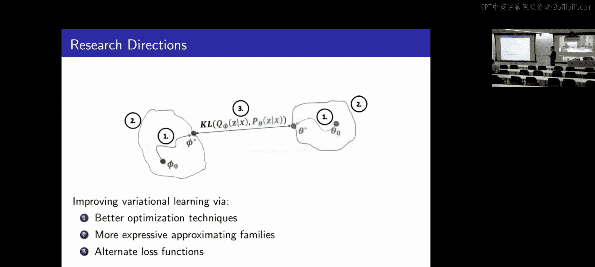

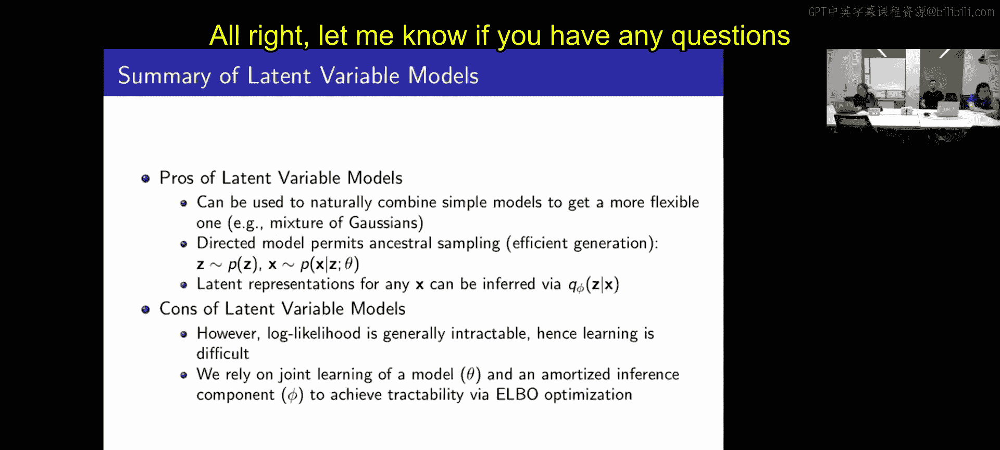

在下一讲中，我们将介绍一种新的模型家族——**标准化流**。它有望结合双方优点：既拥有可处理的精确似然，又能进行高效的采样和隐变量推断。