# 深度生成模型：08：高级流模型

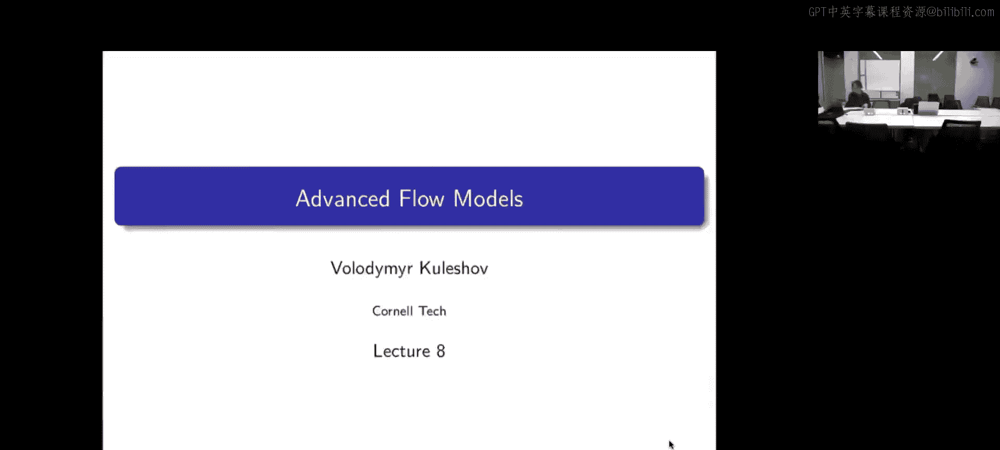

在本节课中，我们将继续学习归一化流模型。我们将深入探讨几种更高级的流模型架构，特别是那些具有三角雅可比矩阵的模型，例如NICE和RealNVP。我们还将探索自回归模型与流模型之间的有趣联系，并最终介绍一种结合两者优势、能实现快速音频生成的实用算法。

---

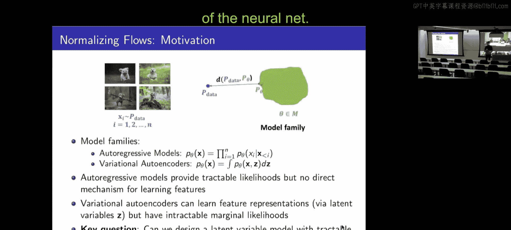

## 课程回顾

上一节我们介绍了归一化流模型的基本概念。归一化流是一种潜在变量模型，它通过一个可逆的映射函数 **F** 将简单的先验分布（如高斯分布）转换为复杂的数据分布。其核心优势在于，它既拥有潜在变量以学习数据特征，又能通过变量替换公式精确计算数据的对数似然，从而实现可追踪的最大似然训练。

变量替换公式如下：

```
log p_θ(x) = log p_z(f^{-1}(x)) + log |det J_{f^{-1}}(x)|
```

其中，**p_z** 是先验分布，**f^{-1}** 是从观测数据 **x** 映射回潜在变量 **z** 的逆变换，**J_{f^{-1}}** 是该逆变换的雅可比矩阵。

然而，该公式在实践中面临挑战：映射 **F** 必须是可逆的、表达能力强的，并且其雅可比矩阵的行列式必须易于计算。上一节我们看到了通过组合多个简单可逆变换（如平面流）来构建复杂流的方法。本节我们将探索另一种策略：直接设计具有易于计算行列式的雅可比矩阵结构。

---

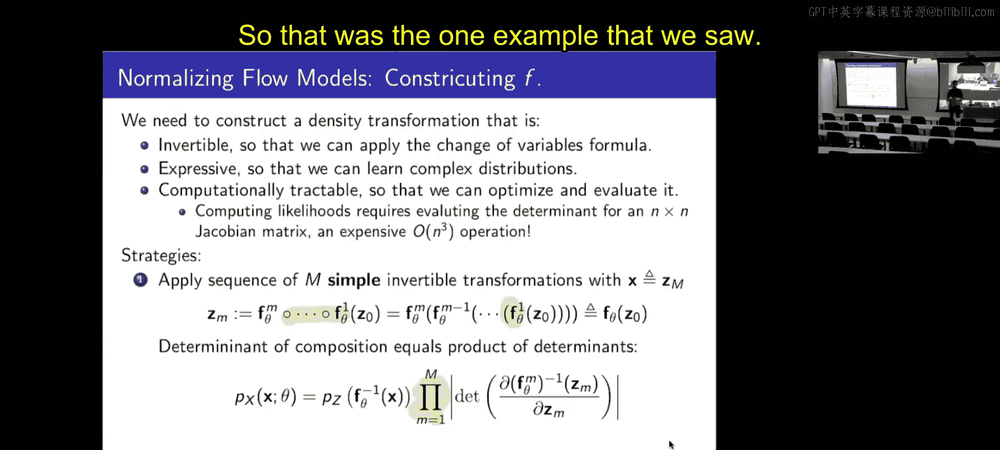

## 具有三角雅可比矩阵的流模型

一种使雅可比行列式计算变得高效的方法是确保雅可比矩阵是三角矩阵。对于三角矩阵，其行列式等于对角线元素的乘积，计算复杂度仅为线性时间。

考虑一个映射 **F: z -> x**。如果每个输出分量 **x_i** 仅依赖于输入分量 **z_1, ..., z_i**（即具有自回归依赖结构），那么其雅可比矩阵将是下三角矩阵。这正是我们将要利用的洞见。

接下来，我们将看到几种基于此策略构建的著名流模型。

---

## NICE 模型

NICE（非线性独立分量估计）模型是早期成功的流模型之一。它通过组合两种简单的层来构建：加法耦合层和缩放层。

### 加法耦合层

加法耦合层是实现三角雅可比结构的关键。其操作如下：

1.  **分割输入**：将输入向量 **z** 分割成两个不相交的子集，例如 **z_{1:d}** 和 **z_{d+1:n}**。
2.  **定义变换**：
    *   对于第一个子集，执行恒等映射：**x_{1:d} = z_{1:d}**。
    *   对于第二个子集，执行一个仿射变换，其中平移量由第一个子集通过一个神经网络 **m_θ** 计算得出：
        **x_{d+1:n} = z_{d+1:n} + m_θ(z_{1:d})**。

该变换的可逆性显而易见：
*   **z_{1:d} = x_{1:d}**
*   **z_{d+1:n} = x_{d+1:n} - m_θ(z_{1:d})**

其雅可比矩阵具有如下形式：
```
J = [ I, 0;
      ∂m_θ/∂z_{1:d}, I ]
```
这是一个下三角矩阵，且对角线元素全为1。因此，其行列式恒为1，这意味着该变换是保体积的。无论神经网络 **m_θ** 多么复杂，我们都不需要计算其雅可比行列式，这带来了极大的灵活性。

### 缩放层

缩放层则更为简单，它对每个输入维度进行独立的缩放：
*   正向映射：**x_i = s_i * z_i**，其中 **s_i > 0**。
*   逆向映射：**z_i = x_i / s_i**。
其雅可比矩阵是对角矩阵 **diag(s)**，行列式为 **∏ s_i**。

NICE模型就是多个加法耦合层和缩放层的组合。尽管是早期模型，它已能生成人脸和数字的图像。

---

## RealNVP 模型

RealNVP（实值非体积保持）模型是NICE的扩展，它修改了耦合层，使其非体积保持，从而增强了表达能力。

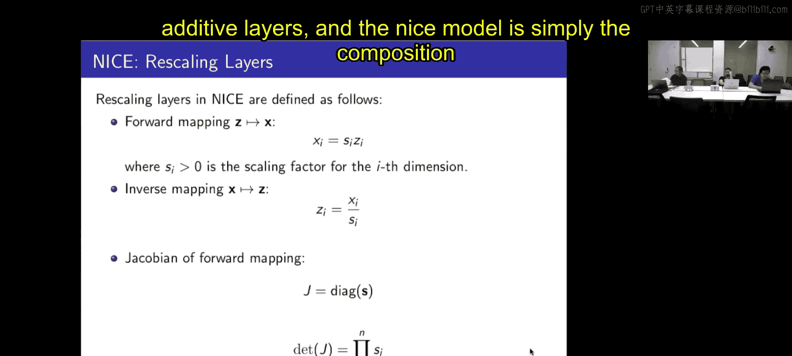

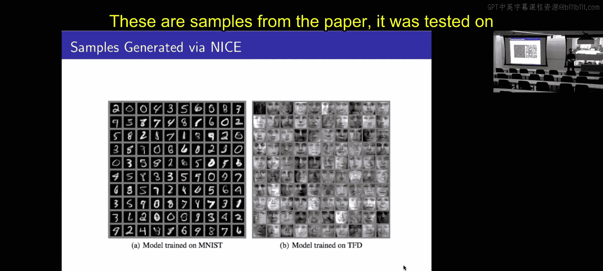

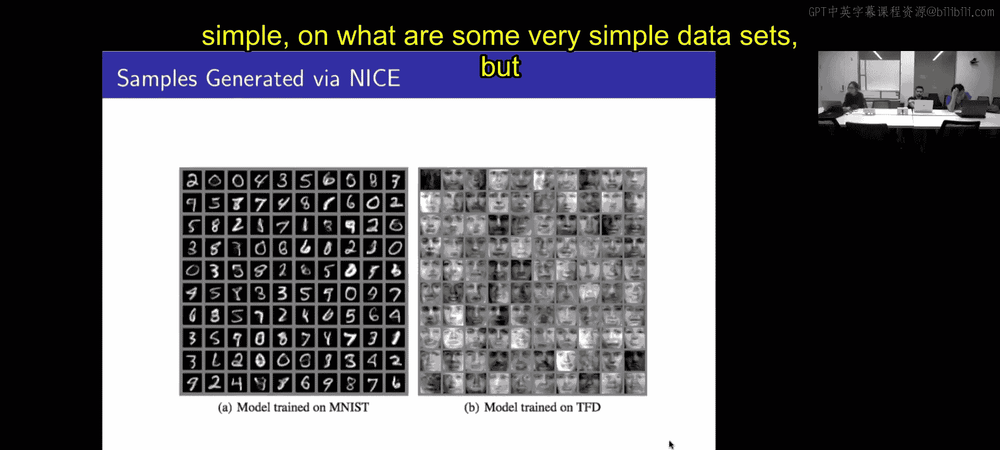

在RealNVP的耦合层中，变换如下：
*   **x_{1:d} = z_{1:d}**
*   **x_{d+1:n} = z_{d+1:n} ⊙ exp(α_θ(z_{1:d})) + μ_θ(z_{1:d})**

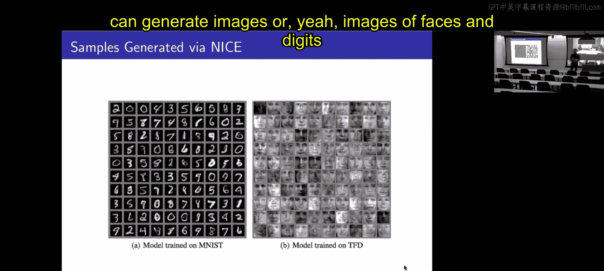

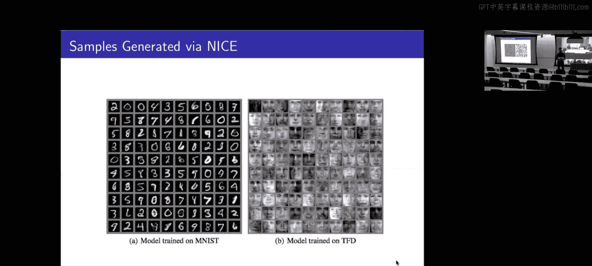

这里，**⊙** 表示逐元素乘法。我们不仅像NICE那样加了一个平移量 **μ_θ**，还对输入进行了由 **exp(α_θ(...))** 控制的缩放。**μ_θ** 和 **α_θ** 均由神经网络参数化。

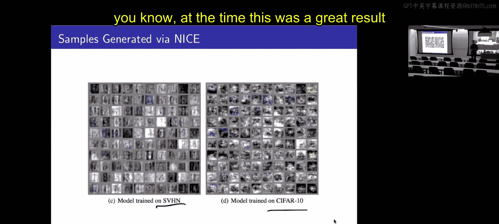

此变换仍是可逆的：
*   **z_{1:d} = x_{1:d}**
*   **z_{d+1:n} = (x_{d+1:n} - μ_θ(z_{1:d})) ⊙ exp(-α_θ(z_{1:d}))**

其雅可比矩阵同样是三角矩阵，但对角线不再全为1，行列式为 **exp(∑ α_θ)**。因此，它能改变概率空间的体积。

RealNVP通过使用更复杂的网络架构和巧妙的输入分割策略（如图像的棋盘格分割），能够生成质量高得多的图像。此外，其潜在空间也展现出有意义的插值特性。

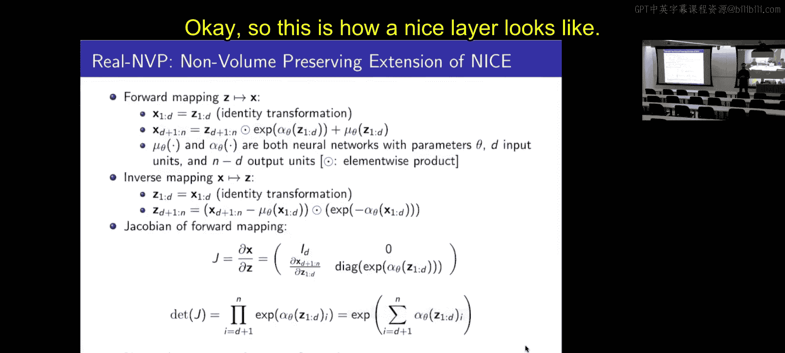

---

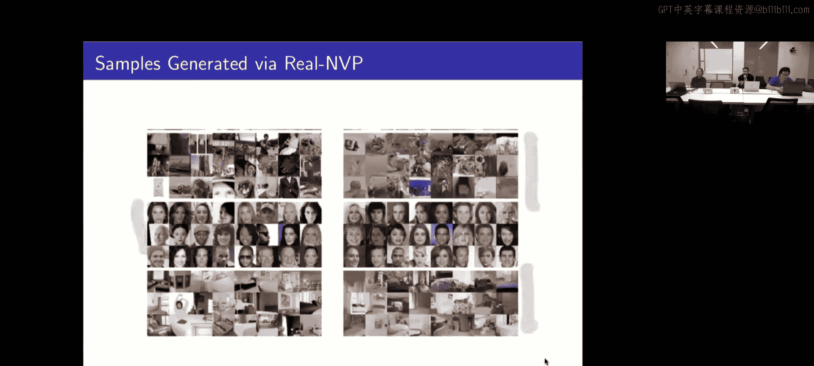

## 自回归模型与流模型的联系

我们已经看到了具有三角雅可比矩阵的流模型。现在，让我们探索它们与自回归模型之间的深刻联系。

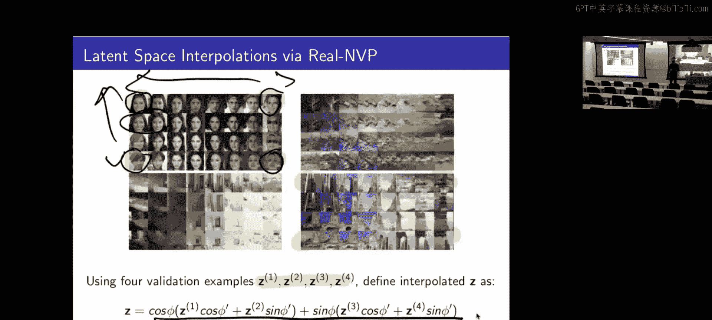

考虑一个高斯自回归模型，其中每个条件分布 **p(x_i | x_{<i})** 是一个高斯分布，其均值 **μ_i** 和方差 **σ_i^2** 由之前的变量通过神经网络确定。

从这个模型中进行采样的过程，实际上定义了一个从一组独立标准高斯噪声 **z** 到数据 **x** 的确定性变换：
```
x_1 = μ_1 + σ_1 * z_1
x_2 = μ_2(x_1) + σ_2(x_1) * z_2
...
```
这个变换是可逆的！只要我们知道所有 **x**，就可以并行计算出所有 **μ_i** 和 **σ_i**，然后逆向求解出 **z**：
```
z_1 = (x_1 - μ_1) / σ_1
z_2 = (x_2 - μ_2(x_1)) / σ_2(x_1)
...
```
因此，一个自回归模型可以重新解释为一个特殊的归一化流，称为 **掩码自回归流**。

---

## MAF 与 IAF：一对互补的流

基于上述联系，我们可以定义两种在计算上互补的流模型。

### 掩码自回归流

MAF 直接对应上述自回归模型作为流的形式：
*   **正向映射 (z -> x)**：是自回归的，因此**采样速度慢**（需顺序计算）。
*   **逆向映射 (x -> z)**：给定所有 **x**，可以并行计算所有 **μ** 和 **σ**，从而快速计算出 **z**。这使得**似然评估和训练很快**。

MAF 继承了标准自回归模型的优缺点：训练高效，但生成缓慢。

### 逆自回归流

IAF 颠倒了依赖关系。其变换如下：
```
x_1 = μ_1 + σ_1 * z_1
x_2 = μ_2(z_1) + σ_2(z_1) * z_2
...
```
这里，**μ_i** 和 **σ_i** 是 **z_{<i}** 的函数，而不是 **x_{<i}** 的函数。
*   **正向映射 (z -> x)**：因为所有 **z** 在开始时已知，所有 **μ_i** 和 **σ_i** 可以并行计算，因此**采样速度极快**。
*   **逆向映射 (x -> z)**：为了从 **x** 计算 **z_1**，我们需要 **μ_1, σ_1**（它们是常数）。得到 **z_1** 后，才能计算 **μ_2(z_1), σ_2(z_1)**，从而得到 **z_2**，依此类推。这个过程是顺序的，因此**似然评估和训练很慢**。

有趣的是，RealNVP 可以看作是 IAF 的一个实例，其中我们对整个数据块（而非单个维度）进行耦合变换，这是一种近似但更高效的实现。

---

## 并行 WaveNet：结合 MAF 与 IAF 的优势

WaveNet 是一个强大的自回归模型，用于生成高质量音频。然而，由于其自回归性质，生成速度很慢（例如，每秒需顺序计算数万次）。

我们可以利用 MAF 和 IAF 的互补性来加速 WaveNet。思路是通过**概率密度蒸馏**进行知识迁移：

1.  **训练教师模型**：首先，训练一个标准的 WaveNet 模型（其行为类似于 MAF）。这是一个优秀的生成模型，但采样慢。
2.  **训练学生模型**：然后，训练一个 IAF 模型作为学生，使其分布尽可能接近教师 WaveNet 的分布。我们通过最小化两者之间的 KL 散度来实现：
    **min_{学生} KL(学生 || 教师) = E_{x~学生}[ log 学生(x) - log 教师(x) ]**。
3.  **可行性**：这个目标函数是可行的，因为：
    *   我们可以从 IAF（学生）快速采样。
    *   对于自己生成的样本，IAF 可以快速计算其似然（因为生成时缓存了 **z**）。
    *   教师 WaveNet 可以评估任何给定样本的密度。

通过这种蒸馏，我们得到了一个具有 WaveNet 质量、但采样速度提高上千倍的 IAF 模型，即“并行 WaveNet”。这使得实时或近实时的高质量音频生成成为可能。

---

## 总结

本节课我们一起深入学习了高级归一化流模型。

我们首先回顾了归一化流的核心思想与挑战。接着，我们探讨了通过设计具有三角雅可比矩阵的流来高效计算行列式的策略，并详细介绍了基于该策略的 NICE 和 RealNVP 模型。

然后，我们揭示了自回归模型与流模型之间的内在联系，并由此引出了 MAF 和 IAF 这一对在计算上互补的流架构：MAF 训练快但采样慢，IAF 采样快但训练慢。

最后，我们看到了如何巧妙地结合这两者，通过概率密度蒸馏将慢速但高质量的 MAF（教师，如 WaveNet）的知识迁移到快速的学生 IAF 中，从而诞生了能实现实时音频生成的并行 WaveNet 算法。

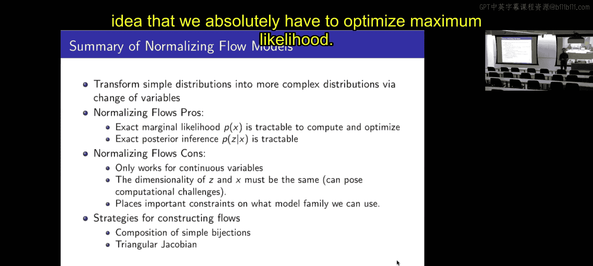

归一化流模型在理论上是优雅的，它提供了精确的似然计算和潜在空间推断。然而，其对架构的约束和较高的计算成本，使其在实际应用中面临挑战。在接下来的课程中，我们将转向一种完全不同的生成模型范式——生成对抗网络，它将放弃直接优化似然的目标，转而寻求一种更灵活的训练方式。