# 深度生成模型：第9讲：生成对抗网络 (GANs) 🎭

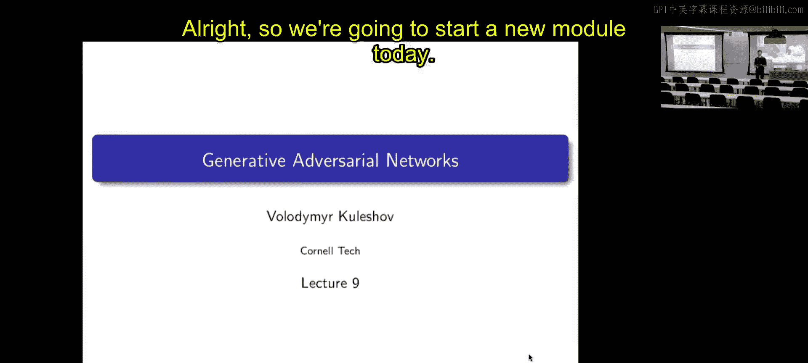

在本节课中，我们将学习一种全新的生成模型训练范式——生成对抗网络。我们将探讨如何绕过直接计算似然函数的复杂性，转而使用基于样本的、无似然的目标函数来训练模型。

## 概述

在之前的课程中，我们学习了多种生成模型，如自回归模型、变分自编码器和标准化流。这些模型的核心训练目标都是最大化数据的对数似然，这通常涉及复杂的计算，例如变分推断或计算雅可比行列式。

本节我们将探索一种不同的策略：**无似然学习**。我们不再直接计算或优化似然函数，而是通过比较从模型分布和数据分布中抽取的样本来定义训练目标。这种方法的核心是**生成对抗网络**。

## 从似然目标到样本目标

上一节我们回顾了基于似然的目标函数及其挑战。本节中，我们来看看如何构建一个完全基于样本比较的训练目标。

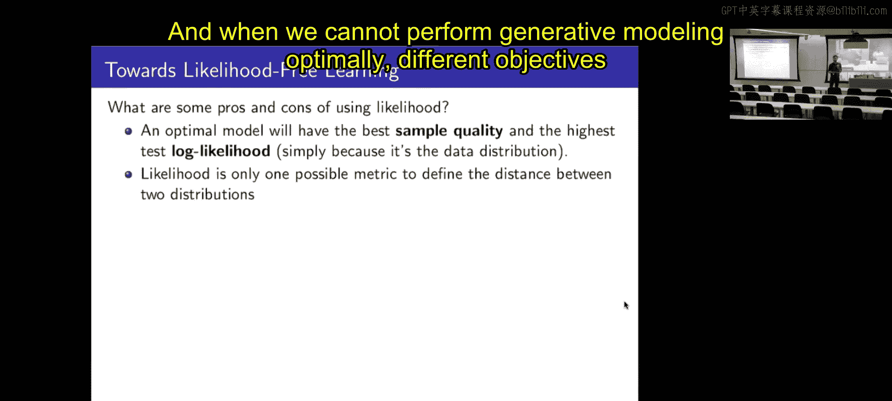

### 两样本检验

我们的目标是判断两组样本是否来自同一分布。在统计学中，这被称为**两样本检验**。其基本框架是：
*   **零假设 (H0)**：两组样本来自同一分布。
*   **备择假设 (H1)**：两组样本来自不同分布。

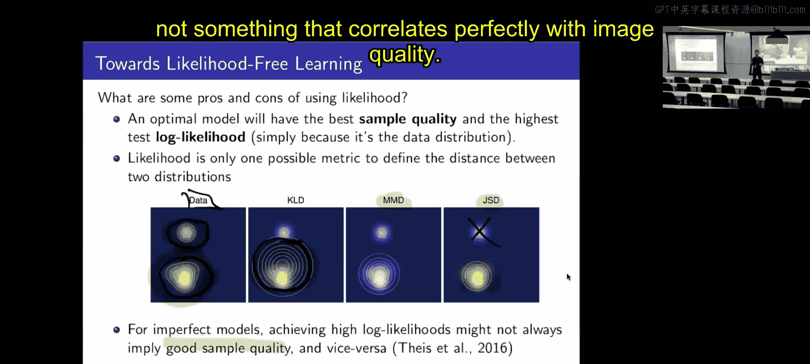

检验通过计算一个**检验统计量**来实现。如果该统计量超过某个阈值，我们就拒绝零假设。一个简单的例子是比较两组样本的均值。

### 将两样本检验应用于生成建模

我们可以将生成建模问题转化为一个两样本检验：
*   **样本集 S1**：来自真实数据分布 `P_data` 的样本（即我们的数据集）。
*   **样本集 S2**：来自生成模型分布 `P_θ` 的样本。

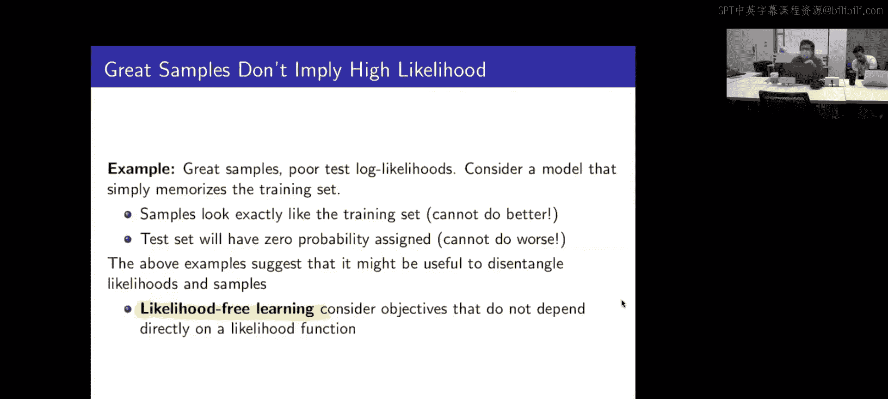

我们的目标是训练生成器 `G_θ`，使得 `P_θ` 尽可能接近 `P_data`。根据两样本检验的思想，我们可以通过最小化某个基于样本的检验统计量来实现这一目标。

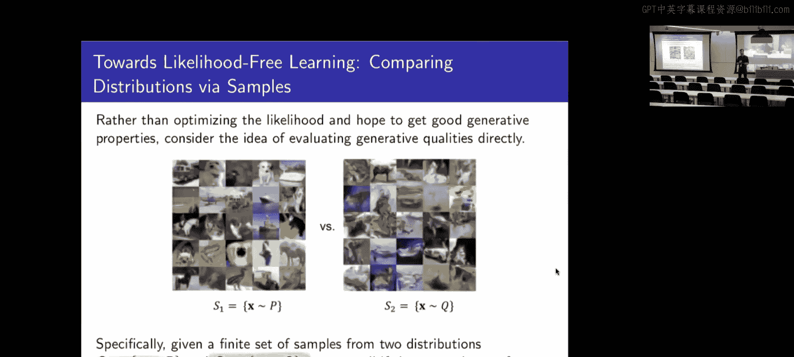

然而，设计一个通用的、强大的检验统计量是困难的。对于任何固定的统计量，我们总能构造出分布不同但统计量相同的反例。

### 学习检验统计量：判别器

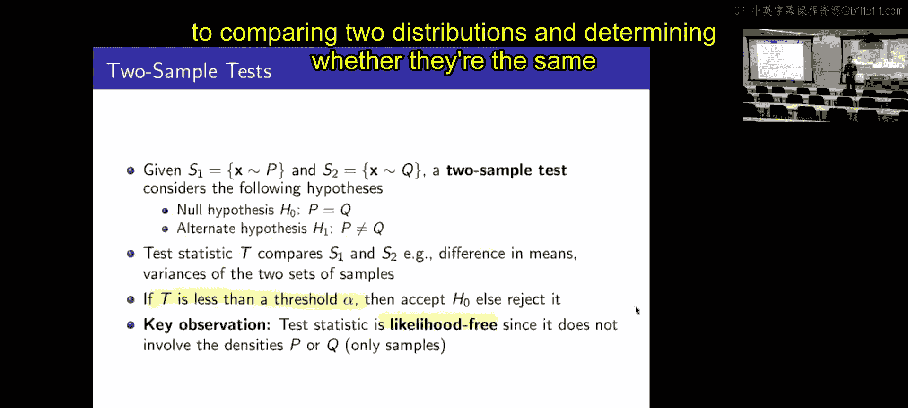

GAN 的关键洞见在于：**我们可以学习这个检验统计量**。
我们知道一组样本是“真实”的，另一组是“生成”的。因此，我们可以训练一个分类器（称为**判别器** `D_φ`）来尽可能好地区分这两类样本。这个最优判别器本身就定义了一个强大的、数据驱动的两样本检验统计量。

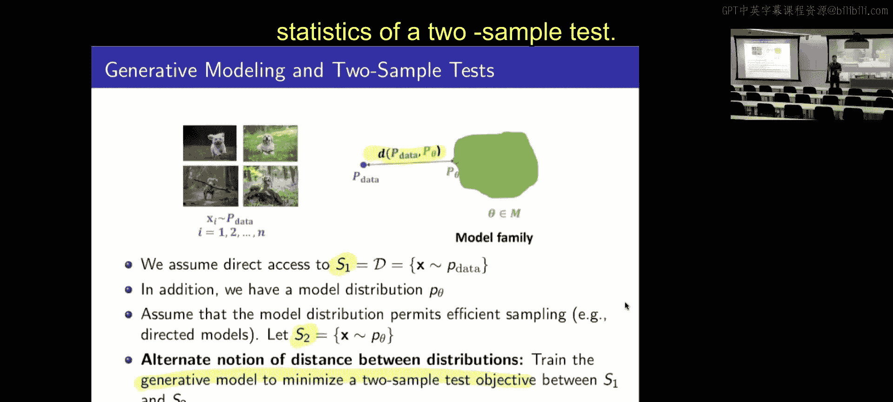

具体来说，判别器是一个函数（如神经网络），它接收样本 `x`，并输出该样本来自真实数据分布的概率 `D(x)`。其训练目标是最大化分类准确率。

通过贝叶斯定理可以证明，**最优判别器** `D*(x)` 的形式为：
`D*(x) = P_data(x) / [P_data(x) + P_θ(x)]`

这等价于一个 sigmoid 函数作用于对数密度比：
`D*(x) = σ(log(P_data(x)) - log(P_θ(x)))`
因此，最优判别器隐式地学习了两个分布之间的密度比。

### 对抗训练：生成器与判别器的博弈

现在我们有两个角色：
1.  **判别器 (D)**：努力区分真实样本和生成样本（最大化分类准确率）。
2.  **生成器 (G)**：努力生成以假乱真的样本，从而**欺骗**判别器（最小化判别器的准确率）。

这形成了一个**极小极大博弈**，其价值函数 `V(G, D)` 为：
`min_G max_D V(G, D) = E_{x~P_data}[log D(x)] + E_{z~p(z)}[log(1 - D(G(z)))]`
*   判别器 `D` 试图**最大化** `V`，使第一项（对真实样本的评分）变大，第二项（对生成样本的评分）变小。
*   生成器 `G` 试图**最小化** `V`，主要是让第二项变大，即让 `D(G(z))` 接近 1，从而欺骗判别器。

### 与 Jensen-Shannon 散度的联系

如果我们假设判别器总是达到最优（即 `D = D*`），那么生成器的优化目标等价于最小化真实数据分布 `P_data` 与模型分布 `P_θ` 之间的 **Jensen-Shannon (JS) 散度**。

JS 散度 `JSD(P || Q)` 定义为：
`JSD(P || Q) = 1/2 KL(P || M) + 1/2 KL(Q || M)`
其中 `M = (P + Q)/2` 是两个分布的混合。

与之前使用的 KL 散度相比，JS 散度具有对称性，且其平方根是一个真正的距离度量（满足三角不等式）。

### 模式覆盖 vs. 模式寻求

KL 散度和 JS 散度的一个关键行为差异在于它们如何处理多峰分布：
*   **KL 散度是模式覆盖的**：为了保持 KL 散度有限，模型必须为数据分布中概率非零的**所有**区域都分配非零概率。这可能导致模型“平均化”所有模式，产生模糊的样本。
*   **JS 散度是模式寻求的**：模型可以只专注于拟合数据分布中的一个或几个模式，而忽略其他模式。这可能导致生成的样本更清晰，但多样性可能降低（即“模式坍塌”）。

以下是两种行为在拟合双峰分布时的示意图：
*   KL 散度目标会拟合一个覆盖两个峰的宽泛分布。
*   JS 散度目标可能会完美拟合其中一个峰，而完全忽略另一个。

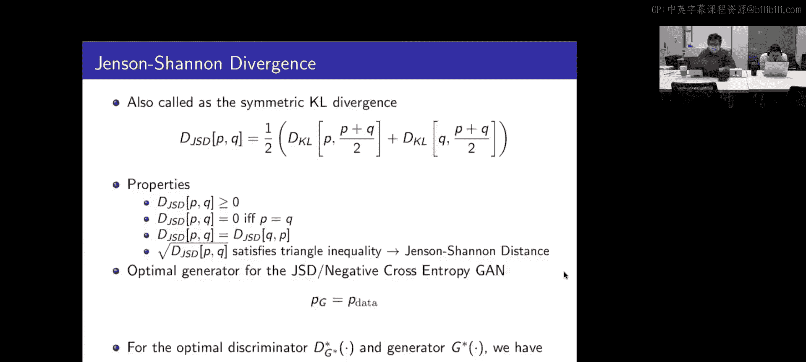

## GAN 训练算法 🚀

以下是 GAN 的基本训练流程：

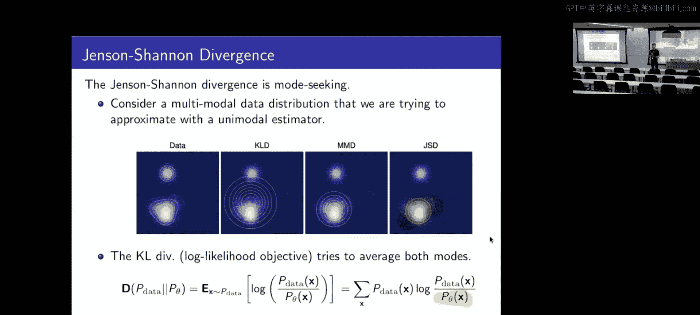

1.  初始化生成器 `G` 和判别器 `D` 的参数。
2.  循环迭代：
    *   **步骤1：更新判别器 `D`**
        *   从真实数据中采样一个小批量 `{x^(1), ..., x^(m)}`。
        *   从先验噪声分布 `p(z)`（如标准正态分布）中采样一个小批量 `{z^(1), ..., z^(m)}`。
        *   通过生成器得到生成样本 `{G(z^(1)), ..., G(z^(m))}`。
        *   通过**梯度上升**更新 `D` 的参数，以最大化价值函数 `V` 中与 `D` 相关的部分：
            `∇_φ (1/m) Σ_{i=1}^m [log D(x^(i)) + log(1 - D(G(z^(i))))]`
    *   **步骤2：更新生成器 `G`**
        *   再次从噪声分布中采样一个小批量 `{z^(1), ..., z^(m)}`。
        *   通过**梯度下降**更新 `G` 的参数，以最小化价值函数 `V` 中与 `G` 相关的部分（或等价地，最大化判别器对生成样本的误判）：
            `∇_θ (1/m) Σ_{i=1}^m log(1 - D(G(z^(i))))`
            （实践中常使用 `∇_θ (1/m) Σ_{i=1}^m -log(D(G(z^(i))))` 作为替代，以提供更强的梯度。）

## GAN 的优势与挑战 ⚖️

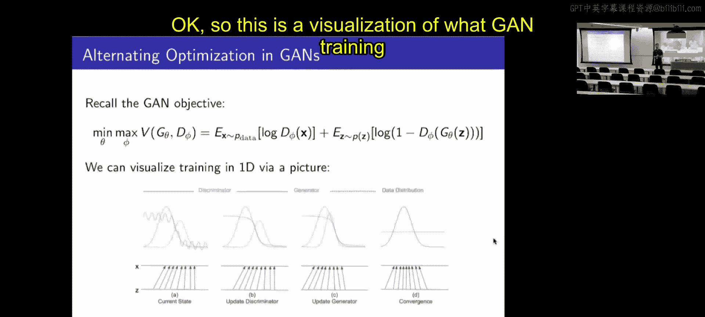

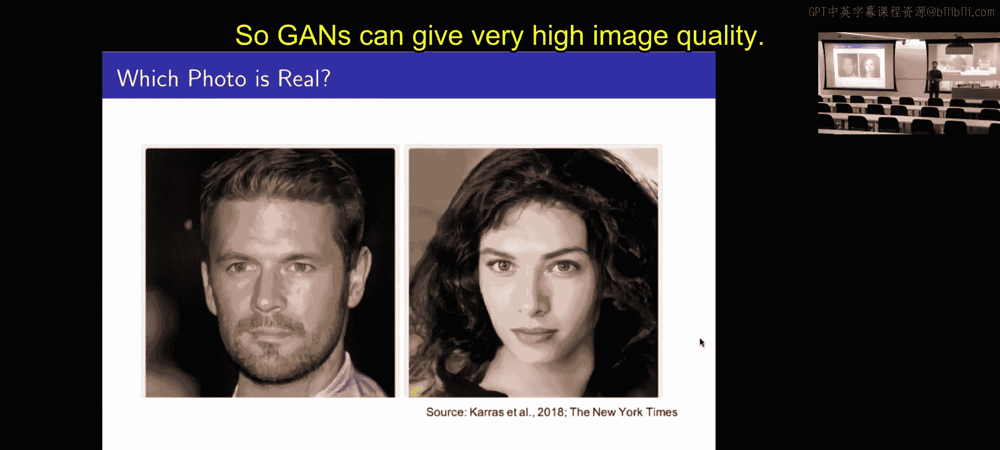

### 优势
*   **样本质量高**：GAN 通常能生成非常清晰、逼真的图像，曾长期是图像生成质量的标杆。
*   **灵活性高**：生成器可以是任何可微分的、能从其采样的过程，架构设计限制较少。
*   **无似然计算**：避免了计算概率密度或似然的复杂性。

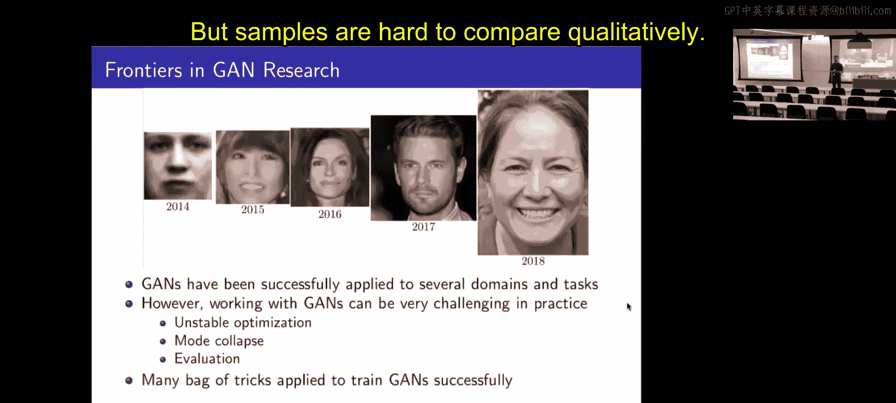

### 挑战与问题
*   **训练不稳定**：极小极大博弈的优化过程可能不稳定，容易发生梯度消失或爆炸、振荡等问题。
*   **模式坍塌**：生成器可能只生成数据分布中的一小部分模式（例如，只生成一种数字或一种人脸），缺乏多样性。
*   **评估困难**：由于没有显式的似然函数，定量评估 GAN 的性能比评估其他生成模型更困难。
*   **超参数敏感**：训练过程对网络架构、学习率、优化器等超参数的选择非常敏感。

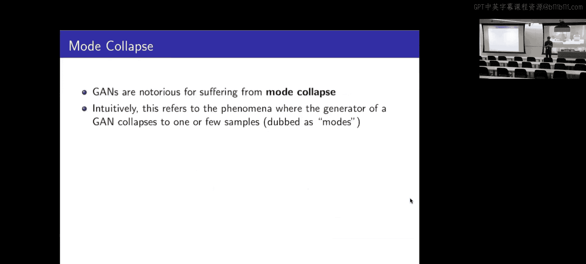

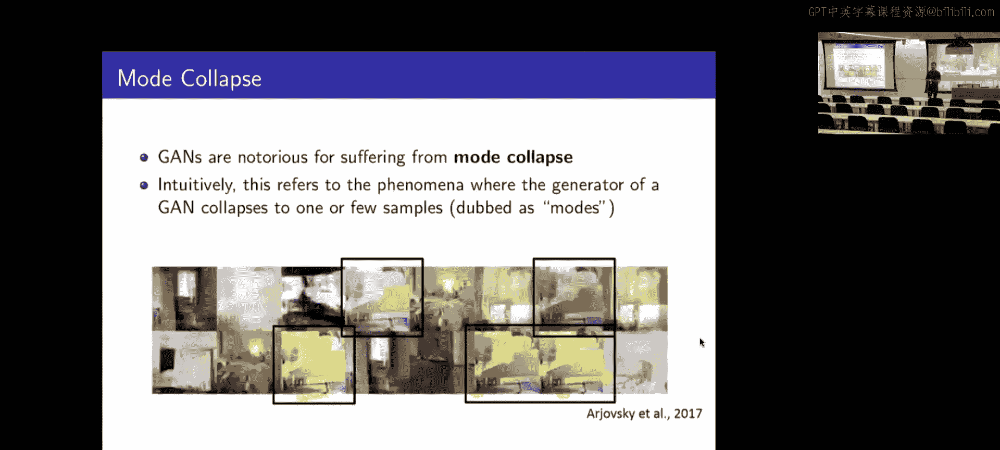

实践中需要许多技巧来稳定 GAN 的训练，例如使用特定的损失函数（如 Wasserstein GAN 中的损失）、梯度惩罚、谱归一化等。

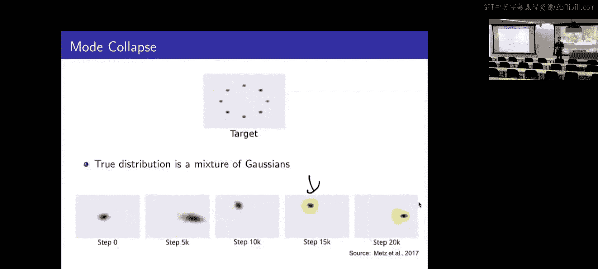

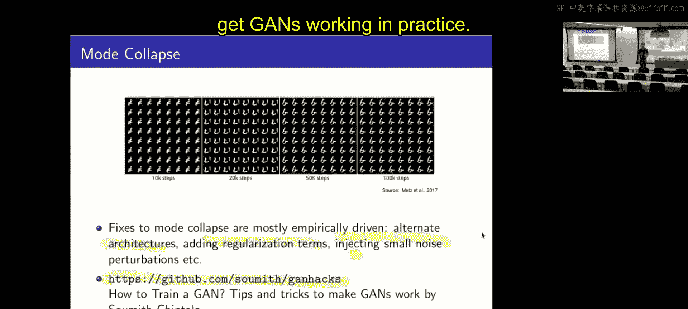

## 总结

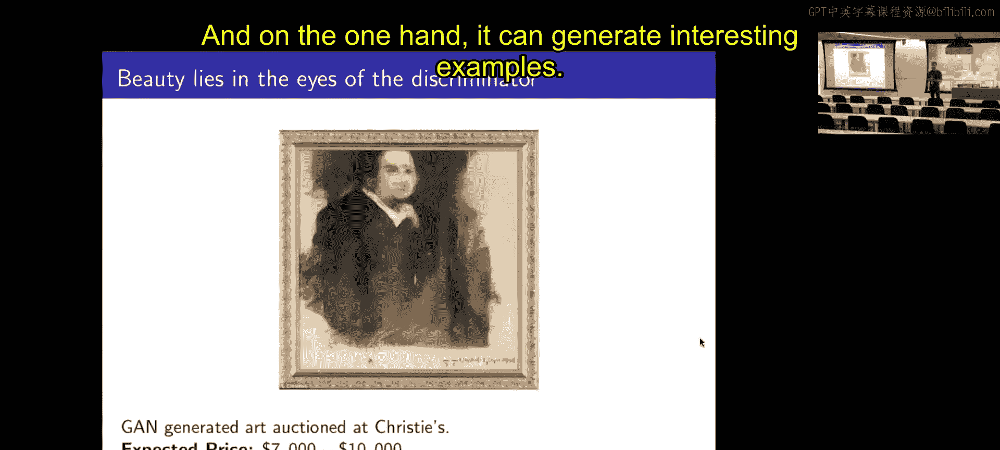

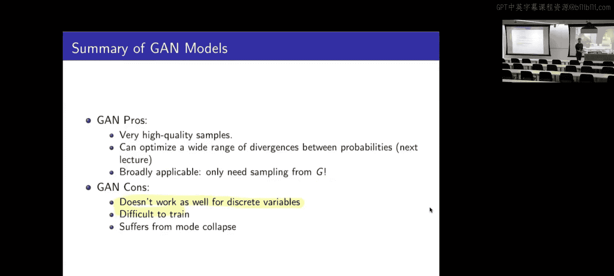

本节课我们一起学习了生成对抗网络的核心思想。GAN 通过引入一个判别器来与生成器进行对抗性博弈，从而实现了无需计算显式似然函数的生成模型训练。其优化目标隐式地最小化了真实分布与模型分布之间的 Jensen-Shannon 散度。尽管 GAN 能产生高质量的样本，但其训练过程的不稳定性和模式坍塌问题也是实际应用中需要重点关注的挑战。在下一讲中，我们将探讨 GAN 的更多变体及其改进方法。