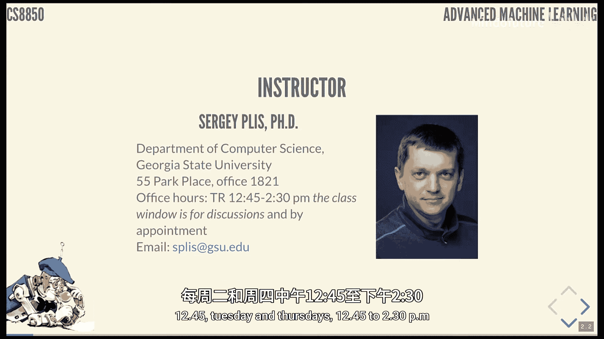
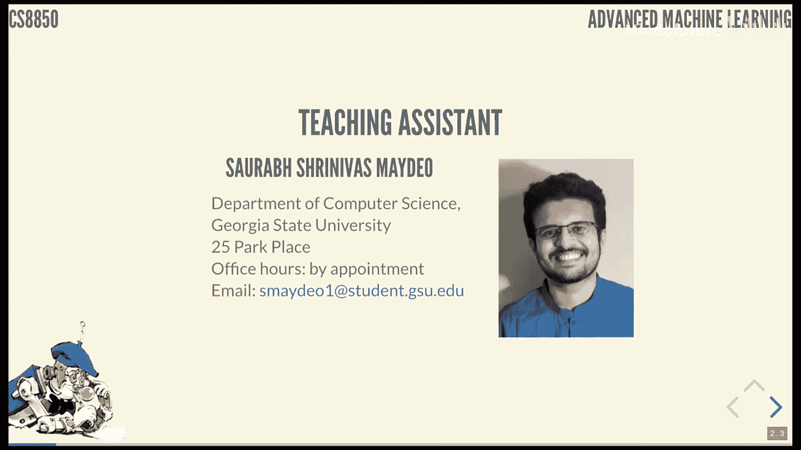

# 001：导论 🚀

在本节课中，我们将学习高级机器学习课程的总体介绍，包括课程目标、讲师介绍以及机器学习的基本概念和历史。

---

## 讲师介绍 👨‍🏫

上一节我们开始了课程，本节中我们来认识一下授课团队。

我是Sergey，是计算机科学系的副教授，同时也是T研究中心机器学习核心的主任。我的经历涵盖学术界、工业界和初创企业。我将尽力向你们传授我对机器学习的热情，并解释其理论和实践应用的重要性。

我的办公室在55 Park Place，但本学期我们不太可能进行线下会面。你们可以随时通过邮件联系我。课程时间（周二和周四的12:45至2:30 PM）将作为主要的办公时间。

以下是关于课程参与的重要说明：
*   课程将以线上同步形式进行。
*   为了营造课堂氛围，请在上课时开启摄像头。
*   如果连接课堂但未开启摄像头，将不会被计入出勤。

我的助教是Z。你们也可以通过邮件与他联系，他会回复并安排一对一的线上交流。

---

## 为什么学习机器学习？🤔

认识了授课团队后，我们来看看学习这门课程的意义。

机器学习是当前科技发展的核心驱动力之一。它不仅是学术研究的前沿，更广泛应用于工业界和日常生活的方方面面。理解机器学习的深层原理和工作机制，对于在任何领域应用它都至关重要。

---

## 什么是机器学习？🧠

理解了学习动机，现在我们来定义机器学习本身。

机器学习是人工智能的一个分支，它使计算机系统能够从数据中“学习”并改进性能，而无需进行明确的编程。其核心思想是让机器从经验（数据）中自动发现规律。

一个简单的形式化描述是：给定任务 **T**、经验 **E** 和性能度量 **P**，如果计算机程序在 **T** 上的性能（由 **P** 衡量）随着经验 **E** 的增加而提高，则称该程序从经验 **E** 中学习。

---

## 机器学习简史 📜

明确了定义，让我们快速回顾一下机器学习的发展历程。

机器学习的发展并非一蹴而就，它经历了多个阶段的演进：
*   **早期思想（1940s-1950s）**：受神经科学启发，出现了感知机等早期模型。
*   **符号主义与专家系统（1960s-1980s）**：基于规则和逻辑的AI方法盛行。
*   **统计学习复兴（1990s-2000s）**：支持向量机（SVM）、决策树等基于统计理论的算法成为主流。
*   **深度学习崛起（2010s-至今）**：得益于大数据和计算力的提升，神经网络（尤其是深度学习）在图像、语音、自然语言处理等领域取得突破性进展。

---

## 强化学习初探 🎮

回顾了历史，本节我们以一个有趣的分支——强化学习作为切入点，初步感受机器学习的魅力。

强化学习是机器学习的一个重要范式，它关注智能体如何在一系列行动中，通过与环境互动并获得奖励或惩罚来学习最优策略。其核心概念可以用马尔可夫决策过程来建模。

一个简化的目标是学习一个策略 **π**，以最大化累积奖励的期望值：
`总奖励 = E[Σ γ^t * R_t]`
其中，`R_t` 是t时刻的即时奖励，`γ` 是折扣因子。

---

## 课程概述 📋

在初步了解了强化学习后，最后我们来总览整个课程的全貌。

本课程将深入探讨机器学习的多个高级主题。我们将不仅学习算法如何使用，更将探究其背后的原理、假设和局限性。课程内容将涵盖理论推导、实践应用以及当前的研究前沿。

以下是本课程的主要安排：
*   授课形式为录播讲座与线上同步讨论相结合。
*   录播视频将上传至网络平台，方便大家按自己的节奏学习。
*   每周的固定时间将进行线上同步会议，用于答疑、讨论和深入交流。

---

本节课中，我们一起学习了课程的基本信息、讲师介绍、机器学习的定义与简史，并初步接触了强化学习的概念，最后了解了课程的整体安排。希望这为我们的深入学习奠定了良好的基础。