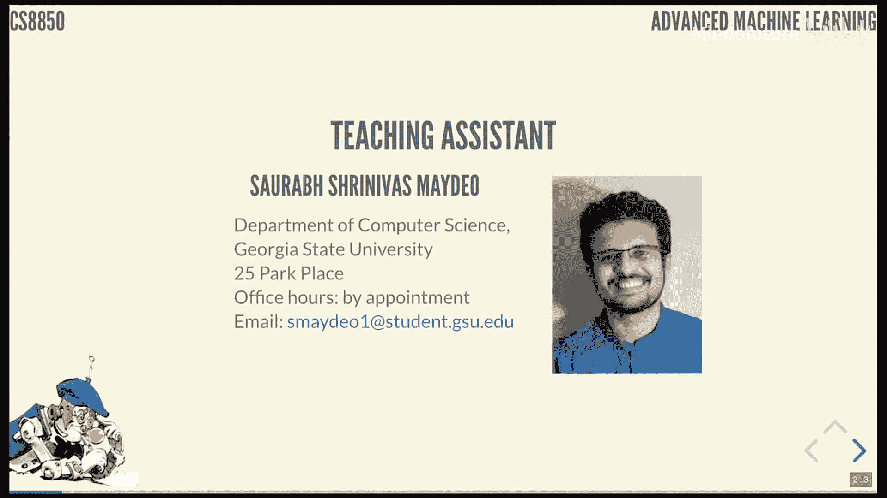

# 002：课程引言 🎓

在本节课中，我们将了解这门高级机器学习课程的基本情况，包括授课形式、教师介绍以及课程的整体安排。

---

## 自我介绍 👨‍🏫

上一节我们介绍了课程的基本形式，本节中我们来认识一下授课教师。

我是谢尔盖。你们可以简单地称呼我为博士。我是计算机科学系的副教授，同时在T研究中心担任机器学习核心部门的主管。我拥有包括工业界和初创公司在内的广泛经验。我将尽力向你们传授或分享我对机器学习及其实际应用的兴趣与见解，并解释机器学习方法背后的一些理论或深层原理为何在学术界、工业界及任何应用场景中都至关重要。

我的办公室地址在帕克广场55号，但由于时间安排，本学期我们不太可能在那里见面。你们可以随时通过邮件向我提问。正式的“办公时间”就是我们的课堂时间。

---

## 教学助理介绍 👨‍💻

介绍完主讲教师，接下来我们认识一下本课程的教学助理。

这是我的助教，Z。同样，不太可能安排线下面谈。你们可以随时给他发邮件，他会回复并安排一对一的线上通话。

---

## 课程形式与特点 📚

了解了课程团队后，我们来看看这门课将以何种形式进行。

这些是我的讲座录像。我通常在晚上录制，因此风格和方式会与实时课堂有所不同。在课堂上，我能获得你们的反馈并与你们直接互动；而录制时，我面对的是空房间，这有时让我很难表现出兴奋感或以理想的方式传达信息。

这种方式有缺点，但也有优点。我会将所有讲座上传到YouTube，你们可以**以不同的速度观看**。我语速可能较慢，因此你们或许会希望以更高的速度播放。你们可以随时暂停、观看，这正是异步学习的意义所在。正如我在邮件中提到的，我们将在周二见面讨论问题。

同时，这也是一次真实的课堂体验。讲座中可能会有卡顿、重复，我不会将其剪辑成营销视频般的质量，而是保留所有的停顿和思考过程。

---

## 课程内容概览 🗺️

明确了学习形式，现在我们来预览一下本节课以及整个课程将要涵盖的内容。

本节课是导论课，我将介绍你们将学习什么，以及我在教学过程中的收获。

1.  **自我介绍**：我会介绍我自己和我的背景，你们也有机会在周二的第一节课或第一次讨论环节介绍自己。
2.  **为何学习机器学习**：探讨学习机器学习的动机与意义。
3.  **什么是机器学习**：阐述机器学习的基本定义。
4.  **机器学习简史**：回顾机器学习领域的发展历程。
5.  **强化学习初探**：为了增加趣味性，我们会初步涉足强化学习。
6.  **课程概述**：介绍本课程的整体安排和结构。

---

## 课堂参与要求 💻

在进入具体内容之前，最后强调一下课堂参与的要求。

我们的课程是在线同步进行的。为了营造一种现场感和人际互动，如果你进入课堂，**请务必开启摄像头**。我将把Zoom设置为仅显示开启视频的参与者。来到课堂却不露脸，基本上不会被计入参与。当然，你也可以预约与我进行一对一的Zoom通话，但我更希望大部分讨论能在常规的课堂时间（周二和周四的12:45至14:30）完成。

---

本节课中，我们一起了解了这门高级机器学习课程的授课教师、教学形式、基本要求以及第一讲的内容框架。从下节课开始，我们将正式踏入机器学习的精彩世界。