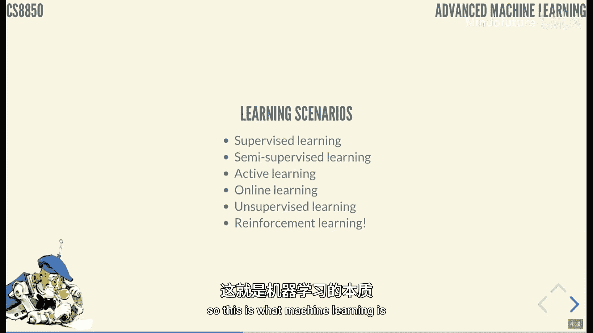

# 004：什么是机器学习 🧠

在本节课中，我们将要学习机器学习的核心定义、其跨学科的本质，以及它所涵盖的主要任务和学习场景。

## 什么是学习？

当我们思考“什么是机器学习”时，首先需要理解“学习”本身。根据维基百科的定义，学习是**获取新的或修改现有的知识、行为、技能、价值观或偏好**的过程，并且可能涉及综合不同类型的信息。这种能力是人类和动物所拥有的。

## 什么是机器学习？

根据亚瑟·塞缪尔在1959年提出的经典定义，**机器学习是赋予计算机无需明确编程即可学习的能力的研究领域**。这引出了编程与学习的区别。

汤姆·米切尔在1998年给出了一个更形式化的定义，很好地描述了一个学习问题：
> 一个计算机程序被认为从**经验E**中学习，针对某项**任务T**和**性能度量P**，如果它在任务T上的性能（由P度量）随着经验E的增加而提高。

这个定义是否对应了我们当前的算法？是否对应了我们在处理YouTube视频、推荐系统等任务时的学习过程？我们将在本学期的学习中寻找答案。

## 机器学习的学科交叉性

机器学习是一门数据科学学科，从某种意义上说，它是一门综合性学科，位于多个领域的交叉点上。

以下是机器学习所结合的核心学科：

*   **统计学**
*   **计算机科学**
*   **优化理论**

此外，机器学习还广泛借鉴了其他领域的知识，包括：
*   人工智能
*   贝叶斯方法
*   计算复杂性理论
*   信息论
*   哲学
*   心理学
*   神经生物学

所有这些知识融合并锻造在一起，形成了我们今天所知的机器学习。

有些人认为机器学习只是应用统计学。这类似于说计算机科学只是应用数学。两者的主要区别在于目标：统计学更关注**模型本身**及其参数的意义，而机器学习更关注**从数据到预测的性能**，并强调计算效率、处理大数据的能力以及最终生成可执行程序的目标。

## 机器学习的主要任务

机器学习处理多种学习任务。以下是其中一些核心任务：

*   **分类**：将实体划分到不同的类别中。例如，区分图片中是苹果还是橙子。
*   **回归**：预测连续值。例如，根据照片估计一个人的年龄或体重。
*   **排序**：根据偏好对项目进行排序。例如，根据用户历史行为推荐电影，或在搜索引擎中排列搜索结果。
*   **聚类**：在没有监督信号的情况下发现数据中的结构，将相似的数据点分组。
*   **降维**：减少数据中的噪声或冗余，将其投影到更低维度的空间以便于分析或可视化。
*   **流形学习**：处理存在于某个低维流形上（而非均匀占据整个高维空间）的数据，常用于数据压缩等任务。
*   **因果学习**：从观测数据中推断因果关系。例如，通过传感器数据判断是温度变化导致压力变化，还是反之。这对于在昂贵或危险环境中（如派往新星球的机器人）规划实验至关重要。

## 机器学习的学习场景

上述任务可以在不同的学习场景下进行。以下是几种主要的学习场景：

*   **监督学习**：存在一个“教师”为每个训练样本提供明确的标签（如“这是猫”，“这是狗”）。
*   **半监督学习**：只有部分数据带有标签，算法需要利用大量未标记的数据和少量标记数据进行学习。
*   **主动学习**：算法可以主动选择或请求获取对学习最有帮助的数据，以提高学习效率。
*   **在线学习**：数据以流的形式实时到达，算法需要边接收数据边进行学习和更新。
*   **无监督学习**：没有任何标签信息，算法完全从数据本身发现模式，聚类是典型例子。
*   **自监督学习**：一种特殊的无监督学习，通过将数据的一部分作为预测目标来构造监督信号。例如，在自然语言处理中，让模型预测句子中被掩盖的词语。
*   **强化学习**：智能体通过与环境交互，根据稀疏的奖励或惩罚信号，学习采取一系列行动以实现目标最大化。

## 总结

本节课中，我们一起学习了机器学习的核心概念。我们从“学习”的定义出发，探讨了亚瑟·塞缪尔和汤姆·米切尔对机器学习的经典界定。我们了解到机器学习是一门融合了统计学、计算机科学和优化理论等多学科的综合性领域。接着，我们梳理了机器学习要解决的主要任务，如分类、回归、排序等，并介绍了这些任务得以实施的不同学习场景，包括监督学习、无监督学习、强化学习等。理解这些基础概念是进一步探索复杂机器学习算法和应用的第一步。