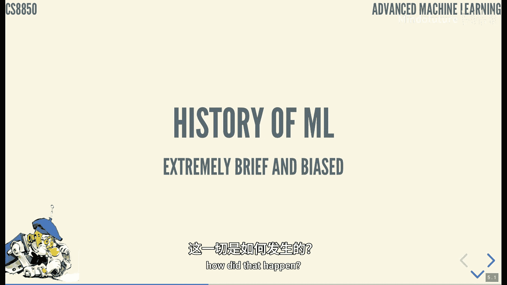
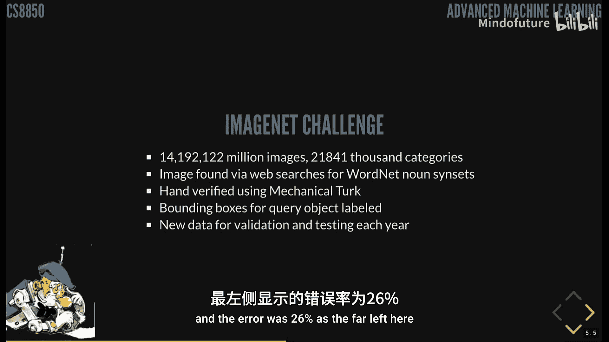
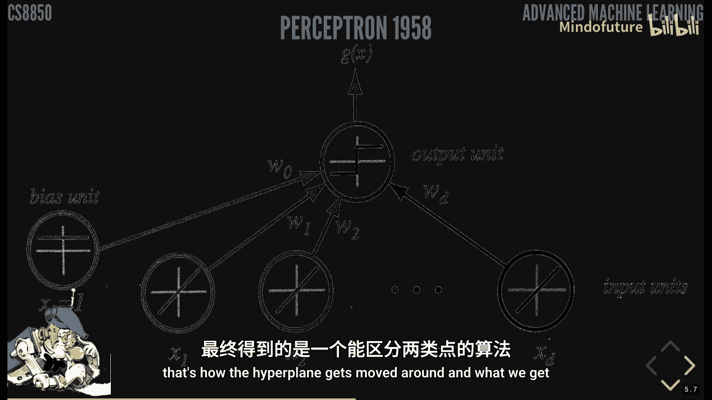
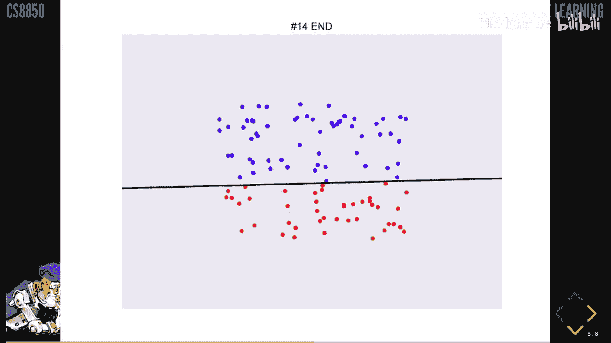
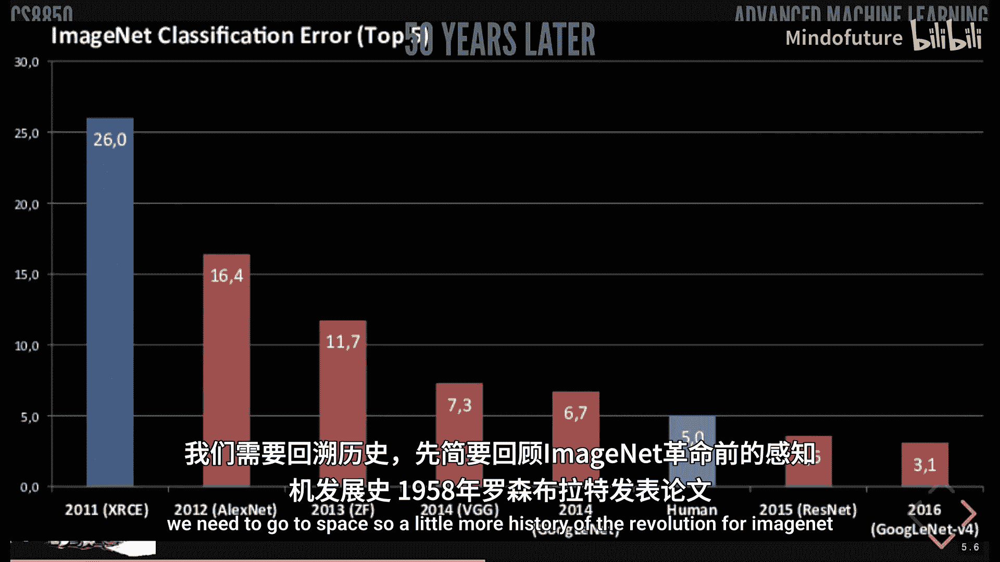
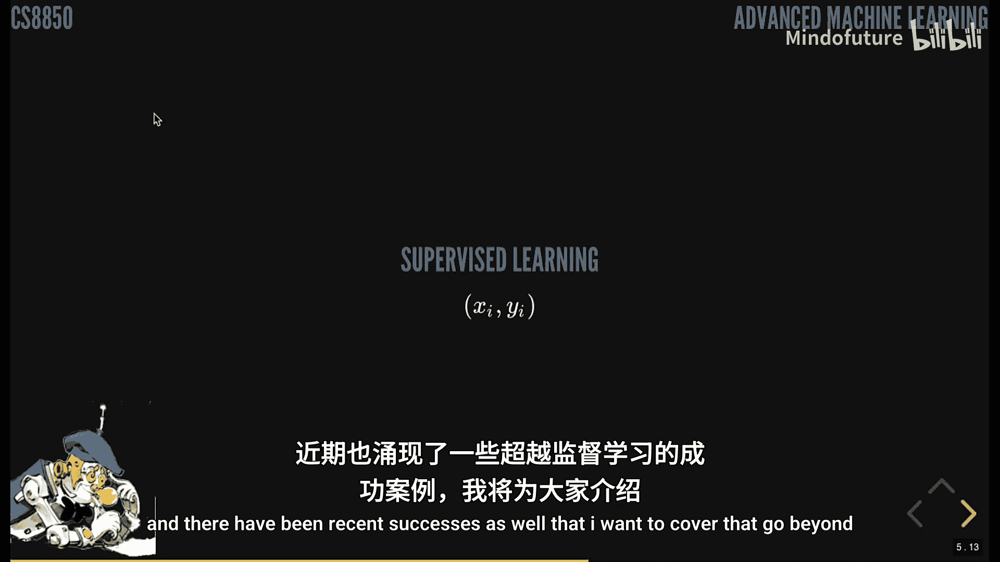

# 005：机器学习的历史 📜

在本节课中，我们将回顾机器学习发展的关键历史节点，了解它是如何从简单的概念演变为今天改变世界的强大技术。我们将从早期的感知机开始，一直讲到引发现代人工智能革命的深度神经网络。

## 从传说与现实谈起

上一节我们介绍了机器学习的广阔前景，本节中我们来看看它的发展历程是如何开启的。

一个著名的都市传说发生在1966年。麻省理工学院的马文·明斯基（Marvin Minsky，1969年图灵奖得主）雇佣了一名大一本科生，并给他布置了一个暑期任务：将相机连接到计算机，并让机器描述它所看到的东西。六十年后，我们才可以说基本解决了这个问题。但事实上，这并非明斯基所为，而是西蒙·派珀特（Simon Papert）雇佣了一个由10名学生组成的团队。这个任务本质上就是计算机视觉问题——一个花费了计算机视觉领域60年时间才实现的研究项目。

在计算机科学中，有时很难向他人解释“简单”任务和“几乎不可能”任务之间的区别。例如，一个客户要求：“当用户拍照时，应用应该检查他们是否在国家公园里。”程序员觉得这很简单，用地理信息系统（GIS）查一下就行。但客户接着说：“并且检查照片里是不是一只鸟。”程序员则需要一个研究团队和五年的时间。有时，这个时间是六十年。

## ImageNet竞赛与深度学习的突破

那么，是什么帮助解决了图像识别的挑战呢？斯坦福大学的李飞飞教授及其团队建立了ImageNet数据集。该数据集包含约1400万张图像和22000个类别。所有图像均通过网络搜索获取，并经由人工（通过亚马逊土耳其机器人平台）仔细验证和标注。组织者还提供了图像中物体的边界框。该竞赛每年都会添加新的验证数据。

在竞赛运行期间，图像分类的错误率最初在26%左右（如下图所示），并逐年缓慢下降。

2012年，多伦多大学杰弗里·辛顿（Geoffrey Hinton）的学生亚历克斯·克里泽夫斯基（Alex Krizhevsky）发表了一篇论文。据说，亚历克斯说服了辛顿开始使用GPU，并实现了一个卷积神经网络（CNN）分类器，在ImageNet数据集上进行训练。在2012年的ImageNet竞赛中，他们的模型（后来被称为AlexNet）将错误率从约26%大幅降低至16.4%。这是一个巨大的飞跃，并立即引起了业界的关注。

此后，亚历克斯和团队在多伦多大学外成立了一家公司以转化知识产权。谷歌和微软开始竞购这家公司，最终谷歌胜出，并以高薪聘请了包括亚历克斯在内的团队成员加入谷歌大脑部门。自AlexNet以来，深度学习在工业界爆发式发展。虽然神经网络和机器学习的研究自20世纪50年代就已开始，但工业界的成功在此时才变得显著。

需要指出的是，AlexNet使用的CNN架构早在1998年就已发明。我们所有人都站在巨人的肩膀上。到2016年，仅仅四年后，ImageNet的错误率已从2011年的26%降至3.1%（如GoogleNet V4所示）。这期间发生了许多与卷积神经网络架构和大规模计算相关的进展。这是一次巨大的、 tectonic shift（构造性转变），使得“AI”一词变得司空见惯，关于机器取代人类工作的讨论也日益普遍。

这种担忧是真实的。例如，我曾在一家公司工作，用一年时间与一个五人团队几乎完全自动化了原本由人工完成的、繁琐的医疗文档信息提取和标注工作。那些不需要创造性思维、重复性的工作确实面临自动化风险。如果你计划从事仅依赖视觉系统而不需要思考或创造的工作，或许应该重新考虑职业规划。自动化的目标正是将人类从繁琐的任务中解放出来，去从事更有趣、更具挑战性和更有用的工作，比如探索太空。

## 神经网络架构的演进

接下来，我们具体看看推动这场革命的关键神经网络架构是如何发展的。

### 感知机：一切的起点

1958年，罗森布拉特（Rosenblatt）发表论文，引入了简单的线性阈值分类器——感知机。其核心是一个带偏置项的输入加权和。

**公式**：`输出 = sign(权重 · 输入 + 偏置)`

其中，偏置输入始终为1，其对应的权重决定了分离超平面的位置。感知机收敛算法能够在线性可分的情况下成功分离两类数据点。我们将在课程中详细讲解这个算法。

### 从单层到深度网络

在感知机被提出后不久，人们立即开始探索将多个感知机堆叠成更强大的网络，以解决更复杂的问题。然而，马文·明斯基和西蒙·派珀特在《感知机》一书中证明，单层感知机无法解决一大类问题，例如异或（XOR）问题。

而堆叠起来的感知机网络（即多层网络）能够解决这些问题。其现代版本就是你可能听说过的深度神经网络。下图展示了一种称为**前馈神经网络**的结构，它由一系列线性变换和逐点的非线性激活函数（如Sigmoid）组成，可用于分类或回归。

### 卷积神经网络：为图像而生

卷积神经网络（CNN）则引入了一种针对图像的**归纳偏置**。它假设图像具有平移不变性：例如，图片中的猫无论出现在左上角还是右下角，它仍然是猫；边缘检测也是如此。这种结构偏置使得CNN特别适合处理图像。

一个有趣的现象是，如果随机初始化一个普通的前馈网络来处理图像，其输出是毫无意义的。但即使不经过训练，一个精心随机初始化的CNN也可能从一开始就表现出不错的准确度。这体现了其结构本身蕴含的强大先验知识。

下图所示的网络结构非常接近2012年获胜的AlexNet。

**有趣之处有两点**：
1.  网络的前面部分是**全卷积的**，仅由卷积层构成。
2.  网络的末端再次连接了**前馈层**（全连接层）。

我们将在课程后期讨论，在某些网络结构中，末端可能不需要前馈连接，仅使用全卷积结构即可。

### 循环神经网络：处理序列数据

除了空间数据，还有像语音、文本、语言以及许多科学时间序列这样的**序列数据**。为此，循环神经网络（RNN）应运而生。

RNN是功能极其强大的工具，理论上可以计算任何可计算的问题，是图灵完备的。但由于其循环步骤的特性（下一步计算必须在前一步完成后才能进行），它可能并非总是最高效的，这与可以高度并行化的CNN不同。尽管如此，RNN仍然是一个重要且强大的模型，即使目前Transformer等架构在某些领域占据主导，我们也不应忽视RNN的能力。

## 监督学习的主导与未来方向

需要指出的是，上述自2012年以来的工业界（及部分学术界）成功，主要归功于**监督学习**。从AlexNet团队被收购开始，整个领域完善得最好的就是监督学习。

当然，也有许多其他方向的尝试和努力，例如：
*   变分自编码器（VAE）
*   贝叶斯优化
*   生成对抗网络（GAN）

但目前，当我们拥有带标签的数据集（即每个样本 `x_i` 都有对应的标签 `y_i`）时，最有效的方法仍然是基于反向传播的监督学习。

然而，机器学习的内涵远不止监督学习。近年来，在**自监督学习**、**强化学习**等领域也取得了显著成功，这些方向超越了传统监督学习的范式，也是本课程后续希望涵盖的内容。

## 总结

本节课中，我们一起学习了机器学习，特别是深度学习的关键发展历史。我们从感知机的诞生讲起，经历了由于理论局限而导致的寒冬，再到通过ImageNet竞赛和AlexNet实现突破的“复兴”时代。我们了解了不同神经网络架构（如前馈网络、CNN、RNN）为解决特定类型问题（如图像、序列）而引入的归纳偏置。最后，我们认识到当前的成功很大程度上建立在监督学习的基础上，但更广阔的学习范式正在蓬勃发展。理解这段历史，有助于我们把握当下技术的来龙去脉，并展望未来的无限可能。