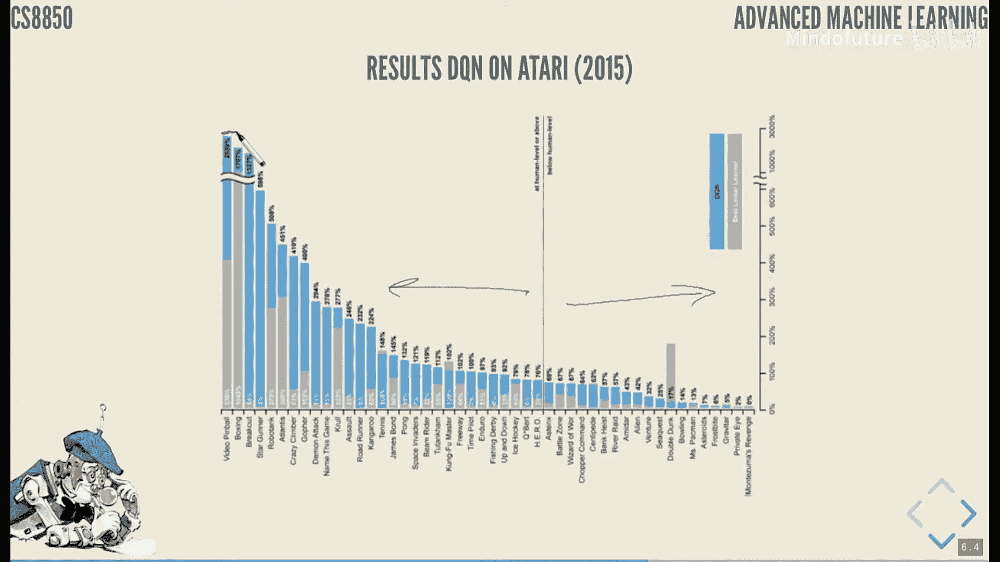
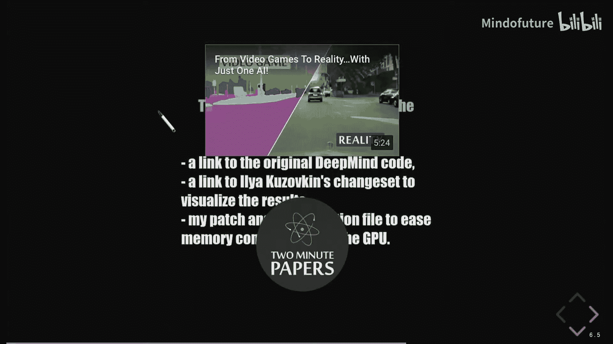
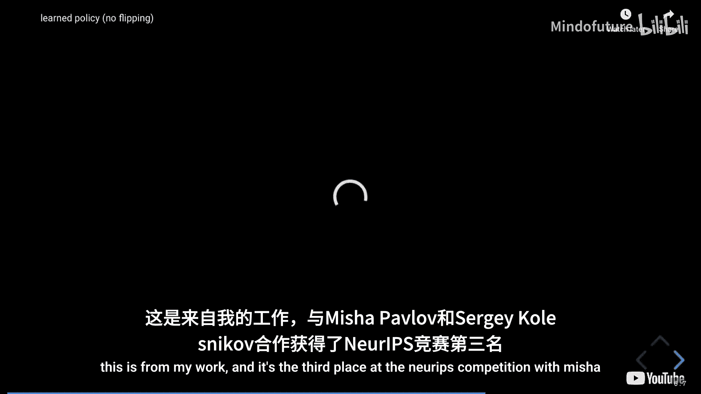
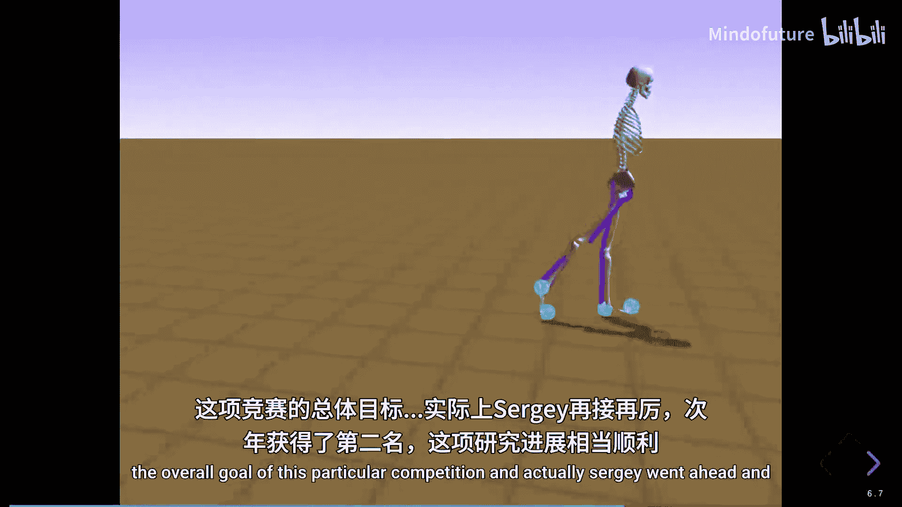
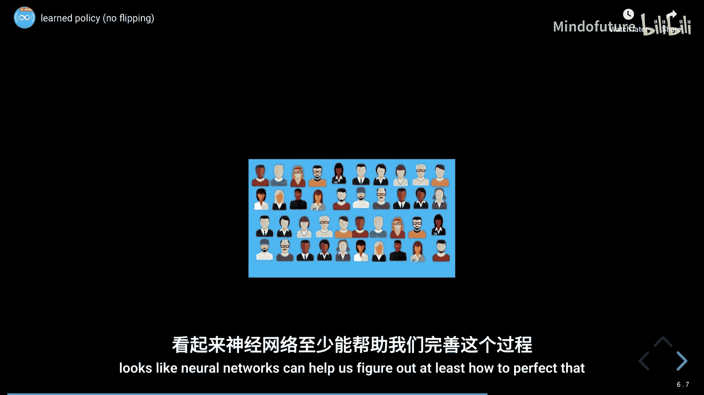

# 006：强化学习 🎮

在本节课中，我们将要学习强化学习的基本概念。强化学习是机器学习的一个重要分支，它考虑的问题与监督学习有很大不同。我们将通过回顾其发展历程和几个标志性应用，来理解强化学习的核心思想和工作原理。

## 强化学习的基本框架

上一节我们介绍了本课程的主题。本节中我们来看看强化学习与传统监督学习的核心区别。

在监督学习中，算法或“大脑”只被展示一个输入样本和一个对应的标签。算法的目标是学习从输入到正确输出的映射。其过程可以概括为：给定输入 `x`，预测输出 `y`。

强化学习的情况则不同。在强化学习中，算法的输出是智能体在世界中采取的一个动作。这个动作会改变世界的状态，智能体随后会观察到状态的变化，并收到一个奖励信号（可以是正数或负数）。简而言之，强化学习是智能体通过与环境交互，根据获得的奖励来学习如何采取行动以最大化长期收益的过程。

## 深度强化学习的崛起：从游戏到现实

强化学习已经存在了一段时间，萨顿和巴尔托的著作曾非常流行。大约20年前，它与马尔可夫决策过程一起是一个研究领域。后来，就像深度学习一样，当它不再那么“时尚”时，人们的兴趣有所减退。但并非所有人都放弃了它。

一个值得提及的、近期的重要突破来自DeepMind。在2015年左右，这家后来被谷歌收购的英国公司开始研究如何让算法玩雅达利游戏。他们的系统仅以屏幕像素作为输入，以游戏得分作为奖励信号，通过卷积神经网络来做出决策（例如控制摇杆上下左右或按键）。

以下是该系统的核心流程：
1.  **输入**：游戏屏幕的像素图像。
2.  **处理**：图像经过卷积神经网络和全连接层。
3.  **输出**：决定摇杆的动作（上、下、左、右、开火等）。
4.  **反馈**：系统执行动作后，立即观察世界状态的变化和获得的分数。
5.  **目标**：通过反向传播等方法，训练系统以最大化游戏得分。

DeepMind成功证明，借助卷积神经网络、深度学习和端到端训练，可以训练出一个模型来玩多种雅达利游戏，并且在许多游戏上达到超越人类的水平。

## 案例分析：算法如何学会游戏策略

让我们通过两个具体例子，看看强化学习算法是如何从零开始学习复杂策略的。

**例子一：打砖块（Breakout）**
算法在训练初期只是试图把球挡回去，表现不佳。但经过大约240分钟（半天）的训练后，算法发现了一个高效策略：它学会了先将砖块墙的侧面打开一个通道，让球进入墙后区域，从而可以连续得分。这个策略完全是通过观察像素和最大化分数这一目标自我探索出来的。

**例子二：海底冒险（Seaquest）**
在这个游戏中，算法看到的同样是像素画面和数字分数。它学会了控制潜艇上浮获取氧气。算法并没有被告知“氧气”的医学价值，它仅仅知道，如果不获取氧气，就无法最大化游戏得分（因为角色会死亡导致游戏结束）。这展示了强化学习智能体能够发现环境中对达成目标至关重要的隐藏因素。

这些突破为后来创造AlphaGo（战胜世界围棋冠军）、AlphaZero（在围棋、象棋等领域达到超越想象的超高水平）以及后续的AlphaStar等奠定了基础。

## 强化学习在机器人控制中的应用

强化学习的另一个重要应用领域是机器人学。目标是在现实世界的机器人操作中应用强化学习，这有助于我们更好地理解诸如手术后身体机能恢复等问题。因为，形式化一个学习如何走路的算法，远比形式化一个学习如何做乘法的算法要复杂。

以下是一个来自NIPS竞赛的机器人控制示例：
*   **任务**：训练一个模型来控制图中骨架的肌肉，使其尽可能行走得更远。
*   **观察**：虽然行走姿态还不完全像人类，但模型确实学会了行走，这非常了不起。
*   **成果**：这项工作在当年竞赛中获得了第三名，次年相关研究更是取得了第二名的好成绩。

看起来，神经网络能够帮助我们至少完善如何学习复杂运动技能这一过程。

## 总结 🎯

本节课中我们一起学习了强化学习。我们了解到强化学习与监督学习的根本区别在于，智能体通过与环境交互并根据奖励信号来学习行动策略。我们回顾了深度强化学习在雅达利游戏上取得的突破性进展，看到了算法如何从像素输入中自我学习出高级游戏策略。最后，我们也探讨了强化学习在机器人控制等现实世界问题中的应用潜力与挑战。强化学习展示了一种让机器通过试错来自主学习复杂技能的强大范式。